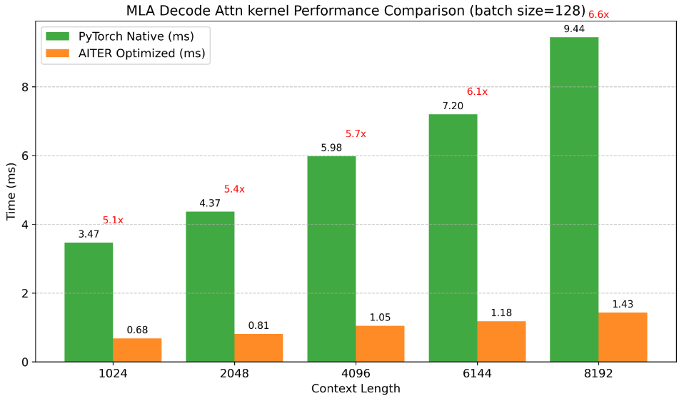

> 原文作者：Daniel Huang  
> [AMD 官方教程](https://rocm.docs.amd.com/projects/ai-developer-hub/en/latest/notebooks/gpu_dev_optimize/aiter_mla_decode_kernel.html) · [固定版本源码](https://github.com/ROCm/gpuaidev/blob/0071bfd4bd3bd9525405c09a6ae69c983b09312a/docs/notebooks/gpu_dev_optimize/aiter_mla_decode_kernel.ipynb)  
> 上游版本：`0071bfd4bd3bd9525405c09a6ae69c983b09312a` · 同步日期：2026-10-12  
> 翻译状态：机器初译，待逐篇人工校对；代码与命令保持原文，未在 AMD GPU 上运行验证。

<!-- cell:1 -->

<a id="mla-decoding-kernel-of-the-aiter-library-to-accelerate-llm-inference"></a>

# AITER 库的 MLA 解码内核
**作者**：Daniel Huang
**知识水平**：中级

<details markdown="1">
<summary>查看英文原文 · 单元 1</summary>

# MLA decoding kernel of the AITER library to accelerate LLM inference

**Author**: Daniel Huang  
**Knowledge level**: Intermediate

</details>

<!-- cell:2 -->

想象一下，您正在 AMD Instinct™ GPU 上部署 大语言模型（例如 DeepSeek-V3/R1），突然解码阶段的多重潜在注意力 (MLA) 成为性能瓶颈。代币生成感觉缓慢，延迟 不断积累，降低了用户体验。这就是 AMD AITER 库发挥作用的地方，它可以显着加速 MLA 解码注意力内核，为您的模型注入新的活力。

AITER 是 AMD 的高性能算子库，针对 AMD Instinct GPU 上的 AI 工作负载进行了优化。在以下情况下它是必不可少的：

- 操作员的表现远远低于理论潜力。

- 特定运营商成为推理瓶颈。

- 您需要针对 AMD Instinct GPU 进行特定于架构的优化。

本教程将指导您逐步集成 AITER MLA 解码注意力内核，以通过 AMD Instinct GPU 增强 LLM 推理。与本机 PyTorch 实现相比，这将在不同的上下文长度下极大地提高内核性能。您将首先设置 MLA 解码注意内核。

**提示**：AITER 库中的内核已集成到流行的 LLM 推理 框架中，例如 vLLM 和 SGLang。这意味着您还可以通过这些框架从 AMD Instinct GPU 上的 AITER 库获得显着的性能提升！

<a id="prerequisites-setting-up-the-acceleration-environment"></a>

## 前置条件：设置加速环境

本教程是使用以下设置进行开发和测试的，建议使用 AMD Instinct GPU 重现相同的模型加速。

<a id="operating-system"></a>

### 操作系统

* **Ubuntu 22.04**：确保您的系统运行的是 Ubuntu 版本 22.04。

<a id="hardware"></a>

### 硬件

* **AMD Instinct GPU**：确保您使用的是支持 ROCm™ 软件的 AMD Instinct GPU，并且您的系统满足[官方要求](https://rocm.docs.amd.com/projects/install-on-linux/en/latest/reference/system-requirements.html)。

<a id="software"></a>

### 软件

* **ROCm 6.3.1**：按照 [ROCm 安装指南](https://rocm.docs.amd.com/projects/install-on-linux/en/latest/install/quick-start.html) 安装并验证 ROCm。

  安装后，使用 `amd-smi` 命令确认您的设置。

  ``` bash
  amd-smi
  ```

  此命令列出可用的 AMD GPU 及其状态。
  
  **注意**：对于 ROCm 6.4 及更早版本，请改用 `rocm-smi` 命令。

* **Docker**：对于容器化部署，请确保 Docker 已正确安装和配置。请遵循适用于您的操作系统的 Docker 安装指南。

  **注意**：确保正确配置 Docker 权限。要配置权限以允许非 root 访问，请运行以下命令：

  ``` bash
  sudo usermod -aG docker $USER
  newgrp docker
  ```

  验证 Docker 是否正常工作：

  ``` bash
  docker run hello-world
  ```

<a id="quick-start-development-environment-set-up"></a>

## 快速启动开发环境搭建

本教程使用预构建的 ROCm PyTorch 映像。

<a id="step-1-launch-the-rocm-pytorch-docker-container"></a>

### 第 1 步：启动 ROCm PyTorch Docker 容器

启动 Docker 容器。该映像是一个交钥匙解决方案，具有预先配置的依赖项：

``` bash
docker run -it --rm \
  --network=host \
  --device=/dev/kfd \
  --device=/dev/dri \
  --group-add=video \
  --ipc=host \
  --cap-add=SYS_PTRACE \
  --security-opt seccomp=unconfined \
  --shm-size 8G \
  -v $(pwd):/workspace \
  -w /workspace \
  rocm/pytorch:latest
```

**注意**：该命令将当前目录挂载到容器中的`/workspace`目录下，方便文件访问。它允许您在此 Docker 容器中执行所有工作，包括手动安装 AITER，并开始使用以下动手实践示例。

<a id="step-2-launch-jupyter-notebooks-in-the-container"></a>

### 步骤 2：在容器中启动 Jupyter Notebooks
在 Docker 容器内，使用以下命令安装 JupyterLab：

``` bash
pip install jupyter
```

启动 Jupyter 服务器：

``` bash
jupyter-lab --ip=0.0.0.0 --port=8888 --no-browser --allow-root
```

**注意**：如果端口`8888`被占用，请指定不同的端口，例如`--port=8890`。将本教程上传到服务器后，本教程的其余部分可以在 Jupyter Notebook 中作为交互式块运行。

<a id="step-3-manually-install-the-aiter-library"></a>

### 步骤3：手动安装AITER库

AITER 是一个快速扩展的库，具有许多强大的功能。要安装 AITER，请使用以下命令：

<details markdown="1">
<summary>查看英文原文 · 单元 2</summary>

Imagine you’re deploying a large language model such as  DeepSeek-V3/R1 on AMD Instinct™ GPUs, when suddenly the Multi Latent Attention (MLA) in the decoding phase becomes a performance bottleneck. Token generation feels sluggish, and latency keeps accumulating, degrading the user experience. This is where the AMD AITER library comes to the rescue, dramatically accelerating the MLA decode attention kernel to breathe new life into your model.

AITER is a high-performance operator library from AMD, optimized for AI workloads on AMD Instinct GPUs. It's indispensable when:

- Operator performance falls far short of the theoretical potential.

- Specific operators become inference bottlenecks.

- You need architecture-specific optimizations for AMD Instinct GPUs.

This tutorial guides you step-by-step through integrating the AITER MLA decode attention kernel to supercharge LLM inference with AMD Instinct GPUs. This will greatly accelerate kernel performance, with different context lengths, compared to native PyTorch implementations. You'll start by setting up the MLA decode attention kernel.

**Tip**: Kernels in the AITER library are already integrated into popular LLM inference frameworks such as vLLM and SGLang. This means you can also achieve significant performance gains from the AITER library on AMD Instinct GPUs through these frameworks!

## Prerequisites: Setting up the acceleration environment

This tutorial was developed and tested using the following setup, which is recommended to reproduce the same model acceleration with AMD Instinct GPUs.

### Operating System

* **Ubuntu 22.04**: Ensure your system is running Ubuntu version 22.04.

### Hardware

* **AMD Instinct GPUs**: Ensure you are using an AMD Instinct GPU with ROCm™ software support and that your system meets the [official requirements](https://rocm.docs.amd.com/projects/install-on-linux/en/latest/reference/system-requirements.html).

### Software

* **ROCm 6.3.1**: Install and verify ROCm by following the [ROCm install guide](https://rocm.docs.amd.com/projects/install-on-linux/en/latest/install/quick-start.html).

  After installation, confirm your setup using the `amd-smi` command.

  ``` bash
  amd-smi
  ```

  This command lists the available AMD GPUs and their status.
  
  **Note**: For ROCm 6.4 and earlier, use the `rocm-smi` command instead.

* **Docker**: For containerized deployment, ensure Docker is installed and configured correctly. Follow the Docker installation guide for your operating system.

  **Note**: Ensure the Docker permissions are correctly configured. To configure permissions to allow non-root access, run the following commands:

  ``` bash
  sudo usermod -aG docker $USER
  newgrp docker
  ```

  Verify Docker is working correctly:

  ``` bash
  docker run hello-world
  ```

## Quick start development environment set up

This tutorial uses the prebuilt ROCm PyTorch image.

### Step 1: Launch the ROCm PyTorch Docker container

Launch the Docker container. This image is a turnkey solution with pre-configured dependencies:

``` bash
docker run -it --rm \
  --network=host \
  --device=/dev/kfd \
  --device=/dev/dri \
  --group-add=video \
  --ipc=host \
  --cap-add=SYS_PTRACE \
  --security-opt seccomp=unconfined \
  --shm-size 8G \
  -v $(pwd):/workspace \
  -w /workspace \
  rocm/pytorch:latest
```

**Note**: This command mounts the current directory to the `/workspace` directory in the container for easy file access. It lets you perform all work in this Docker container, including manually installing AITER, and get started with the following hands-on, practical examples.

### Step 2: Launch Jupyter Notebooks in the container

Inside the Docker container, install JupyterLab using the following command:

``` bash
pip install jupyter
```

Start the Jupyter server:

``` bash
jupyter-lab --ip=0.0.0.0 --port=8888 --no-browser --allow-root
```

**Note**: If port `8888` is occupied, specify a different port, such as `--port=8890`. The rest of this tutorial can run as interactive blocks in your Jupyter notebook after you upload this tutorial to your server.

### Step 3: Manually install the AITER library

AITER is a rapidly expanding library with many powerful features. To install AITER, use these commands:

</details>

```python
%%bash
git clone --recursive https://github.com/ROCm/aiter.git
cd aiter
python3 setup.py develop
export PYTHONPATH=$PYTHONPATH:/workspace/aiter
```

<!-- cell:4 -->

**注意**：如果您在环境中运行 Jupyter 和 AITER，请相应地设置 `PYTHONPATH`。

<a id="understanding-the-mla-decode-attention-kernel"></a>

## 理解 MLA 解码注意力内核

您可以在[AITER源代码](https://github.com/ROCm/aiter/blob/main/aiter/mla.py#L114C1-L126C3)中找到MLA解码注意力内核定义。它至少需要八个输入参数，并且可以接受三个附加可选输入。这是 `mla_decode_fwd` 的函数定义，包括参数：

```
def mla_decode_fwd(  
    q,                   # [batch_size, num_heads, kv_lora_rank + qk_rope_dim]  
    kv_buffer,           # [num_pages, page_size, num_heads_kv, qk_head_dim]  
    o,                   # Output buffer [batch_size, num_heads, kv_lora_rank]  
    qo_indptr,           # Query sequence pointer [batch_size + 1]  
    kv_indptr,           # KV sequence pointer [batch_size + 1]  
    kv_indices,          # KV indices [kv_indptr[-1]]  
    kv_last_page_lens,   # Last page sizes [batch_size]  
    max_seqlen_q,        # Maximum query sequence length  
    sm_scale=None,       # Scaling factor (default: 1.0/sqrt(qk_head_dim))  
    logit_cap=0.0,       # (Under development)  
    num_kv_splits=None,  # KV splits (auto-determined)  
): 
```

每个参数都有特定的形状要求，因此正确的配置是获得最佳性能的关键：

* **q** （`torch.tensor` 类型）：这是具有 `[batch_size, num_heads, kv_lora_rank + qk_rope_dim]` 等形状要求的查询张量。
* **kv buffer**（`torch.tensor`类型）：这是总的KV 缓存张量，其形状要求如`[num_pages, page_size, num_heads_kv, qk_head_dim]`，其中`num_heads_kv`在解码阶段始终为`1`，`num_pages`和`page_size`共同表示可分页KV 缓存。当`page_size = 1`时，KV 缓存被设置为原始表示，这浪费了大量的GPU内存。
* **o** （`torch.tensor` 类型）：这是输出缓冲区。 `mla_decode_fwd` 函数会将结果放入 `o`，其形状要求类似于 `[batch_size, num_heads, kv_lora_rank]`。
* **qo_indptr**（`torch.tensor`类型）：这是一个指向每个查询和输出序列起始地址的指针，形状要求如`[batch_size + 1]`。当批次中每个序列的序列长度不同时，使用`qo_indptr`记录该信息，有助于正确处理每个序列。
* **kv_indptr**（`torch.tensor`类型）：这是一个指向每个context/kv序列起始地址的指针，形状要求如`[batch_size + 1]`。一个批次内每个查询序列不同，答案的序列也不同，因此context/kv序列长度也不同。 `kv_indptr` 变量记录此信息以帮助正确处理查询序列的每个上下文/kv。
* **kv_indices** （`torch.tensor` 类型）：包含每个序列的具体 kv 起始索引。它的形状要求如`[kv_indptr[-1]]`。
* **kv_last_page_lens**（`torch.tensor`类型）：这是每个序列的最后一个页面大小，形状要求如`[batch_size]`。
* **max_seqlen_q:** （`torch.tensor` 类型）：这是该批次中所有查询的最大序列长度。
* **sm_scale**（`scalar`类型）：这等于`1.0 / (qk_head_dim**0.5)`，代表尺度点积注意力公式中的分母。
* **logit_cap**：这是一项正在进行的工作，可以忽略。更多信息请参见下面的[注释](https://github.com/ROCm/aiter/blob/main/aiter/mla.py#L128)。
* **num_kv_splits**（`scalar`类型）：该参数可以忽略。它表示分配多少个 GPU 工作组或块来处理 kv，但代码将使用启发式算法确定该值。

<details markdown="1">
<summary>查看英文原文 · 单元 4</summary>

**Note**: If you're running Jupyter and AITER in your environment, set `PYTHONPATH` accordingly.

## Understanding the MLA decode attention kernel

You can find the MLA decoding attention kernel definition in the [AITER source code](https://github.com/ROCm/aiter/blob/main/aiter/mla.py#L114C1-L126C3). It requires a minimum of eight input parameters and can accept three additional optional inputs. Here's the function definition for `mla_decode_fwd`, including the parameters:

```
def mla_decode_fwd(  
    q,                   # [batch_size, num_heads, kv_lora_rank + qk_rope_dim]  
    kv_buffer,           # [num_pages, page_size, num_heads_kv, qk_head_dim]  
    o,                   # Output buffer [batch_size, num_heads, kv_lora_rank]  
    qo_indptr,           # Query sequence pointer [batch_size + 1]  
    kv_indptr,           # KV sequence pointer [batch_size + 1]  
    kv_indices,          # KV indices [kv_indptr[-1]]  
    kv_last_page_lens,   # Last page sizes [batch_size]  
    max_seqlen_q,        # Maximum query sequence length  
    sm_scale=None,       # Scaling factor (default: 1.0/sqrt(qk_head_dim))  
    logit_cap=0.0,       # (Under development)  
    num_kv_splits=None,  # KV splits (auto-determined)  
): 
```

Each parameter has specific shape requirements, so proper configuration is key to optimal performance:

* **q** (`torch.tensor` type): This is the query tensor with shape requirements like `[batch_size, num_heads, kv_lora_rank + qk_rope_dim]`.
* **kv buffer** (`torch.tensor` type): This is the total kv cache tensor with shape requirements like `[num_pages, page_size, num_heads_kv, qk_head_dim]`, where `num_heads_kv` is always `1` in the decode phase, and `num_pages` and `page_size` jointly represent the pageable kv cache. When `page_size = 1`, the kv cache is set to the original representation, which wastes a lot of GPU memory.
* **o** (`torch.tensor` type): This is the output buffer. The `mla_decode_fwd` function will place the result into `o`, which has shape requirements like `[batch_size, num_heads, kv_lora_rank]`.
* **qo_indptr** (`torch.tensor` type): This is a pointer to the start address of each query and output sequence, with shape requirements like `[batch_size + 1]`. When the sequence length of each sequence in a batch is different, the `qo_indptr` is used to record this information, which helps handle each sequence correctly.
* **kv_indptr** (`torch.tensor` type): This is a pointer to the start address of each context/kv sequence, with shape requirements like `[batch_size + 1]`. Each query sequence is different within a batch, and the sequence of answers is also different, so the context/kv sequence lengths are also different. The `kv_indptr` variable records this information to help handle each context/kv of the query sequence correctly.
* **kv_indices** (`torch.tensor` type): This contains the concrete kv start indices of each sequence. It has shape requirements like `[kv_indptr[-1]]`.
* **kv_last_page_lens** (`torch.tensor` type): This is the last page size of each sequence, with shape requirements like `[batch_size]`.
* **max_seqlen_q:** (`torch.tensor` type): This is the max sequence length across all the queries in this batch.
* **sm_scale** (`scalar` type): This is equal to `1.0 / (qk_head_dim**0.5)`, which represents the denominator in the scale dot product attention formula.
* **logit_cap**: This is a work in progress and can be ignored. For more information, see the following [annotation](https://github.com/ROCm/aiter/blob/main/aiter/mla.py#L128).
* **num_kv_splits** (`scalar` type): This parameter can be ignored. It represents how many GPU work groups or blocks to allocate to handle kv, but the code will determine this value using a heuristic algorithm.

</details>

<!-- cell:5 -->

<a id="running-a-practical-example"></a>

## 运行一个实际的例子

现在是开始逐步演练的时候了，该演练将使 MLA 解码注意力在您的 Instinct MI300X 上以闪电般的速度运行。

<a id="setting-the-environment"></a>

### 设置环境

首先准备AMD MI300X GPU，CPU备用：

<details markdown="1">
<summary>查看英文原文 · 单元 5</summary>

## Running a practical example

It's time to get started with a step-by-step walkthrough that will have the MLA decoding attention running at lightning speed on your Instinct MI300X.

### Setting the environment

First prepare the AMD MI300X GPU, with the CPU standing by as backup:

</details>

```python
import os
import sys

# Change working directory to the repo
os.chdir("./aiter")  # relative path from the notebook location

# Add current directory (aiter repo root) to Python path
sys.path.insert(0, os.getcwd())

import torch
from aiter.mla import mla_decode_fwd 

# Let's get our hardware ready for the show!
device = torch.device("cuda" if torch.cuda.is_available() else "cpu")
print(f"All systems go! Running on: {device}")
```

<!-- cell:7 -->

<a id="prepare-the-tensors"></a>

### 准备张量

现在为这次运行准备张量。您将配置以下内容：

- 一批128个序列，使用`batch_size = 128`

- 4096个代币KV 缓存（我们模型的内存），使用`kv_cache_seqlen = 4096`

- 单查询解码，使用`q_seqlen = 1`

<details markdown="1">
<summary>查看英文原文 · 单元 7</summary>

### Prepare the tensors

Now prepare your tensors for this run through. You'll configure the following:

- A batch of 128 sequences, using `batch_size = 128`

- A 4096-token KV cache (the memory of our model), using `kv_cache_seqlen = 4096`

- Single-query decoding, using `q_seqlen = 1`

</details>

```python
# Your performance parameters
batch_size = 128       # How many sequences we're processing
kv_cache_seqlen = 4096 # How far back our model can remember
q_seqlen = 1           # Decoding one token at a time

# Initialize our pointer arrays
qo_indptr = torch.zeros(batch_size + 1, dtype=torch.int, device=device)
kv_indptr = torch.zeros(batch_size + 1, dtype=torch.int, device=device)

# Fill with sequence lengths (simple case: all equal)
seq_lens_qo = torch.full((batch_size,), q_seqlen, dtype=torch.int, device=device)
seq_lens_kv = torch.full((batch_size,), kv_cache_seqlen, dtype=torch.int, device=device)
```

<!-- cell:9 -->

上面的示例代码首先为 `qo_indptr` 和 `kv_indptr` 声明两个缓冲区，然后用 `q_seqlen = 1` 和 `kv_cache_seqlen = 4096` 填充 `seq_lens_qo` 和 `seq_lens_kv`。为简单起见，假设每个序列具有相同的 `q_seqlen ` 和 `kv cache seqlen`。

<details markdown="1">
<summary>查看英文原文 · 单元 9</summary>

The sample code above first declares two buffers for `qo_indptr` and `kv_indptr` and then fills `seq_lens_qo` and `seq_lens_kv` with `q_seqlen = 1` and `kv_cache_seqlen = 4096`. For simplicity, it assumes each sequence has the same `q_seqlen `and `kv cache seqlen`.

</details>

<!-- cell:10 -->

然后，它通过向 `cumsum` 函数传递 qkv 的序列长度来填充 `kv_indptr` 和 `qo_indptr`，然后通过从前一个值中减去后一个值来计算每个序列的实际长度。这就是高效注意力的“秘密武器”。

<details markdown="1">
<summary>查看英文原文 · 单元 10</summary>

It then fills `kv_indptr` and `qo_indptr` by passing the `cumsum` function the sequence lengths of qkv, then calculating the actual length of each sequence by subtracting the latter value from the former. This is the "secret sauce" of efficient attention.

</details>

```python
# Calculate cumulative lengths - this tells us where each sequence starts
kv_indptr[1:] = torch.cumsum(seq_lens_kv, dim=0)  # KV memory layout
qo_indptr[1:] = torch.cumsum(seq_lens_qo, dim=0) # Query/output layout

# For example: kv_indptr = [0,5,11,18] means:
# Sequence 0: positions 0-4 (length 5)
# Sequence 1: positions 5-10 (length 6)
# Sequence 2: positions 11-17 (length 7)
```

<!-- cell:12 -->

现在准备您的 键值缓存。将此视为模型的工作记忆。

-初始化每个序列的具体kv起始索引和每个序列的kv最后页透镜（大小）。
- 为简单起见，定义 `page_size = 1`，因此每个序列的 kv 最后一页镜头为 `1`。
- 对于本例，将 `kv_indices` 的最大值设置为 `2097152`。这是从 `batch_size * 16384` 计算出来的，等于 `128 * 16384`。这意味着对于 `128` 的 `batch_size`，您可以为每个序列生成最多 `16384` 令牌。

<details markdown="1">
<summary>查看英文原文 · 单元 12</summary>

Now prepare your key-value cache. Think of this as the working memory for the model.

- Initialize the concrete kv start indices of each sequence and the kv last page lens (size) of each sequence.
- For simplicity, define `page_size = 1`, so the kv last page lens for each sequence is `1`.
- For this example, set the maximum value for `kv_indices` to `2097152`. This is calculated from `batch_size * 16384`, which is equal to `128 * 16384`. This means for a `batch_size` of `128`, you can generate up to `16384` tokens for each sequence.

</details>

```python
kv_indices = torch.randint(0, 2097152, (kv_indptr[-1].item(),), dtype=torch.int, device=device)
kv_last_page_lens = torch.ones(batch_size, dtype=torch.int, device=device)
```

<!-- cell:14 -->

现在是时候介绍主要输入，即查询张量和 KV 缓存 以及输出缓冲区。它们是 `q`、`kv buffer` 和 `o`：

<details markdown="1">
<summary>查看英文原文 · 单元 14</summary>

Now it's time to introduce the main inputs, which are the query tensor and KV cache, and the output buffer. These are `q`, `kv buffer`, and `o`:

</details>

```python
num_heads = 128        # Number of attention heads
q_head_dim = 128       # Dimension per head
kv_lora_rank = 512     # LoRA rank for KV
qk_rope_head_dim = 64  # Rotary embedding dimension

# The query tensor - what we're asking our model
q = torch.randn(
    (batch_size * q_seqlen, num_heads, kv_lora_rank + qk_rope_head_dim),
    dtype=torch.bfloat16, device=device
)
num_heads_kv = 1
page_size = 1
q_head_dim = 128
# Our KV cache - the model's knowledge bank
kv_buffer = torch.randn(
    (2097152, page_size, num_heads_kv, kv_lora_rank + qk_rope_head_dim), 
    dtype=torch.bfloat16, device=device
)

# The output buffer - where the magic will happen
o = torch.empty(
    (batch_size * q_seqlen, num_heads, kv_lora_rank), 
    dtype=torch.bfloat16, device=device
).fill_(-1)
```

<!-- cell:16 -->

**注意**：您不必定义这些缓冲区。但是，请确保您定义的形状大小与此处看到的值相匹配。

<details markdown="1">
<summary>查看英文原文 · 单元 16</summary>

**Note**: You don't have to define these buffers. However, ensure you define the shape size to match the values seen here.

</details>

<!-- cell:17 -->

<a id="launching-the-kernel"></a>

### 启动内核

一切就绪后，启动优化的 MLA 解码注意力内核。

<details markdown="1">
<summary>查看英文原文 · 单元 17</summary>

### Launching the kernel

With everything set, launch your optimized MLA decode attention kernel.

</details>

```python
mla_decode_fwd(
        q,
        kv_buffer,
        o,
        qo_indptr,
        kv_indptr,
        kv_indices,
        kv_last_page_lens,
        1,
        sm_scale= 1.0 / (q_head_dim**0.5)
    )
```

<!-- cell:19 -->

现在看看你得到了什么结果。

<details markdown="1">
<summary>查看英文原文 · 单元 19</summary>

Now see what results you got.

</details>

```python
print(o)
```

<!-- cell:21 -->

最终的形状是：

<details markdown="1">
<summary>查看英文原文 · 单元 21</summary>

The final shape is:

</details>

```python
print(o.shape)
```

<!-- cell:23 -->

<a id="summary"></a>

## 总结

现在，注意力计算已得到优化，结果已准备好无缝流入模型的下一层，从而使整个 推理 管道以最大速度运行。

严格的基准测试显示了内核的真正能力：

**基准亮点**：

- 评估多个上下文长度（512-4096 个标记）
- 使用固定批量大小进行测试 (128)
- 比较不同的MLA算法实现

**结果**：

- 比原生 PyTorch 实现持续加速。



想象一下这些收益对您的应用程序意味着什么：
- 减少了实时应用程序的 延迟
- 增加了吞吐量用于批量处理
- 全面降低计算成本

准备好采取下一步了吗？使用以下资源深入了解 AITER 功能：

- 探索 [AITER GitHub 存储库](https://github.com/ROCm/aiter)。 
- 查看其他优化示例。
- 对存储库加注星标以保持新功能的更新。

<details markdown="1">
<summary>查看英文原文 · 单元 23</summary>

## Summary

With the attention computation now optimized, the results are ready to flow seamlessly into the next layer of your model, keeping your entire inference pipeline running at maximum velocity.

Rigorous benchmarking shows the real ability of the kernel:

**Benchmark Highlights**:

- Evaluated multiple context lengths (512-4096 tokens)
- Tested with fixed batch sizes (128)
- Compared different MLA algorithm implementations

**Result**:

- A consistent speedup over native PyTorch implementations.


Imagine what these gains could mean for your application:
- Reduced latency for real-time applications
- Increased throughput for batch processing
- Lower compute costs across the board

Ready to take the next step? Dive deeper into the AITER capabilities with the following resources:

- Explore the [AITER GitHub repository](https://github.com/ROCm/aiter). 
- Check out additional optimization examples.
- Star the repository to stay updated on new features.

</details>
