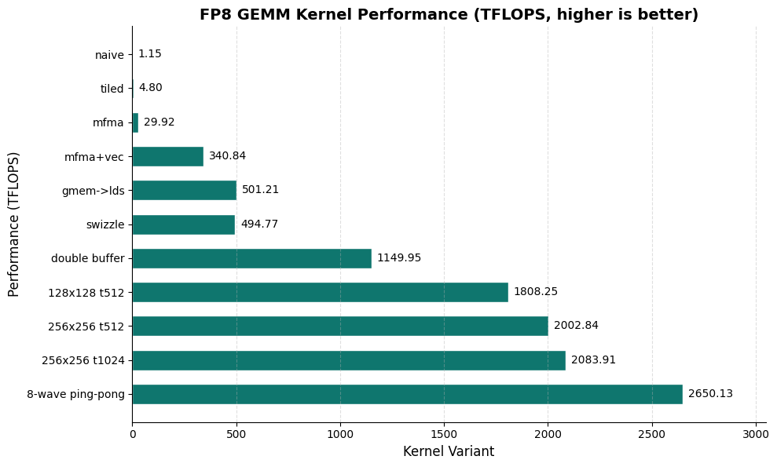

> 原文作者：Jiahui Cao  
> [AMD 官方教程](https://rocm.docs.amd.com/projects/ai-developer-hub/en/latest/notebooks/gpu_dev_optimize/fp8_gemm_hip_cdna4.html) · [固定版本源码](https://github.com/ROCm/gpuaidev/blob/0071bfd4bd3bd9525405c09a6ae69c983b09312a/docs/notebooks/gpu_dev_optimize/fp8_gemm_hip_cdna4.ipynb)  
> 上游版本：`0071bfd4bd3bd9525405c09a6ae69c983b09312a` · 同步日期：2026-10-12  
> 翻译状态：机器初译，待逐篇人工校对；代码与命令保持原文，未在 AMD GPU 上运行验证。

<!-- cell:1 -->

<a id="fp8-gemm-optimization-on-amd-cdna4-based-gpus"></a>

# 在 AMD CDNA4 GPU 上优化 FP8 GEMM
**作者**：Jiahui Cao
**合著者**：Aman Salykov
**知识水平:** 高级

在本教程中，您将了解如何使用 [基于 AMD Instinct™ CDNA4](https://www.amd.com/en/technologies/cdna.html) GPU 优化 HIP 中的 FP8 矩阵乘法 (GEMM) 内核。通过分步实践指导，您将了解双缓冲、LDS（本地数据共享）内存调配和 8 个 wavefront 乒乓调度等优化技术。您还将更深入地了解如何在 HIP 内核中有效利用矩阵核心、编译器内部函数和内联汇编。

<a id="tutorial-workflow"></a>

## 教程工作流程

1. [Docker和ROCm的环境设置](#env-setup)
2. [硬件和软件验证](#hw-check)
3. [设置和实用程序](#setup-util)
4. [朴素内核（基线）](#naive)
5. [LDS 平铺内核](#lds)
6. [MFMA内核（矩阵核心指令）](#mfma)
7. [MFMA+矢量化全局加载](#mfma-vec)
8. [MFMA + 直接全局到 LDS 加载](#bufferload)
9. [MFMA + 混合 LDS](#swizzle)
10. [MFMA+双缓冲](#double-buf)
11. [多波：128×128分块，512线程（8波）](#mw-128)
12. [多波：256×256分块，512线程（8波）——最佳配置](#mw-256)
13. [多波：256×256分块，1024线程（16波）](#mw-256-16)
14. [8波乒乓调度](#pingpong)
15. [最终结果](#results)
16. [参考 GEMM 与 hipBLASLt](#ref-GEMM)

<details markdown="1">
<summary>查看英文原文 · 单元 1</summary>

# FP8 GEMM optimization on AMD CDNA4-based GPUs

**Author:** Jiahui Cao  
**Co-author:** Aman Salykov  
**Knowledge level:** Advanced

In this tutorial, you'll learn how to optimize an FP8 Matrix Multiplication (GEMM) kernel in HIP with [AMD Instinct™ CDNA4-based](https://www.amd.com/en/technologies/cdna.html) GPUs. Through hands-on, step-by-step instructions, you'll be introduced to optimization techniques such as double-buffering, LDS (Local Data Share) memory swizzling, and 8-wave ping-pong scheduling. You'll also develop a deeper understanding of how to effectively utilize Matrix Cores, compiler intrinsics, and inline assembly within HIP kernels.

## Tutorial workflow

1. [Environment setup with Docker and ROCm](#env-setup)
2. [Verify hardware and software](#hw-check)
3. [Setups and utilities](#setup-util)
4. [Naive kernel (baseline)](#naive)
5. [LDS tiled kernel](#lds)
6. [MFMA kernel (matrix core instructions)](#mfma)
7. [MFMA + vectorized global load](#mfma-vec)
8. [MFMA + direct global-to-LDS load](#bufferload)
9. [MFMA + swizzled LDS](#swizzle)
10. [MFMA + double buffering](#double-buf)
11. [Multi-wave: 128×128 tile, 512 threads (8 waves)](#mw-128)
12. [Multi-wave: 256×256 tile, 512 threads (8 waves)—best configuration](#mw-256)
13. [Multi-wave: 256×256 tile, 1024 threads (16 waves)](#mw-256-16)
14. [8-wave ping-pong scheduling](#pingpong)
15. [Final results](#results)
16. [Reference GEMM with hipBLASLt](#ref-GEMM)

</details>

<!-- cell:2 -->

<a id="prerequisites"></a>

## 前置条件

本教程是使用以下设置进行开发和测试的：

<a id="operating-system"></a>

### 操作系统

* **Ubuntu 22.04 或 24.04**：确保您的系统运行的是 Ubuntu 版本 22.04 或 24.04。

<a id="hardware"></a>

### 硬件

* **AMD Instinct MI350X 或 MI355X**：`gfx950` CDNA4 GPU，支持 FP8 矩阵核心。确保您的系统满足[官方要求](https://rocm.docs.amd.com/projects/install-on-linux/en/latest/reference/system-requirements.html)。

<a id="software"></a>

### 软件

* **ROCm with PyTorch**：提供预构建的 ROCm Docker 镜像，包括 [ROCm PyTorch 镜像](https://hub.docker.com/r/rocm/pytorch)。您可以使用这些预构建的 Docker 映像来节省手动设置 ROCm 环境的工作量。

  > 此Notebook已在 AMD Instinct MI355X 上使用 ROCm 7.1.1 + Python 3.10 + PyTorch 2.10 堆栈进行测试。 

* **Docker**：确保 Docker 已正确安装和配置。请遵循适用于您的操作系统的 Docker 安装指南。如果您运行的系统已经安装了所需的 ROCm + Python + PyTorch 堆栈，请跳过此步骤。

  >**注意：** 确保 Docker 权限配置正确。要配置非 root 访问权限，请运行：

  ```bash
  sudo usermod -aG docker $USER
  newgrp docker
  ```

  验证 Docker 是否正常工作：

  ```bash
  docker run hello-world
  ```

<a id="env-setup"></a>

<a id="1-environment-setup-with-docker-and-rocm"></a>

## 1. 使用 Docker 和 ROCm 设置环境

按照以下步骤设置环境、启动 Jupyter Notebooks 并安装依赖项。

<a id="launch-the-docker-container"></a>

### 启动 Docker 容器

> **注意：** 如果您在已安装 ROCm 的系统上运行，则可以跳过此步骤并继续[安装 Jupyter 并启动Notebook服务器](#install-jupyter)。

从主机启动 Docker 容器：

```bash
docker run -it --rm \
  --network=host \
  --device=/dev/kfd \
  --device=/dev/dri \
  --group-add=video \
  --ipc=host \
  --cap-add=SYS_PTRACE \
  --security-opt seccomp=unconfined \
  --shm-size 8G \
  -v $(pwd):/workspace \
  -w /workspace \
  rocm/pytorch:rocm7.1.1_ubuntu22.04_py3.10_pytorch_release_2.10.0
```

> **注意：** 该命令将当前目录挂载到容器中的 `/workspace` 中。确保在运行 Docker 命令之前将Notebook文件复制到此目录，或者在启动后上传到 Jupyter Notebook 环境。您可以从 [AI Developer Hub GitHub 存储库](https://github.com/ROCm/gpuaidev) 下载此Notebook。

<a id="install-jupyter"></a>
<a id="install-jupyter-and-launch-the-notebook-server"></a>

### 安装 Jupyter 并启动Notebook服务器

在 Docker 容器内（或者，如果不使用 Docker，则直接在系统上）安装 Jupyter：

```bash
pip install jupyter matplotlib pandas
```

启动 Jupyter 服务器：

```bash
jupyter-lab --ip=0.0.0.0 --port=8888 --no-browser --allow-root
```

> **注意：** 确保端口 `8888` 尚未被使用。如果是，请将 `--port=8888` 替换为其他端口号，例如 `--port=8890`。

> **注意：** 将此文件上传到 Jupyter Notebook 环境后，本教程的其余部分将在 Jupyter Notebook 中作为交互式块运行。

<a id="hw-check"></a>

<a id="2-verify-hardware-and-software"></a>

## 2. 验证硬件和软件

确认您的 GPU 已被检测到并满足要求。

<details markdown="1">
<summary>查看英文原文 · 单元 2</summary>

## Prerequisites

This tutorial was developed and tested using the following setup:

### Operating system

* **Ubuntu 22.04 or 24.04**: Ensure your system is running Ubuntu version 22.04 or 24.04.

### Hardware

* **AMD Instinct MI350X or MI355X**: `gfx950` CDNA4 GPUs with FP8 Matrix Core support. Ensure your system meets the [official requirements](https://rocm.docs.amd.com/projects/install-on-linux/en/latest/reference/system-requirements.html).

### Software

* **ROCm with PyTorch**: Prebuilt ROCm Docker images are provided, including a [ROCm PyTorch image](https://hub.docker.com/r/rocm/pytorch). You can use these prebuilt Docker images to save the effort of manually setting up a ROCm environment.

  >This notebook was tested with the ROCm 7.1.1 + Python 3.10 + PyTorch 2.10 stack on AMD Instinct MI355X. 

* **Docker**: Ensure Docker is installed and configured correctly. Follow the Docker installation guide for your operating system. Skip this if you are running on a system that already has the required ROCm + Python + PyTorch stack installed.

  >**Note:** Ensure Docker permissions are correctly configured. To configure permissions for non-root access, run:

  ```bash
  sudo usermod -aG docker $USER
  newgrp docker
  ```

  Verify Docker is working correctly:

  ```bash
  docker run hello-world
  ```

<a id="env-setup"></a>

## 1. Environment setup with Docker and ROCm

Follow these steps to set up the environment, launch Jupyter Notebooks, and install the dependencies.

### Launch the Docker container

> **Note:** If you are running on a system with ROCm already installed, you can skip this step and proceed to [Install Jupyter and launch the notebook server](#install-jupyter).

Launch the Docker container from your host machine:

```bash
docker run -it --rm \
  --network=host \
  --device=/dev/kfd \
  --device=/dev/dri \
  --group-add=video \
  --ipc=host \
  --cap-add=SYS_PTRACE \
  --security-opt seccomp=unconfined \
  --shm-size 8G \
  -v $(pwd):/workspace \
  -w /workspace \
  rocm/pytorch:rocm7.1.1_ubuntu22.04_py3.10_pytorch_release_2.10.0
```

> **Note:** This command mounts the current directory to `/workspace` in the container. Ensure the notebook file is either copied to this directory before running the Docker command or uploaded into the Jupyter Notebook environment after it starts. You can download this notebook from the [AI Developer Hub GitHub repository](https://github.com/ROCm/gpuaidev).

<a id="install-jupyter"></a>
### Install Jupyter and launch the notebook server

Inside the Docker container (or, directly on your system, if not using Docker), install Jupyter:

```bash
pip install jupyter matplotlib pandas
```

Start the Jupyter server:

```bash
jupyter-lab --ip=0.0.0.0 --port=8888 --no-browser --allow-root
```

> **Note:** Ensure port `8888` is not already in use. If it is, replace `--port=8888` with another port number, for example, `--port=8890`.

> **Note:** The rest of this tutorial runs as interactive blocks in your Jupyter notebook after you upload this file to your Jupyter Notebook environment.

<a id="hw-check"></a>

## 2. Verify hardware and software

Confirm your GPU is detected and meets the requirements.

</details>

<!-- cell:3 -->

**前置条件：** 在继续之前安装以下依赖项。

<details markdown="1">
<summary>查看英文原文 · 单元 3</summary>

**Prerequisites:** Install the following dependencies before proceeding.

</details>

```python
%%bash
pip install ninja matplotlib pandas torch
# (optional) Check if all needed packages are there
# pip list | grep -E 'ninja|matplotlib|pandas|torch'
```

<!-- cell:5 -->

运行状态检查以确认您拥有正确的 GPU、PyTorch 可见、FP8 可用且 `hipcc` 存在。

<details markdown="1">
<summary>查看英文原文 · 单元 5</summary>

Run a status check to confirm that you have the right GPU, it is visible to PyTorch, FP8 is available, and `hipcc` is present.

</details>

```python
import subprocess, sys

# ── ROCm agent check ──────────────────────────────────────────────────────
result = subprocess.run(
    ['/opt/rocm/bin/rocm_agent_enumerator'],
    capture_output=True, text=True
)
agents = [a for a in result.stdout.strip().splitlines() if a != 'gfx000']
print('Detected GPU agents:', agents)

required_arch = 'gfx950'
assert any(required_arch in a for a in agents), (
    f'No {required_arch} GPU found. This notebook requires an AMD Instinct MI350X or MI355X (gfx950 architecture / CDNA4).'
)
print(f'[OK] {required_arch} GPU detected ({len(agents)} device(s))')

# ── PyTorch / HIP check ───────────────────────────────────────────────────
import torch
assert torch.cuda.is_available(), 'torch.cuda.is_available() returned False'
print(f'[OK] PyTorch {torch.__version__}  HIP {torch.version.hip}')
print(f'[OK] GPU count : {torch.cuda.device_count()}')
print(f'[OK] Device 0  : {torch.cuda.get_device_name(0)}')

# ── FP8 dtype check ───────────────────────────────────────────────────────
assert hasattr(torch, 'float8_e4m3fn'), 'torch.float8_e4m3fn not available'
print('[OK] torch.float8_e4m3fn available')

# ── hipcc check ───────────────────────────────────────────────────────────
import shutil
hipcc = shutil.which('hipcc')
assert hipcc, 'hipcc not found in PATH'
print(f'[OK] hipcc : {hipcc}')


print('\nAll hardware checks passed.')
```

```text
Detected GPU agents: ['gfx950', 'gfx950', 'gfx950', 'gfx950', 'gfx950', 'gfx950', 'gfx950', 'gfx950']
[OK] gfx950 GPU detected (8 device(s))
[OK] PyTorch 2.10.0+rocm7.1  HIP 7.1.25424
[OK] GPU count : 8
[OK] Device 0  : AMD Instinct MI355X
[OK] torch.float8_e4m3fn available
[OK] hipcc : /usr/bin/hipcc

All hardware checks passed.
```

<!-- cell:7 -->

<a id="setup-util"></a>
<a id="3-setups-and-utilities"></a>

## 3. 设置和实用程序

本节中的代码定义了整个教程中使用的实用程序：导入和路径设置、构建配置、输入生成、正确性检查、JIT 编译包装器、基准测试和图表渲染。

<details markdown="1">
<summary>查看英文原文 · 单元 7</summary>

<a id="setup-util"></a>
## 3. Setups and utilities

Code in this section defines utilities used throughout the tutorial: imports and path setup, build configuration, input generation, correctness checking, JIT compilation wrappers, benchmarking, and chart rendering.

</details>

<!-- cell:8 -->

**导入。** 添加所需的 Python 和第三方包。

<details markdown="1">
<summary>查看英文原文 · 单元 8</summary>

**Imports.** Adds the required Python and third-party packages.

</details>

```python
import os
import shutil
import site
import subprocess
import sys
import textwrap
from pathlib import Path
from typing import Any, Dict, List, Optional, Set, Tuple

# ---------------------------------------------------------------------------
# Third-party imports
# ---------------------------------------------------------------------------

import pandas as pd
import torch
from torch.utils.cpp_extension import load_inline

try:
    from IPython.display import SVG, display
except Exception:
    SVG = None

    def display(obj: Any) -> Any:  # type: ignore[misc]
        return obj
```

<!-- cell:10 -->

**构建配置和全局状态。** 设置 JIT 构建目录，将 `hipcc` 配置为 C++ 编译器，并初始化模块缓存、内核注册表和基准形状。

<details markdown="1">
<summary>查看英文原文 · 单元 10</summary>

**Build configuration and global state.** Sets the JIT build directory, configures `hipcc` as the C++ compiler, and initializes the module cache, kernel registry, and benchmark shapes.

</details>

```python
# ---------------------------------------------------------------------------
# Build configuration
# ---------------------------------------------------------------------------

NOTEBOOK_BUILD_ROOT = Path(
    os.environ.get("FP8_GEMM_NOTEBOOK_BUILD_ROOT", Path.cwd().resolve() / ".fp8_gemm_notebook_build")
)
NOTEBOOK_BUILD_ROOT.mkdir(parents=True, exist_ok=True)

_hip_compiler = shutil.which("hipcc")
if _hip_compiler:
    os.environ.setdefault("CXX", _hip_compiler)
os.environ.setdefault("PYTORCH_ROCM_ARCH", "gfx950")
os.environ.setdefault("MAX_JOBS", str(min(8, os.cpu_count() or 1)))
INLINE_BUILD_VERBOSE = os.environ.get("FP8_GEMM_BUILD_VERBOSE", "1").strip().lower() not in {"0", "false", "no"}

# ---------------------------------------------------------------------------
# Global state
# ---------------------------------------------------------------------------

MODULE_CACHE: Dict[str, Any] = {}
KERNEL_REGISTRY: Dict[str, Dict[str, Any]] = {}
KERNEL_BENCHMARK_ORDER = [
    "naive",
    "tiled",
    "mfma",
    "mfma_vec",
    "bufferload",
    "bufferload_swizzle",
    "double_bufferload",
    "mw_128x128_t512",
    "mw_256x256_t512",
    "mw_256x256_t1024",
    "pingpong_8wave",
]

DEMO_SHAPE = (256, 256, 256)
SECTION_BENCH_SHAPE = (1024, 1024, 1024)
BENCH_SHAPE = (4096, 4096, 4096)
SECTION_BENCH_WARMUP = 2
SECTION_BENCH_ITERS = 5
BENCH_INPUT_CACHE: Dict[Tuple[Tuple[int, int, int], int, str], Tuple[torch.Tensor, torch.Tensor]] = {}
```

<!-- cell:12 -->

**运行时信息。** 以下报告返回当前 PyTorch、HIP 和设备信息的快照，可用于验证正确的 ROCm 堆栈是否处于活动状态。

<details markdown="1">
<summary>查看英文原文 · 单元 12</summary>

**Runtime info.** The following report returns a snapshot of the current PyTorch, HIP, and device information, useful for verifying that the correct ROCm stack is active.

</details>

```python
def runtime_report() -> Dict[str, Any]:
    return {
        "torch": torch.__version__,
        "hip": getattr(torch.version, "hip", None),
        "cuda_available": torch.cuda.is_available(),
        "device": torch.cuda.get_device_name(0) if torch.cuda.is_available() else "none",
        "float8_dtype": str(getattr(torch, "float8_e4m3fn", "missing")),
        "CXX": os.environ.get("CXX"),
        "PYTORCH_ROCM_ARCH": os.environ.get("PYTORCH_ROCM_ARCH"),
    }
```

<!-- cell:14 -->

**输入生成。** 创建随机 FP8 (E4M3) 张量以进行正确性检查 (`256×256×256`) 和性能基准测试 (`4096×4096×4096`)。输入被缓存，因此每个形状仅分配一次。

<details markdown="1">
<summary>查看英文原文 · 单元 14</summary>

**Input generation.** Creates random FP8 (E4M3) tensors for correctness checks (`256×256×256`) and performance benchmarks (`4096×4096×4096`). Inputs are cached so each shape is allocated only once.

</details>

```python
def make_inputs(M: int, N: int, K: int, *, seed: int = 0, device: str = "cuda") -> Tuple[torch.Tensor, torch.Tensor]:
    if not torch.cuda.is_available():
        raise RuntimeError("CUDA/HIP device is required.")
    torch.manual_seed(seed)
    a = torch.randn((M, K), device=device, dtype=torch.float32).to(torch.float8_e4m3fn)
    torch.manual_seed(seed + 1)
    b = torch.randn((N, K), device=device, dtype=torch.float32).to(torch.float8_e4m3fn)
    return a, b


def ensure_demo_inputs() -> Tuple[torch.Tensor, torch.Tensor]:
    global A_demo, B_demo
    if "A_demo" not in globals() or "B_demo" not in globals():
        A_demo, B_demo = make_inputs(*DEMO_SHAPE, seed=0)
    return A_demo, B_demo


def ensure_bench_inputs(
    shape: Tuple[int, int, int] = BENCH_SHAPE,
    *,
    seed: int = 11,
    device: str = "cuda",
) -> Tuple[torch.Tensor, torch.Tensor]:
    key = (tuple(shape), seed, device)
    if key not in BENCH_INPUT_CACHE:
        BENCH_INPUT_CACHE[key] = make_inputs(*shape, seed=seed, device=device)
    return BENCH_INPUT_CACHE[key]
```

<!-- cell:16 -->

**正确性助手。** 通过 `A @ Bᵀ` 计算 float32 参考结果，并检查每个内核的输出的最大绝对误差、平均绝对误差和最大相对误差。 `register_kernel` 将编译模块添加到全局注册表中，以便最终的基准测试循环可以按顺序运行所有内核。

<details markdown="1">
<summary>查看英文原文 · 单元 16</summary>

**Correctness helpers.** Computes a float32 reference result via `A @ Bᵀ` and checks each kernel's output for the maximum absolute error, the mean absolute error, and the maximum relative error. `register_kernel` adds a compiled module to the global registry, so that the final benchmark loop can run all kernels in order.

</details>

```python
def reference_gemm(a: torch.Tensor, b: torch.Tensor) -> torch.Tensor:
    return (a.float() @ b.float().T).to(torch.bfloat16)


def compute_error_metrics(out: torch.Tensor, ref: torch.Tensor) -> Dict[str, float]:
    out_f = out.float()
    ref_f = ref.float()
    diff = (out_f - ref_f).abs()
    rel = diff / ref_f.abs().clamp_min(1.0e-6)
    return {
        "max_abs": float(diff.max().item()),
        "mean_abs": float(diff.mean().item()),
        "max_rel": float(rel.max().item()),
    }


def run_correctness_case(
    label: str,
    module: Any,
    a: torch.Tensor,
    b: torch.Tensor,
    *,
    alpha: float = 1.0,
    beta: float = 0.0,
    max_abs_tol: float = 1.0,
) -> Dict[str, Any]:
    out = module.fp8_gemm(a, b, alpha, beta)
    torch.cuda.synchronize()
    metrics = compute_error_metrics(out, reference_gemm(a, b))
    finite = bool(torch.isfinite(out).all().item())
    return {
        "kernel": label,
        "status": "PASS" if finite and metrics["max_abs"] <= max_abs_tol else "CHECK",
        "max_abs": metrics["max_abs"],
        "mean_abs": metrics["mean_abs"],
        "max_rel": metrics["max_rel"],
    }

# ---------------------------------------------------------------------------
# Kernel registry
# ---------------------------------------------------------------------------

def register_kernel(key: str, label: str, chart_label: str, module: Any) -> Any:
    KERNEL_REGISTRY[key] = {
        "label": label,
        "chart_label": chart_label,
        "module": module,
    }
    return module
```

<!-- cell:18 -->

**JIT 构建助手。** 调用 `torch.utils.cpp_extension.load_inline` 将每个 HIP 内核 JIT 编译为 Python 可调用模块的包装器函数。 `build_standard_module` 处理通用内核签名，`build_pingpong_module` 处理乒乓变体，它具有不同的启动界面。构建的模块缓存在磁盘和内存中。

<details markdown="1">
<summary>查看英文原文 · 单元 18</summary>

**JIT build helpers.** Wrapper functions that call `torch.utils.cpp_extension.load_inline` to JIT-compile each HIP kernel into a Python-callable module. `build_standard_module` handles the generic kernel signature, and `build_pingpong_module` handles the ping-pong variant, which has a different launch interface. Built modules are cached on disk and in memory.

</details>

```python
def _make_standard_cpp_wrapper(
    launch_symbol: str,
    block: Tuple[int, int, int],
    grid_x_expr: str,
    grid_y_expr: str,
) -> str:
    return textwrap.dedent(
        f"""
        #include <torch/extension.h>
        #include <ATen/cuda/CUDAContext.h>
        #include <hip/hip_fp8.h>
        #include <hip/hip_runtime.h>

        using fp8e4m3 = __hip_fp8_e4m3;
        using bf16 = __hip_bfloat16;

        void {launch_symbol}(const fp8e4m3* dA,
                             const fp8e4m3* dB,
                             bf16* dC,
                             int M,
                             int N,
                             int K,
                             int lda,
                             int ldb,
                             int ldc,
                             float alpha,
                             float beta,
                             dim3 grid,
                             dim3 block,
                             hipStream_t stream);

        void fp8_gemm_out(torch::Tensor a, torch::Tensor b, torch::Tensor out, double alpha, double beta) {{
            auto a_contig = a.contiguous();
            auto b_contig = b.contiguous();
            const auto M = static_cast<int>(a_contig.size(0));
            const auto K = static_cast<int>(a_contig.size(1));
            const auto N = static_cast<int>(b_contig.size(0));

            dim3 block({block[0]}, {block[1]}, {block[2]});
            dim3 grid({grid_x_expr}, {grid_y_expr}, 1);

            {launch_symbol}(
                reinterpret_cast<const fp8e4m3*>(a_contig.data_ptr()),
                reinterpret_cast<const fp8e4m3*>(b_contig.data_ptr()),
                reinterpret_cast<bf16*>(out.data_ptr()),
                M,
                N,
                K,
                K,
                K,
                N,
                static_cast<float>(alpha),
                static_cast<float>(beta),
                grid,
                block,
                at::cuda::getDefaultCUDAStream());
        }}

        torch::Tensor fp8_gemm(torch::Tensor a, torch::Tensor b, double alpha, double beta) {{
            auto out = torch::zeros({{a.size(0), b.size(0)}},
                                    torch::TensorOptions().device(a.device()).dtype(torch::kBFloat16));
            fp8_gemm_out(a, b, out, alpha, beta);
            return out;
        }}
        """
    )


def _make_pingpong_cpp_wrapper(launch_symbol: str) -> str:
    return textwrap.dedent(
        f"""
        #include <torch/extension.h>e
        #include <ATen/cuda/CUDAContext.h>
        #include <hip/hip_fp8.h>
        #include <hip/hip_runtime.h>

        using fp8e4m3 = __hip_fp8_e4m3;
        using bf16 = __hip_bfloat16;

        void {launch_symbol}(const fp8e4m3* dA,
                             const fp8e4m3* dB,
                             bf16* dC,
                             int M,
                             int N,
                             int K,
                             hipStream_t stream);

        void fp8_gemm_out(torch::Tensor a, torch::Tensor b, torch::Tensor out, double alpha, double beta) {{
            TORCH_CHECK(alpha == 1.0 && beta == 0.0,
                        "ping-pong wrapper currently supports alpha=1 and beta=0 only");

            auto a_contig = a.contiguous();
            auto b_contig = b.contiguous();
            const auto M = static_cast<int>(a_contig.size(0));
            const auto K = static_cast<int>(a_contig.size(1));
            const auto N = static_cast<int>(b_contig.size(0));

            {launch_symbol}(
                reinterpret_cast<const fp8e4m3*>(a_contig.data_ptr()),
                reinterpret_cast<const fp8e4m3*>(b_contig.data_ptr()),
                reinterpret_cast<bf16*>(out.data_ptr()),
                M,
                N,
                K,
                at::cuda::getDefaultCUDAStream());
        }}

        torch::Tensor fp8_gemm(torch::Tensor a, torch::Tensor b, double alpha, double beta) {{
            auto out = torch::zeros({{a.size(0), b.size(0)}},
                                    torch::TensorOptions().device(a.device()).dtype(torch::kBFloat16));
            fp8_gemm_out(a, b, out, alpha, beta);
            return out;
        }}
        """
    )


def build_standard_module(
    module_name: str,
    hip_source: str,
    launch_symbol: str,
    block: Tuple[int, int, int],
    grid_x_expr: str,
    grid_y_expr: str,
    *,
    cpp_std: str = "c++17",
    verbose: bool = False,
) -> Any:
    if module_name in MODULE_CACHE:
        return MODULE_CACHE[module_name]

    build_dir = NOTEBOOK_BUILD_ROOT / module_name
    build_dir.mkdir(parents=True, exist_ok=True)
    cpp_source = _make_standard_cpp_wrapper(launch_symbol, block, grid_x_expr, grid_y_expr)
    extra_cflags = ["-O3", f"-std={cpp_std}", "--offload-arch=gfx950", "-fno-gpu-rdc"]
    extra_cuda_cflags = ["-O3", f"-std={cpp_std}", "--offload-arch=gfx950"]
    build_verbose = verbose or INLINE_BUILD_VERBOSE
    print(f"[build] compiling {module_name}", flush=True)
    module = load_inline(
        name=module_name,
        cpp_sources=cpp_source,
        cuda_sources=hip_source,
        functions=["fp8_gemm", "fp8_gemm_out"],
        extra_cflags=extra_cflags,
        extra_cuda_cflags=extra_cuda_cflags,
        build_directory=str(build_dir),
        with_cuda=True,
        verbose=build_verbose,
    )
    print(f"[build] ready {module_name}", flush=True)
    MODULE_CACHE[module_name] = module
    return module


def build_pingpong_module(
    module_name: str,
    hip_source: str,
    *,
    launch_symbol: str = "launch_pingpong_fp8_gemm",
    cpp_std: str = "c++20",
    verbose: bool = False,
) -> Any:
    if module_name in MODULE_CACHE:
        return MODULE_CACHE[module_name]

    build_dir = NOTEBOOK_BUILD_ROOT / module_name
    build_dir.mkdir(parents=True, exist_ok=True)
    cpp_source = _make_pingpong_cpp_wrapper(launch_symbol)
    extra_cflags = ["-O3", f"-std={cpp_std}", "--offload-arch=gfx950", "-fno-gpu-rdc"]
    extra_cuda_cflags = ["-O3", f"-std={cpp_std}", "--offload-arch=gfx950"]
    build_verbose = verbose or INLINE_BUILD_VERBOSE
    print(f"[build] compiling {module_name}", flush=True)
    module = load_inline(
        name=module_name,
        cpp_sources=cpp_source,
        cuda_sources=hip_source,
        functions=["fp8_gemm", "fp8_gemm_out"],
        extra_cflags=extra_cflags,
        extra_cuda_cflags=extra_cuda_cflags,
        build_directory=str(build_dir),
        with_cuda=True,
        verbose=build_verbose,
    )
    print(f"[build] ready {module_name}", flush=True)
    MODULE_CACHE[module_name] = module
    return module
```

<!-- cell:20 -->

**基准测试。** `benchmark_module` 使用 HIP 事件和旋转缓冲池来测量内核 延迟，以在迭代之间刷新 L2 缓存。 `run_section_report` 在每个内核部分之后运行正确性检查和快速基准测试。 `benchmark_registered_kernels` 运行全套程序以获得最终结果图表。

<details markdown="1">
<summary>查看英文原文 · 单元 20</summary>

**Benchmarking.** `benchmark_module` measures kernel latency using HIP events with a rotating buffer pool to flush the L2 cache between iterations. `run_section_report` runs both a correctness check and a quick benchmark after each kernel section. `benchmark_registered_kernels` runs the full suite in order for the final results chart.

</details>

```python
def benchmark_module(
    label: str,
    chart_label: str,
    module: Any,
    a: torch.Tensor,
    b: torch.Tensor,
    *,
    warmup: int = 5,
    iters: int = 10,
    alpha: float = 1.0,
    beta: float = 0.0,
    verify: bool = False,
) -> Dict[str, Any]:
    out = torch.empty((a.size(0), b.size(0)), device=a.device, dtype=torch.bfloat16)
    metrics = {"max_abs": float("nan"), "mean_abs": float("nan"), "max_rel": float("nan")}

    if verify:
        module.fp8_gemm_out(a, b, out, alpha, beta)
        torch.cuda.synchronize()
        metrics = compute_error_metrics(out, reference_gemm(a, b))

    # Build a rotating buffer pool (~512 MB) to flush L2 cache between iterations,
    # matching the methodology used in bench_gemm.cpp.
    _ROTATING_TARGET_BYTES = 512 * 1024 * 1024
    block_bytes = a.nbytes + b.nbytes
    n_bufs = max(1, _ROTATING_TARGET_BYTES // block_bytes)
    rng = torch.Generator(device=a.device)
    bufs = [(a if i == 0 else torch.empty(a.shape, dtype=torch.float32, device=a.device).uniform_(-1, 1, generator=rng).to(a.dtype),
             b if i == 0 else torch.empty(b.shape, dtype=torch.float32, device=b.device).uniform_(-1, 1, generator=rng).to(b.dtype))
            for i in range(n_bufs)]

    for i in range(warmup):
        ra, rb = bufs[i % n_bufs]
        out.zero_()
        module.fp8_gemm_out(ra, rb, out, alpha, beta)
        torch.cuda.synchronize()

    # One reused event pair + sync-per-iter + zero C — matches bench_gemm.cpp methodology.
    ev_start = torch.cuda.Event(enable_timing=True)
    ev_end   = torch.cuda.Event(enable_timing=True)
    times_ms: List[float] = []

    for i in range(iters):
        ra, rb = bufs[(i + warmup) % n_bufs]
        out.zero_()
        ev_start.record()
        module.fp8_gemm_out(ra, rb, out, alpha, beta)
        ev_end.record()
        ev_end.synchronize()
        times_ms.append(float(ev_start.elapsed_time(ev_end)))

    best_ms = min(times_ms)
    avg_ms = sum(times_ms) / len(times_ms)
    M, N, K = int(a.size(0)), int(b.size(0)), int(a.size(1))
    flops = 2.0 * M * N * K
    return {
        "kernel": label,
        "chart_label": chart_label,
        "M": M, "N": N, "K": K,
        "best_ms": best_ms,
        "avg_ms": avg_ms,
        "best_tflops": flops / (best_ms * 1e-3) / 1e12,
        "avg_tflops": flops / (avg_ms * 1e-3) / 1e12,
        "max_abs": metrics["max_abs"],
        "mean_abs": metrics["mean_abs"],
        "max_rel": metrics["max_rel"],
    }


def run_section_report(
    label: str,
    chart_label: str,
    module: Any,
    *,
    alpha: float = 1.0,
    beta: float = 0.0,
    max_abs_tol: float = 1.0,
    bench_shape: Tuple[int, int, int] = SECTION_BENCH_SHAPE,
    bench_warmup: int = SECTION_BENCH_WARMUP,
    bench_iters: int = SECTION_BENCH_ITERS,
) -> Dict[str, Any]:
    print(f"[section] {label}: correctness on {DEMO_SHAPE[0]}x{DEMO_SHAPE[1]}x{DEMO_SHAPE[2]}", flush=True)
    demo_a, demo_b = ensure_demo_inputs()
    correctness = run_correctness_case(label, module, demo_a, demo_b, alpha=alpha, beta=beta, max_abs_tol=max_abs_tol)

    print(f"[section] {label}: benchmark on {bench_shape[0]}x{bench_shape[1]}x{bench_shape[2]} "
          f"(warmup={bench_warmup}, iters={bench_iters})", flush=True)
    bench_a, bench_b = ensure_bench_inputs(bench_shape, seed=11)
    perf = benchmark_module(label, chart_label, module, bench_a, bench_b,
                            warmup=bench_warmup, iters=bench_iters, alpha=alpha, beta=beta)
    return {
        "kernel": label,
        "status": correctness["status"],
        "max_abs": correctness["max_abs"],
        "mean_abs": correctness["mean_abs"],
        "max_rel": correctness["max_rel"],
        "M": perf["M"], "N": perf["N"], "K": perf["K"],
        "avg_ms": perf["avg_ms"],
        "avg_tflops": perf["avg_tflops"],
        "best_ms": perf["best_ms"],
        "best_tflops": perf["best_tflops"],
    }


def benchmark_registered_kernels(
    *,
    shape: Tuple[int, int, int] = BENCH_SHAPE,
    order: Optional[List[str]] = None,
    warmup: int = 5,
    iters: int = 10,
    verify: bool = False,
) -> pd.DataFrame:
    order = KERNEL_BENCHMARK_ORDER if order is None else order
    a, b = make_inputs(*shape, seed=11)
    rows = []
    for key in order:
        entry = KERNEL_REGISTRY[key]
        print(f"[benchmark] {entry['label']} on {shape[0]}x{shape[1]}x{shape[2]} "
              f"(warmup={warmup}, iters={iters})", flush=True)
        rows.append(benchmark_module(entry["label"], entry["chart_label"], entry["module"],
                                     a, b, warmup=warmup, iters=iters, verify=verify))
    return pd.DataFrame(rows)
```

<!-- cell:22 -->

**图表渲染器。** 使用 `matplotlib` 绘制内核 TFLOPS 的水平条形图。

<details markdown="1">
<summary>查看英文原文 · 单元 22</summary>

**Chart renderer.** Plots a horizontal bar chart of kernel TFLOPS using `matplotlib`.

</details>

```python
import matplotlib.pyplot as plt
import matplotlib.ticker as mticker


def display_performance_chart(
    df,
    *,
    value_col="avg_tflops",
    title="FP8 GEMM Kernel Performance",
    sort_values=False,
    xlabel="Performance (TFLOPS)",
    ylabel="Kernel Variant",
):
    chart_df = (
        df.sort_values(value_col, ascending=True) if sort_values
        else df.iloc[::-1].reset_index(drop=True)
    )
    labels = (
        chart_df["chart_label"] if "chart_label" in chart_df.columns
        else chart_df["kernel"]
    )
    values = chart_df[value_col].astype(float)

    colors = ["#d97706" if i == len(values) - 1 else "#0f766e"
              for i in range(len(values))]

    fig, ax = plt.subplots(figsize=(10, max(4, len(values) * 0.55)))
    bars = ax.barh(labels, values, color=colors, edgecolor="white", height=0.6)

    for bar, val in zip(bars, values):
        ax.text(
            bar.get_width() + values.max() * 0.01,
            bar.get_y() + bar.get_height() / 2,
            f"{val:.2f}",
            va="center", ha="left", fontsize=10,
        )

    ax.set_xlabel(xlabel, fontsize=12)
    ax.set_ylabel(ylabel, fontsize=12)
    ax.set_title(title, fontsize=14, fontweight="bold")
    ax.xaxis.set_major_formatter(mticker.FormatStrFormatter("%.0f"))
    ax.set_xlim(0, values.max() * 1.15)
    ax.spines[["top", "right"]].set_visible(False)
    ax.grid(axis="x", linestyle="--", alpha=0.4)
    plt.tight_layout()
    plt.show()
```

<!-- cell:24 -->

<a id="naive"></a>

<a id="4-naive-kernel-baseline"></a>

## 4. Naive 内核（基线）

这是最简单的 FP8 GEMM 内核实现： **一个线程计算一个输出元素** $C[row, col]$ 通过
循环遍历整个 $K$ 维度并在 FP32 中累积。

```
thread (row, col)  →  acc = Σ A[row,k] * B[col,k]  for k in [0, K)
                   →  C[row,col] = α·acc + β·C[row,col]
```

每个线程在每次迭代时直接从全局内存重新加载 `A` 和 `B` 的 $K$ 元素。
没有数据重用：内核**严重受内存限制**，使得算术单元几乎闲置。

朴素内核是我们的性能基准。所有后续内核都旨在逐步改进这一点。

<details markdown="1">
<summary>查看英文原文 · 单元 24</summary>

<a id="naive"></a>

## 4. Naive kernel (baseline)

Here is the simplest possible FP8 GEMM kernel implementation: **one thread computes one output element** $C[row, col]$ by
looping over the full $K$ dimension and accumulating in FP32.

```
thread (row, col)  →  acc = Σ A[row,k] * B[col,k]  for k in [0, K)
                   →  C[row,col] = α·acc + β·C[row,col]
```

Every thread reloads its $K$ elements of `A` and `B` directly from global memory on every iteration.
There is no data reuse: the kernel is **heavily memory-bound**, leaving arithmetic units almost idle.

The naive kernel is our performance baseline. All subsequent kernels aim to improve on that progressively.

</details>

```python
naive_cuda = textwrap.dedent(
    r"""
    #include <hip/hip_fp8.h>
    #include <hip/hip_runtime.h>

    using fp8e4m3 = __hip_fp8_e4m3;
    using bf16 = __hip_bfloat16;

    __global__ void naive_gemm_fp8_kernel(const fp8e4m3* A,
                                          const fp8e4m3* B,
                                          bf16* C,
                                          int M,
                                          int N,
                                          int K,
                                          int lda,
                                          int ldb,
                                          int ldc,
                                          float alpha,
                                          float beta) {
        const int row = blockIdx.y * blockDim.y + threadIdx.y;
        const int col = blockIdx.x * blockDim.x + threadIdx.x;
        if (row >= M || col >= N) {
            return;
        }

        float acc = 0.0f;
        for (int k = 0; k < K; ++k) {
            acc += float(A[row * lda + k]) * float(B[col * ldb + k]);
        }

        const float c_prev = (beta == 0.0f) ? 0.0f : static_cast<float>(C[row * ldc + col]);
        C[row * ldc + col] = bf16(alpha * acc + beta * c_prev);
    }

    void launch_naive_gemm_fp8(const fp8e4m3* dA,
                               const fp8e4m3* dB,
                               bf16* dC,
                               int M,
                               int N,
                               int K,
                               int lda,
                               int ldb,
                               int ldc,
                               float alpha,
                               float beta,
                               dim3 grid,
                               dim3 block,
                               hipStream_t stream) {
        hipLaunchKernelGGL(naive_gemm_fp8_kernel,
                           grid,
                           block,
                           0,
                           stream,
                           dA,
                           dB,
                           dC,
                           M,
                           N,
                           K,
                           lda,
                           ldb,
                           ldc,
                           alpha,
                           beta);
    }
    """
)
```

<!-- cell:26 -->

以下单元使用 PyTorch 的 `load_inline` JIT 编译内核并将其加载为 Python 模块。

<details markdown="1">
<summary>查看英文原文 · 单元 26</summary>

The following cell JIT-compiles the kernel using PyTorch's `load_inline` and loads it as a Python module.

</details>

```python
naive_module = build_standard_module(
    module_name="fp8_gemm_naive_inline",
    hip_source=naive_cuda,
    launch_symbol="launch_naive_gemm_fp8",
    block=(16, 16, 1),
    grid_x_expr="(N + block.x - 1) / block.x",
    grid_y_expr="(M + block.y - 1) / block.y",
    verbose=False,
)
register_kernel("naive", "naive_gemm_fp8", "naive", naive_module)
pd.DataFrame([run_section_report("naive_gemm_fp8", "naive", naive_module, bench_shape=(4096, 4096, 4096))])
```

<!-- cell:28 -->

<a id="lds"></a>
<a id="5-lds-tiled-kernel"></a>

## 5. LDS 平铺内核

对于使用它的每个输出，朴素内核都会从全局内存中重新加载每个 FP8 值。 **LDS 平铺** 对此进行了改进：`A` 的平铺和 `B` 的平铺协作加载到
共享内存（LDS）一次，块中的每个线程都会为依赖于它们的所有输出重用这些加载的值。

```
for k0 in range(0, K, TILE_K):
    load A[block_row, k0:k0+TILE_K]  →  LDS_A   (cooperative, all threads)
    load B[block_col, k0:k0+TILE_K]  →  LDS_B
    __syncthreads()
    for k in range(TILE_K):
        acc += LDS_A[thread_row, k] * LDS_B[k, thread_col]
    __syncthreads()
```

由于每个全局负载提供多个输出，因此算术强度得到提高。然而，计算路径仍然使用标量 FMA 指令，因此矩阵核心单元的利用率仍然为零。

<details markdown="1">
<summary>查看英文原文 · 单元 28</summary>

<a id="lds"></a>
## 5. LDS tiled kernel

The naive kernel reloads every FP8 value from global memory for every output that uses it. **LDS tiling** improves on that: a tile of `A` and a tile of `B` are cooperatively loaded into
shared memory (LDS) once, and every thread in the block reuses those loaded values for all outputs that depend on them.

```
for k0 in range(0, K, TILE_K):
    load A[block_row, k0:k0+TILE_K]  →  LDS_A   (cooperative, all threads)
    load B[block_col, k0:k0+TILE_K]  →  LDS_B
    __syncthreads()
    for k in range(TILE_K):
        acc += LDS_A[thread_row, k] * LDS_B[k, thread_col]
    __syncthreads()
```

Arithmetic intensity improves because each global load feeds multiple outputs. However, the compute path still uses scalar FMA instructions, so utilization of the matrix-core units remains zero.

</details>

```python
hip_source = textwrap.dedent(
    r'''
#include <hip/hip_fp8.h>
#include <hip/hip_runtime.h>

using fp8e4m3 = __hip_fp8_e4m3;
using bf16 = __hip_bfloat16;

__global__ void tiled_gemm_fp8_kernel(const fp8e4m3* A,
                                      const fp8e4m3* B,
                                      bf16* C,
                                      int M,
                                      int N,
                                      int K,
                                      int lda,
                                      int ldb,
                                      int ldc,
                                      float alpha,
                                      float beta) {
    constexpr int tile_m = 4;
    constexpr int tile_n = 16;
    constexpr int tile_k = 16;
    constexpr int waves_per_block = 4;
    constexpr int block_tile_m = tile_m * waves_per_block;

    __shared__ float As[waves_per_block][tile_m][tile_k];
    __shared__ float Bs[waves_per_block][tile_k][tile_n];

    const int wave_id = threadIdx.y / tile_m;
    const int local_y = threadIdx.y % tile_m;
    const int row = blockIdx.y * block_tile_m + wave_id * tile_m + local_y;
    const int col = blockIdx.x * tile_n + threadIdx.x;

    float acc = 0.0f;
    for (int k0 = 0; k0 < K; k0 += tile_k) {
        As[wave_id][local_y][threadIdx.x] = float(A[row * lda + (k0 + threadIdx.x)]);

        #pragma unroll
        for (int kk = local_y; kk < tile_k; kk += tile_m) {
            Bs[wave_id][kk][threadIdx.x] = float(B[col * ldb + (k0 + kk)]);
        }

        __syncthreads();

        for (int k = 0; k < tile_k; ++k) {
            acc += As[wave_id][local_y][k] * Bs[wave_id][k][threadIdx.x];
        }

        __syncthreads();
    }

    const float c_prev = (beta == 0.0f) ? 0.0f : static_cast<float>(C[row * ldc + col]);
    C[row * ldc + col] = bf16(alpha * acc + beta * c_prev);
}

void launch_tiled_gemm_fp8(const fp8e4m3* dA,
                           const fp8e4m3* dB,
                           bf16* dC,
                           int M,
                           int N,
                           int K,
                           int lda,
                           int ldb,
                           int ldc,
                           float alpha,
                           float beta,
                           dim3 grid,
                           dim3 block,
                           hipStream_t stream) {
    hipLaunchKernelGGL(tiled_gemm_fp8_kernel,
                       grid,
                       block,
                       0,
                       stream,
                       dA,
                       dB,
                       dC,
                       M,
                       N,
                       K,
                       lda,
                       ldb,
                       ldc,
                       alpha,
                       beta);
}
    '''
)
```

<!-- cell:30 -->

以下单元使用 PyTorch 的 `load_inline` JIT 编译内核并将其加载为 Python 模块。

<details markdown="1">
<summary>查看英文原文 · 单元 30</summary>

The following cell JIT-compiles the kernel using PyTorch's `load_inline` and loads it as a Python module.

</details>

```python
module = build_standard_module(
    module_name="fp8_gemm_tiled",
    hip_source=hip_source,
    launch_symbol="launch_tiled_gemm_fp8",
    block=(16, 16, 1),
    grid_x_expr="(N + 16 - 1) / 16",
    grid_y_expr="(M + 16 - 1) / 16",
    cpp_std="c++17",
    verbose=False,
)
register_kernel("tiled", "tiled_gemm_fp8", "tiled", module)
pd.DataFrame([run_section_report("tiled_gemm_fp8", "tiled", module, bench_shape=(4096, 4096, 4096))])
```

<!-- cell:32 -->

<a id="mfma"></a>
<a id="6-mfma-kernel-matrix-core-instructions"></a>

## 6.MFMA内核（矩阵核心指令）

LDS-tiled 内核使用标量 FMA，现已替换为 FP8 **`16×16×128` MFMA**
指令（`V_MFMA_F32_16X16X128_F8F6F4`），波级操作。一个波形中的所有 64 个通道协作在一条指令中计算 $D = A \cdot B + C$。

<a id="why-mfma-is-much-faster"></a>

### 为什么 MFMA 更快

每条 MFMA 指令贡献 **65 536 FLOPs**，与每条 FMA 指令贡献的 **2 FLOPs** 相比，多出 512 倍。

<a id="wave-lane-mapping-for-1616128"></a>

### `16×16×128` 的波道映射

在一波（64 个泳道）内，泳道被分为行选择器和 K 片段选择器：
```cpp
int row_in_tile = lane & 15;    // selects row [0,15] of the 16×16 output tile
int row_group   = lane >> 4;    // [0,3] → selects one 4-row output stripe
int k_chunk0    = row_group * 16;         // 0, 16, 32, 48
int k_chunk1    = k_chunk0 + 64;         // 64, 80, 96, 112
```
Each 通道保存 `A` 的 32 个 FP8 元素和 `B` 的 32 个 FP8 元素（每个 2 个 16 元素块），并将四个 FP32 累加器写回为 BF16。

<details markdown="1">
<summary>查看英文原文 · 单元 32</summary>

<a id="mfma"></a>
## 6. MFMA kernel (matrix core instructions)

The LDS-tiled kernel uses scalar FMA, which is now replaced with the FP8 **`16×16×128` MFMA**
instruction (`V_MFMA_F32_16X16X128_F8F6F4`), a wave-level operation. All 64 lanes in a wave cooperate to compute $D = A \cdot B + C$ in a single instruction.

### Why MFMA is much faster

Each MFMA instruction contributes **65 536 FLOPs**—512× more compared to the **2 FLOPs** contributed by each FMA instruction.

### Wave-lane mapping for `16×16×128`

Inside one wave (64 lanes), lanes are split into a row selector and a K-fragment selector:
```cpp
int row_in_tile = lane & 15;    // selects row [0,15] of the 16×16 output tile
int row_group   = lane >> 4;    // [0,3] → selects one 4-row output stripe
int k_chunk0    = row_group * 16;         // 0, 16, 32, 48
int k_chunk1    = k_chunk0 + 64;         // 64, 80, 96, 112
```
Each lane holds 32 FP8 elements of `A` and 32 FP8 elements of `B` (two 16-element chunks each), and writes back four FP32 accumulators as BF16.

</details>

```python
hip_source = textwrap.dedent(
    r'''
#include <hip/hip_fp8.h>
#include <hip/hip_runtime.h>
#include <hip/hip_ext_ocp.h>

#include <cstdint>

using fp8e4m3 = __hip_fp8_e4m3;
using bf16 = __hip_bfloat16;

using fp8_t = __amd_fp8_storage_t;
using fp8x32_t = __attribute__((vector_size(32 * sizeof(fp8_t)))) fp8_t;
using fp32x4_t = __attribute__((vector_size(4 * sizeof(float)))) float;

__global__ void mfma_gemm_fp8_kernel(const fp8e4m3* A,
                                     const fp8e4m3* B,
                                     bf16* C,
                                     int M,
                                     int N,
                                     int K,
                                     int lda,
                                     int ldb,
                                     int ldc,
                                     float alpha,
                                     float beta) {
    constexpr int tile_m = 16;
    constexpr int tile_n = 16;
    constexpr int tile_k = 128;
    constexpr int waves_m = 2;
    constexpr int waves_n = 2;
    constexpr int waves_per_block = waves_m * waves_n;
    constexpr int block_tile_m = waves_m * tile_m;
    constexpr int block_tile_n = waves_n * tile_n;

    if ((K % tile_k) != 0) {
        return;
    }

    const int wave_id = threadIdx.y;
    if (wave_id >= waves_per_block) {
        return;
    }
    const int wave_m = wave_id / waves_n;
    const int wave_n = wave_id % waves_n;

    const int base_m = blockIdx.y * block_tile_m + wave_m * tile_m;
    const int base_n = blockIdx.x * block_tile_n + wave_n * tile_n;

    __shared__ fp8_t As[waves_per_block][tile_m][tile_k] __attribute__((aligned(32)));
    __shared__ fp8_t Bs[waves_per_block][tile_n][tile_k] __attribute__((aligned(32)));

    const int tid = threadIdx.x;
    const int lane = tid & 63;
    const int row = lane & 15;
    const int k_group = lane >> 4;

    fp32x4_t c_reg = {0.f, 0.f, 0.f, 0.f};
    constexpr int32_t scale_a = 0;
    constexpr int32_t scale_b = 0;

    const fp8_t* A_storage = reinterpret_cast<const fp8_t*>(A);
    const fp8_t* B_storage = reinterpret_cast<const fp8_t*>(B);

    for (int k0 = 0; k0 < K; k0 += tile_k) {
        for (int idx = tid; idx < tile_m * tile_k; idx += blockDim.x) {
            const int r = idx / tile_k;
            const int k = idx % tile_k;
            const int gr = base_m + r;
            const int gk = k0 + k;
            As[wave_id][r][k] = (gr < M && gk < K) ? A_storage[gr * lda + gk] : fp8_t{};
        }
        for (int idx = tid; idx < tile_n * tile_k; idx += blockDim.x) {
            const int c = idx / tile_k;
            const int k = idx % tile_k;
            const int gc = base_n + c;
            const int gk = k0 + k;
            Bs[wave_id][c][k] = (gc < N && gk < K) ? B_storage[gc * ldb + gk] : fp8_t{};
        }

        __syncthreads();

        fp8x32_t a_reg{};
        fp8x32_t b_reg{};
        const int a_row = row;
        const int b_col = row;
        const int k_base = k_group * 16;

        #pragma unroll
        for (int j = 0; j < 16; ++j) {
            a_reg[j]      = As[wave_id][a_row][k_base + j];
            b_reg[j]      = Bs[wave_id][b_col][k_base + j];
            a_reg[16 + j] = As[wave_id][a_row][64 + k_base + j];
            b_reg[16 + j] = Bs[wave_id][b_col][64 + k_base + j];
        }
        c_reg = __builtin_amdgcn_mfma_scale_f32_16x16x128_f8f6f4(
            a_reg, b_reg, c_reg, 0, 0, 0, scale_a, 0, scale_b);

        __syncthreads();
    }

    const int col = row;
    const int row_base = k_group * 4;
    #pragma unroll
    for (int i = 0; i < 4; ++i) {
        const int out_row = base_m + row_base + i;
        const int out_col = base_n + col;
        if (out_row < M && out_col < N) {
            const float c_prev = (beta == 0.0f) ? 0.0f : static_cast<float>(C[out_row * ldc + out_col]);
            C[out_row * ldc + out_col] = bf16(alpha * c_reg[i] + beta * c_prev);
        }
    }
}

void launch_mfma_gemm_fp8(const fp8e4m3* dA,
                          const fp8e4m3* dB,
                          bf16* dC,
                          int M,
                          int N,
                          int K,
                          int lda,
                          int ldb,
                          int ldc,
                          float alpha,
                          float beta,
                          dim3 grid,
                          dim3 block,
                          hipStream_t stream) {
    hipLaunchKernelGGL(mfma_gemm_fp8_kernel,
                       grid,
                       block,
                       0,
                       stream,
                       dA,
                       dB,
                       dC,
                       M,
                       N,
                       K,
                       lda,
                       ldb,
                       ldc,
                       alpha,
                       beta);
}
    '''
)
```

<!-- cell:34 -->

以下单元使用 PyTorch 的 `load_inline` JIT 编译内核并将其加载为 Python 模块。

<details markdown="1">
<summary>查看英文原文 · 单元 34</summary>

The following cell JIT-compiles the kernel using PyTorch's `load_inline` and loads it as a Python module.

</details>

```python
module = build_standard_module(
    module_name="fp8_gemm_mfma",
    hip_source=hip_source,
    launch_symbol="launch_mfma_gemm_fp8",
    block=(64, 4, 1),
    grid_x_expr="N / 32",
    grid_y_expr="M / 32",
    cpp_std="c++17",
    verbose=False,
)
register_kernel("mfma", "mfma_gemm_fp8", "mfma", module)
pd.DataFrame([run_section_report("mfma_gemm_fp8", "mfma", module, bench_shape=(4096, 4096, 4096))])
```

<!-- cell:36 -->

<a id="mfma-vec"></a>
<a id="7-mfma--vectorized-global-load"></a>

## 7. MFMA + 矢量化全局负载

MFMA 内核一次从全局内存加载一个元素的 FP8 值。下一步是替换标量
加载 **16 字节 (`uint4`) 向量加载**，每条指令打包 16 个 FP8 值。

```cpp
using fp8x16_t = __attribute__((vector_size(16))) fp8_t;

static inline __device__ fp8x16_t load_fp8x16(const fp8_t* p) {
    const uint4 v = *reinterpret_cast<const uint4*>(p);
    return *reinterpret_cast<const fp8x16_t*>(&v);
}
```

每个负载打包 16 个值可将每通道负载循环迭代次数减少 16 倍，从而降低
指令开销并提高内核中计算与内存指令的比率。

<details markdown="1">
<summary>查看英文原文 · 单元 36</summary>

<a id="mfma-vec"></a>
## 7. MFMA + vectorized global load

The MFMA kernel loads FP8 values from global memory one element at a time. The next step is to replace the scalar
loads with **16-byte (`uint4`) vector loads**, packing 16 FP8 values per instruction.

```cpp
using fp8x16_t = __attribute__((vector_size(16))) fp8_t;

static inline __device__ fp8x16_t load_fp8x16(const fp8_t* p) {
    const uint4 v = *reinterpret_cast<const uint4*>(p);
    return *reinterpret_cast<const fp8x16_t*>(&v);
}
```

Packing 16 values per load reduces the per-lane load-loop iteration count by 16×, lowering
instruction overhead and improving the ratio of compute to memory instructions in the kernel.

</details>

```python
hip_source = textwrap.dedent(
    r'''
#include <hip/hip_fp8.h>
#include <hip/hip_runtime.h>
#include <hip/hip_ext_ocp.h>

#include <cstdint>

using fp8e4m3 = __hip_fp8_e4m3;
using bf16 = __hip_bfloat16;

using fp8_t = __amd_fp8_storage_t;
using fp8x16_t = __attribute__((vector_size(16))) fp8_t;
using fp8x32_t = __attribute__((vector_size(32 * sizeof(fp8_t)))) fp8_t;
using fp32x4_t = __attribute__((vector_size(4 * sizeof(float)))) float;

static inline __device__ fp8x16_t
load_fp8x16_u4(const fp8_t* p) {
    const uint4 v = *reinterpret_cast<const uint4*>(p);
    return *reinterpret_cast<const fp8x16_t*>(&v);
}

__global__ void mfma_gemm_fp8_vec_kernel(const fp8e4m3* A,
                                         const fp8e4m3* B,
                                         bf16* C,
                                         int M,
                                         int N,
                                         int K,
                                         int lda,
                                         int ldb,
                                         int ldc,
                                         float alpha,
                                         float beta) {
    constexpr int tile_m = 16;
    constexpr int tile_n = 16;
    constexpr int tile_k = 128;
    constexpr int vec_bytes = 16;
    constexpr int vecs_per_row = tile_k / vec_bytes;
    constexpr int waves_m = 2;
    constexpr int waves_n = 2;
    constexpr int waves_per_block = waves_m * waves_n;
    constexpr int block_tile_m = waves_m * tile_m;
    constexpr int block_tile_n = waves_n * tile_n;

    if ((M % block_tile_m) != 0 || (N % block_tile_n) != 0 || (K % tile_k) != 0) {
        return;
    }

    const int wave_id = threadIdx.y;
    if (wave_id >= waves_per_block) {
        return;
    }
    const int wave_m = wave_id / waves_n;
    const int wave_n = wave_id % waves_n;
    const int base_m = blockIdx.y * block_tile_m + wave_m * tile_m;
    const int base_n = blockIdx.x * block_tile_n + wave_n * tile_n;

    __shared__ __align__(16) fp8_t As[waves_per_block][tile_m][tile_k];
    __shared__ __align__(16) fp8_t Bs[waves_per_block][tile_n][tile_k];

    const int tid = threadIdx.x;
    const int lane = tid & 63;
    const int row = lane & 15;
    const int k_group = lane >> 4;

    fp32x4_t c_reg = {0.f, 0.f, 0.f, 0.f};
    const int32_t scale_a = 0;
    const int32_t scale_b = 0;

    const fp8_t* A_storage = reinterpret_cast<const fp8_t*>(A);
    const fp8_t* B_storage = reinterpret_cast<const fp8_t*>(B);

    for (int k0 = 0; k0 < K; k0 += tile_k) {
        const int vec0 = tid;
        const int vec1 = tid + 64;
        const int r0 = vec0 / vecs_per_row;
        const int r1 = vec1 / vecs_per_row;
        const int k_vec = vec0 % vecs_per_row;
        const int k = k_vec * vec_bytes;

        const fp8x16_t a_vec0 = load_fp8x16_u4(A_storage + (base_m + r0) * lda + (k0 + k));
        const fp8x16_t a_vec1 = load_fp8x16_u4(A_storage + (base_m + r1) * lda + (k0 + k));
        *reinterpret_cast<fp8x16_t*>(&As[wave_id][r0][k]) = a_vec0;
        *reinterpret_cast<fp8x16_t*>(&As[wave_id][r1][k]) = a_vec1;

        const fp8x16_t b_vec0 = load_fp8x16_u4(B_storage + (base_n + r0) * ldb + (k0 + k));
        const fp8x16_t b_vec1 = load_fp8x16_u4(B_storage + (base_n + r1) * ldb + (k0 + k));
        *reinterpret_cast<fp8x16_t*>(&Bs[wave_id][r0][k]) = b_vec0;
        *reinterpret_cast<fp8x16_t*>(&Bs[wave_id][r1][k]) = b_vec1;

        __syncthreads();

        fp8x32_t a_reg{};
        fp8x32_t b_reg{};
        const int a_row = row;
        const int b_col = row;
        const int k_base = k_group * 16;

        const fp8x16_t* a_ptr0 = reinterpret_cast<const fp8x16_t*>(&As[wave_id][a_row][k_base + 0]);
        const fp8x16_t* a_ptr1 = reinterpret_cast<const fp8x16_t*>(&As[wave_id][a_row][k_base + 64]);
        const fp8x16_t* b_ptr0 = reinterpret_cast<const fp8x16_t*>(&Bs[wave_id][b_col][k_base + 0]);
        const fp8x16_t* b_ptr1 = reinterpret_cast<const fp8x16_t*>(&Bs[wave_id][b_col][k_base + 64]);
        const fp8x16_t a0 = *a_ptr0;
        const fp8x16_t a1 = *a_ptr1;
        const fp8x16_t b0 = *b_ptr0;
        const fp8x16_t b1 = *b_ptr1;

        #pragma unroll
        for (int j = 0; j < 16; ++j) {
            a_reg[j] = a0[j];
            a_reg[16 + j] = a1[j];
            b_reg[j] = b0[j];
            b_reg[16 + j] = b1[j];
        }

        c_reg = __builtin_amdgcn_mfma_scale_f32_16x16x128_f8f6f4(
            a_reg, b_reg, c_reg, 0, 0, 0, scale_a, 0, scale_b);

        __syncthreads();
    }

    const int col = row;
    const int row_base = k_group * 4;
    #pragma unroll
    for (int i = 0; i < 4; ++i) {
        const int out_row = base_m + row_base + i;
        const int out_col = base_n + col;
        const float c_prev = (beta == 0.0f) ? 0.0f : static_cast<float>(C[out_row * ldc + out_col]);
        C[out_row * ldc + out_col] = bf16(alpha * c_reg[i] + beta * c_prev);
    }
}

void launch_mfma_gemm_fp8_vec(const fp8e4m3* dA,
                              const fp8e4m3* dB,
                              bf16* dC,
                              int M,
                              int N,
                              int K,
                              int lda,
                              int ldb,
                              int ldc,
                              float alpha,
                              float beta,
                              dim3 grid,
                              dim3 block,
                              hipStream_t stream) {
    hipLaunchKernelGGL(mfma_gemm_fp8_vec_kernel,
                       grid,
                       block,
                       0,
                       stream,
                       dA,
                       dB,
                       dC,
                       M,
                       N,
                       K,
                       lda,
                       ldb,
                       ldc,
                       alpha,
                       beta);
}
    '''
)
```

<!-- cell:38 -->

以下单元使用 PyTorch 的 `load_inline` JIT 编译内核并将其加载为 Python 模块。

<details markdown="1">
<summary>查看英文原文 · 单元 38</summary>

The following cell JIT-compiles the kernel using PyTorch's `load_inline` and loads it as a Python module.

</details>

```python
module = build_standard_module(
    module_name="fp8_gemm_mfma_vec",
    hip_source=hip_source,
    launch_symbol="launch_mfma_gemm_fp8_vec",
    block=(64, 4, 1),
    grid_x_expr="N / 32",
    grid_y_expr="M / 32",
    cpp_std="c++17",
    verbose=False,
)
register_kernel("mfma_vec", "mfma_gemm_fp8_vec", "mfma+vec", module)
pd.DataFrame([run_section_report("mfma_gemm_fp8_vec", "mfma+vec", module, bench_shape=(4096, 4096, 4096))])
```

<!-- cell:40 -->

<a id="bufferload"></a>
<a id="8-mfma--direct-global-to-lds-load"></a>

## 8. MFMA + 直接全局到 LDS 加载

矢量负载仍然通过矢量通用寄存器 (VGPR) 文件。 CDNA4 通过 `llvm.amdgcn.raw.buffer.load.lds` 内在函数添加了**直接全局到 LDS 的路径**，该路径将数据从全局内存直接移至 LDS，而不触及 VGPR：

```
Vector load path:   global memory → VGPR → LDS
Buffer load path:   global memory ──────→ LDS   (CDNA4 only, up to 128 bits/lane)
```

缓冲区资源描述符 (`srsrc`) 是一个 128 位结构，用于对基指针、字节范围和访问标志进行编码：

```cpp
__device__ inline i32x4 make_srsrc(const void* ptr, uint32_t range_bytes) {
    buffer_resource rsrc = {reinterpret_cast<uint64_t>(ptr), range_bytes, 0x110000};
    return *reinterpret_cast<const i32x4*>(&rsrc);
}
// Usage:
i32x4 srsrc_a = make_srsrc(A_ptr, range_a);
llvm_amdgcn_raw_buffer_load_lds(srsrc_a, lds_ptr, /*size=*/16, voffset, 0, 0, 0);
```

这消除了加载路径的 VGPR 压力并缩短了指令序列，从而释放了 MFMA 累加器的寄存器。

<details markdown="1">
<summary>查看英文原文 · 单元 40</summary>

<a id="bufferload"></a>
## 8. MFMA + direct global-to-LDS load

The vector loads still pass through the Vector General Purpose Registers (VGPRs) file. CDNA4 adds a **direct global-to-LDS path** via the `llvm.amdgcn.raw.buffer.load.lds` intrinsic, which moves data from global memory straight into LDS without touching VGPRs:

```
Vector load path:   global memory → VGPR → LDS
Buffer load path:   global memory ──────→ LDS   (CDNA4 only, up to 128 bits/lane)
```

The buffer resource descriptor (`srsrc`) is a 128-bit struct that encodes the base pointer, byte range, and access flags:

```cpp
__device__ inline i32x4 make_srsrc(const void* ptr, uint32_t range_bytes) {
    buffer_resource rsrc = {reinterpret_cast<uint64_t>(ptr), range_bytes, 0x110000};
    return *reinterpret_cast<const i32x4*>(&rsrc);
}
// Usage:
i32x4 srsrc_a = make_srsrc(A_ptr, range_a);
llvm_amdgcn_raw_buffer_load_lds(srsrc_a, lds_ptr, /*size=*/16, voffset, 0, 0, 0);
```

This eliminates VGPR pressure for the load path and shortens the instruction sequence, freeing the registers for MFMA accumulators.

</details>

```python
hip_source = textwrap.dedent(
    r'''
#include <hip/hip_fp8.h>
#include <hip/hip_runtime.h>
#include <hip/hip_ext_ocp.h>

#include <cstdint>

using fp8e4m3 = __hip_fp8_e4m3;
using bf16 = __hip_bfloat16;

using fp8_t = __amd_fp8_storage_t;
using fp8x16_t = __attribute__((vector_size(16))) fp8_t;
using fp8x32_t = __attribute__((vector_size(32))) fp8_t;
using fp32x4_t = __attribute__((vector_size(4 * sizeof(float)))) float;
using i32x4 = int32_t __attribute__((ext_vector_type(4)));
using u32x4 = uint32_t __attribute__((ext_vector_type(4)));
using as3_uint32_ptr = uint32_t __attribute__((address_space(3)))*;

extern "C" __device__ void llvm_amdgcn_raw_buffer_load_lds(i32x4 rsrc,
                                                           as3_uint32_ptr lds_ptr,
                                                           int size,
                                                           int voffset,
                                                           int soffset,
                                                           int offset,
                                                           int aux) __asm("llvm.amdgcn.raw.buffer.load.lds");

struct buffer_resource {
    uint64_t ptr;
    uint32_t range;
    uint32_t config;
};

__device__ inline i32x4
make_srsrc(const void* ptr, uint32_t range_bytes) {
    std::uintptr_t as_int = reinterpret_cast<std::uintptr_t>(ptr);
    std::uint64_t as_u64 = static_cast<std::uint64_t>(as_int);
    buffer_resource rsrc = {as_u64, range_bytes, 0x110000};
    return *reinterpret_cast<const i32x4*>(&rsrc);
}

__global__ void mfma_gemm_fp8_bufferload_kernel(const fp8e4m3* A,
                                                const fp8e4m3* B,
                                                bf16* C,
                                                int M,
                                                int N,
                                                int K,
                                                int lda,
                                                int ldb,
                                                int ldc,
                                                float alpha,
                                                float beta) {
    constexpr int tile_m = 16;
    constexpr int tile_n = 16;
    constexpr int tile_k = 128;
    constexpr int vec_bytes = 16;
    constexpr int waves_m = 2;
    constexpr int waves_n = 2;
    constexpr int waves_per_block = waves_m * waves_n;
    constexpr int block_tile_m = waves_m * tile_m;
    constexpr int block_tile_n = waves_n * tile_n;

    if ((M % block_tile_m) != 0 || (N % block_tile_n) != 0 || (K % tile_k) != 0) {
        return;
    }

    const int wave_id = threadIdx.y;
    if (wave_id >= waves_per_block) {
        return;
    }
    const int wave_m = wave_id / waves_n;
    const int wave_n = wave_id % waves_n;
    const int base_m = blockIdx.y * block_tile_m + wave_m * tile_m;
    const int base_n = blockIdx.x * block_tile_n + wave_n * tile_n;

    __shared__ __align__(16) fp8_t As[waves_per_block][tile_m][tile_k];
    __shared__ __align__(16) fp8_t Bs[waves_per_block][tile_n][tile_k];

    const int tid = threadIdx.x;
    const int lane = tid & 63;
    const int row = lane & 15;
    const int k_group = lane >> 4;
    const int col = row;
    const int phys_row0 = tid >> 3;
    const int phys_row1 = phys_row0 + 8;
    const int phys_kvec = tid & 7;
    const int phys_col = phys_kvec * vec_bytes;

    fp32x4_t c_reg = {0.f, 0.f, 0.f, 0.f};
    const int32_t scale_a = 0;
    const int32_t scale_b = 0;

    const fp8_t* A_storage = reinterpret_cast<const fp8_t*>(A);
    const fp8_t* B_storage = reinterpret_cast<const fp8_t*>(B);

    const uint32_t range_a = static_cast<uint32_t>(M * lda * sizeof(fp8_t));
    const uint32_t range_b = static_cast<uint32_t>(N * ldb * sizeof(fp8_t));
    i32x4 srsrc_a = make_srsrc(A_storage, range_a);
    i32x4 srsrc_b = make_srsrc(B_storage, range_b);

    const int a_voffset0_base = (base_m + phys_row0) * lda + phys_col;
    const int a_voffset1_base = (base_m + phys_row1) * lda + phys_col;
    const int b_voffset0_base = (base_n + phys_row0) * ldb + phys_col;
    const int b_voffset1_base = (base_n + phys_row1) * ldb + phys_col;

    const as3_uint32_ptr a_lds_ptr0 = (as3_uint32_ptr)((void*)&As[wave_id][phys_row0][phys_col]);
    const as3_uint32_ptr a_lds_ptr1 = (as3_uint32_ptr)((void*)&As[wave_id][phys_row1][phys_col]);
    const as3_uint32_ptr b_lds_ptr0 = (as3_uint32_ptr)((void*)&Bs[wave_id][phys_row0][phys_col]);
    const as3_uint32_ptr b_lds_ptr1 = (as3_uint32_ptr)((void*)&Bs[wave_id][phys_row1][phys_col]);

    for (int k0 = 0; k0 < K; k0 += tile_k) {
        llvm_amdgcn_raw_buffer_load_lds(
            srsrc_a, a_lds_ptr0, vec_bytes, a_voffset0_base + k0, 0, 0, 0);
        llvm_amdgcn_raw_buffer_load_lds(
            srsrc_a, a_lds_ptr1, vec_bytes, a_voffset1_base + k0, 0, 0, 0);
        llvm_amdgcn_raw_buffer_load_lds(
            srsrc_b, b_lds_ptr0, vec_bytes, b_voffset0_base + k0, 0, 0, 0);
        llvm_amdgcn_raw_buffer_load_lds(
            srsrc_b, b_lds_ptr1, vec_bytes, b_voffset1_base + k0, 0, 0, 0);

        asm volatile("s_waitcnt vmcnt(0)");
        __syncthreads();

        fp8x32_t a_reg{};
        fp8x32_t b_reg{};
        const int k_base = k_group * 16;

        u32x4 a_u0, a_u1, b_u0, b_u1;

        const uint32_t a_addr0 = reinterpret_cast<uintptr_t>(&As[wave_id][row][k_base]);
        const uint32_t a_addr1 = reinterpret_cast<uintptr_t>(&As[wave_id][row][k_base + 64]);
        const uint32_t b_addr0 = reinterpret_cast<uintptr_t>(&Bs[wave_id][col][k_base]);
        const uint32_t b_addr1 = reinterpret_cast<uintptr_t>(&Bs[wave_id][col][k_base + 64]);

        asm volatile(
            "ds_read_b128 %0, %4 offset:0\n"
            "ds_read_b128 %1, %5 offset:0\n"
            "ds_read_b128 %2, %6 offset:0\n"
            "ds_read_b128 %3, %7 offset:0\n"
            "s_waitcnt lgkmcnt(0)\n"
            : "=v"(a_u0), "=v"(a_u1), "=v"(b_u0), "=v"(b_u1)
            : "v"(a_addr0), "v"(a_addr1), "v"(b_addr0), "v"(b_addr1)
            : "memory");

        union {
            u32x4 u;
            fp8x16_t f;
        } a0, a1, b0, b1;
        a0.u = a_u0;
        a1.u = a_u1;
        b0.u = b_u0;
        b1.u = b_u1;

        #pragma unroll
        for (int j = 0; j < 16; ++j) {
            a_reg[j] = a0.f[j];
            a_reg[16 + j] = a1.f[j];
            b_reg[j] = b0.f[j];
            b_reg[16 + j] = b1.f[j];
        }

        c_reg = __builtin_amdgcn_mfma_scale_f32_16x16x128_f8f6f4(
            a_reg, b_reg, c_reg, 0, 0, 0, scale_a, 0, scale_b);

        __syncthreads();
    }

    const int row_base = k_group * 4;
    #pragma unroll
    for (int i = 0; i < 4; ++i) {
        const int out_row = base_m + row_base + i;
        const int out_col = base_n + col;
        const float c_prev = (beta == 0.0f) ? 0.0f : static_cast<float>(C[out_row * ldc + out_col]);
        C[out_row * ldc + out_col] = bf16(alpha * c_reg[i] + beta * c_prev);
    }
}


void launch_mfma_gemm_fp8_bufferload(const fp8e4m3* dA,
                                     const fp8e4m3* dB,
                                     bf16* dC,
                                     int M,
                                     int N,
                                     int K,
                                     int lda,
                                     int ldb,
                                     int ldc,
                                     float alpha,
                                     float beta,
                                     dim3 grid,
                                     dim3 block,
                                     hipStream_t stream) {
    hipLaunchKernelGGL(mfma_gemm_fp8_bufferload_kernel,
                       grid,
                       block,
                       0,
                       stream,
                       dA,
                       dB,
                       dC,
                       M,
                       N,
                       K,
                       lda,
                       ldb,
                       ldc,
                       alpha,
                       beta);
}
    '''
)
```

<!-- cell:42 -->

以下单元使用 PyTorch 的 `load_inline` JIT 编译内核并将其加载为 Python 模块。

<details markdown="1">
<summary>查看英文原文 · 单元 42</summary>

The following cell JIT-compiles the kernel using PyTorch's `load_inline` and loads it as a Python module.

</details>

```python
module = build_standard_module(
    module_name="fp8_gemm_bufferload",
    hip_source=hip_source,
    launch_symbol="launch_mfma_gemm_fp8_bufferload",
    block=(64, 4, 1),
    grid_x_expr="N / 32",
    grid_y_expr="M / 32",
    cpp_std="c++17",
    verbose=False,
)
register_kernel("bufferload", "mfma_gemm_fp8_bufferload", "gmem->lds", module)
pd.DataFrame([run_section_report("mfma_gemm_fp8_bufferload", "gmem->lds", module, bench_shape=(4096, 4096, 4096))])
```

<!-- cell:44 -->

<a id="swizzle"></a>
<a id="9-mfma--swizzled-lds"></a>

## 9. MFMA + 混合 LDS

现在数据直接加载到 LDS 中，新的瓶颈是 `ds_read_b128` 期间的 **LDS 存储体冲突**。
CDNA4 有 64 个 LDS 库。 `ds_read_b128` 指令分四个阶段执行。如果线程
在同一阶段内，它们会连续着陆。

<a id="xor-swizzle-pattern"></a>

### 异或混合模式

在存储时对 16 字节列应用**基于行的 XOR 重新映射，以便读取访问 
模式变得无冲突。

```cpp
int swizzle_col(int row, int col) {
    const int pair = (row >> 1) & 7;
    const int perm = pair ^ (((pair >> 1) ^ (pair >> 2)) & 1);
    const int mask = perm << 4;   // shifts in units of 16 bytes
    return col ^ mask;            // XOR is self-inverse: same function for read and write
}
```

由于 XOR 是其自身的逆，因此两个 LDS 使用相同的 `swizzle_col` 函数
存储（在全局到 LDS 加载期间）和 LDS 读取（在片段组装期间）。

<a id="why-the-gain-is-modest-at-this-stage"></a>

### 为什么现阶段收益不大

调配后，银行冲突被消除，但**获取/计算序列化**仍然存在
使 MFMA 空闲窗口。 swizzle 索引计算还增加了少量指令开销。
一旦添加双缓冲，swizzle 收益就会变得更大（这将在 [MFMA + 双缓冲](#double-buf) 中进行说明）。

<details markdown="1">
<summary>查看英文原文 · 单元 44</summary>

<a id="swizzle"></a>
## 9. MFMA + swizzled LDS

With data now being loaded directly into LDS, the new bottleneck is **LDS bank conflicts** during `ds_read_b128`.
CDNA4 has 64 LDS banks. The `ds_read_b128` instruction is executed in four phases. If threads
within one phase land on the same bank, they serialize.

### XOR swizzle pattern

Apply a **row-based XOR remap on 16-byte columns** at store time so that the read access 
pattern becomes conflict-free.

```cpp
int swizzle_col(int row, int col) {
    const int pair = (row >> 1) & 7;
    const int perm = pair ^ (((pair >> 1) ^ (pair >> 2)) & 1);
    const int mask = perm << 4;   // shifts in units of 16 bytes
    return col ^ mask;            // XOR is self-inverse: same function for read and write
}
```

Because XOR is its own inverse, the same `swizzle_col` function is used for both the LDS
store (during the global-to-LDS load) and the LDS read (during fragment assembly).

### Why the gain is modest at this stage

After swizzling, bank conflicts are eliminated, but **fetch/compute serialization** still
leaves MFMA idle windows. The swizzle index computation also adds a small instruction overhead.
The swizzle payoff becomes much larger once double buffering is added (which will be illustrated in [MFMA + double buffering](#double-buf)).

</details>

```python
hip_source = textwrap.dedent(
    r'''
#include <hip/hip_fp8.h>
#include <hip/hip_runtime.h>
#include <hip/hip_ext_ocp.h>

#include <cstdint>

using fp8e4m3 = __hip_fp8_e4m3;
using bf16 = __hip_bfloat16;

using fp8_t = __amd_fp8_storage_t;
using fp8x16_t = __attribute__((vector_size(16))) fp8_t;
using fp8x32_t = __attribute__((vector_size(32))) fp8_t;
using fp32x4_t = __attribute__((vector_size(4 * sizeof(float)))) float;
using i32x4 = int32_t __attribute__((ext_vector_type(4)));
using u32x4 = uint32_t __attribute__((ext_vector_type(4)));
using as3_uint32_ptr = uint32_t __attribute__((address_space(3)))*;

extern "C" __device__ void llvm_amdgcn_raw_buffer_load_lds(i32x4 rsrc,
                                                           as3_uint32_ptr lds_ptr,
                                                           int size,
                                                           int voffset,
                                                           int soffset,
                                                           int offset,
                                                           int aux) __asm("llvm.amdgcn.raw.buffer.load.lds");

struct buffer_resource {
    uint64_t ptr;
    uint32_t range;
    uint32_t config;
};

__device__ inline i32x4
make_srsrc(const void* ptr, uint32_t range_bytes) {
    std::uintptr_t as_int = reinterpret_cast<std::uintptr_t>(ptr);
    std::uint64_t as_u64 = static_cast<std::uint64_t>(as_int);
    buffer_resource rsrc = {as_u64, range_bytes, 0x110000};
    return *reinterpret_cast<const i32x4*>(&rsrc);
}

__global__ void mfma_gemm_fp8_bufferload_swizzle_kernel(const fp8e4m3* A,
                                                        const fp8e4m3* B,
                                                        bf16* C,
                                                        int M,
                                                        int N,
                                                        int K,
                                                        int lda,
                                                        int ldb,
                                                        int ldc,
                                                        float alpha,
                                                        float beta) {
    constexpr int tile_m = 16;
    constexpr int tile_n = 16;
    constexpr int tile_k = 128;
    constexpr int vec_bytes = 16;
    constexpr int waves_m = 2;
    constexpr int waves_n = 2;
    constexpr int waves_per_block = waves_m * waves_n;
    constexpr int block_tile_m = waves_m * tile_m;
    constexpr int block_tile_n = waves_n * tile_n;

    if ((M % block_tile_m) != 0 || (N % block_tile_n) != 0 || (K % tile_k) != 0) {
        return;
    }

    const int wave_id = threadIdx.y;
    if (wave_id >= waves_per_block) {
        return;
    }
    const int wave_m = wave_id / waves_n;
    const int wave_n = wave_id % waves_n;
    const int base_m = blockIdx.y * block_tile_m + wave_m * tile_m;
    const int base_n = blockIdx.x * block_tile_n + wave_n * tile_n;

    __shared__ __align__(16) fp8_t As[waves_per_block][tile_m][tile_k];
    __shared__ __align__(16) fp8_t Bs[waves_per_block][tile_n][tile_k];

    const int tid = threadIdx.x;
    const int lane = tid & 63;
    const int row = lane & 15;
    const int k_group = lane >> 4;
    const int col = row;

    const int phys_row0 = tid >> 3;
    const int phys_row1 = phys_row0 + 8;
    const int phys_kvec = tid & 7;
    const int phys_col = phys_kvec * vec_bytes;

    const int a_pair0 = phys_row0 >> 1;
    const int a_pair1 = phys_row1 >> 1;
    const int b_pair0 = phys_row0 >> 1;
    const int b_pair1 = phys_row1 >> 1;
    const int a_store_mask0 = (a_pair0 ^ (((a_pair0 >> 1) ^ (a_pair0 >> 2)) & 1)) << 4;
    const int a_store_mask1 = (a_pair1 ^ (((a_pair1 >> 1) ^ (a_pair1 >> 2)) & 1)) << 4;
    const int b_store_mask0 = (b_pair0 ^ (((b_pair0 >> 1) ^ (b_pair0 >> 2)) & 1)) << 4;
    const int b_store_mask1 = (b_pair1 ^ (((b_pair1 >> 1) ^ (b_pair1 >> 2)) & 1)) << 4;

    const int a_src_col0 = phys_col ^ a_store_mask0;
    const int a_src_col1 = phys_col ^ a_store_mask1;
    const int b_src_col0 = phys_col ^ b_store_mask0;
    const int b_src_col1 = phys_col ^ b_store_mask1;

    fp32x4_t c_reg = {0.f, 0.f, 0.f, 0.f};
    constexpr int32_t scale_a = 0;
    constexpr int32_t scale_b = 0;

    const fp8_t* A_storage = reinterpret_cast<const fp8_t*>(A);
    const fp8_t* B_storage = reinterpret_cast<const fp8_t*>(B);

    const uint32_t range_a = static_cast<uint32_t>(M * lda * sizeof(fp8_t));
    const uint32_t range_b = static_cast<uint32_t>(N * ldb * sizeof(fp8_t));
    i32x4 srsrc_a = make_srsrc(A_storage, range_a);
    i32x4 srsrc_b = make_srsrc(B_storage, range_b);

    const int a_voffset0_base = (base_m + phys_row0) * lda + a_src_col0;
    const int a_voffset1_base = (base_m + phys_row1) * lda + a_src_col1;
    const int b_voffset0_base = (base_n + phys_row0) * ldb + b_src_col0;
    const int b_voffset1_base = (base_n + phys_row1) * ldb + b_src_col1;

    as3_uint32_ptr a_lds_ptr0 = (as3_uint32_ptr)((void*)&As[wave_id][phys_row0][phys_col]);
    as3_uint32_ptr a_lds_ptr1 = (as3_uint32_ptr)((void*)&As[wave_id][phys_row1][phys_col]);
    as3_uint32_ptr b_lds_ptr0 = (as3_uint32_ptr)((void*)&Bs[wave_id][phys_row0][phys_col]);
    as3_uint32_ptr b_lds_ptr1 = (as3_uint32_ptr)((void*)&Bs[wave_id][phys_row1][phys_col]);

    const int logical_col_lo = k_group * vec_bytes;
    const int logical_col_hi = logical_col_lo + 64;
    const int logical_col_first = logical_col_lo;
    const int logical_col_second = logical_col_hi;

    const int a_row_pair = row >> 1;
    const int b_col_pair = col >> 1;
    const int a_mask16 = (a_row_pair ^ (((a_row_pair >> 1) ^ (a_row_pair >> 2)) & 1)) << 4;
    const int b_mask16 = (b_col_pair ^ (((b_col_pair >> 1) ^ (b_col_pair >> 2)) & 1)) << 4;
    const int a_col0 = logical_col_first ^ a_mask16;
    const int a_col1 = logical_col_second ^ a_mask16;
    const int b_col0 = logical_col_first ^ b_mask16;
    const int b_col1 = logical_col_second ^ b_mask16;

    const uint32_t a_addr0 = reinterpret_cast<uintptr_t>(&As[wave_id][row][a_col0]);
    const uint32_t a_addr1 = reinterpret_cast<uintptr_t>(&As[wave_id][row][a_col1]);
    const uint32_t b_addr0 = reinterpret_cast<uintptr_t>(&Bs[wave_id][col][b_col0]);
    const uint32_t b_addr1 = reinterpret_cast<uintptr_t>(&Bs[wave_id][col][b_col1]);

    for (int k0 = 0; k0 < K; k0 += tile_k) {
        llvm_amdgcn_raw_buffer_load_lds(
            srsrc_a, a_lds_ptr0, vec_bytes, a_voffset0_base + k0, 0, 0, 0);
        llvm_amdgcn_raw_buffer_load_lds(
            srsrc_a, a_lds_ptr1, vec_bytes, a_voffset1_base + k0, 0, 0, 0);

        llvm_amdgcn_raw_buffer_load_lds(
            srsrc_b, b_lds_ptr0, vec_bytes, b_voffset0_base + k0, 0, 0, 0);
        llvm_amdgcn_raw_buffer_load_lds(
            srsrc_b, b_lds_ptr1, vec_bytes, b_voffset1_base + k0, 0, 0, 0);

        asm volatile("s_waitcnt vmcnt(0)");
        __syncthreads();

        fp8x32_t a_reg{};
        fp8x32_t b_reg{};

        u32x4 a_u0, a_u1, b_u0, b_u1;

        asm volatile(
            "ds_read_b128 %0, %4 offset:0\n"
            "ds_read_b128 %1, %5 offset:0\n"
            "ds_read_b128 %2, %6 offset:0\n"
            "ds_read_b128 %3, %7 offset:0\n"
            "s_waitcnt lgkmcnt(0)\n"
            : "=v"(a_u0), "=v"(a_u1), "=v"(b_u0), "=v"(b_u1)
            : "v"(a_addr0), "v"(a_addr1), "v"(b_addr0), "v"(b_addr1)
            : "memory");

        union {
            u32x4 u;
            fp8x16_t f;
        } a0, a1, b0, b1;
        a0.u = a_u0;
        a1.u = a_u1;
        b0.u = b_u0;
        b1.u = b_u1;

        #pragma unroll
        for (int j = 0; j < 16; ++j) {
            a_reg[j] = a0.f[j];
            a_reg[16 + j] = a1.f[j];
            b_reg[j] = b0.f[j];
            b_reg[16 + j] = b1.f[j];
        }

        c_reg = __builtin_amdgcn_mfma_scale_f32_16x16x128_f8f6f4(
            a_reg, b_reg, c_reg, 0, 0, 0, scale_a, 0, scale_b);

        __syncthreads();
    }

    const int row_base = k_group * 4;
    #pragma unroll
    for (int i = 0; i < 4; ++i) {
        const int out_row = base_m + row_base + i;
        const int out_col = base_n + col;
        const float c_prev = (beta == 0.0f) ? 0.0f : static_cast<float>(C[out_row * ldc + out_col]);
        C[out_row * ldc + out_col] = bf16(alpha * c_reg[i] + beta * c_prev);
    }
}

void launch_mfma_gemm_fp8_bufferload_swizzle(const fp8e4m3* dA,
                                             const fp8e4m3* dB,
                                             bf16* dC,
                                             int M,
                                             int N,
                                             int K,
                                             int lda,
                                             int ldb,
                                             int ldc,
                                             float alpha,
                                             float beta,
                                             dim3 grid,
                                             dim3 block,
                                             hipStream_t stream) {
    hipLaunchKernelGGL(mfma_gemm_fp8_bufferload_swizzle_kernel,
                       grid,
                       block,
                       0,
                       stream,
                       dA,
                       dB,
                       dC,
                       M,
                       N,
                       K,
                       lda,
                       ldb,
                       ldc,
                       alpha,
                       beta);
}
    '''
)
```

<!-- cell:46 -->

以下单元使用 PyTorch 的 `load_inline` JIT 编译内核并将其加载为 Python 模块。

<details markdown="1">
<summary>查看英文原文 · 单元 46</summary>

The following cell JIT-compiles the kernel using PyTorch's `load_inline` and loads it as a Python module.

</details>

```python
module = build_standard_module(
    module_name="fp8_gemm_bufferload_swizzle",
    hip_source=hip_source,
    launch_symbol="launch_mfma_gemm_fp8_bufferload_swizzle",
    block=(64, 4, 1),
    grid_x_expr="N / 32",
    grid_y_expr="M / 32",
    cpp_std="c++17",
    verbose=False,
)
register_kernel("bufferload_swizzle", "mfma_gemm_fp8_bufferload_swizzle", "swizzle", module)
pd.DataFrame([run_section_report("mfma_gemm_fp8_bufferload_swizzle", "swizzle", module, bench_shape=(4096, 4096, 4096))])
```

<!-- cell:48 -->

<a id="double-buf"></a>
<a id="10-mfma--double-buffering"></a>

## 10.MFMA + 双缓冲

使用单个 LDS 缓冲区，每个 K-tile 迭代都遵循严格的**加载 → 同步 → 计算**
顺序，使 MFMA 单元在加载阶段处于空闲状态。

双缓冲为每个操作数保留**两个 LDS 插槽**（ping 和 pong）：
- 当 MFMA 消耗来自插槽 `cur` 的图块 `t` 时，下一个图块 `t+1` 将被提取到插槽 `nxt` 中。
- 在图块边界：等待获取、同步，然后交换槽（`cur ^= 1`、`nxt ^= 1`）。

```
Single buffer:   [ load₀ | sync | mfma₀ | load₁ | sync | mfma₁ | ... ]
Double buffer:   [ load₀ | sync | mfma₀+load₁ | sync | mfma₁+load₂ | ... ]
                                   ↑ overlapped
```

通过双缓冲，MFMA 计算与下一个图块的数据移动重叠，并且 **swizzle 完全得到回报** - 消除 [MFMA + Swizzled LDS](#swizzle) 中描述的 LDS Bank 冲突的好处不再被掩盖
通过串行负载失速。

<details markdown="1">
<summary>查看英文原文 · 单元 48</summary>

<a id="double-buf"></a>
## 10. MFMA + double buffering

With a single LDS buffer, every K-tile iteration follows a strict **load → sync → compute**
sequence, leaving MFMA units idle during the load phase.

Double buffering keeps **two LDS slots** (ping and pong) per operand:
- While MFMA consumes tile `t` from slot `cur`, the next tile `t+1` is being fetched into slot `nxt`.
- At tile boundary: wait for the fetch, sync, then swap slots (`cur ^= 1`, `nxt ^= 1`).

```
Single buffer:   [ load₀ | sync | mfma₀ | load₁ | sync | mfma₁ | ... ]
Double buffer:   [ load₀ | sync | mfma₀+load₁ | sync | mfma₁+load₂ | ... ]
                                   ↑ overlapped
```

With double buffering, MFMA compute overlaps with the next tile's data movement and **the swizzle pays off fully**—the benefits from removing the LDS bank conflicts described in [MFMA + Swizzled LDS](#swizzle) are no longer masked
by the serial load stall.

</details>

```python
hip_source = textwrap.dedent(
    r'''
#include <hip/hip_fp8.h>
#include <hip/hip_runtime.h>
#include <hip/hip_ext_ocp.h>

#include <cstdint>

using fp8e4m3 = __hip_fp8_e4m3;
using bf16 = __hip_bfloat16;

using fp8_t = __amd_fp8_storage_t;
using fp8x16_t = __attribute__((vector_size(16))) fp8_t;
using fp8x32_t = __attribute__((vector_size(32))) fp8_t;
using fp32x4_t = __attribute__((vector_size(4 * sizeof(float)))) float;
using i32x4 = int32_t __attribute__((ext_vector_type(4)));
using u32x4 = uint32_t __attribute__((ext_vector_type(4)));
using as3_uint32_ptr = uint32_t __attribute__((address_space(3)))*;

extern "C" __device__ void llvm_amdgcn_raw_buffer_load_lds(i32x4 rsrc,
                                                           as3_uint32_ptr lds_ptr,
                                                           int size,
                                                           int voffset,
                                                           int soffset,
                                                           int offset,
                                                           int aux) __asm("llvm.amdgcn.raw.buffer.load.lds");

struct buffer_resource {
    uint64_t ptr;
    uint32_t range;
    uint32_t config;
};

__device__ inline i32x4
make_srsrc(const void* ptr, uint32_t range_bytes) {
    std::uintptr_t as_int = reinterpret_cast<std::uintptr_t>(ptr);
    std::uint64_t as_u64 = static_cast<std::uint64_t>(as_int);
    buffer_resource rsrc = {as_u64, range_bytes, 0x110000};
    return *reinterpret_cast<const i32x4*>(&rsrc);
}

__device__ __forceinline__ int p2p3_mask16(int row_idx) {
    const int pair = (row_idx >> 1) & 7;
    const int perm = pair ^ (((pair >> 1) ^ (pair >> 2)) & 1);
    return perm << 4;
}

__global__ void mfma_gemm_fp8_double_bufferload_kernel(const fp8e4m3* A,
                                                       const fp8e4m3* B,
                                                       bf16* C,
                                                       int M,
                                                       int N,
                                                       int K,
                                                       int lda,
                                                       int ldb,
                                                       int ldc,
                                                       float alpha,
                                                       float beta) {
    constexpr int tile_m = 32;
    constexpr int tile_n = 32;
    constexpr int tile_k = 128;
    constexpr int waves_m = 2;
    constexpr int waves_n = 2;
    constexpr int waves_per_block = waves_m * waves_n;
    constexpr int block_tile_m = waves_m * tile_m;
    constexpr int block_tile_n = waves_n * tile_n;
    constexpr int vec_bytes = 16;
    constexpr int wave_size = 64;
    constexpr int vecs_per_row = tile_k / vec_bytes;
    constexpr int a_rows_per_wave_load = block_tile_m / waves_per_block;
    constexpr int b_rows_per_wave_load = block_tile_n / waves_per_block;
    static_assert((block_tile_m % waves_per_block) == 0, "A rows must split across waves");
    static_assert((block_tile_n % waves_per_block) == 0, "B rows must split across waves");
    constexpr int a_loads_per_lane = (a_rows_per_wave_load * vecs_per_row) / wave_size;
    constexpr int b_loads_per_lane = (b_rows_per_wave_load * vecs_per_row) / wave_size;
    static_assert(((a_rows_per_wave_load * vecs_per_row) % wave_size) == 0,
                  "A vectors per wave must split across lanes");
    static_assert(((b_rows_per_wave_load * vecs_per_row) % wave_size) == 0,
                  "B vectors per wave must split across lanes");

    if ((M % block_tile_m) != 0 || (N % block_tile_n) != 0 || (K % tile_k) != 0) {
        return;
    }

    if (threadIdx.x >= wave_size) {
        return;
    }

    const int wave_id = threadIdx.y;
    if (wave_id >= waves_per_block) {
        return;
    }
    const int wave_m = wave_id / waves_n;
    const int wave_n = wave_id % waves_n;

    const int block_base_m = blockIdx.y * block_tile_m;
    const int block_base_n = blockIdx.x * block_tile_n;
    const int a_row_base = wave_m * tile_m;
    const int b_row_base = wave_n * tile_n;
    const int base_m = block_base_m + a_row_base;
    const int base_n = block_base_n + b_row_base;

    __shared__ __align__(16) fp8_t As[2][block_tile_m][tile_k];
    __shared__ __align__(16) fp8_t Bs[2][block_tile_n][tile_k];

    const int tid = threadIdx.x;
    const int lane = tid & 63;
    const int row = lane & 15;
    const int k_group = lane >> 4;
    const int col = row;
    const int logical_col0 = k_group * vec_bytes;
    const int logical_col1 = logical_col0 + 64;

    const int a_mask_r0 = p2p3_mask16(row);
    const int a_mask_r1 = p2p3_mask16(row + 16);
    const int b_mask_c0 = p2p3_mask16(col);
    const int b_mask_c1 = p2p3_mask16(col + 16);

    fp32x4_t c00 = {0.f, 0.f, 0.f, 0.f};
    fp32x4_t c01 = {0.f, 0.f, 0.f, 0.f};
    fp32x4_t c10 = {0.f, 0.f, 0.f, 0.f};
    fp32x4_t c11 = {0.f, 0.f, 0.f, 0.f};
    constexpr int32_t scale_a = 0;
    constexpr int32_t scale_b = 0;

    const fp8_t* A_storage = reinterpret_cast<const fp8_t*>(A);
    const fp8_t* B_storage = reinterpret_cast<const fp8_t*>(B);

    const uint32_t range_a = static_cast<uint32_t>(M * lda * sizeof(fp8_t));
    const uint32_t range_b = static_cast<uint32_t>(N * ldb * sizeof(fp8_t));
    i32x4 srsrc_a = make_srsrc(A_storage, range_a);
    i32x4 srsrc_b = make_srsrc(B_storage, range_b);

    const uint32_t a00_addr0_buf0 =
        reinterpret_cast<uintptr_t>(&As[0][a_row_base + row][logical_col0 ^ a_mask_r0]);
    const uint32_t a00_addr1_buf0 =
        reinterpret_cast<uintptr_t>(&As[0][a_row_base + row][logical_col1 ^ a_mask_r0]);
    const uint32_t a10_addr0_buf0 =
        reinterpret_cast<uintptr_t>(&As[0][a_row_base + row + 16][logical_col0 ^ a_mask_r1]);
    const uint32_t a10_addr1_buf0 =
        reinterpret_cast<uintptr_t>(&As[0][a_row_base + row + 16][logical_col1 ^ a_mask_r1]);
    const uint32_t b00_addr0_buf0 =
        reinterpret_cast<uintptr_t>(&Bs[0][b_row_base + col][logical_col0 ^ b_mask_c0]);
    const uint32_t b00_addr1_buf0 =
        reinterpret_cast<uintptr_t>(&Bs[0][b_row_base + col][logical_col1 ^ b_mask_c0]);
    const uint32_t b01_addr0_buf0 =
        reinterpret_cast<uintptr_t>(&Bs[0][b_row_base + col + 16][logical_col0 ^ b_mask_c1]);
    const uint32_t b01_addr1_buf0 =
        reinterpret_cast<uintptr_t>(&Bs[0][b_row_base + col + 16][logical_col1 ^ b_mask_c1]);

    const uint32_t a00_addr0_buf1 =
        reinterpret_cast<uintptr_t>(&As[1][a_row_base + row][logical_col0 ^ a_mask_r0]);
    const uint32_t a00_addr1_buf1 =
        reinterpret_cast<uintptr_t>(&As[1][a_row_base + row][logical_col1 ^ a_mask_r0]);
    const uint32_t a10_addr0_buf1 =
        reinterpret_cast<uintptr_t>(&As[1][a_row_base + row + 16][logical_col0 ^ a_mask_r1]);
    const uint32_t a10_addr1_buf1 =
        reinterpret_cast<uintptr_t>(&As[1][a_row_base + row + 16][logical_col1 ^ a_mask_r1]);
    const uint32_t b00_addr0_buf1 =
        reinterpret_cast<uintptr_t>(&Bs[1][b_row_base + col][logical_col0 ^ b_mask_c0]);
    const uint32_t b00_addr1_buf1 =
        reinterpret_cast<uintptr_t>(&Bs[1][b_row_base + col][logical_col1 ^ b_mask_c0]);
    const uint32_t b01_addr0_buf1 =
        reinterpret_cast<uintptr_t>(&Bs[1][b_row_base + col + 16][logical_col0 ^ b_mask_c1]);
    const uint32_t b01_addr1_buf1 =
        reinterpret_cast<uintptr_t>(&Bs[1][b_row_base + col + 16][logical_col1 ^ b_mask_c1]);

    union regpack32 {
        struct {
            u32x4 lo;
            u32x4 hi;
        } u;
        fp8x32_t f;
    };

    auto prefetch_tile = [&](int buf, int k0) {
        #pragma unroll
        for (int i = 0; i < a_loads_per_lane; ++i) {
            const int vec = lane + i * wave_size;
            const int r = vec >> 3;
            const int k = (vec & 7) * vec_bytes;
            const int load_row = wave_id * a_rows_per_wave_load + r;
            const int mask16 = p2p3_mask16(load_row);
            const int src_k = k ^ mask16;
            const as3_uint32_ptr a_lds = (as3_uint32_ptr)((void*)&As[buf][load_row][k]);
            llvm_amdgcn_raw_buffer_load_lds(
                srsrc_a,
                a_lds,
                vec_bytes,
                (block_base_m + load_row) * lda + (k0 + src_k),
                0,
                0,
                0);
        }

        #pragma unroll
        for (int i = 0; i < b_loads_per_lane; ++i) {
            const int vec = lane + i * wave_size;
            const int r = vec >> 3;
            const int k = (vec & 7) * vec_bytes;
            const int load_row = wave_id * b_rows_per_wave_load + r;
            const int mask16 = p2p3_mask16(load_row);
            const int src_k = k ^ mask16;
            const as3_uint32_ptr b_lds = (as3_uint32_ptr)((void*)&Bs[buf][load_row][k]);
            llvm_amdgcn_raw_buffer_load_lds(
                srsrc_b,
                b_lds,
                vec_bytes,
                (block_base_n + load_row) * ldb + (k0 + src_k),
                0,
                0,
                0);
        }
    };

    prefetch_tile(0, 0);
    asm volatile("s_waitcnt vmcnt(0)" ::: "memory");
    __syncthreads();

    int cur = 0;
    for (int k0 = 0; k0 < K; k0 += tile_k) {

        const int next_k0 = k0 + tile_k;
        const int nxt = cur ^ 1;
        if (next_k0 < K) {
            prefetch_tile(nxt, next_k0);
        }

        regpack32 a0, a1, b0, b1;
        if (cur == 0) {
            asm volatile(
                "ds_read_b128 %0, %8 offset:0\n"
                "ds_read_b128 %1, %9 offset:0\n"
                "ds_read_b128 %2, %10 offset:0\n"
                "ds_read_b128 %3, %11 offset:0\n"
                "ds_read_b128 %4, %12 offset:0\n"
                "ds_read_b128 %5, %13 offset:0\n"
                "ds_read_b128 %6, %14 offset:0\n"
                "ds_read_b128 %7, %15 offset:0\n"
                "s_waitcnt lgkmcnt(0)\n"
                : "=v"(a0.u.lo), "=v"(a0.u.hi), "=v"(a1.u.lo), "=v"(a1.u.hi),
                  "=v"(b0.u.lo), "=v"(b0.u.hi), "=v"(b1.u.lo), "=v"(b1.u.hi)
                : "v"(a00_addr0_buf0), "v"(a00_addr1_buf0), "v"(a10_addr0_buf0), "v"(a10_addr1_buf0),
                  "v"(b00_addr0_buf0), "v"(b00_addr1_buf0), "v"(b01_addr0_buf0), "v"(b01_addr1_buf0)
                : "memory");
        } else {
            asm volatile(
                "ds_read_b128 %0, %8 offset:0\n"
                "ds_read_b128 %1, %9 offset:0\n"
                "ds_read_b128 %2, %10 offset:0\n"
                "ds_read_b128 %3, %11 offset:0\n"
                "ds_read_b128 %4, %12 offset:0\n"
                "ds_read_b128 %5, %13 offset:0\n"
                "ds_read_b128 %6, %14 offset:0\n"
                "ds_read_b128 %7, %15 offset:0\n"
                "s_waitcnt lgkmcnt(0)\n"
                : "=v"(a0.u.lo), "=v"(a0.u.hi), "=v"(a1.u.lo), "=v"(a1.u.hi),
                  "=v"(b0.u.lo), "=v"(b0.u.hi), "=v"(b1.u.lo), "=v"(b1.u.hi)
                : "v"(a00_addr0_buf1), "v"(a00_addr1_buf1), "v"(a10_addr0_buf1), "v"(a10_addr1_buf1),
                  "v"(b00_addr0_buf1), "v"(b00_addr1_buf1), "v"(b01_addr0_buf1), "v"(b01_addr1_buf1)
                : "memory");
        }

        c00 = __builtin_amdgcn_mfma_scale_f32_16x16x128_f8f6f4(
            a0.f, b0.f, c00, 0, 0, 0, scale_a, 0, scale_b);
        c01 = __builtin_amdgcn_mfma_scale_f32_16x16x128_f8f6f4(
            a0.f, b1.f, c01, 0, 0, 0, scale_a, 0, scale_b);
        c10 = __builtin_amdgcn_mfma_scale_f32_16x16x128_f8f6f4(
            a1.f, b0.f, c10, 0, 0, 0, scale_a, 0, scale_b);
        c11 = __builtin_amdgcn_mfma_scale_f32_16x16x128_f8f6f4(
            a1.f, b1.f, c11, 0, 0, 0, scale_a, 0, scale_b);

        if (next_k0 < K) {
            asm volatile("s_waitcnt vmcnt(0)" ::: "memory");
            __syncthreads();
            cur = nxt;
        }
    }

    const int row_base = k_group * 4;
    #pragma unroll
    for (int i = 0; i < 4; ++i) {
        const int out_r0 = base_m + row_base + i;
        const int out_r1 = out_r0 + 16;
        const int out_c0 = base_n + col;
        const int out_c1 = out_c0 + 16;

        const float p00 = (beta == 0.0f) ? 0.0f : static_cast<float>(C[out_r0 * ldc + out_c0]);
        const float p01 = (beta == 0.0f) ? 0.0f : static_cast<float>(C[out_r0 * ldc + out_c1]);
        const float p10 = (beta == 0.0f) ? 0.0f : static_cast<float>(C[out_r1 * ldc + out_c0]);
        const float p11 = (beta == 0.0f) ? 0.0f : static_cast<float>(C[out_r1 * ldc + out_c1]);

        C[out_r0 * ldc + out_c0] = bf16(alpha * c00[i] + beta * p00);
        C[out_r0 * ldc + out_c1] = bf16(alpha * c01[i] + beta * p01);
        C[out_r1 * ldc + out_c0] = bf16(alpha * c10[i] + beta * p10);
        C[out_r1 * ldc + out_c1] = bf16(alpha * c11[i] + beta * p11);
    }
}


void launch_mfma_gemm_fp8_double_bufferload(const fp8e4m3* dA,
                                     const fp8e4m3* dB,
                                     bf16* dC,
                                     int M,
                                     int N,
                                     int K,
                                     int lda,
                                     int ldb,
                                     int ldc,
                                     float alpha,
                                     float beta,
                                     dim3 grid,
                                     dim3 block,
                                     hipStream_t stream) {
    hipLaunchKernelGGL(mfma_gemm_fp8_double_bufferload_kernel,
                       grid,
                       block,
                       0,
                       stream,
                       dA,
                       dB,
                       dC,
                       M,
                       N,
                       K,
                       lda,
                       ldb,
                       ldc,
                       alpha,
                       beta);
}
    '''
)
```

<!-- cell:50 -->

以下单元使用 PyTorch 的 `load_inline` JIT 编译内核并将其加载为 Python 模块。

<details markdown="1">
<summary>查看英文原文 · 单元 50</summary>

The following cell JIT-compiles the kernel using PyTorch's `load_inline` and loads it as a Python module.

</details>

```python
module = build_standard_module(
    module_name="fp8_gemm_double_bufferload",
    hip_source=hip_source,
    launch_symbol="launch_mfma_gemm_fp8_double_bufferload",
    block=(64, 4, 1),
    grid_x_expr="N / 64",
    grid_y_expr="M / 64",
    cpp_std="c++17",
    verbose=False,
)
register_kernel("double_bufferload", "mfma_gemm_fp8_double_bufferload", "double buffer", module)
pd.DataFrame([run_section_report("mfma_gemm_fp8_double_bufferload", "double buffer", module, bench_shape=(4096, 4096, 4096))])
```

<!-- cell:52 -->

<a id="mw-128"></a>
<a id="11-multi-wave-128128-tile-512-threads-8-waves"></a>

## 11.多波：128×128分块，512线程（8波）

双缓冲隐藏了大部分负载 延迟，但每个块仍然只覆盖一个小的输出块。
该内核**扩大了图块和波数**以保持 GPU 更多占用：

- **每块更多的波浪：** 飞行中的 MFMA 工作更多，空闲间隙更少。
- **更大的输出图块：** 每个全局负载的数据重用更多，算术强度更好。
- **使用较重的图块进行双缓冲：**有更多时间隐藏下一次获取。

此配置使用具有 8 个波形（512 个线程/块）的 `128×128` 输出块。
每个块覆盖 `C` 的 `128×128` 区域，该区域在 `2×4` 布局中分为 8 个波。

网格：`(N/128) × (M/128)` 块。每个输出图块都被一个块覆盖。

<details markdown="1">
<summary>查看英文原文 · 单元 52</summary>

<a id="mw-128"></a>
## 11. Multi-wave: 128×128 tile, 512 threads (8 waves)

Double buffering hides most of the load latency, but each block still only covers a small output tile.
This kernel **scales up the tile and wave count** to keep the GPU more occupied:

- **More waves per block:** More MFMA work in flight, fewer idle gaps.
- **Larger output tile:** More data reuse per global load, better arithmetic intensity.
- **Double buffering with a heavier tile:** More time to hide the next fetch.

This configuration uses a `128×128` output tile with 8 waves (512 threads / block).
Each block covers a `128×128` region of `C`, which is split across 8 waves in a `2×4` layout.

Grid: `(N/128) × (M/128)` blocks. Every output tile is covered by exactly one block.

</details>

```python
hip_source = textwrap.dedent(
    r'''
#include <hip/hip_ext_ocp.h>
#include <hip/hip_fp8.h>
#include <hip/hip_runtime.h>

#include <cstdint>

using fp8e4m3 = __hip_fp8_e4m3;
using bf16 = __hip_bfloat16;

using fp8_t = __amd_fp8_storage_t;
using fp8x32_t = __attribute__((vector_size(32))) fp8_t;
using fp32x4_t = __attribute__((vector_size(4 * sizeof(float)))) float;
using i32x4 = int32_t __attribute__((ext_vector_type(4)));
using u32x4 = uint32_t __attribute__((ext_vector_type(4)));
using as3_uint32_ptr = uint32_t __attribute__((address_space(3)))*;

extern "C" __device__ void llvm_amdgcn_raw_buffer_load_lds(i32x4 rsrc,
                                                           as3_uint32_ptr lds_ptr,
                                                           int size,
                                                           int voffset,
                                                           int soffset,
                                                           int offset,
                                                           int aux) __asm("llvm.amdgcn.raw.buffer.load.lds");

struct buffer_resource {
    uint64_t ptr;
    uint32_t range;
    uint32_t config;
};

__device__ inline i32x4
make_srsrc_mw128x128_t512(const void* ptr, uint32_t range_bytes) {
    std::uintptr_t as_int = reinterpret_cast<std::uintptr_t>(ptr);
    std::uint64_t as_u64 = static_cast<std::uint64_t>(as_int);
    buffer_resource rsrc = {as_u64, range_bytes, 0x110000};
    return *reinterpret_cast<const i32x4*>(&rsrc);
}

__device__ __forceinline__ int p2p3_mask16_mw128(int row_idx) {
    const int pair = (row_idx >> 1) & 7;
    const int perm = pair ^ (((pair >> 1) ^ (pair >> 2)) & 1);
    return perm << 4;
}

__global__ void
mfma_gemm_fp8_double_bufferload_multiwave_128x128x128_t512_wave64x32_kernel(const fp8e4m3* A,
                                                                              const fp8e4m3* B,
                                                                              bf16* C,
                                                                              int M,
                                                                              int N,
                                                                              int K,
                                                                              int lda,
                                                                              int ldb,
                                                                              int ldc,
                                                                              float alpha,
                                                                              float beta) {
    constexpr int tile_m = 128;
    constexpr int tile_n = 128;
    constexpr int tile_k = 128;
    constexpr int wave_tile_m = 64;
    constexpr int wave_tile_n = 32;
    constexpr int vec_bytes = 16;
    constexpr int wave_size = 64;
    constexpr int waves_per_block = 8;
    constexpr int block_threads = waves_per_block * wave_size;

    if ((M % tile_m) != 0 || (N % tile_n) != 0 || (K % tile_k) != 0) {
        return;
    }
    if (blockDim.x != block_threads) {
        return;
    }

    const int base_m = blockIdx.y * tile_m;
    const int base_n = blockIdx.x * tile_n;

    __shared__ __align__(16) fp8_t As[2][tile_m][tile_k];
    __shared__ __align__(16) fp8_t Bs[2][tile_n][tile_k];

    const int tid = threadIdx.x;
    const int wave_id = tid >> 6;
    const int lane = tid & (wave_size - 1);

    const int row = lane & 15;
    const int k_group = lane >> 4;
    const int col = row;
    const int logical_col0 = k_group * vec_bytes;
    const int logical_col1 = logical_col0 + 64;

    const int a_wave_base_m = (wave_id < 4) ? 0 : 64;
    const int b_wave_base_n = (wave_id & 3) * wave_tile_n;

    const int a_r0 = a_wave_base_m + row;
    const int a_r1 = a_r0 + 16;
    const int a_r2 = a_r0 + 32;
    const int a_r3 = a_r0 + 48;
    const int b_c0 = b_wave_base_n + col;
    const int b_c1 = b_c0 + 16;

    const int a_mask_r0 = p2p3_mask16_mw128(a_r0);
    const int a_mask_r1 = p2p3_mask16_mw128(a_r1);
    const int a_mask_r2 = p2p3_mask16_mw128(a_r2);
    const int a_mask_r3 = p2p3_mask16_mw128(a_r3);
    const int b_mask_c0 = p2p3_mask16_mw128(b_c0);
    const int b_mask_c1 = p2p3_mask16_mw128(b_c1);

    fp32x4_t c00 = {0.f, 0.f, 0.f, 0.f};
    fp32x4_t c01 = {0.f, 0.f, 0.f, 0.f};
    fp32x4_t c10 = {0.f, 0.f, 0.f, 0.f};
    fp32x4_t c11 = {0.f, 0.f, 0.f, 0.f};
    fp32x4_t c20 = {0.f, 0.f, 0.f, 0.f};
    fp32x4_t c21 = {0.f, 0.f, 0.f, 0.f};
    fp32x4_t c30 = {0.f, 0.f, 0.f, 0.f};
    fp32x4_t c31 = {0.f, 0.f, 0.f, 0.f};

    constexpr int32_t scale_a = 0;
    constexpr int32_t scale_b = 0;

    const fp8_t* A_storage = reinterpret_cast<const fp8_t*>(A);
    const fp8_t* B_storage = reinterpret_cast<const fp8_t*>(B);
    const uint32_t range_a = static_cast<uint32_t>(M * lda * sizeof(fp8_t));
    const uint32_t range_b = static_cast<uint32_t>(N * ldb * sizeof(fp8_t));
    i32x4 srsrc_a = make_srsrc_mw128x128_t512(A_storage, range_a);
    i32x4 srsrc_b = make_srsrc_mw128x128_t512(B_storage, range_b);

    const uint32_t a00_addr0_buf0 = reinterpret_cast<uintptr_t>(&As[0][a_r0][logical_col0 ^ a_mask_r0]);
    const uint32_t a00_addr1_buf0 = reinterpret_cast<uintptr_t>(&As[0][a_r0][logical_col1 ^ a_mask_r0]);
    const uint32_t a10_addr0_buf0 = reinterpret_cast<uintptr_t>(&As[0][a_r1][logical_col0 ^ a_mask_r1]);
    const uint32_t a10_addr1_buf0 = reinterpret_cast<uintptr_t>(&As[0][a_r1][logical_col1 ^ a_mask_r1]);
    const uint32_t a20_addr0_buf0 = reinterpret_cast<uintptr_t>(&As[0][a_r2][logical_col0 ^ a_mask_r2]);
    const uint32_t a20_addr1_buf0 = reinterpret_cast<uintptr_t>(&As[0][a_r2][logical_col1 ^ a_mask_r2]);
    const uint32_t a30_addr0_buf0 = reinterpret_cast<uintptr_t>(&As[0][a_r3][logical_col0 ^ a_mask_r3]);
    const uint32_t a30_addr1_buf0 = reinterpret_cast<uintptr_t>(&As[0][a_r3][logical_col1 ^ a_mask_r3]);
    const uint32_t b00_addr0_buf0 = reinterpret_cast<uintptr_t>(&Bs[0][b_c0][logical_col0 ^ b_mask_c0]);
    const uint32_t b00_addr1_buf0 = reinterpret_cast<uintptr_t>(&Bs[0][b_c0][logical_col1 ^ b_mask_c0]);
    const uint32_t b10_addr0_buf0 = reinterpret_cast<uintptr_t>(&Bs[0][b_c1][logical_col0 ^ b_mask_c1]);
    const uint32_t b10_addr1_buf0 = reinterpret_cast<uintptr_t>(&Bs[0][b_c1][logical_col1 ^ b_mask_c1]);

    const uint32_t a00_addr0_buf1 = reinterpret_cast<uintptr_t>(&As[1][a_r0][logical_col0 ^ a_mask_r0]);
    const uint32_t a00_addr1_buf1 = reinterpret_cast<uintptr_t>(&As[1][a_r0][logical_col1 ^ a_mask_r0]);
    const uint32_t a10_addr0_buf1 = reinterpret_cast<uintptr_t>(&As[1][a_r1][logical_col0 ^ a_mask_r1]);
    const uint32_t a10_addr1_buf1 = reinterpret_cast<uintptr_t>(&As[1][a_r1][logical_col1 ^ a_mask_r1]);
    const uint32_t a20_addr0_buf1 = reinterpret_cast<uintptr_t>(&As[1][a_r2][logical_col0 ^ a_mask_r2]);
    const uint32_t a20_addr1_buf1 = reinterpret_cast<uintptr_t>(&As[1][a_r2][logical_col1 ^ a_mask_r2]);
    const uint32_t a30_addr0_buf1 = reinterpret_cast<uintptr_t>(&As[1][a_r3][logical_col0 ^ a_mask_r3]);
    const uint32_t a30_addr1_buf1 = reinterpret_cast<uintptr_t>(&As[1][a_r3][logical_col1 ^ a_mask_r3]);
    const uint32_t b00_addr0_buf1 = reinterpret_cast<uintptr_t>(&Bs[1][b_c0][logical_col0 ^ b_mask_c0]);
    const uint32_t b00_addr1_buf1 = reinterpret_cast<uintptr_t>(&Bs[1][b_c0][logical_col1 ^ b_mask_c0]);
    const uint32_t b10_addr0_buf1 = reinterpret_cast<uintptr_t>(&Bs[1][b_c1][logical_col0 ^ b_mask_c1]);
    const uint32_t b10_addr1_buf1 = reinterpret_cast<uintptr_t>(&Bs[1][b_c1][logical_col1 ^ b_mask_c1]);

    union regpack32 {
        struct {
            u32x4 lo;
            u32x4 hi;
        } u;
        fp8x32_t f;
    };

    auto prefetch_tile = [&](int buf, int k0) {
        const int row_in_8 = lane >> 3;
        const int k = (lane & 7) * vec_bytes;
#pragma unroll
        for (int stripe = 0; stripe < 2; ++stripe) {
            const int r = wave_id * 8 + row_in_8 + stripe * 64;
            const int mask16 = p2p3_mask16_mw128(r);
            const int src_k = k ^ mask16;

            const as3_uint32_ptr a_lds = (as3_uint32_ptr)((void*)&As[buf][r][k]);
            const as3_uint32_ptr b_lds = (as3_uint32_ptr)((void*)&Bs[buf][r][k]);

            llvm_amdgcn_raw_buffer_load_lds(
                srsrc_a, a_lds, vec_bytes, (base_m + r) * lda + (k0 + src_k), 0, 0, 0);
            llvm_amdgcn_raw_buffer_load_lds(
                srsrc_b, b_lds, vec_bytes, (base_n + r) * ldb + (k0 + src_k), 0, 0, 0);
        }
    };

    prefetch_tile(0, 0);
    asm volatile("s_waitcnt vmcnt(0)");
    __syncthreads();

    int cur = 0;
    for (int k0 = 0; k0 < K; k0 += tile_k) {
        const int next_k0 = k0 + tile_k;
        const int nxt = cur ^ 1;
        if (next_k0 < K) {
            prefetch_tile(nxt, next_k0);
        }

        regpack32 a0, a1, a2, a3, b0, b1;
        if (cur == 0) {
            asm volatile(
                "ds_read_b128 %0, %12 offset:0\n"
                "ds_read_b128 %1, %13 offset:0\n"
                "ds_read_b128 %2, %14 offset:0\n"
                "ds_read_b128 %3, %15 offset:0\n"
                "ds_read_b128 %4, %16 offset:0\n"
                "ds_read_b128 %5, %17 offset:0\n"
                "ds_read_b128 %6, %18 offset:0\n"
                "ds_read_b128 %7, %19 offset:0\n"
                "ds_read_b128 %8, %20 offset:0\n"
                "ds_read_b128 %9, %21 offset:0\n"
                "ds_read_b128 %10, %22 offset:0\n"
                "ds_read_b128 %11, %23 offset:0\n"
                "s_waitcnt lgkmcnt(0)\n"
                : "=&v"(a0.u.lo),
                  "=&v"(a0.u.hi),
                  "=&v"(a1.u.lo),
                  "=&v"(a1.u.hi),
                  "=&v"(a2.u.lo),
                  "=&v"(a2.u.hi),
                  "=&v"(a3.u.lo),
                  "=&v"(a3.u.hi),
                  "=&v"(b0.u.lo),
                  "=&v"(b0.u.hi),
                  "=&v"(b1.u.lo),
                  "=&v"(b1.u.hi)
                : "v"(a00_addr0_buf0),
                  "v"(a00_addr1_buf0),
                  "v"(a10_addr0_buf0),
                  "v"(a10_addr1_buf0),
                  "v"(a20_addr0_buf0),
                  "v"(a20_addr1_buf0),
                  "v"(a30_addr0_buf0),
                  "v"(a30_addr1_buf0),
                  "v"(b00_addr0_buf0),
                  "v"(b00_addr1_buf0),
                  "v"(b10_addr0_buf0),
                  "v"(b10_addr1_buf0)
                : "memory");
        } else {
            asm volatile(
                "ds_read_b128 %0, %12 offset:0\n"
                "ds_read_b128 %1, %13 offset:0\n"
                "ds_read_b128 %2, %14 offset:0\n"
                "ds_read_b128 %3, %15 offset:0\n"
                "ds_read_b128 %4, %16 offset:0\n"
                "ds_read_b128 %5, %17 offset:0\n"
                "ds_read_b128 %6, %18 offset:0\n"
                "ds_read_b128 %7, %19 offset:0\n"
                "ds_read_b128 %8, %20 offset:0\n"
                "ds_read_b128 %9, %21 offset:0\n"
                "ds_read_b128 %10, %22 offset:0\n"
                "ds_read_b128 %11, %23 offset:0\n"
                "s_waitcnt lgkmcnt(0)\n"
                : "=&v"(a0.u.lo),
                  "=&v"(a0.u.hi),
                  "=&v"(a1.u.lo),
                  "=&v"(a1.u.hi),
                  "=&v"(a2.u.lo),
                  "=&v"(a2.u.hi),
                  "=&v"(a3.u.lo),
                  "=&v"(a3.u.hi),
                  "=&v"(b0.u.lo),
                  "=&v"(b0.u.hi),
                  "=&v"(b1.u.lo),
                  "=&v"(b1.u.hi)
                : "v"(a00_addr0_buf1),
                  "v"(a00_addr1_buf1),
                  "v"(a10_addr0_buf1),
                  "v"(a10_addr1_buf1),
                  "v"(a20_addr0_buf1),
                  "v"(a20_addr1_buf1),
                  "v"(a30_addr0_buf1),
                  "v"(a30_addr1_buf1),
                  "v"(b00_addr0_buf1),
                  "v"(b00_addr1_buf1),
                  "v"(b10_addr0_buf1),
                  "v"(b10_addr1_buf1)
                : "memory");
        }

        c00 = __builtin_amdgcn_mfma_scale_f32_16x16x128_f8f6f4(a0.f, b0.f, c00, 0, 0, 0, scale_a, 0, scale_b);
        c01 = __builtin_amdgcn_mfma_scale_f32_16x16x128_f8f6f4(a0.f, b1.f, c01, 0, 0, 0, scale_a, 0, scale_b);
        c10 = __builtin_amdgcn_mfma_scale_f32_16x16x128_f8f6f4(a1.f, b0.f, c10, 0, 0, 0, scale_a, 0, scale_b);
        c11 = __builtin_amdgcn_mfma_scale_f32_16x16x128_f8f6f4(a1.f, b1.f, c11, 0, 0, 0, scale_a, 0, scale_b);
        c20 = __builtin_amdgcn_mfma_scale_f32_16x16x128_f8f6f4(a2.f, b0.f, c20, 0, 0, 0, scale_a, 0, scale_b);
        c21 = __builtin_amdgcn_mfma_scale_f32_16x16x128_f8f6f4(a2.f, b1.f, c21, 0, 0, 0, scale_a, 0, scale_b);
        c30 = __builtin_amdgcn_mfma_scale_f32_16x16x128_f8f6f4(a3.f, b0.f, c30, 0, 0, 0, scale_a, 0, scale_b);
        c31 = __builtin_amdgcn_mfma_scale_f32_16x16x128_f8f6f4(a3.f, b1.f, c31, 0, 0, 0, scale_a, 0, scale_b);

        if (next_k0 < K) {
            asm volatile("s_waitcnt vmcnt(0)");
            __syncthreads();
            cur = nxt;
        }
    }

    const int row_base = k_group * 4;
    const int out_c0 = base_n + b_wave_base_n + col;
    const int out_c1 = out_c0 + 16;

    if (beta == 0.0f) {
#pragma unroll
        for (int i = 0; i < 4; ++i) {
            const int out_r0 = base_m + a_wave_base_m + row_base + i;
            const int out_r1 = out_r0 + 16;
            const int out_r2 = out_r0 + 32;
            const int out_r3 = out_r0 + 48;

            C[out_r0 * ldc + out_c0] = bf16(alpha * c00[i]);
            C[out_r0 * ldc + out_c1] = bf16(alpha * c01[i]);
            C[out_r1 * ldc + out_c0] = bf16(alpha * c10[i]);
            C[out_r1 * ldc + out_c1] = bf16(alpha * c11[i]);
            C[out_r2 * ldc + out_c0] = bf16(alpha * c20[i]);
            C[out_r2 * ldc + out_c1] = bf16(alpha * c21[i]);
            C[out_r3 * ldc + out_c0] = bf16(alpha * c30[i]);
            C[out_r3 * ldc + out_c1] = bf16(alpha * c31[i]);
        }
    } else {
#pragma unroll
        for (int i = 0; i < 4; ++i) {
            const int out_r0 = base_m + a_wave_base_m + row_base + i;
            const int out_r1 = out_r0 + 16;
            const int out_r2 = out_r0 + 32;
            const int out_r3 = out_r0 + 48;

            const float p00 = static_cast<float>(C[out_r0 * ldc + out_c0]);
            const float p01 = static_cast<float>(C[out_r0 * ldc + out_c1]);
            const float p10 = static_cast<float>(C[out_r1 * ldc + out_c0]);
            const float p11 = static_cast<float>(C[out_r1 * ldc + out_c1]);
            const float p20 = static_cast<float>(C[out_r2 * ldc + out_c0]);
            const float p21 = static_cast<float>(C[out_r2 * ldc + out_c1]);
            const float p30 = static_cast<float>(C[out_r3 * ldc + out_c0]);
            const float p31 = static_cast<float>(C[out_r3 * ldc + out_c1]);

            C[out_r0 * ldc + out_c0] = bf16(alpha * c00[i] + beta * p00);
            C[out_r0 * ldc + out_c1] = bf16(alpha * c01[i] + beta * p01);
            C[out_r1 * ldc + out_c0] = bf16(alpha * c10[i] + beta * p10);
            C[out_r1 * ldc + out_c1] = bf16(alpha * c11[i] + beta * p11);
            C[out_r2 * ldc + out_c0] = bf16(alpha * c20[i] + beta * p20);
            C[out_r2 * ldc + out_c1] = bf16(alpha * c21[i] + beta * p21);
            C[out_r3 * ldc + out_c0] = bf16(alpha * c30[i] + beta * p30);
            C[out_r3 * ldc + out_c1] = bf16(alpha * c31[i] + beta * p31);
        }
    }
}

void launch_mfma_gemm_fp8_double_bufferload_mw128x128_t512_wave64x32(const fp8e4m3* dA,
                                                                      const fp8e4m3* dB,
                                                                      bf16* dC,
                                                                      int M,
                                                                      int N,
                                                                      int K,
                                                                      int lda,
                                                                      int ldb,
                                                                      int ldc,
                                                                      float alpha,
                                                                      float beta,
                                                                      dim3 grid,
                                                                      dim3 block,
                                                                      hipStream_t stream) {
    hipLaunchKernelGGL(mfma_gemm_fp8_double_bufferload_multiwave_128x128x128_t512_wave64x32_kernel,
                       grid,
                       block,
                       0,
                       stream,
                       dA,
                       dB,
                       dC,
                       M,
                       N,
                       K,
                       lda,
                       ldb,
                       ldc,
                       alpha,
                       beta);
}
    '''
)
```

<!-- cell:54 -->

以下单元使用 PyTorch 的 `load_inline` JIT 编译内核并将其加载为 Python 模块。

<details markdown="1">
<summary>查看英文原文 · 单元 54</summary>

The following cell JIT-compiles the kernel using PyTorch's `load_inline` and loads it as a Python module.

</details>

```python
module = build_standard_module(
    module_name="fp8_gemm_mw_128x128_t512",
    hip_source=hip_source,
    launch_symbol="launch_mfma_gemm_fp8_double_bufferload_mw128x128_t512_wave64x32",
    block=(512, 1, 1),
    grid_x_expr="N / 128",
    grid_y_expr="M / 128",
    cpp_std="c++17",
    verbose=False,
)
register_kernel("mw_128x128_t512", "mfma_gemm_fp8_double_bufferload_multiwave_128x128x128_t512", "128x128 t512", module)
pd.DataFrame([run_section_report("mfma_gemm_fp8_double_bufferload_multiwave_128x128x128_t512", "128x128 t512", module, bench_shape=(4096, 4096, 4096))])
```

<!-- cell:56 -->

<a id="mw-256"></a>
<a id="12-multi-wave-256256-tile-512-threads-8-wavesbest-configuration"></a>

## 12.多波：256×256分块，512线程（8波）——最佳配置

将输出块从 `128×128` 扩展到 `256×256`，同时保留 8 波，使输出块增加一倍
每个块的工作量。更大的图块可以增加数据重用并为双缓冲提供更多时间
将下一个 K-tile 获取隐藏在 MFMA 计算后面。

<a id="wave-layout-in-the-256256_t512-kernel"></a>

### `256×256_t512` 内核中的 Wave 布局

八个波排列在 `256×256` 输出块的 `2×4` 网格中：
- **全局→LDS**：所有八个波协作将 A 和 B 的 `256×128` LDS 瓷砖填充为窄行条带。
- **输出图块**：`Wave0–3` 和 `Wave4–7` 在 `256×128` C/D 区域中按 64 行带交替。
- **A (LDS→reg)**：读取按行带分组。
- **B (LDS→reg)**：读数按固定波对 `(Wave0,Wave4)`、`(Wave1,Wave5)` 等分组。

这是**最佳的多波配置**：具有平衡块大小的最大分块。
网格：`(N/256) × (M/256)` 块。

<details markdown="1">
<summary>查看英文原文 · 单元 56</summary>

<a id="mw-256"></a>
## 12. Multi-wave: 256×256 tile, 512 threads (8 waves)—best configuration

Expanding the output tile from `128×128` to `256×256` while keeping 8 waves doubles the
work per block. The larger tile increases data reuse and gives double buffering more time
to hide the next K-tile fetch behind MFMA compute.

### Wave layout in the `256×256_t512` kernel

Eight waves are arranged in a `2×4` grid across the `256×256` output tile:
- **Global→LDS**: All eight waves cooperate to fill a `256×128` LDS tile for A and B as narrow row strips.
- **Output tile**: `Wave0–3` and `Wave4–7` alternate by 64-row bands across the `256×128` C/D region.
- **A (LDS→reg)**: Reads are grouped by row bands.
- **B (LDS→reg)**: Reads are grouped in fixed wave pairs `(Wave0,Wave4)`, `(Wave1,Wave5)`, etc.

This is the **best multi-wave configuration**: largest tile with a balanced block size.
Grid: `(N/256) × (M/256)` blocks.

</details>

```python
hip_source = textwrap.dedent(
    r'''
#include <hip/hip_ext_ocp.h>
#include <hip/hip_fp8.h>
#include <hip/hip_runtime.h>

#include <cstdint>

using fp8e4m3 = __hip_fp8_e4m3;
using bf16 = __hip_bfloat16;

using fp8_t = __amd_fp8_storage_t;
using fp8x32_t = __attribute__((vector_size(32))) fp8_t;
using fp32x4_t = __attribute__((vector_size(4 * sizeof(float)))) float;
using i32x4 = int32_t __attribute__((ext_vector_type(4)));
using u32x4 = uint32_t __attribute__((ext_vector_type(4)));
using as3_uint32_ptr = uint32_t __attribute__((address_space(3)))*;

extern "C" __device__ void llvm_amdgcn_raw_buffer_load_lds(i32x4 rsrc,
                                                           as3_uint32_ptr lds_ptr,
                                                           int size,
                                                           int voffset,
                                                           int soffset,
                                                           int offset,
                                                           int aux) __asm("llvm.amdgcn.raw.buffer.load.lds");

struct buffer_resource {
    uint64_t ptr;
    uint32_t range;
    uint32_t config;
};

__device__ inline i32x4
make_srsrc_mw256x256_t512_wave64x32(const void* ptr, uint32_t range_bytes) {
    std::uintptr_t as_int = reinterpret_cast<std::uintptr_t>(ptr);
    std::uint64_t as_u64 = static_cast<std::uint64_t>(as_int);
    buffer_resource rsrc = {as_u64, range_bytes, 0x110000};
    return *reinterpret_cast<const i32x4*>(&rsrc);
}

__device__ __forceinline__ int p2p3_mask16_mw256_t512(int row_idx) {
    const int pair = (row_idx >> 1) & 7;
    const int perm = pair ^ (((pair >> 1) ^ (pair >> 2)) & 1);
    return perm << 4;
}

template <int StaticM, int StaticN, int StaticK, bool BetaZero, bool CrossK>
__global__ __launch_bounds__(512, 2) void
mfma_gemm_fp8_double_bufferload_multiwave_256x256x128_t512_wave64x32_kernel(const fp8e4m3* __restrict__ A,
                                                                              const fp8e4m3* __restrict__ B,
                                                                              bf16* __restrict__ C,
                                                                              int M,
                                                                              int N,
                                                                              int K,
                                                                              int lda,
                                                                              int ldb,
                                                                              int ldc,
                                                                              float alpha,
                                                                              float beta) {
    if constexpr (BetaZero) {
        (void)beta;
    }

    constexpr int tile_m = 256;
    constexpr int tile_n = 256;
    constexpr int tile_k = 128;
    constexpr int vec_bytes = 16;
    constexpr int wave_size = 64;
    constexpr int waves_per_block = 8;
    constexpr int block_threads = waves_per_block * wave_size;
    constexpr bool kStaticShape = (StaticM > 0) && (StaticN > 0) && (StaticK > 0);

    if constexpr (kStaticShape) {
        static_assert((StaticM % tile_m) == 0, "StaticM must be aligned to tile_m");
        static_assert((StaticN % tile_n) == 0, "StaticN must be aligned to tile_n");
        static_assert((StaticK % tile_k) == 0, "StaticK must be aligned to tile_k");
        if (M != StaticM || N != StaticN || K != StaticK) {
            return;
        }
    } else {
        if ((M % tile_m) != 0 || (N % tile_n) != 0 || (K % tile_k) != 0) {
            return;
        }
    }
    if (blockDim.x != block_threads || blockIdx.z != 0) {
        return;
    }

    const int effective_m = kStaticShape ? StaticM : M;
    const int effective_n = kStaticShape ? StaticN : N;
    const int effective_k = kStaticShape ? StaticK : K;
    const int base_m = blockIdx.y * tile_m;
    const int base_n = blockIdx.x * tile_n;

    __shared__ __align__(16) fp8_t As[2][2][128][128];
    __shared__ __align__(16) fp8_t Bs[2][2][128][128];

    const int tid = threadIdx.x;
    const int wave_id = tid >> 6;
    const int lane = tid & (wave_size - 1);
    const int row = lane & 15;
    const int k_group = lane >> 4;
    const int col = row;
    const int logical_col0 = k_group * vec_bytes;
    const int logical_col1 = logical_col0 + 64;

    const int wave_row_half = wave_id >> 2;
    const int wave_col_slot = wave_id & 3;

    const int a_r0 = row;
    const int a_r1 = row + 16;
    const int a_r2 = row + 32;
    const int a_r3 = row + 48;
    const int a_r4 = row + 64;
    const int a_r5 = row + 80;
    const int a_r6 = row + 96;
    const int a_r7 = row + 112;

    const int a_mask_r0 = p2p3_mask16_mw256_t512(wave_row_half * 128 + a_r0);
    const int a_mask_r1 = p2p3_mask16_mw256_t512(wave_row_half * 128 + a_r1);
    const int a_mask_r2 = p2p3_mask16_mw256_t512(wave_row_half * 128 + a_r2);
    const int a_mask_r3 = p2p3_mask16_mw256_t512(wave_row_half * 128 + a_r3);
    const int a_mask_r4 = p2p3_mask16_mw256_t512(wave_row_half * 128 + a_r4);
    const int a_mask_r5 = p2p3_mask16_mw256_t512(wave_row_half * 128 + a_r5);
    const int a_mask_r6 = p2p3_mask16_mw256_t512(wave_row_half * 128 + a_r6);
    const int a_mask_r7 = p2p3_mask16_mw256_t512(wave_row_half * 128 + a_r7);

    const int b_base = wave_col_slot * 32;
    const int b_c0 = b_base + col;
    const int b_c1 = b_c0 + 16;

    const int b0_mask_c0 = p2p3_mask16_mw256_t512(0 * 128 + b_c0);
    const int b0_mask_c1 = p2p3_mask16_mw256_t512(0 * 128 + b_c1);
    const int b1_mask_c0 = p2p3_mask16_mw256_t512(1 * 128 + b_c0);
    const int b1_mask_c1 = p2p3_mask16_mw256_t512(1 * 128 + b_c1);

    fp32x4_t acc[2][4][4];
#pragma unroll
    for (int a_part = 0; a_part < 2; ++a_part) {
#pragma unroll
        for (int r16 = 0; r16 < 4; ++r16) {
#pragma unroll
            for (int c16 = 0; c16 < 4; ++c16) {
                acc[a_part][r16][c16] = fp32x4_t{0.f, 0.f, 0.f, 0.f};
            }
        }
    }

    constexpr int32_t scale_a = 0;
    constexpr int32_t scale_b = 0;

    const fp8_t* A_storage = reinterpret_cast<const fp8_t*>(A);
    const fp8_t* B_storage = reinterpret_cast<const fp8_t*>(B);
    const uint32_t range_a = static_cast<uint32_t>(effective_m * lda * sizeof(fp8_t));
    const uint32_t range_b = static_cast<uint32_t>(effective_n * ldb * sizeof(fp8_t));
    i32x4 srsrc_a = make_srsrc_mw256x256_t512_wave64x32(A_storage, range_a);
    i32x4 srsrc_b = make_srsrc_mw256x256_t512_wave64x32(B_storage, range_b);

    union regpack32 {
        struct {
            u32x4 lo;
            u32x4 hi;
        } u;
        fp8x32_t f;
    };

    auto read_pair_async = [&](regpack32& out0,
                               regpack32& out1,
                               uint32_t addr0,
                               uint32_t addr1,
                               uint32_t addr2,
                               uint32_t addr3) {
        asm volatile(
            "ds_read_b128 %0, %4 offset:0\n"
            "ds_read_b128 %1, %5 offset:0\n"
            "ds_read_b128 %2, %6 offset:0\n"
            "ds_read_b128 %3, %7 offset:0\n"
            : "=&v"(out0.u.lo), "=&v"(out0.u.hi), "=&v"(out1.u.lo), "=&v"(out1.u.hi)
            : "v"(addr0), "v"(addr1), "v"(addr2), "v"(addr3)
            : "memory");
    };

    auto wait_lds = [&]() {
        asm volatile("s_waitcnt lgkmcnt(0)" ::: "memory");
    };

    auto prefetch_tile = [&](int buf, int k0) {
        const int row_in_8 = lane >> 3;
        const int k = (lane & 7) * vec_bytes;
#pragma unroll
        for (int half = 0; half < 2; ++half) {
#pragma unroll
            for (int stripe = 0; stripe < 2; ++stripe) {
                const int local_r = wave_id * 8 + row_in_8 + stripe * 64;
                const int global_r = half * 128 + local_r;
                const int mask16 = p2p3_mask16_mw256_t512(global_r);
                const int src_k = k ^ mask16;

                const as3_uint32_ptr a_lds = (as3_uint32_ptr)((void*)&As[buf][half][local_r][k]);
                const as3_uint32_ptr b_lds = (as3_uint32_ptr)((void*)&Bs[buf][half][local_r][k]);

                llvm_amdgcn_raw_buffer_load_lds(
                    srsrc_a, a_lds, vec_bytes, (base_m + global_r) * lda + (k0 + src_k), 0, 0, 0);
                llvm_amdgcn_raw_buffer_load_lds(
                    srsrc_b, b_lds, vec_bytes, (base_n + global_r) * ldb + (k0 + src_k), 0, 0, 0);
            }
        }
    };

    auto accumulate_from_buffer = [&](int buf) {
        regpack32 b_regs[4];
        {
            const uint32_t b00_addr0 = reinterpret_cast<uintptr_t>(&Bs[buf][0][b_c0][logical_col0 ^ b0_mask_c0]);
            const uint32_t b00_addr1 = reinterpret_cast<uintptr_t>(&Bs[buf][0][b_c0][logical_col1 ^ b0_mask_c0]);
            const uint32_t b01_addr0 = reinterpret_cast<uintptr_t>(&Bs[buf][0][b_c1][logical_col0 ^ b0_mask_c1]);
            const uint32_t b01_addr1 = reinterpret_cast<uintptr_t>(&Bs[buf][0][b_c1][logical_col1 ^ b0_mask_c1]);
            read_pair_async(b_regs[0], b_regs[1], b00_addr0, b00_addr1, b01_addr0, b01_addr1);

            const uint32_t b10_addr0 = reinterpret_cast<uintptr_t>(&Bs[buf][1][b_c0][logical_col0 ^ b1_mask_c0]);
            const uint32_t b10_addr1 = reinterpret_cast<uintptr_t>(&Bs[buf][1][b_c0][logical_col1 ^ b1_mask_c0]);
            const uint32_t b11_addr0 = reinterpret_cast<uintptr_t>(&Bs[buf][1][b_c1][logical_col0 ^ b1_mask_c1]);
            const uint32_t b11_addr1 = reinterpret_cast<uintptr_t>(&Bs[buf][1][b_c1][logical_col1 ^ b1_mask_c1]);
            read_pair_async(b_regs[2], b_regs[3], b10_addr0, b10_addr1, b11_addr0, b11_addr1);
            wait_lds();
        }

        regpack32 a_first[4];
        regpack32 a_second[4];
        {
            const uint32_t a00_addr0 = reinterpret_cast<uintptr_t>(&As[buf][wave_row_half][a_r0][logical_col0 ^ a_mask_r0]);
            const uint32_t a00_addr1 = reinterpret_cast<uintptr_t>(&As[buf][wave_row_half][a_r0][logical_col1 ^ a_mask_r0]);
            const uint32_t a01_addr0 = reinterpret_cast<uintptr_t>(&As[buf][wave_row_half][a_r1][logical_col0 ^ a_mask_r1]);
            const uint32_t a01_addr1 = reinterpret_cast<uintptr_t>(&As[buf][wave_row_half][a_r1][logical_col1 ^ a_mask_r1]);
            read_pair_async(a_first[0], a_first[1], a00_addr0, a00_addr1, a01_addr0, a01_addr1);

            const uint32_t a02_addr0 = reinterpret_cast<uintptr_t>(&As[buf][wave_row_half][a_r2][logical_col0 ^ a_mask_r2]);
            const uint32_t a02_addr1 = reinterpret_cast<uintptr_t>(&As[buf][wave_row_half][a_r2][logical_col1 ^ a_mask_r2]);
            const uint32_t a03_addr0 = reinterpret_cast<uintptr_t>(&As[buf][wave_row_half][a_r3][logical_col0 ^ a_mask_r3]);
            const uint32_t a03_addr1 = reinterpret_cast<uintptr_t>(&As[buf][wave_row_half][a_r3][logical_col1 ^ a_mask_r3]);
            read_pair_async(a_first[2], a_first[3], a02_addr0, a02_addr1, a03_addr0, a03_addr1);
            wait_lds();
        }

        const uint32_t a10_addr0 = reinterpret_cast<uintptr_t>(&As[buf][wave_row_half][a_r4][logical_col0 ^ a_mask_r4]);
        const uint32_t a10_addr1 = reinterpret_cast<uintptr_t>(&As[buf][wave_row_half][a_r4][logical_col1 ^ a_mask_r4]);
        const uint32_t a11_addr0 = reinterpret_cast<uintptr_t>(&As[buf][wave_row_half][a_r5][logical_col0 ^ a_mask_r5]);
        const uint32_t a11_addr1 = reinterpret_cast<uintptr_t>(&As[buf][wave_row_half][a_r5][logical_col1 ^ a_mask_r5]);
        read_pair_async(a_second[0], a_second[1], a10_addr0, a10_addr1, a11_addr0, a11_addr1);

#pragma unroll
        for (int c16 = 0; c16 < 4; ++c16) {
            acc[0][0][c16] = __builtin_amdgcn_mfma_scale_f32_16x16x128_f8f6f4(
                a_first[0].f,
                b_regs[c16].f,
                acc[0][0][c16],
                0,
                0,
                0,
                scale_a,
                0,
                scale_b);
            acc[0][1][c16] = __builtin_amdgcn_mfma_scale_f32_16x16x128_f8f6f4(
                a_first[1].f,
                b_regs[c16].f,
                acc[0][1][c16],
                0,
                0,
                0,
                scale_a,
                0,
                scale_b);
            acc[0][2][c16] = __builtin_amdgcn_mfma_scale_f32_16x16x128_f8f6f4(
                a_first[2].f,
                b_regs[c16].f,
                acc[0][2][c16],
                0,
                0,
                0,
                scale_a,
                0,
                scale_b);
            acc[0][3][c16] = __builtin_amdgcn_mfma_scale_f32_16x16x128_f8f6f4(
                a_first[3].f,
                b_regs[c16].f,
                acc[0][3][c16],
                0,
                0,
                0,
                scale_a,
                0,
                scale_b);
        }

        const uint32_t a12_addr0 = reinterpret_cast<uintptr_t>(&As[buf][wave_row_half][a_r6][logical_col0 ^ a_mask_r6]);
        const uint32_t a12_addr1 = reinterpret_cast<uintptr_t>(&As[buf][wave_row_half][a_r6][logical_col1 ^ a_mask_r6]);
        const uint32_t a13_addr0 = reinterpret_cast<uintptr_t>(&As[buf][wave_row_half][a_r7][logical_col0 ^ a_mask_r7]);
        const uint32_t a13_addr1 = reinterpret_cast<uintptr_t>(&As[buf][wave_row_half][a_r7][logical_col1 ^ a_mask_r7]);
        read_pair_async(a_second[2], a_second[3], a12_addr0, a12_addr1, a13_addr0, a13_addr1);

        wait_lds();

#pragma unroll
        for (int r16 = 0; r16 < 4; ++r16) {
#pragma unroll
            for (int c16 = 0; c16 < 4; ++c16) {
                acc[1][r16][c16] = __builtin_amdgcn_mfma_scale_f32_16x16x128_f8f6f4(
                    a_second[r16].f,
                    b_regs[c16].f,
                    acc[1][r16][c16],
                    0,
                    0,
                    0,
                    scale_a,
                    0,
                    scale_b);
            }
        }
    };

    prefetch_tile(0, 0);
    asm volatile("s_waitcnt vmcnt(0)" ::: "memory");
    __syncthreads();

    int cur = 0;
    if constexpr (!CrossK) {
        if constexpr (kStaticShape) {
            constexpr int k_iters = StaticK / tile_k;
#pragma unroll
            for (int iter = 0; iter < k_iters; ++iter) {
                const int k0 = iter * tile_k;
                const int next_k0 = k0 + tile_k;
                const int nxt = cur ^ 1;
                if (iter + 1 < k_iters) {
                    prefetch_tile(nxt, next_k0);
                }

                accumulate_from_buffer(cur);

                if (iter + 1 < k_iters) {
                    asm volatile("s_waitcnt vmcnt(0)" ::: "memory");
                    __syncthreads();
                    cur = nxt;
                }
            }
        } else {
            for (int k0 = 0; k0 < effective_k; k0 += tile_k) {
                const int next_k0 = k0 + tile_k;
                const int nxt = cur ^ 1;
                if (next_k0 < effective_k) {
                    prefetch_tile(nxt, next_k0);
                }

                accumulate_from_buffer(cur);

                if (next_k0 < effective_k) {
                    asm volatile("s_waitcnt vmcnt(0)" ::: "memory");
                    __syncthreads();
                    cur = nxt;
                }
            }
        }
    } else {
        if constexpr (kStaticShape) {
            constexpr int k_iters = StaticK / tile_k;
            if constexpr (k_iters > 1) {
                prefetch_tile(1, tile_k);
            }

#pragma unroll
            for (int iter = 0; iter < k_iters; ++iter) {
                const int nxt = cur ^ 1;

                accumulate_from_buffer(cur);

                if (iter + 1 < k_iters) {
                    __syncthreads();
                    if (iter + 2 < k_iters) {
                        prefetch_tile(cur, (iter + 2) * tile_k);
                        asm volatile("s_waitcnt vmcnt(0)" ::: "memory");
                    } else {
                        asm volatile("s_waitcnt vmcnt(0)" ::: "memory");
                    }
                    __syncthreads();
                    cur = nxt;
                }
            }
        } else {
            if (tile_k < effective_k) {
                prefetch_tile(1, tile_k);
            }

            for (int k0 = 0; k0 < effective_k; k0 += tile_k) {
                const int next_k0 = k0 + tile_k;
                const int future_k0 = k0 + 2 * tile_k;
                const int nxt = cur ^ 1;

                accumulate_from_buffer(cur);

                if (next_k0 < effective_k) {
                    __syncthreads();
                    if (future_k0 < effective_k) {
                        prefetch_tile(cur, future_k0);
                        asm volatile("s_waitcnt vmcnt(0)" ::: "memory");
                    } else {
                        asm volatile("s_waitcnt vmcnt(0)" ::: "memory");
                    }
                    __syncthreads();
                    cur = nxt;
                }
            }
        }
    }

    const int row_base = k_group * 4;
    const int c00 = base_n + wave_col_slot * 32 + col;
    const int c01 = c00 + 16;
    const int c10 = base_n + 128 + wave_col_slot * 32 + col;
    const int c11 = c10 + 16;

#pragma unroll
    for (int a_part = 0; a_part < 2; ++a_part) {
#pragma unroll
        for (int r16 = 0; r16 < 4; ++r16) {
            const int out_row_base =
                base_m + wave_row_half * 128 + a_part * 64 + r16 * 16 + row_base;
#pragma unroll
            for (int i = 0; i < 4; ++i) {
                const int out_r = out_row_base + i;
                const int out_row = out_r * ldc;

                bf16 v00;
                bf16 v01;
                bf16 v10;
                bf16 v11;
                if constexpr (BetaZero) {
                    v00 = bf16(alpha * acc[a_part][r16][0][i]);
                    v01 = bf16(alpha * acc[a_part][r16][1][i]);
                    v10 = bf16(alpha * acc[a_part][r16][2][i]);
                    v11 = bf16(alpha * acc[a_part][r16][3][i]);
                } else {
                    const float p00 = static_cast<float>(C[out_row + c00]);
                    const float p01 = static_cast<float>(C[out_row + c01]);
                    const float p10 = static_cast<float>(C[out_row + c10]);
                    const float p11 = static_cast<float>(C[out_row + c11]);
                    v00 = bf16(alpha * acc[a_part][r16][0][i] + beta * p00);
                    v01 = bf16(alpha * acc[a_part][r16][1][i] + beta * p01);
                    v10 = bf16(alpha * acc[a_part][r16][2][i] + beta * p10);
                    v11 = bf16(alpha * acc[a_part][r16][3][i] + beta * p11);
                }

                C[out_row + c00] = v00;
                C[out_row + c01] = v01;
                C[out_row + c10] = v10;
                C[out_row + c11] = v11;
            }
        }
    }
}

void launch_mfma_gemm_fp8_double_bufferload_mw256x256_t512_wave64x32(const fp8e4m3* dA,
                                                                       const fp8e4m3* dB,
                                                                       bf16* dC,
                                                                       int M,
                                                                       int N,
                                                                       int K,
                                                                       int lda,
                                                                       int ldb,
                                                                       int ldc,
                                                                       float alpha,
                                                                       float beta,
                                                                       dim3 grid,
                                                                       dim3 block,
                                                                       hipStream_t stream) {
    constexpr int static_m = 256;
    constexpr int static_n = 256;
    constexpr int static_k = 512;
    const bool use_static_shape = (M == static_m) && (N == static_n) && (K == static_k);

    if (beta == 0.0f) {
        if (use_static_shape) {
            hipLaunchKernelGGL(
                (mfma_gemm_fp8_double_bufferload_multiwave_256x256x128_t512_wave64x32_kernel<static_m, static_n, static_k, true, false>),
                grid,
                block,
                0,
                stream,
                dA,
                dB,
                dC,
                M,
                N,
                K,
                lda,
                ldb,
                ldc,
                alpha,
                beta);
        } else {
            hipLaunchKernelGGL(
                (mfma_gemm_fp8_double_bufferload_multiwave_256x256x128_t512_wave64x32_kernel<-1, -1, -1, true, false>),
                grid,
                block,
                0,
                stream,
                dA,
                dB,
                dC,
                M,
                N,
                K,
                lda,
                ldb,
                ldc,
                alpha,
                beta);
        }
    } else {
        if (use_static_shape) {
            hipLaunchKernelGGL(
                (mfma_gemm_fp8_double_bufferload_multiwave_256x256x128_t512_wave64x32_kernel<static_m, static_n, static_k, false, false>),
                grid,
                block,
                0,
                stream,
                dA,
                dB,
                dC,
                M,
                N,
                K,
                lda,
                ldb,
                ldc,
                alpha,
                beta);
        } else {
            hipLaunchKernelGGL(
                (mfma_gemm_fp8_double_bufferload_multiwave_256x256x128_t512_wave64x32_kernel<-1, -1, -1, false, false>),
                grid,
                block,
                0,
                stream,
                dA,
                dB,
                dC,
                M,
                N,
                K,
                lda,
                ldb,
                ldc,
                alpha,
                beta);
        }
    }
}
    '''
)
```

<!-- cell:58 -->

以下单元使用 PyTorch 的 `load_inline` JIT 编译内核并将其加载为 Python 模块。

<details markdown="1">
<summary>查看英文原文 · 单元 58</summary>

The following cell JIT-compiles the kernel using PyTorch's `load_inline` and loads it as a Python module.

</details>

```python
module = build_standard_module(
    module_name="fp8_gemm_mw_256x256_t512",
    hip_source=hip_source,
    launch_symbol="launch_mfma_gemm_fp8_double_bufferload_mw256x256_t512_wave64x32",
    block=(512, 1, 1),
    grid_x_expr="N / 256",
    grid_y_expr="M / 256",
    cpp_std="c++17",
    verbose=False,
)
register_kernel("mw_256x256_t512", "mfma_gemm_fp8_double_bufferload_multiwave_256x256x128_t512", "256x256 t512", module)
pd.DataFrame([run_section_report("mfma_gemm_fp8_double_bufferload_multiwave_256x256x128_t512", "256x256 t512", module, bench_shape=(4096, 4096, 4096))])
```

<!-- cell:60 -->

<a id="mw-256-16"></a>
<a id="13-multi-wave-256256-tile-1024-threads-16-waves"></a>

## 13.多波：256×256分块，1024线程（16波）

此变体保留了 `256×256` 输出图块，但将线程数加倍至 1024（16 个波）。
更多的waves会暴露每个区块更多的工作，但额外的资源是有代价的：

- **每个 CU 的注册压力** 会导致同时驻留的块更少（占用率更低）。
- **块内有更多同步开销**。
- **A 和 B 块的 LDS 占用空间更大**。

加倍波浪实际上会产生轻微的**回归**（-2.6%）。 [多波：256×256分块，512线程（8波）]中的`256×256_t512`配置(#mw-256) 
确实达到了tile大小和资源压力之间的最佳平衡。

<details markdown="1">
<summary>查看英文原文 · 单元 60</summary>

<a id="mw-256-16"></a>
## 13. Multi-wave: 256×256 tile, 1024 threads (16 waves)

This variant keeps the `256×256` output tile but doubles the thread count to 1024 (16 waves).
More waves expose more work per block, but the extra resources come at a cost:

- **Higher register pressure** per CU leads to fewer blocks resident simultaneously (lower occupancy).
- **More synchronization overhead** within the block.
- **Larger LDS footprint** for A and B tiles.

Doubling the waves actually gives a slight **regression** (-2.6%). The `256×256_t512` configuration in [Multi-wave: 256×256 tile, 512 threads (8 waves)](#mw-256) 
indeed achieved the best balance between tile size and resource pressure.

</details>

```python
hip_source = textwrap.dedent(
    r'''
#include <hip/hip_ext_ocp.h>
#include <hip/hip_fp8.h>
#include <hip/hip_runtime.h>

#include <cstdint>

using fp8e4m3 = __hip_fp8_e4m3;
using bf16 = __hip_bfloat16;

using fp8_t = __amd_fp8_storage_t;
using fp8x32_t = __attribute__((vector_size(32))) fp8_t;
using fp32x4_t = __attribute__((vector_size(4 * sizeof(float)))) float;
using i32x4 = int32_t __attribute__((ext_vector_type(4)));
using u32x4 = uint32_t __attribute__((ext_vector_type(4)));
using as3_uint32_ptr = uint32_t __attribute__((address_space(3)))*;

extern "C" __device__ void llvm_amdgcn_raw_buffer_load_lds(i32x4 rsrc,
                                                           as3_uint32_ptr lds_ptr,
                                                           int size,
                                                           int voffset,
                                                           int soffset,
                                                           int offset,
                                                           int aux) __asm("llvm.amdgcn.raw.buffer.load.lds");

struct buffer_resource {
    uint64_t ptr;
    uint32_t range;
    uint32_t config;
};

__device__ inline i32x4
make_srsrc_mw256x256_t1024_wave64x32(const void* ptr, uint32_t range_bytes) {
    std::uintptr_t as_int = reinterpret_cast<std::uintptr_t>(ptr);
    std::uint64_t as_u64 = static_cast<std::uint64_t>(as_int);
    buffer_resource rsrc = {as_u64, range_bytes, 0x110000};
    return *reinterpret_cast<const i32x4*>(&rsrc);
}

__device__ __forceinline__ int p2p3_mask16_mw256_t1024(int row_idx) {
    const int pair = (row_idx >> 1) & 7;
    const int perm = pair ^ (((pair >> 1) ^ (pair >> 2)) & 1);
    return perm << 4;
}

template <int StaticM, int StaticN, int StaticK, bool BetaZero, bool CrossK>
__global__ __launch_bounds__(1024, 2) void
mfma_gemm_fp8_double_bufferload_multiwave_256x256x128_t1024_wave64x32_kernel(const fp8e4m3* A,
                                                                               const fp8e4m3* B,
                                                                               bf16* C,
                                                                               int M,
                                                                               int N,
                                                                               int K,
                                                                               int lda,
                                                                               int ldb,
                                                                               int ldc,
                                                                               float alpha,
                                                                               float beta) {
    if constexpr (BetaZero) {
        (void)beta;
    }

    constexpr int TileM = 256;
    constexpr int TileN = 256;
    constexpr int TileK = 128;
    constexpr int BlockThreads = 1024;
    constexpr int WaveTileM = 64;
    constexpr int WaveTileN = 32;
    constexpr int wave_size = 64;
    constexpr int vec_bytes = 16;
    constexpr int num_stages = 2;

    constexpr int wave_rows16 = WaveTileM / 16;
    constexpr int wave_cols16 = WaveTileN / 16;
    constexpr int vecs_per_row = TileK / vec_bytes;
    constexpr int total_a_vecs = TileM * vecs_per_row;
    constexpr int total_b_vecs = TileN * vecs_per_row;
    static_assert((total_a_vecs % BlockThreads) == 0, "A vectors must split across block threads");
    static_assert((total_b_vecs % BlockThreads) == 0, "B vectors must split across block threads");
    constexpr int a_loads_per_thread = total_a_vecs / BlockThreads;
    constexpr int b_loads_per_thread = total_b_vecs / BlockThreads;

    constexpr int waves_per_block = BlockThreads / wave_size;
    constexpr int wave_tiles_m = TileM / WaveTileM;
    constexpr int wave_tiles_n = TileN / WaveTileN;
    constexpr int total_wave_tiles = wave_tiles_m * wave_tiles_n;
    constexpr int wave_tiles_per_wave = (total_wave_tiles + waves_per_block - 1) / waves_per_block;
    constexpr bool kStaticShape = (StaticM > 0) && (StaticN > 0) && (StaticK > 0);

    if constexpr (kStaticShape) {
        static_assert((StaticM % TileM) == 0, "StaticM must be aligned to TileM");
        static_assert((StaticN % TileN) == 0, "StaticN must be aligned to TileN");
        static_assert((StaticK % TileK) == 0, "StaticK must be aligned to TileK");
        if (M != StaticM || N != StaticN || K != StaticK) {
            return;
        }
    } else {
        if ((M % TileM) != 0 || (N % TileN) != 0 || (K % TileK) != 0) {
            return;
        }
    }
    if (blockDim.x != BlockThreads || blockIdx.z != 0) {
        return;
    }

    const int effective_m = kStaticShape ? StaticM : M;
    const int effective_n = kStaticShape ? StaticN : N;
    const int effective_k = kStaticShape ? StaticK : K;
    const int base_m = blockIdx.y * TileM;
    const int base_n = blockIdx.x * TileN;

    __shared__ __align__(16) fp8_t As[num_stages][TileM][TileK];
    __shared__ __align__(16) fp8_t Bs[num_stages][TileN][TileK];

    const int tid = threadIdx.x;
    const int wave_id = tid >> 6;
    const int lane = tid & (wave_size - 1);
    const int row = lane & 15;
    const int k_group = lane >> 4;
    const int col = row;
    const int logical_col0 = k_group * vec_bytes;
    const int logical_col1 = logical_col0 + 64;

    int local_tile_m[wave_tiles_per_wave];
    int local_tile_n[wave_tiles_per_wave];
    int local_tile_active[wave_tiles_per_wave];
#pragma unroll
    for (int i = 0; i < wave_tiles_per_wave; ++i) {
        const int linear_tile = wave_id + i * waves_per_block;
        const bool active = linear_tile < total_wave_tiles;
        local_tile_active[i] = active ? 1 : 0;
        local_tile_m[i] = active ? ((linear_tile / wave_tiles_n) * WaveTileM) : 0;
        local_tile_n[i] = active ? ((linear_tile % wave_tiles_n) * WaveTileN) : 0;
    }

    fp32x4_t acc[wave_tiles_per_wave][wave_rows16][wave_cols16];
#pragma unroll
    for (int i = 0; i < wave_tiles_per_wave; ++i) {
#pragma unroll
        for (int r16 = 0; r16 < wave_rows16; ++r16) {
#pragma unroll
            for (int c16 = 0; c16 < wave_cols16; ++c16) {
                acc[i][r16][c16] = fp32x4_t{0.f, 0.f, 0.f, 0.f};
            }
        }
    }

    constexpr int32_t scale_a = 0;
    constexpr int32_t scale_b = 0;
    const fp8_t* A_storage = reinterpret_cast<const fp8_t*>(A);
    const fp8_t* B_storage = reinterpret_cast<const fp8_t*>(B);
    const uint32_t range_a = static_cast<uint32_t>(effective_m * lda * sizeof(fp8_t));
    const uint32_t range_b = static_cast<uint32_t>(effective_n * ldb * sizeof(fp8_t));
    i32x4 srsrc_a = make_srsrc_mw256x256_t1024_wave64x32(A_storage, range_a);
    i32x4 srsrc_b = make_srsrc_mw256x256_t1024_wave64x32(B_storage, range_b);

    union regpack32 {
        struct {
            u32x4 lo;
            u32x4 hi;
        } u;
        fp8x32_t f;
    };

    auto read_pair_async = [&](regpack32& out0,
                               regpack32& out1,
                               uint32_t addr0,
                               uint32_t addr1,
                               uint32_t addr2,
                               uint32_t addr3) {
        asm volatile(
            "ds_read_b128 %0, %4 offset:0\n"
            "ds_read_b128 %1, %5 offset:0\n"
            "ds_read_b128 %2, %6 offset:0\n"
            "ds_read_b128 %3, %7 offset:0\n"
            : "=&v"(out0.u.lo), "=&v"(out0.u.hi), "=&v"(out1.u.lo), "=&v"(out1.u.hi)
            : "v"(addr0), "v"(addr1), "v"(addr2), "v"(addr3)
            : "memory");
    };

    auto wait_lds = [&]() {
        asm volatile("s_waitcnt lgkmcnt(0)" ::: "memory");
    };

    auto prefetch_tile = [&](int buf, int k0) {
#pragma unroll
        for (int i = 0; i < a_loads_per_thread; ++i) {
            const int vec = tid + i * BlockThreads;
            const int r = vec >> 3;
            const int k = (vec & 7) * vec_bytes;
            const int mask16 = p2p3_mask16_mw256_t1024(r);
            const int src_k = k ^ mask16;
            const as3_uint32_ptr a_lds = (as3_uint32_ptr)((void*)&As[buf][r][k]);
            llvm_amdgcn_raw_buffer_load_lds(
                srsrc_a, a_lds, vec_bytes, (base_m + r) * lda + (k0 + src_k), 0, 0, 0);
        }
#pragma unroll
        for (int i = 0; i < b_loads_per_thread; ++i) {
            const int vec = tid + i * BlockThreads;
            const int r = vec >> 3;
            const int k = (vec & 7) * vec_bytes;
            const int mask16 = p2p3_mask16_mw256_t1024(r);
            const int src_k = k ^ mask16;
            const as3_uint32_ptr b_lds = (as3_uint32_ptr)((void*)&Bs[buf][r][k]);
            llvm_amdgcn_raw_buffer_load_lds(
                srsrc_b, b_lds, vec_bytes, (base_n + r) * ldb + (k0 + src_k), 0, 0, 0);
        }
    };

    auto accumulate_from_buffer = [&](int buf) {
#pragma unroll
        for (int tile_i = 0; tile_i < wave_tiles_per_wave; ++tile_i) {
            if (!local_tile_active[tile_i]) {
                continue;
            }

            const int tile_base_m = local_tile_m[tile_i];
            const int tile_base_n = local_tile_n[tile_i];

            regpack32 b0, b1;
            regpack32 a0, a1, a2, a3;

            const int col0 = tile_base_n + col;
            const int col1 = col0 + 16;
            const int b_mask0 = p2p3_mask16_mw256_t1024(col0);
            const int b_mask1 = p2p3_mask16_mw256_t1024(col1);
            const uint32_t b0_addr0 = reinterpret_cast<uintptr_t>(&Bs[buf][col0][logical_col0 ^ b_mask0]);
            const uint32_t b0_addr1 = reinterpret_cast<uintptr_t>(&Bs[buf][col0][logical_col1 ^ b_mask0]);
            const uint32_t b1_addr0 = reinterpret_cast<uintptr_t>(&Bs[buf][col1][logical_col0 ^ b_mask1]);
            const uint32_t b1_addr1 = reinterpret_cast<uintptr_t>(&Bs[buf][col1][logical_col1 ^ b_mask1]);
            read_pair_async(b0, b1, b0_addr0, b0_addr1, b1_addr0, b1_addr1);

            const int row0 = tile_base_m + row;
            const int row1 = row0 + 16;
            const int a_mask0 = p2p3_mask16_mw256_t1024(row0);
            const int a_mask1 = p2p3_mask16_mw256_t1024(row1);
            const uint32_t a0_addr0 = reinterpret_cast<uintptr_t>(&As[buf][row0][logical_col0 ^ a_mask0]);
            const uint32_t a0_addr1 = reinterpret_cast<uintptr_t>(&As[buf][row0][logical_col1 ^ a_mask0]);
            const uint32_t a1_addr0 = reinterpret_cast<uintptr_t>(&As[buf][row1][logical_col0 ^ a_mask1]);
            const uint32_t a1_addr1 = reinterpret_cast<uintptr_t>(&As[buf][row1][logical_col1 ^ a_mask1]);
            read_pair_async(a0, a1, a0_addr0, a0_addr1, a1_addr0, a1_addr1);
            wait_lds();

            acc[tile_i][0][0] = __builtin_amdgcn_mfma_scale_f32_16x16x128_f8f6f4(
                a0.f, b0.f, acc[tile_i][0][0], 0, 0, 0, scale_a, 0, scale_b);
            acc[tile_i][0][1] = __builtin_amdgcn_mfma_scale_f32_16x16x128_f8f6f4(
                a0.f, b1.f, acc[tile_i][0][1], 0, 0, 0, scale_a, 0, scale_b);
            acc[tile_i][1][0] = __builtin_amdgcn_mfma_scale_f32_16x16x128_f8f6f4(
                a1.f, b0.f, acc[tile_i][1][0], 0, 0, 0, scale_a, 0, scale_b);
            acc[tile_i][1][1] = __builtin_amdgcn_mfma_scale_f32_16x16x128_f8f6f4(
                a1.f, b1.f, acc[tile_i][1][1], 0, 0, 0, scale_a, 0, scale_b);

            const int row2 = row0 + 32;
            const int row3 = row0 + 48;
            const int a_mask2 = p2p3_mask16_mw256_t1024(row2);
            const int a_mask3 = p2p3_mask16_mw256_t1024(row3);
            const uint32_t a2_addr0 = reinterpret_cast<uintptr_t>(&As[buf][row2][logical_col0 ^ a_mask2]);
            const uint32_t a2_addr1 = reinterpret_cast<uintptr_t>(&As[buf][row2][logical_col1 ^ a_mask2]);
            const uint32_t a3_addr0 = reinterpret_cast<uintptr_t>(&As[buf][row3][logical_col0 ^ a_mask3]);
            const uint32_t a3_addr1 = reinterpret_cast<uintptr_t>(&As[buf][row3][logical_col1 ^ a_mask3]);
            read_pair_async(a2, a3, a2_addr0, a2_addr1, a3_addr0, a3_addr1);
            wait_lds();

            acc[tile_i][2][0] = __builtin_amdgcn_mfma_scale_f32_16x16x128_f8f6f4(
                a2.f, b0.f, acc[tile_i][2][0], 0, 0, 0, scale_a, 0, scale_b);
            acc[tile_i][2][1] = __builtin_amdgcn_mfma_scale_f32_16x16x128_f8f6f4(
                a2.f, b1.f, acc[tile_i][2][1], 0, 0, 0, scale_a, 0, scale_b);
            acc[tile_i][3][0] = __builtin_amdgcn_mfma_scale_f32_16x16x128_f8f6f4(
                a3.f, b0.f, acc[tile_i][3][0], 0, 0, 0, scale_a, 0, scale_b);
            acc[tile_i][3][1] = __builtin_amdgcn_mfma_scale_f32_16x16x128_f8f6f4(
                a3.f, b1.f, acc[tile_i][3][1], 0, 0, 0, scale_a, 0, scale_b);
        }
    };

    prefetch_tile(0, 0);
    asm volatile("s_waitcnt vmcnt(0)" ::: "memory");
    __syncthreads();

    int cur = 0;
    if constexpr (!CrossK) {
        if constexpr (kStaticShape) {
            constexpr int k_iters = StaticK / TileK;
#pragma unroll
            for (int iter = 0; iter < k_iters; ++iter) {
                const int k0 = iter * TileK;
                const int next_k0 = k0 + TileK;
                const int nxt = cur ^ 1;
                if (iter + 1 < k_iters) {
                    prefetch_tile(nxt, next_k0);
                }

                accumulate_from_buffer(cur);

                if (iter + 1 < k_iters) {
                    asm volatile("s_waitcnt vmcnt(0)" ::: "memory");
                    __syncthreads();
                    cur = nxt;
                }
            }
        } else {
            for (int k0 = 0; k0 < effective_k; k0 += TileK) {
                const int next_k0 = k0 + TileK;
                const int nxt = cur ^ 1;
                if (next_k0 < effective_k) {
                    prefetch_tile(nxt, next_k0);
                }

                accumulate_from_buffer(cur);

                if (next_k0 < effective_k) {
                    asm volatile("s_waitcnt vmcnt(0)" ::: "memory");
                    __syncthreads();
                    cur = nxt;
                }
            }
        }
    } else {
        if constexpr (kStaticShape) {
            constexpr int k_iters = StaticK / TileK;
            if constexpr (k_iters > 1) {
                prefetch_tile(1, TileK);
            }

#pragma unroll
            for (int iter = 0; iter < k_iters; ++iter) {
                const int nxt = cur ^ 1;

                accumulate_from_buffer(cur);

                if (iter + 1 < k_iters) {
                    __syncthreads();
                    if (iter + 2 < k_iters) {
                        prefetch_tile(cur, (iter + 2) * TileK);
                        asm volatile("s_waitcnt vmcnt(0)" ::: "memory");
                    } else {
                        asm volatile("s_waitcnt vmcnt(0)" ::: "memory");
                    }
                    __syncthreads();
                    cur = nxt;
                }
            }
        } else {
            if (TileK < effective_k) {
                prefetch_tile(1, TileK);
            }

            for (int k0 = 0; k0 < effective_k; k0 += TileK) {
                const int next_k0 = k0 + TileK;
                const int future_k0 = k0 + 2 * TileK;
                const int nxt = cur ^ 1;

                accumulate_from_buffer(cur);

                if (next_k0 < effective_k) {
                    __syncthreads();
                    if (future_k0 < effective_k) {
                        prefetch_tile(cur, future_k0);
                        asm volatile("s_waitcnt vmcnt(0)" ::: "memory");
                    } else {
                        asm volatile("s_waitcnt vmcnt(0)" ::: "memory");
                    }
                    __syncthreads();
                    cur = nxt;
                }
            }
        }
    }

    const int row_base = k_group * 4;
#pragma unroll
    for (int tile_i = 0; tile_i < wave_tiles_per_wave; ++tile_i) {
        if (!local_tile_active[tile_i]) {
            continue;
        }

        const int out_tile_m = base_m + local_tile_m[tile_i];
        const int out_tile_n = base_n + local_tile_n[tile_i];

#pragma unroll
        for (int row16 = 0; row16 < wave_rows16; ++row16) {
            const int out_row_base = out_tile_m + row16 * 16 + row_base;
#pragma unroll
            for (int i = 0; i < 4; ++i) {
                const int out_r = out_row_base + i;
#pragma unroll
                for (int col16 = 0; col16 < wave_cols16; ++col16) {
                    const int out_c = out_tile_n + col16 * 16 + col;
                    if constexpr (BetaZero) {
                        C[out_r * ldc + out_c] = bf16(alpha * acc[tile_i][row16][col16][i]);
                    } else {
                        const float prev = static_cast<float>(C[out_r * ldc + out_c]);
                        C[out_r * ldc + out_c] =
                            bf16(alpha * acc[tile_i][row16][col16][i] + beta * prev);
                    }
                }
            }
        }
    }
}

void launch_mfma_gemm_fp8_double_bufferload_mw256x256_t1024_wave64x32(const fp8e4m3* dA,
                                                                        const fp8e4m3* dB,
                                                                        bf16* dC,
                                                                        int M,
                                                                        int N,
                                                                        int K,
                                                                        int lda,
                                                                        int ldb,
                                                                        int ldc,
                                                                        float alpha,
                                                                        float beta,
                                                                        dim3 grid,
                                                                        dim3 block,
                                                                        hipStream_t stream) {
    constexpr int static_m = 256;
    constexpr int static_n = 256;
    constexpr int static_k = 1024;
    const bool use_static_shape = (M == static_m) && (N == static_n) && (K == static_k);

    if (beta == 0.0f) {
        if (use_static_shape) {
            hipLaunchKernelGGL(
                (mfma_gemm_fp8_double_bufferload_multiwave_256x256x128_t1024_wave64x32_kernel<static_m, static_n, static_k, true, false>),
                grid,
                block,
                0,
                stream,
                dA,
                dB,
                dC,
                M,
                N,
                K,
                lda,
                ldb,
                ldc,
                alpha,
                beta);
        } else {
            hipLaunchKernelGGL(
                (mfma_gemm_fp8_double_bufferload_multiwave_256x256x128_t1024_wave64x32_kernel<-1, -1, -1, true, false>),
                grid,
                block,
                0,
                stream,
                dA,
                dB,
                dC,
                M,
                N,
                K,
                lda,
                ldb,
                ldc,
                alpha,
                beta);
        }
    } else {
        if (use_static_shape) {
            hipLaunchKernelGGL(
                (mfma_gemm_fp8_double_bufferload_multiwave_256x256x128_t1024_wave64x32_kernel<static_m, static_n, static_k, false, false>),
                grid,
                block,
                0,
                stream,
                dA,
                dB,
                dC,
                M,
                N,
                K,
                lda,
                ldb,
                ldc,
                alpha,
                beta);
        } else {
            hipLaunchKernelGGL(
                (mfma_gemm_fp8_double_bufferload_multiwave_256x256x128_t1024_wave64x32_kernel<-1, -1, -1, false, false>),
                grid,
                block,
                0,
                stream,
                dA,
                dB,
                dC,
                M,
                N,
                K,
                lda,
                ldb,
                ldc,
                alpha,
                beta);
        }
    }
}
    '''
)
```

<!-- cell:62 -->

以下单元使用 PyTorch 的 `load_inline` JIT 编译内核并将其加载为 Python 模块。

<details markdown="1">
<summary>查看英文原文 · 单元 62</summary>

The following cell JIT-compiles the kernel using PyTorch's `load_inline` and loads it as a Python module.

</details>

```python
module = build_standard_module(
    module_name="fp8_gemm_mw_256x256_t1024",
    hip_source=hip_source,
    launch_symbol="launch_mfma_gemm_fp8_double_bufferload_mw256x256_t1024_wave64x32",
    block=(1024, 1, 1),
    grid_x_expr="N / 256",
    grid_y_expr="M / 256",
    cpp_std="c++17",
    verbose=False,
)
register_kernel("mw_256x256_t1024", "mfma_gemm_fp8_double_bufferload_multiwave_256x256x128_t1024", "256x256 t1024", module)
pd.DataFrame([run_section_report("mfma_gemm_fp8_double_bufferload_multiwave_256x256x128_t1024", "256x256 t1024", module, bench_shape=(4096, 4096, 4096))])
```

<!-- cell:64 -->

<a id="pingpong"></a>
<a id="14-8-wave-ping-pong-scheduling"></a>

## 14. 8波乒乓调度

最终优化修改了`256×256_t512`内核内部的**指令调度**
遵循 8 个 wavefront 乒乓模式，如中所述
[HipKittens：速度与激情 AMD 内核](https://arxiv.org/abs/2511.08083)。

每个 SIMD 单元容纳**两个波**。而不是让两波都发出类似的指令
并竞争相同的执行单元，他们被迫扮演**交替角色**：
- **Wave A** 发出内存指令（缓冲区加载、LDS 读取）。
- **Wave B** 发布 MFMA 指令。
- 他们每半次迭代交换角色。

```
SIMD 0:  Wave 0 [mem | mfma | mem | mfma | ...]  ← alternating
         Wave 4 [mfma| mem | mfma| mem  | ...]  ← opposite phase
```

<a id="llvm-intrinsics-used"></a>

### 使用的 LLVM 内在函数

|内在|目的|
| --- | --- |
| `__builtin_amdgcn_s_barrier()` |使一部分波失速以产生相分离 |
| `__builtin_amdgcn_s_setprio(x)` |提高或降低波次调度优先级 (0–3) |
| `__builtin_amdgcn_sched_barrier(0)` |防止编译器跨此点重新排序指令 |

###热循环结构（简化）

```cpp
#pragma unroll 2
for (int k = 0; k < K/128 - 2; ++k, tic^=1, toc^=1) {
    // Wave-A: issue ds_read + buffer_load
    // Wave-B: s_setprio(1) → mfma → s_setprio(0)
    // s_barrier to swap roles
}
// Epilogue: drain last two K-tiles manually (not shown)
```

`#pragma unroll 2` 至关重要：它展开两次迭代，以便分块 `t+1` 的负载
在计算分块 `t` 时对调度程序可见，从而实现更好的指令交错
并消除寄存器溢出。

<details markdown="1">
<summary>查看英文原文 · 单元 64</summary>

<a id="pingpong"></a>
## 14. 8-wave ping-pong scheduling

The final optimization modifies **instruction scheduling** inside the `256×256_t512` kernel
following the 8-wave ping-pong pattern as described in
[HipKittens: Fast and Furious AMD Kernels](https://arxiv.org/abs/2511.08083).

Each SIMD unit holds **two waves**. Instead of letting both waves issue similar instructions
and compete for the same execution units, they are forced into **alternate roles**:
- **Wave A** issues memory instructions (buffer loads, LDS reads).
- **Wave B** issues MFMA instructions.
- They swap roles every half-iteration.

```
SIMD 0:  Wave 0 [mem | mfma | mem | mfma | ...]  ← alternating
         Wave 4 [mfma| mem | mfma| mem  | ...]  ← opposite phase
```

### LLVM intrinsics used

| Intrinsic | Purpose |
| --- | --- |
| `__builtin_amdgcn_s_barrier()` | Stalls a subset of waves to create phase separation |
| `__builtin_amdgcn_s_setprio(x)` | Raises or lowers wave scheduling priority (0–3) |
| `__builtin_amdgcn_sched_barrier(0)` | Prevents the compiler from reordering instructions across this point |

### Hot loop structure (simplified)

```cpp
#pragma unroll 2
for (int k = 0; k < K/128 - 2; ++k, tic^=1, toc^=1) {
    // Wave-A: issue ds_read + buffer_load
    // Wave-B: s_setprio(1) → mfma → s_setprio(0)
    // s_barrier to swap roles
}
// Epilogue: drain last two K-tiles manually (not shown)
```

`#pragma unroll 2` is critical: it unrolls two iterations so that the load of tile `t+1`
is visible to the scheduler when computing tile `t`, enabling better instruction interleaving
and eliminating register spilling.

</details>

```python
pingpong_utils = textwrap.dedent(
    r'''
#include <hip/hip_fp8.h>
#include <hip/hip_runtime.h>
#include <random>
#include <bit>

using fp8 = __hip_fp8_e4m3;
using fp8x4 = __hip_fp8x4_e4m3;
using bf16 = __hip_bfloat16;
using i32x4 = int32_t __attribute__((ext_vector_type(4)));
using as3_uint32_ptr = uint32_t __attribute__((address_space(3)))*;

#define CHECK_HIP_ERROR(error)                                                                                  \
    if (error != hipSuccess) {                                                                                  \
        fprintf(stderr, "Hip error: '%s'(%d) at %s:%d\n", hipGetErrorString(error), error, __FILE__, __LINE__); \
        exit(EXIT_FAILURE);                                                                                     \
    }

void*
hip_malloc_host(size_t size) {
    void* ptr;
    CHECK_HIP_ERROR(hipHostMalloc(&ptr, size));
    return ptr;
}

void*
hip_malloc_device(size_t size) {
    void* ptr;
    CHECK_HIP_ERROR(hipMalloc(&ptr, size));
    return ptr;
}

void
init_random(fp8* array, size_t size, size_t seed = 0) {
    std::mt19937 gen(seed);
    std::normal_distribution<float> dis(-1.0f, 1.0f);
    for (size_t i = 0; i < size; i++) {
        array[i] = fp8(dis(gen));
    }
}
    '''
)

pingpong_kernel_header = textwrap.dedent(
    r'''

extern "C" __device__ void
llvm_amdgcn_raw_buffer_load_lds(i32x4 rsrc, as3_uint32_ptr lds_ptr, int size, int voffset, int soffset, int offset, int aux) __asm(
    "llvm.amdgcn.raw.buffer.load.lds");

struct buffer_resource {
    const void* ptr;
    int32_t range;
    int32_t config;
};

__device__ i32x4
make_buffer_resource(const void* ptr, int32_t range) {
    buffer_resource res{ptr, range, 0x110000};
    return __builtin_bit_cast(i32x4, res);
}

template <int ld>
__device__ inline void
global_to_lds(const fp8* global_ptr, fp8* lds_ptr, const int& waveid, uint32_t (&swizzled_offsets)[2]) {
    i32x4 srsrc = make_buffer_resource(global_ptr, 128 * ld);
    lds_ptr = lds_ptr + waveid * 1024;
#pragma unroll
    for (int i = 0; i < 2; i++) {
        lds_ptr = lds_ptr + (i * 8192);
        uintptr_t lds_addr = reinterpret_cast<uintptr_t>(lds_ptr);
        as3_uint32_ptr lds_ptr = (as3_uint32_ptr)(lds_addr);

        llvm_amdgcn_raw_buffer_load_lds(srsrc, lds_ptr, 16, swizzled_offsets[i], 0, 0, 0);
    }
}

struct coord {
    int row;
    int col;
};

__device__ inline coord
swizzle_lds_coord(int row, int col) {
    const uint32_t offset = (row * 128 + col);
    const int swizzle = ((offset % (16 * 128)) >> 8) << 4;
    const int swizzled_offset = offset ^ swizzle;
    int swizzled_row = swizzled_offset / 128;
    int swizzled_col = swizzled_offset % 128;
    return {swizzled_row, swizzled_col};
}

template <int ld>
__device__ inline void
calculate_swizzled_offsets(uint32_t (&swizzled_offsets)[2], const int& waveid, const int& laneid) {
    int wave_offset = (waveid / 2) * 16 * ld;
    int row = ((waveid % 2) * 64 + laneid) / 8;
    int col = (laneid % 8) * 16;
    coord dst_coord = swizzle_lds_coord(row, col);
    int swizzled_row = dst_coord.row;
    int swizzled_col = dst_coord.col;
#pragma unroll
    for (int i = 0; i < 2; i++) {
        swizzled_offsets[i] = wave_offset + (i * 64 + swizzled_row) * ld + swizzled_col;
    }
}

__device__ inline static void
lds_to_a_reg(fp8* lds_ptr, fp8x4 (&a_reg)[4][8], const int& laneid) {
#pragma unroll
    for (int k = 0; k < 2; k++) {
        int row = laneid % 16;
        int col = (laneid / 16) * 16 + k * 64;
        const uint32_t lds_uint32_ptr = reinterpret_cast<uintptr_t>(lds_ptr);
        const uint32_t offset = lds_uint32_ptr + row * 128 + col;
        const uint32_t addr = offset ^ (((offset % (16 * 128)) >> 8) << 4);
        const int idx = k * 4;

#pragma unroll
        for (int i = 0; i < 4; i++) {
            const int offset = i * 2048;
            asm volatile("ds_read_b128 %0, %1 offset:%2\n" : "=v"(*reinterpret_cast<float4*>(&a_reg[i][idx])) : "v"(addr), "i"(offset) : "memory");
        }
    }
}

__device__ inline static void
lds_to_b_reg(fp8* lds_ptr, fp8x4 (&b_reg)[2][8], const int& laneid) {
#pragma unroll
    for (int k = 0; k < 2; k++) {
        int row = laneid % 16;
        int col = (laneid / 16) * 16 + k * 64;
        const uint32_t lds_uint32_ptr = reinterpret_cast<uintptr_t>(lds_ptr);
        const uint32_t offset = lds_uint32_ptr + row * 128 + col;
        const uint32_t addr = offset ^ (((offset % (16 * 128)) >> 8) << 4);
        const int idx = k * 4;

#pragma unroll
        for (int i = 0; i < 2; i++) {
            const int offset = i * 2048;
            asm volatile("ds_read_b128 %0, %1 offset:%2\n" : "=v"(*reinterpret_cast<float4*>(&b_reg[i][idx])) : "v"(addr), "i"(offset) : "memory");
        }
    }
}

__device__ static inline void
mfma_16x16x128_f8f8(const fp8x4 (&a_reg)[8], const fp8x4 (&b_reg)[8], float2 (&c_reg)[2]) {
    typedef __attribute__((__vector_size__(8 * sizeof(int)))) int intx8_t;
    typedef __attribute__((__vector_size__(4 * sizeof(float)))) float floatx4_t;

    *(floatx4_t*)c_reg = {__builtin_amdgcn_mfma_scale_f32_16x16x128_f8f6f4(*(intx8_t*)a_reg, *(intx8_t*)b_reg, *(floatx4_t*)c_reg, 0, 0, 0, 0, 0, 0)};
}

__device__ static inline void
mfma(const fp8x4 (&a_reg)[4][8], const fp8x4 (&b_reg)[2][8], float2 (&c_reg)[4][2][2]) {
#pragma unroll
    for (int i = 0; i < 4; i++) {
#pragma unroll
        for (int j = 0; j < 2; j++) {
            mfma_16x16x128_f8f8(a_reg[i], b_reg[j], c_reg[i][j]);
        }
    }
}

static __host__ __device__ inline bf16
float_to_bf16_custom(const float& val) {
    return std::bit_cast<bf16>(static_cast<uint16_t>(std::bit_cast<uint32_t>(val) >> 16));
}

template <int ld>
__device__ inline void
store_accumulator(float2 (&c_reg)[4][2][2], bf16* global_ptr, const int& laneid) {
    const int row_offset = 4 * (laneid / 16);
    const int col_offset = laneid % 16;
#pragma unroll
    for (int i = 0; i < 4; i++) {
        const int row = i * 16 + row_offset;
#pragma unroll
        for (int j = 0; j < 2; j++) {
            const int col = j * 16 + col_offset;
#pragma unroll
            for (int k = 0; k < 2; k++) {
                global_ptr[(row + k * 2) * ld + col] = float_to_bf16_custom(c_reg[i][j][k].x);
                global_ptr[(row + k * 2 + 1) * ld + col] = float_to_bf16_custom(c_reg[i][j][k].y);
            }
        }
    }
}

template <int M, int N, int K>
__global__ void
__launch_bounds__(512, 2) fp8_gemm_256x256x128(fp8* A, fp8* B, bf16* C) {
    __shared__ fp8 A_lds[2][2][128 * 128];
    __shared__ fp8 B_lds[2][2][128 * 128];

    fp8x4 a_reg[4][8];
    fp8x4 b_reg0[2][8];
    fp8x4 b_reg1[2][8];

    float2 c_reg0[4][2][2]{};
    float2 c_reg1[4][2][2]{};
    float2 c_reg2[4][2][2]{};
    float2 c_reg3[4][2][2]{};

    const int waveid = threadIdx.x / 64;
    const int laneid = threadIdx.x % 64;

    uint32_t swizzled_offsets[2];
    calculate_swizzled_offsets<K>(swizzled_offsets, waveid, laneid);

    constexpr int num_blocks_k = K / 128;
    constexpr int num_blocks_n = N / 256;

    const int block_m = blockIdx.x / num_blocks_n;
    const int block_n = blockIdx.x % num_blocks_n;

    const int wave_m = waveid / 4;
    const int wave_n = waveid % 4;

    int db_idx0 = 0, db_idx1 = 1;

    fp8* global_load_B0 = B + (2 * block_n * 128 * K);
    fp8* global_load_A0 = A + (2 * block_m * 128 * K);
    fp8* global_load_B1 = B + ((2 * block_n + 1) * 128 * K);
    fp8* global_load_A1 = A + ((2 * block_m + 1) * 128 * K);

    global_to_lds<K>(global_load_B0, B_lds[db_idx0][0], waveid, swizzled_offsets);
    global_to_lds<K>(global_load_A0, A_lds[db_idx0][0], waveid, swizzled_offsets);
    global_to_lds<K>(global_load_B1, B_lds[db_idx0][1], waveid, swizzled_offsets);
    global_to_lds<K>(global_load_A1, A_lds[db_idx0][1], waveid, swizzled_offsets);

    if (wave_m == 1) { __builtin_amdgcn_s_barrier(); }

    asm volatile("s_waitcnt vmcnt(4)");
    __builtin_amdgcn_s_barrier();

    global_to_lds<K>(global_load_B0 + 128, B_lds[db_idx1][0], waveid, swizzled_offsets);
    global_to_lds<K>(global_load_A0 + 128, A_lds[db_idx1][0], waveid, swizzled_offsets);
    global_to_lds<K>(global_load_B1 + 128, B_lds[db_idx1][1], waveid, swizzled_offsets);

    asm volatile("s_waitcnt vmcnt(6)");
    __builtin_amdgcn_s_barrier();

#pragma unroll 2
    for (int k = 0; k < (num_blocks_k - 2); k++) {
        fp8* B_lds_wave0 = B_lds[db_idx0][0] + wave_n * 32 * 128;
        lds_to_b_reg(B_lds_wave0, b_reg0, laneid);
        fp8* A_lds_wave0 = A_lds[db_idx0][0] + wave_m * 64 * 128;
        lds_to_a_reg(A_lds_wave0, a_reg, laneid);
        global_to_lds<K>(global_load_A1 + (k + 1) * 128, A_lds[db_idx1][1], waveid, swizzled_offsets);
        asm volatile("s_waitcnt lgkmcnt(8)");
        __builtin_amdgcn_s_barrier();

        asm volatile("s_waitcnt lgkmcnt(0)");
        __builtin_amdgcn_s_setprio(1);
        mfma(a_reg, b_reg0, c_reg0);
        __builtin_amdgcn_s_setprio(0);
        __builtin_amdgcn_s_barrier();
        __builtin_amdgcn_sched_barrier(0);

        fp8* B_lds_wave1 = B_lds[db_idx0][1] + wave_n * 32 * 128;
        lds_to_b_reg(B_lds_wave1, b_reg1, laneid);
        global_to_lds<K>(global_load_B0 + (k + 2) * 128, B_lds[db_idx0][0], waveid, swizzled_offsets);
        __builtin_amdgcn_s_barrier();

        asm volatile("s_waitcnt lgkmcnt(0)");
        __builtin_amdgcn_s_setprio(1);
        mfma(a_reg, b_reg1, c_reg1);
        __builtin_amdgcn_s_setprio(0);
        __builtin_amdgcn_s_barrier();

        fp8* A_lds_wave1 = A_lds[db_idx0][1] + wave_m * 64 * 128;
        lds_to_a_reg(A_lds_wave1, a_reg, laneid);
        global_to_lds<K>(global_load_A0 + (k + 2) * 128, A_lds[db_idx0][0], waveid, swizzled_offsets);
        __builtin_amdgcn_s_barrier();

        asm volatile("s_waitcnt lgkmcnt(0)");
        __builtin_amdgcn_s_setprio(1);
        mfma(a_reg, b_reg0, c_reg2);
        __builtin_amdgcn_s_setprio(0);
        __builtin_amdgcn_s_barrier();
        __builtin_amdgcn_sched_barrier(0);

        global_to_lds<K>(global_load_B1 + (k + 2) * 128, B_lds[db_idx0][1], waveid, swizzled_offsets);
        asm volatile("s_waitcnt vmcnt(6)");
        __builtin_amdgcn_s_barrier();

        __builtin_amdgcn_s_setprio(1);
        mfma(a_reg, b_reg1, c_reg3);
        __builtin_amdgcn_s_setprio(0);
        __builtin_amdgcn_s_barrier();

        db_idx0 ^= 1;
        db_idx1 ^= 1;
    }

    {
        constexpr int k = num_blocks_k - 2;
        fp8* B_lds_wave0 = B_lds[db_idx0][0] + wave_n * 32 * 128;
        lds_to_b_reg(B_lds_wave0, b_reg0, laneid);
        fp8* A_lds_wave0 = A_lds[db_idx0][0] + wave_m * 64 * 128;
        lds_to_a_reg(A_lds_wave0, a_reg, laneid);
        global_to_lds<K>(global_load_A1 + (k + 1) * 128, A_lds[db_idx1][1], waveid, swizzled_offsets);
        __builtin_amdgcn_s_barrier();

        asm volatile("s_waitcnt lgkmcnt(0)");
        __builtin_amdgcn_s_setprio(1);
        mfma(a_reg, b_reg0, c_reg0);
        __builtin_amdgcn_s_setprio(0);
        __builtin_amdgcn_s_barrier();
        __builtin_amdgcn_sched_barrier(0);

        fp8* B_lds_wave1 = B_lds[db_idx0][1] + wave_n * 32 * 128;
        lds_to_b_reg(B_lds_wave1, b_reg1, laneid);
        __builtin_amdgcn_s_barrier();

        asm volatile("s_waitcnt lgkmcnt(0)");
        __builtin_amdgcn_s_setprio(1);
        mfma(a_reg, b_reg1, c_reg1);
        __builtin_amdgcn_s_setprio(0);
        __builtin_amdgcn_s_barrier();

        fp8* A_lds_wave1 = A_lds[db_idx0][1] + wave_m * 64 * 128;
        lds_to_a_reg(A_lds_wave1, a_reg, laneid);
        asm volatile("s_waitcnt vmcnt(4)");
        __builtin_amdgcn_s_barrier();

        asm volatile("s_waitcnt lgkmcnt(0)");
        __builtin_amdgcn_s_setprio(1);
        mfma(a_reg, b_reg0, c_reg2);
        __builtin_amdgcn_s_setprio(0);
        __builtin_amdgcn_s_barrier();

        B_lds_wave0 = B_lds[db_idx1][0] + wave_n * 32 * 128;
        lds_to_b_reg(B_lds_wave0, b_reg0, laneid);
        __builtin_amdgcn_s_barrier();

        // asm volatile("s_waitcnt lgkmcnt(0)");
        __builtin_amdgcn_s_setprio(1);
        mfma(a_reg, b_reg1, c_reg3);
        __builtin_amdgcn_s_setprio(0);
        __builtin_amdgcn_s_barrier();
        __builtin_amdgcn_sched_barrier(0);
        db_idx0 ^= 1, db_idx1 ^= 1;
    }

    {
        fp8* A_lds_wave0 = A_lds[db_idx0][0] + wave_m * 64 * 128;
        lds_to_a_reg(A_lds_wave0, a_reg, laneid);
        asm volatile("s_waitcnt vmcnt(0)");
        __builtin_amdgcn_s_barrier();

        asm volatile("s_waitcnt lgkmcnt(0)");
        __builtin_amdgcn_s_setprio(1);
        mfma(a_reg, b_reg0, c_reg0);
        __builtin_amdgcn_s_setprio(0);
        __builtin_amdgcn_s_barrier();
        bf16* global_store0 = C + (2 * block_m * 128 + wave_m * 64) * N + 2 * block_n * 128 + wave_n * 32;
        store_accumulator<N>(c_reg0, global_store0, laneid);

        fp8* B_lds_wave1 = B_lds[db_idx0][1] + wave_n * 32 * 128;
        lds_to_b_reg(B_lds_wave1, b_reg1, laneid);
        __builtin_amdgcn_s_barrier();
        __builtin_amdgcn_sched_barrier(0);

        asm volatile("s_waitcnt lgkmcnt(0)");
        __builtin_amdgcn_s_setprio(1);
        mfma(a_reg, b_reg1, c_reg1);
        __builtin_amdgcn_s_setprio(0);
        __builtin_amdgcn_s_barrier();
        bf16* global_store1 = C + (2 * block_m * 128 + wave_m * 64) * N + (2 * block_n + 1) * 128 + wave_n * 32;
        store_accumulator<N>(c_reg1, global_store1, laneid);

        fp8* A_lds_wave1 = A_lds[db_idx0][1] + wave_m * 64 * 128;
        lds_to_a_reg(A_lds_wave1, a_reg, laneid);
        __builtin_amdgcn_s_barrier();

        asm volatile("s_waitcnt lgkmcnt(0)");
        __builtin_amdgcn_s_setprio(1);
        mfma(a_reg, b_reg0, c_reg2);
        mfma(a_reg, b_reg1, c_reg3);
        __builtin_amdgcn_s_setprio(0);
        __builtin_amdgcn_s_barrier();
    }

    if (wave_m == 0) { __builtin_amdgcn_s_barrier(); }

    bf16* global_store2 = C + ((2 * block_m + 1) * 128 + wave_m * 64) * N + 2 * block_n * 128 + wave_n * 32;
    store_accumulator<N>(c_reg2, global_store2, laneid);
    bf16* global_store3 = C + ((2 * block_m + 1) * 128 + wave_m * 64) * N + (2 * block_n + 1) * 128 + wave_n * 32;
    store_accumulator<N>(c_reg3, global_store3, laneid);
}
    '''
)

pingpong_wrapper = textwrap.dedent(
    r'''
#include <torch/types.h>
#include <torch/extension.h>
#include <hip/hip_runtime.h>
#include <hip/hip_fp8.h>

void launch_pingpong_fp8_gemm(const fp8* dA,
                              const fp8* dB,
                              bf16* dC,
                              int M,
                              int N,
                              int K,
                              hipStream_t stream) {
    const dim3 block(512, 1, 1);
    const dim3 grid((M * N) / (256 * 256), 1, 1);

    if (M == 256 && N == 256 && K == 256) {
        hipLaunchKernelGGL((fp8_gemm_256x256x128<256, 256, 256>), grid, block, 0, stream,
                           const_cast<fp8*>(dA), const_cast<fp8*>(dB), dC);
        return;
    }
    if (M == 4096 && N == 4096 && K == 4096) {
        hipLaunchKernelGGL((fp8_gemm_256x256x128<4096, 4096, 4096>), grid, block, 0, stream,
                           const_cast<fp8*>(dA), const_cast<fp8*>(dB), dC);
        return;
    }
    if (M == 8192 && N == 8192 && K == 8192) {
        hipLaunchKernelGGL((fp8_gemm_256x256x128<8192, 8192, 8192>), grid, block, 0, stream,
                           const_cast<fp8*>(dA), const_cast<fp8*>(dB), dC);
        return;
    }

    TORCH_CHECK(false, "unsupported ping-pong shape");
}
    '''
)

hip_source = pingpong_utils + "\n" + pingpong_kernel_header + "\n" + pingpong_wrapper
```

<!-- cell:66 -->

以下单元使用 PyTorch 的 `load_inline` JIT 编译内核并将其加载为 Python 模块。

<details markdown="1">
<summary>查看英文原文 · 单元 66</summary>

The following cell JIT-compiles the kernel using PyTorch's `load_inline` and loads it as a Python module.

</details>

<!-- cell:67 -->

<a id="results"></a>
<a id="15-final-results"></a>

## 15. 最终结果

下面的代码生成随后的表格和图表，总结了以 `M=N=K=4096` 为基准的所有内核变体。

<details markdown="1">
<summary>查看英文原文 · 单元 67</summary>

<a id="results"></a>
## 15. Final results

The code below generates the table and chart that follow, summarizing all the kernel variants benchmarked at `M=N=K=4096`.

</details>

```python
final_warmup = 5
final_iters = 50

combined_results = benchmark_registered_kernels(
    shape=(4096, 4096, 4096),
    order=KERNEL_BENCHMARK_ORDER,
    warmup=final_warmup,
    iters=final_iters,
    verify=False,
)
display(combined_results[["kernel", "avg_ms", "avg_tflops", "best_tflops"]])
```

```text
[benchmark] naive_gemm_fp8 on 4096x4096x4096 (warmup=5, iters=50)
[benchmark] tiled_gemm_fp8 on 4096x4096x4096 (warmup=5, iters=50)
[benchmark] mfma_gemm_fp8 on 4096x4096x4096 (warmup=5, iters=50)
[benchmark] mfma_gemm_fp8_vec on 4096x4096x4096 (warmup=5, iters=50)
[benchmark] mfma_gemm_fp8_bufferload on 4096x4096x4096 (warmup=5, iters=50)
[benchmark] mfma_gemm_fp8_bufferload_swizzle on 4096x4096x4096 (warmup=5, iters=50)
[benchmark] mfma_gemm_fp8_double_bufferload on 4096x4096x4096 (warmup=5, iters=50)
[benchmark] mfma_gemm_fp8_double_bufferload_multiwave_128x128x128_t512 on 4096x4096x4096 (warmup=5, iters=50)
[benchmark] mfma_gemm_fp8_double_bufferload_multiwave_256x256x128_t512 on 4096x4096x4096 (warmup=5, iters=50)
[benchmark] mfma_gemm_fp8_double_bufferload_multiwave_256x256x128_t1024 on 4096x4096x4096 (warmup=5, iters=50)
[benchmark] fp8_gemm_256x256x128_ping_pong on 4096x4096x4096 (warmup=5, iters=50)
```

```text
                                               kernel      avg_ms  \
0                                      naive_gemm_fp8  119.767116   
1                                      tiled_gemm_fp8   28.612325   
2                                       mfma_gemm_fp8    4.592903   
3                                   mfma_gemm_fp8_vec    0.403238   
4                            mfma_gemm_fp8_bufferload    0.274217   
5                    mfma_gemm_fp8_bufferload_swizzle    0.277783   
6                     mfma_gemm_fp8_double_bufferload    0.119517   
7   mfma_gemm_fp8_double_bufferload_multiwave_128x...    0.076007   
8   mfma_gemm_fp8_double_bufferload_multiwave_256x...    0.068622   
9   mfma_gemm_fp8_double_bufferload_multiwave_256x...    0.065952   
10                     fp8_gemm_256x256x128_ping_pong    0.051861   

     avg_tflops  best_tflops  
0      1.147552     1.149158  
1      4.803488     4.808558  
2     29.924198    30.034046  
3    340.838130   345.148826  
4    501.205592   506.030703  
5    494.770680   499.848910  
6   1149.948746  1164.727032  
7   1808.245015  1863.326304  
8   2002.842736  2086.201461  
9   2083.911951  2156.886285  
10  2650.134714  2716.184866  
```

```python
display_performance_chart(
    combined_results,
    value_col="avg_tflops",
    title="FP8 GEMM Kernel Performance (TFLOPS, higher is better)",
    ylabel="Performance (TFLOPS)",
    xlabel="Kernel Variant",
)
```

```text
<Figure size 1000x605 with 1 Axes>
```



<!-- cell:70 -->

<a id="ref-GEMM"></a>
<a id="16-reference-gemm-with-hipblaslt"></a>

## 16. 使用 hipBLASLt 参考 GEMM

> **注意：** 本节使用 `hipblaslt-bench` CLI 对 `hipBLASLt` 进行基准测试作为参考，该 CLI 随 ROCm Docker 映像 (`/opt/rocm/bin/hipblaslt-bench`) 一起提供。除非单独安装 `hipBLASLt`，否则它可能在非 Docker 安装中不可用。

<details markdown="1">
<summary>查看英文原文 · 单元 70</summary>

<a id="ref-GEMM"></a>
## 16. Reference GEMM with hipBLASLt

> **Note:** This section benchmarks `hipBLASLt` as a reference using the `hipblaslt-bench` CLI, which ships with the ROCm Docker image (`/opt/rocm/bin/hipblaslt-bench`). It may not be available on non-Docker installs unless `hipBLASLt` is installed separately.

</details>

```python
import subprocess
from pathlib import Path

bench_bin = "/opt/rocm/bin/hipblaslt-bench"
assert Path(bench_bin).is_file(), f"hipblaslt-bench not found at {bench_bin}"
print(f"Using bench binary: {bench_bin}")


def run_hipblaslt_fp8_gemm(M, N, K, iters=50, cold_iters=5):
    """Run hipblaslt-bench with FP8 (E4M3 / f8_r) inputs and bf16 output.

    Note: We use --a_type/b_type f8_r (the OCP E4M3 variant) rather than
    f8_fnuz_r. As of ROCm 7.1, hipBLASLt's init kernel for the fnuz variant
    has a missing-symbol bug. The compute path itself is fine; only the
    bench's input-fill kernel is affected. f8_r works on CDNA4 hardware.
    """
    cmd = [
        bench_bin,
        "-m", str(M), "-n", str(N), "-k", str(K),
        "--a_type", "f8_r", "--b_type", "f8_r",
        "--c_type", "bf16_r", "--d_type", "bf16_r",
        "--compute_type", "f32_r",
        "--transA", "N", "--transB", "T",
        "--iters", str(iters), "--cold_iters", str(cold_iters),
        "--use_gpu_timer",
    ]
    out = subprocess.run(cmd, capture_output=True, text=True, check=True)
    # Last CSV line of stdout has the timing fields.
    # Filter out hipBLASLt's banner / device-info / header lines.
    data_lines = [
        l for l in out.stdout.strip().splitlines()
        if l and not l.startswith(("hip", "Q", "D", "m", "I", "[", ":", "transA", "Is "))
    ]
    last_line = data_lines[-1]
    fields = last_line.split(",")
    gflops = float(fields[-3])
    gbps   = float(fields[-2])
    us     = float(fields[-1])
    return {
        "M": M, "N": N, "K": K,
        "tflops": gflops / 1e3,
        "gbps":   gbps,
        "us":     us,
    }


# --- Benchmark the same shapes used by the hand-tuned kernels ---
for M, N, K in [(4096, 4096, 4096), (8192, 8192, 8192)]:
    result = run_hipblaslt_fp8_gemm(M=M, N=N, K=K)
    print(f"\nhipBLASLt FP8 GEMM ({M}x{N}x{K}, E4M3, bf16 out):")
    print(f"  Time:   {result['us']:.2f} us")
    print(f"  Perf:   {result['tflops']:.2f} TFLOPS")
    print(f"  BW:     {result['gbps']:.2f} GB/s")
```
