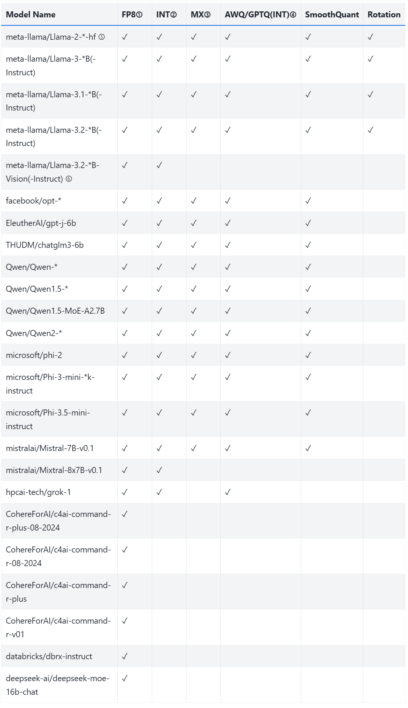
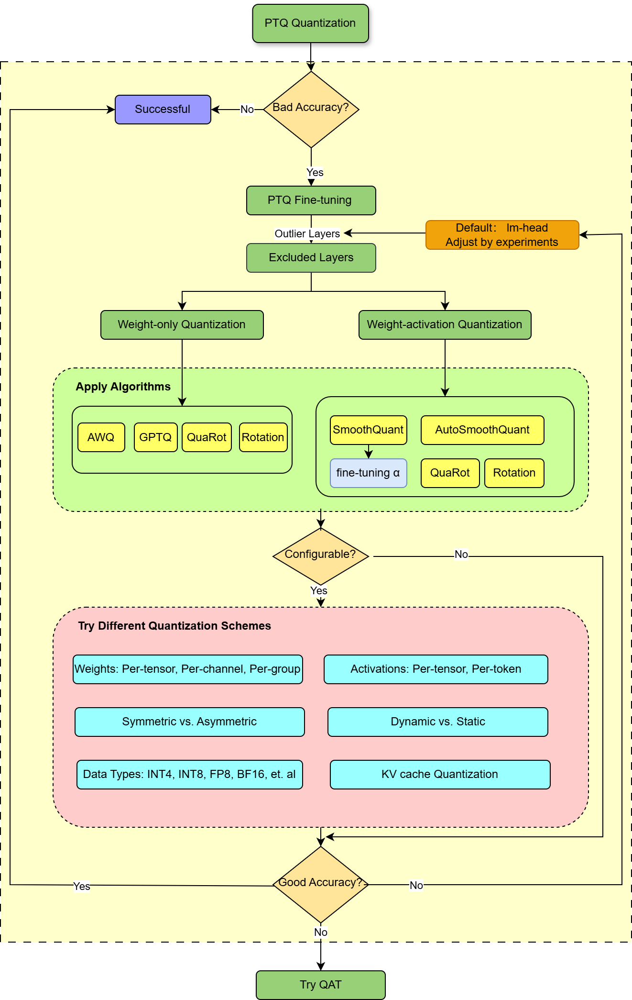
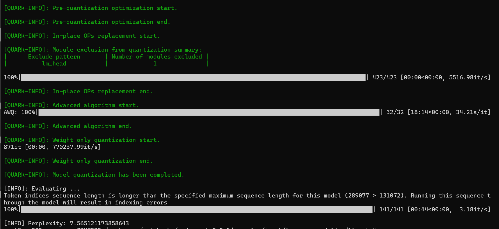

> 原文作者：Charles Yang  
> [AMD 官方教程](https://rocm.docs.amd.com/projects/ai-developer-hub/en/latest/notebooks/gpu_dev_optimize/fp8_quantization_quark_vllm.html) · [固定版本源码](https://github.com/ROCm/gpuaidev/blob/0071bfd4bd3bd9525405c09a6ae69c983b09312a/docs/notebooks/gpu_dev_optimize/fp8_quantization_quark_vllm.ipynb)  
> 上游版本：`0071bfd4bd3bd9525405c09a6ae69c983b09312a` · 同步日期：2026-10-12  
> 翻译状态：机器初译，待逐篇人工校对；代码与命令保持原文，未在 AMD GPU 上运行验证。

<!-- cell:1 -->

<a id="fp8-quantization-with-amd-quark-for-vllm"></a>

# 使用 AMD Quark 为 vLLM 进行 FP8 量化
**作者**：Charles Yang
**知识水平**：中级

量化可以有效减少内存和带宽使用，加速计算，并以最小的精度损失改进吞吐量。 

[vLLM](https://docs.vllm.ai/en/latest/) 是一个开源库，旨在为 大语言模型 (LLM) 推理 提供高 吞吐量 和低 延迟。它通过高效批处理请求和充分利用 GPU 资源来优化文本生成工作负载，使开发人员能够管理代码生成和大规模对话式 AI 等复杂任务。

vLLM 可以利用灵活而强大的 量化 工具包 [Quark](https://quark.docs.amd.com/latest/index.html) 来生成在 AMD GPU 上运行的高性能量化模型。 Quark 专门支持使用权重、激活和 KV 缓存 量化 以及尖端 量化 算法（如 AWQ、GPTQ、Rotation 和 SmoothQuant）量化大型语言模型。

本教程将指导您设置 Quark 并将 LLM 模型量化为 FP8，然后使用 [ROCm](https://rocm.docs.amd.com/en/latest/index.html) 软件堆栈在 AMD Instinct™ GPU 上运行 FP8 模型。了解如何配置 Quark 参数、实现不同的模型精度以及与不同的 量化 算法进行性能比较。

<details markdown="1">
<summary>查看英文原文 · 单元 1</summary>

# FP8 quantization with AMD Quark for vLLM 

**Author**: Charles Yang  
**Knowledge level**: Intermediate

Quantization can effectively reduce memory and bandwidth usage, accelerate computation, and improve throughput with minimal accuracy loss. 

[vLLM](https://docs.vllm.ai/en/latest/) is an open-source library designed to deliver high throughput and low latency for large language model (LLM) inference. It optimizes text generation workloads by efficiently batching requests and making full use of GPU resources, empowering developers to manage complex tasks like code generation and large-scale conversational AI.

vLLM can leverage [Quark](https://quark.docs.amd.com/latest/index.html), a flexible and powerful quantization toolkit, to produce performant quantized models to run on AMD GPUs. Quark has specialized support for quantizing large language models with weight, activation, and KV cache quantization and cutting-edge quantization algorithms like AWQ, GPTQ, Rotation, and SmoothQuant.

This tutorial guides you through setting up Quark and quantizing LLM models to FP8, then running the FP8 model on AMD Instinct™ GPUs using the [ROCm](https://rocm.docs.amd.com/en/latest/index.html) software stack. Learn how to configure Quark parameters, achieve different model precisions, and compare performance with different quantization algorithms.

</details>

<!-- cell:2 -->

<a id="supported-models"></a>

## 支持的型号



**图 1：** AMD Quark 工具中支持的型号。

<a id="notes"></a>

### 注释

- **(1) FP8**：指 OCP `fp8_e4m3` 数据类型 量化。
- **(2) INT**：包括 `INT8`、`UINT8`、`INT4` 和 `UINT4` 量化 类型。
- **(3) MX**：包括自定义 OCP 数据类型，例如：
  - `MXINT8`
  - `MXFP8E4M3`
  - `MXFP8E5M2`
  - `MXFP4`
  - `MXFP6E3M2`
  - `MXFP6E2M3`
- **(4) GPTQ**：`QuantScheme` 仅支持 `PerGroup` 和 `PerChannel` 值。
- **(5)**：`*` 表示不同的型号尺寸（例如，`7B` 或 `13B`）。
- **(6)**：对于 `meta-llama/Llama-3.2-*B-Vision` 模型，仅量化语言组件。视觉模块不包括在内。

<details markdown="1">
<summary>查看英文原文 · 单元 2</summary>

## Supported models


**Figure 1:** Supported models in the AMD Quark tool.

### Notes

- **(1) FP8**: Refers to OCP `fp8_e4m3` data type quantization.
- **(2) INT**: Includes `INT8`, `UINT8`, `INT4`, and `UINT4` quantization types.
- **(3) MX**: Includes custom OCP data types such as:
  - `MXINT8`
  - `MXFP8E4M3`
  - `MXFP8E5M2`
  - `MXFP4`
  - `MXFP6E3M2`
  - `MXFP6E2M3`
- **(4) GPTQ**: `QuantScheme` only supports the  `PerGroup` and `PerChannel` values.
- **(5)**: `*` indicates different model sizes (for example, `7B` or `13B`).
- **(6)**: For `meta-llama/Llama-3.2-*B-Vision` models, only the language components are quantized. The vision modules are excluded.

</details>

<!-- cell:3 -->

<a id="prerequisites"></a>

## 前置条件

本教程是使用以下设置进行开发和测试的。 

<a id="operating-system"></a>

### 操作系统

* **Ubuntu 22.04**：确保您的系统运行的是 Ubuntu 版本 22.04。

<a id="software"></a>

### 软件

* **ROCm 6.2 或 6.3**：按照 [ROCm 安装指南](https://rocm.docs.amd.com/projects/install-on-linux/en/latest/install/quick-start.html) 安装并验证 ROCm。安装后，使用以下命令确认您的设置：

    ``` bash
    amd-smi
    ```

    此命令列出了您的 AMD GPU 以及相关详细信息。
    
    **注意**：对于 ROCm 6.4 及更早版本，请改用 `rocm-smi` 命令。

* **Docker**：确保 Docker 已正确安装和配置。请遵循适用于您的操作系统的 Docker 安装指南。

   **注意**：确保正确配置 Docker 权限。要配置权限以允许非 root 访问，请运行以下命令：

   ``` bash
   sudo usermod -aG docker $USER
   newgrp docker
   ```

   验证 Docker 是否正常工作：

   ``` bash
   docker run hello-world
   ```

<a id="hugging-face-api-access"></a>

### Hugging Face API 访问

* 从[Hugging Face](https://huggingface.co)获取API令牌用于下载模型。
* 确保 Hugging Face API 令牌具有访问 [Meta Llama 检查点](https://huggingface.co/meta-llama/Llama-3.1-8B) 所需的权限和批准。

<details markdown="1">
<summary>查看英文原文 · 单元 3</summary>

## Prerequisites

This tutorial was developed and tested using the following setup. 

### Operating system

* **Ubuntu 22.04**: Ensure your system is running Ubuntu version 22.04.

### Software

* **ROCm 6.2 or 6.3**: Install and verify ROCm by following the [ROCm install guide](https://rocm.docs.amd.com/projects/install-on-linux/en/latest/install/quick-start.html). After installation, confirm your setup using:

    ``` bash
    amd-smi
    ```

    This command lists your AMD GPUs with relevant details.
    
    **Note**: For ROCm 6.4 and earlier, use the `rocm-smi` command instead.

* **Docker**: Ensure Docker is installed and configured correctly. Follow the Docker installation guide for your operating system.

   **Note**: Ensure the Docker permissions are correctly configured. To configure permissions to allow non-root access, run the following commands:

   ``` bash
   sudo usermod -aG docker $USER
   newgrp docker
   ```

   Verify Docker is working correctly with:

   ``` bash
   docker run hello-world
   ```

### Hugging Face API access

* Obtain an API token from [Hugging Face](https://huggingface.co) for downloading models.
* Ensure the Hugging Face API token has the necessary permissions and approval to access the [Meta Llama checkpoints](https://huggingface.co/meta-llama/Llama-3.1-8B).

</details>

<!-- cell:4 -->

<a id="env-setup"></a>

<a id="environment-setup-with-docker-and-rocm"></a>

## 使用 Docker 和 ROCm 设置环境

请按照以下步骤配置您的教程环境：

<a id="1-pull-the-docker-image"></a>

### 1. 拉取 Docker 镜像

确保您的系统满足[系统要求](https://rocm.docs.amd.com/projects/install-on-linux/en/latest/reference/system-requirements.html)。

拉取本教程所需的 Docker 映像：

``` bash
docker pull rocm/vllm:latest
```

<a id="2-launch-the-docker-container"></a>

### 2.启动Docker容器

启动 Docker 容器并映射必要的目录。从您的主机运行以下命令：

``` bash
docker run -it --rm \
  --network=host \
  --device=/dev/kfd \
  --device=/dev/dri \
  --group-add=video \
  --ipc=host \
  --cap-add=SYS_PTRACE \
  --security-opt seccomp=unconfined \
  --shm-size 8G \
  -v $(pwd):/workspace \
  -w /workspace/notebooks \
  rocm/vllm:latest
```

**注意**：该命令将当前目录挂载到容器中的`/workspace`目录中。确保在运行 Docker 命令之前将Notebook文件复制到此目录，或者在启动后上传到 Jupyter Notebook 环境。保存终端输出中提供的令牌或 URL，以便从 Web 浏览器访问Notebook。您可以从 [AI Developer Hub GitHub 存储库](https://github.com/ROCm/gpuaidev) 下载此Notebook。

<a id="launch-jupyter"></a>

<a id="3-launch-jupyter-notebooks-in-the-container"></a>

### 3. 在容器中启动 Jupyter Notebooks

在 Docker 容器内，使用以下命令安装 Jupyter：

``` bash
pip install jupyter
```

启动 Jupyter 服务器：

``` bash
jupyter-lab --ip=0.0.0.0 --port=8888 --no-browser --allow-root
```

**注意**：在运行上述命令之前，请确保您的系统上尚未使用端口 `8888`。如果是，您可以通过将 `--port=8888` 替换为其他端口号来指定其他端口，例如 `--port=8890`。

<details markdown="1">
<summary>查看英文原文 · 单元 4</summary>

<a id="env-setup"></a>

## Environment setup with Docker and ROCm

Follow these steps to configure your tutorial environment:

### 1. Pull the Docker image

Ensure your system meets the [system requirements](https://rocm.docs.amd.com/projects/install-on-linux/en/latest/reference/system-requirements.html).

Pull the Docker image required for this tutorial:

``` bash
docker pull rocm/vllm:latest
```

### 2. Launch the Docker container

Launch the Docker container and map the necessary directories. From your host machine, run this command:

``` bash
docker run -it --rm \
  --network=host \
  --device=/dev/kfd \
  --device=/dev/dri \
  --group-add=video \
  --ipc=host \
  --cap-add=SYS_PTRACE \
  --security-opt seccomp=unconfined \
  --shm-size 8G \
  -v $(pwd):/workspace \
  -w /workspace/notebooks \
  rocm/vllm:latest
```

**Note**: This command mounts the current directory to the `/workspace` directory in the container. Ensure the notebook file is either copied to this directory before running the Docker command or uploaded into the Jupyter Notebook environment after it starts. Save the token or URL provided in the terminal output to access the notebook from your web browser. You can download this notebook from the [AI Developer Hub GitHub repository](https://github.com/ROCm/gpuaidev).

<a id="launch-jupyter"></a>

### 3. Launch Jupyter Notebooks in the container

Inside the Docker container, install Jupyter using the following command:

``` bash
pip install jupyter
```

Start the Jupyter server:

``` bash
jupyter-lab --ip=0.0.0.0 --port=8888 --no-browser --allow-root
```

**Note**: Ensure port `8888` is not already in use on your system before running the above command. If it is, you can specify a different port by replacing `--port=8888` with another port number, for example, `--port=8890`.

</details>

<!-- cell:5 -->

<a id="install-deps"></a>

<a id="4-installing-dependencies"></a>

### 4.安装依赖项

接下来，安装 CMake 和 Quark。选择 PyTorch 的 CPU 轮，以便 Quark 可以在没有 GPU 的Notebook上运行。虽然速度较慢，但​​对于尝试 Quark 来说还是可以的。从 PyPI 安装 Quark，它会引入所需的依赖项。

在 Docker 容器中运行的 Jupyter Notebook 中运行以下命令：

<details markdown="1">
<summary>查看英文原文 · 单元 5</summary>

<a id="install-deps"></a>

### 4. Installing dependencies

Next, install CMake and Quark. Select the CPU wheel of PyTorch so that Quark can run on laptops without GPUs. This is slower but is fine for trying Quark out. Install Quark from PyPI, which pulls in the required dependencies.

Run the following commands inside the Jupyter notebook running within the Docker container:

</details>

```python
!pip install cmake amd-quark==0.8.1
!pip install ipython ipywidgets 
!pip install huggingface_hub
!pip install evaluate>=0.4.0
!pip install accelerate datasets pillow pillow transformers zstandard lm-eval
```

<!-- cell:7 -->

<a id="5-provide-your-hugging-face-token"></a>

### 5. 提供您的拥抱令牌

您需要 Hugging Face API 令牌才能访问 Llama-3.1-8B。在 [Hugging Face Tokens](https://huggingface.co/settings/tokens) 生成您的令牌并请求访问 [Llama-3.1-8B-Instruct](https://huggingface.co/meta-llama/Llama-3.1-8B-Instruct)。令牌通常以“hf_”开头。

在 Jupyter Notebook中运行以下交互式块来设置令牌：

<details markdown="1">
<summary>查看英文原文 · 单元 7</summary>

### 5. Provide your Hugging Face token

You'll require a Hugging Face API token to access Llama-3.1-8B. Generate your token at [Hugging Face Tokens](https://huggingface.co/settings/tokens) and request access for [Llama-3.1-8B-Instruct](https://huggingface.co/meta-llama/Llama-3.1-8B-Instruct). Tokens typically start with "hf_".

Run the following interactive block in your Jupyter notebook to set up the token:

</details>

```python
from huggingface_hub import notebook_login, HfApi

# Prompt the user to log in
notebook_login()
```

<!-- cell:9 -->

验证您的令牌是否被正确接受：

<details markdown="1">
<summary>查看英文原文 · 单元 9</summary>

Verify that your token was accepted correctly:

</details>

```python
# Validate the token
try:
    api = HfApi()
    user_info = api.whoami()
    print(f"Token validated successfully! Logged in as: {user_info['name']}")
except Exception as e:
    print(f"Token validation failed. Error: {e}")
```

<!-- cell:11 -->

<a id="quantization-process"></a>

## 量化 流程

安装 Quark 后，请按照以下步骤了解如何使用它。
Quark 量化流程包括以下步骤：

1.加载模型
2. 准备校准数据加载器
3.设置量化配置
4. 量化模型
5. 导出模型
6. vLLM评估

<details markdown="1">
<summary>查看英文原文 · 单元 11</summary>

## Quantization process

After installing Quark, follow these steps to learn how to use it.
The Quark quantization process includes the following steps:

1. Load the model
2. Prepare the calibration dataloader
3. Set the quantization configuration
4. Quantize the model
5. Export the model
6. Evaluation in vLLM

</details>

<!-- cell:12 -->

<a id="1-load-the-model"></a>

### 1.加载模型
Quark 使用转换器来获取模型和分词器。

<details markdown="1">
<summary>查看英文原文 · 单元 12</summary>

### 1. Load the model
Quark uses transformers to fetch the model and tokenizer.

</details>

```python
from transformers import AutoTokenizer, AutoModelForCausalLM

MODEL_ID = "meta-llama/Llama-3.1-8B-Instruct"
MAX_SEQ_LEN = 512

model = AutoModelForCausalLM.from_pretrained(
    MODEL_ID, device_map="auto", torch_dtype="auto",
)
model.eval()

tokenizer = AutoTokenizer.from_pretrained(MODEL_ID, model_max_length=MAX_SEQ_LEN)
tokenizer.pad_token = tokenizer.eos_token
```

<!-- cell:14 -->

<a id="2-prepare-the-calibration-dataloader"></a>

### 2. 准备校准数据加载器
Quark 使用 PyTorch 数据加载器加载校准数据。更多如何高效使用标定数据集的详细信息，请参见[添加标定数据集](https://quark.docs.amd.com/latest/pytorch/calibration_datasets.html)。

<details markdown="1">
<summary>查看英文原文 · 单元 14</summary>

### 2. Prepare the calibration dataloader
Quark uses the PyTorch dataloader to load calibration data. For more details about how to use calibration datasets efficiently, see [Adding Calibration Datasets](https://quark.docs.amd.com/latest/pytorch/calibration_datasets.html).

</details>

```python
from datasets import load_dataset
from torch.utils.data import DataLoader

BATCH_SIZE = 1
NUM_CALIBRATION_DATA = 512

# Load the dataset and get the calibration data.
dataset = load_dataset("mit-han-lab/pile-val-backup", split="validation")
text_data = dataset["text"][:NUM_CALIBRATION_DATA]

tokenized_outputs = tokenizer(text_data, return_tensors="pt",
    padding=True, truncation=True, max_length=MAX_SEQ_LEN)
calib_dataloader = DataLoader(tokenized_outputs['input_ids'],
    batch_size=BATCH_SIZE, drop_last=True)
```

<!-- cell:16 -->

<a id="3-set-the-quantization-configuration"></a>

### 3.设置量化配置

首先下载并解压缩示例配置文件和必要的包。

<details markdown="1">
<summary>查看英文原文 · 单元 16</summary>

### 3. Set the quantization configuration

Start by downloading and unzipping the example configuration files and necessary packages.

</details>

```python

%%bash
#Install unzip and wget
apt-get update
apt-get install -y unzip wget

# Download and unzip AMD Quark examples
wget -O amd_quark-0.8.1.zip https://download.amd.com/opendownload/Quark/amd_quark-0.8.1.zip
unzip -o amd_quark-0.8.1.zip
```

<!-- cell:18 -->

设置 量化 配置。本教程在权重、激活和 KV 缓存 上使用 `FP8` 每张量 量化，而 量化 算法是 AutoSmoothQuant。更多详情请参见[Quark配置指南](https://quark.docs.amd.com/latest/pytorch/user_guide_config_description.html)。

<details markdown="1">
<summary>查看英文原文 · 单元 18</summary>

Set the quantization configuration. This tutorial uses `FP8` per-tensor quantization on weight, activation, and the KV cache, while the quantization algorithm is AutoSmoothQuant. See the [Quark configuration guide](https://quark.docs.amd.com/latest/pytorch/user_guide_config_description.html) for further details.

</details>

```python
from quark.torch.quantization import (QConfig, QLayerConfig,
                                     FP8E4M3PerTensorSpec,
                                     load_quant_algo_config_from_file)

# Define fp8/per-tensor/static spec.
FP8_PER_TENSOR_SPEC = FP8E4M3PerTensorSpec(observer_method="min_max",
    is_dynamic=False).to_quantization_spec()

# Define global quantization config, input tensors and weight apply FP8_PER_TENSOR_SPEC.
global_quant_config = QLayerConfig(input_tensors=FP8_PER_TENSOR_SPEC,
    weight=FP8_PER_TENSOR_SPEC)

# Define quantization config for kv-cache layers, output tensors apply FP8_PER_TENSOR_SPEC.
KV_CACHE_SPEC = FP8_PER_TENSOR_SPEC
kv_cache_layer_names_for_llama = ["*k_proj", "*v_proj"]
kv_cache_quant_config = {name :
    QLayerConfig(input_tensors=global_quant_config.input_tensors,
                       weight=global_quant_config.weight,
                       output_tensors=KV_CACHE_SPEC)
    for name in kv_cache_layer_names_for_llama}
layer_quant_config = kv_cache_quant_config.copy()

# Define algorithm config by config file.
LLAMA_AUTOSMOOTHQUANT_CONFIG_FILE = 'amd_quark-0.8.1/examples/torch/language_modeling/llm_ptq/models/llama/autosmoothquant_config.json'
algo_config = [load_quant_algo_config_from_file(LLAMA_AUTOSMOOTHQUANT_CONFIG_FILE)]

EXCLUDE_LAYERS = ["lm_head"]
quant_config = QConfig(
    global_quant_config=global_quant_config,
    layer_quant_config=layer_quant_config,
    kv_cache_quant_config=kv_cache_quant_config,
    exclude=EXCLUDE_LAYERS,
    algo_config=algo_config)
```

<!-- cell:20 -->

<a id="4-quantize-the-model"></a>

### 4. 量化模型
应用 量化。量化后，在导出之前先冻结量化模型。

<details markdown="1">
<summary>查看英文原文 · 单元 20</summary>

### 4. Quantize the model
Apply the quantization. After quantizing, freeze the quantized model first before exporting.

</details>

```python
import torch
from quark.torch import ModelQuantizer
from quark.torch.export import JsonExporterConfig

# Apply quantization.
quantizer = ModelQuantizer(quant_config)
quant_model = quantizer.quantize_model(model, calib_dataloader)

# Freeze quantized model to export.
freezed_model = quantizer.freeze(model)
```

<!-- cell:22 -->

<a id="5-export-the-model"></a>

### 5.导出模型
使用 HuggingFace safetensors 格式导出模型。有关更多详细信息，请参阅[HuggingFace safetensors](https://huggingface.co/docs/safetensors/en/index)。

<details markdown="1">
<summary>查看英文原文 · 单元 22</summary>

### 5. Export the model
Export the model using the HuggingFace safetensors format. For more details, see [HuggingFace safetensors](https://huggingface.co/docs/safetensors/en/index).

</details>

```python
from quark.torch.quantization.config.config import QConfig
from quark.torch.export.config.config import ExporterConfig
from quark.shares.utils.log import ScreenLogger
from quark.torch import ModelExporter
from transformers import AutoTokenizer
from torch import nn
from pathlib import Path
from typing import List, Optional, Dict, Any
import torch
import json
import sys
import os


logger = ScreenLogger(__name__)
# Define export config.
LLAMA_KV_CACHE_GROUP = ["*k_proj", "*v_proj"]
export_config = ExporterConfig(json_export_config=JsonExporterConfig())
export_config.json_export_config.kv_cache_group = LLAMA_KV_CACHE_GROUP
export_path= "Llama-3.1-8B-Instruct-FP8"


EXPORT_DIR = MODEL_ID.split("/")[1] + "-FP8"
exporter = ModelExporter(config=export_config, export_dir=EXPORT_DIR)

model = exporter.get_export_model(freezed_model, quant_config=quant_config, custom_mode="quark", add_export_info_for_hf=True)
model.save_pretrained(export_path)
try:
    model_type = 'llama'
    use_fast = True if model_type in ["grok", "cohere", "olmo"] else False
    tokenizer = AutoTokenizer.from_pretrained(MODEL_ID, trust_remote_code=True, use_fast=use_fast)
    tokenizer.save_pretrained(export_path)
except Exception as e:
    logger.error(f"An error occurred when saving tokenizer: {e}.  You can try to save the tokenizer manually")
exporter.reset_model(model=model)
logger.info(f"hf_format quantized model exported to {export_path} successfully.")
```

<!-- cell:24 -->

<a id="6-evaluation-in-vllm"></a>

### 6. vLLM 评估

现在您可以直接通过 LLM 入口点加载并运行 Quark 量化模型：

<details markdown="1">
<summary>查看英文原文 · 单元 24</summary>

### 6. Evaluation in vLLM

Now you can load and run the Quark quantized model directly through the LLM entrypoint:

</details>

```python
from vllm import LLM, SamplingParams

# Sample prompts.
prompts = [
    "Hello, my name is",
    "The president of the United States is",
    "The capital of France is",
    "The future of AI is",
]
# Create a sampling params object.
sampling_params = SamplingParams(temperature=0.8, top_p=0.95)

# Create an LLM.
llm = LLM(model="Llama-3.1-8B-Instruct-FP8",
          kv_cache_dtype='fp8',quantization='quark')
# Generate texts from the prompts. The output is a list of RequestOutput objects
# that contain the prompt, generated text, and other information.
outputs = llm.generate(prompts, sampling_params)
# Print the outputs.
print("\nGenerated Outputs:\n" + "-" * 60)
for output in outputs:
    prompt = output.prompt
    generated_text = output.outputs[0].text
    print(f"Prompt:    {prompt!r}")
    print(f"Output:    {generated_text!r}")
    print("-" * 60)

# clean up and release GPU 
del llm

# Step 2: Call garbage collector
import gc
gc.collect()

# Step 3: If using PyTorch backend, clear CUDA (optional but helpful)
import torch
if torch.cuda.is_available():
    torch.cuda.empty_cache()
    torch.cuda.ipc_collect()
```

<!-- cell:26 -->

您还可以使用 `lm_eval` 来评估准确性：

<details markdown="1">
<summary>查看英文原文 · 单元 26</summary>

You can also use `lm_eval` to evaluate accuracy:

</details>

```python
!lm_eval --model vllm \
  --model_args pretrained=Llama-3.1-8B-Instruct-FP8,kv_cache_dtype='fp8',quantization='quark' \
  --tasks gsm8k
```

<!-- cell:28 -->

<a id="quark-quantization-script"></a>

## Quark 量化 脚本
除了上面的Python API示例之外，Quark还提供了量化脚本来更方便地量化大型语言模型。它支持使用各种不同的 量化 方案和优化算法来量化模型。它可以导出量化模型并运行评估任务。

**注意：** 您可以使用 `--output_dir` 选项更改脚本的输出目录。

<details markdown="1">
<summary>查看英文原文 · 单元 28</summary>

## Quark quantization script
In addition to the Python API example above, Quark also offers a quantization script to quantize large language models more conveniently. It supports quantizing models using a variety of different quantization schemes and optimization algorithms. It can export the quantized model and run evaluation tasks as it goes.

**Note:** You can change the output directory for the script using the `--output_dir` option.

</details>

```python
import os
os.chdir("./amd_quark-0.8.1/examples/torch/language_modeling/llm_ptq/")
!python3 quantize_quark.py --model_dir meta-llama/Llama-3.1-8B-Instruct \
                          --output_dir ./Llama-3.1-8B-Instruct-FP8 \
                          --quant_scheme w_fp8_a_fp8 \
                          --kv_cache_dtype fp8 \
                          --quant_algo autosmoothquant \
                          --num_calib_data 512 \
                          --model_export hf_format \
                          --tasks gsm8k
```

<!-- cell:30 -->

<a id="best-practices-for-post-training-quantization-ptq"></a>

## 培训后最佳实践 量化 (PTQ)

本节概述了使用 AMD Quark PyTorch 进行 PTQ 的最佳实践。它提供有关 微调 您的 量化 策略的指导，以解决精度下降问题。下面的示例使用 `meta-llama/Llama-3.1-8B-Instruct` 模型和 `quark/examples/torch/language_modeling/llm_ptq` 中的代码文件来演示该方法。



**图 2：** AMD Quark PyTorch 量化 的最佳实践

<details markdown="1">
<summary>查看英文原文 · 单元 30</summary>

## Best practices for Post-Training Quantization (PTQ)

This section outlines the best practices for PTQ with AMD Quark PyTorch. It provides guidance on fine-tuning your quantization strategy to address accuracy degradation issues. The example below uses the `meta-llama/Llama-3.1-8B-Instruct` model and code files from `quark/examples/torch/language_modeling/llm_ptq` to demonstrate the methodology.


**Figure 2:** Best practices for AMD Quark PyTorch quantization

</details>

<!-- cell:31 -->

确认您当前的工作目录是 `./amd_quark-0.8.1/examples/torch/language_modeling/llm_ptq/`，然后运行以下代码。

<details markdown="1">
<summary>查看英文原文 · 单元 31</summary>

Confirm your current working directory is `./amd_quark-0.8.1/examples/torch/language_modeling/llm_ptq/`, then run the code below.

</details>

```python
exclude_layers="*lm_head *layers.0.mlp.down_proj"
!python3 quantize_quark.py --model_dir meta-llama/Llama-3.1-8B-Instruct \
                          --quant_scheme w_fp8_a_fp8 \
                          --exclude_layers $exclude_layers 
```

<!-- cell:33 -->

<a id="applying-various-quantization-algorithms"></a>

## 应用各种量化算法
AMD Quark 支持专为 LLM 设计的各种 量化 算法。您可以尝试以下算法来提高准确性。 

**注：** 本节中模型精度不限于FP8。

<a id="awq-activation-aware-weight-quantization"></a>

### AWQ（激活感知权重 量化）
AWQ 确定平滑通过网格搜索的最佳缩放因子，并广泛应用于仅 量化 的低位权重（例如，组大小为 128 的 W4 量化）。可以使用以下命令应用该算法。

<details markdown="1">
<summary>查看英文原文 · 单元 33</summary>

## Applying various quantization algorithms
AMD Quark supports various quantization algorithms specifically designed for LLMs. You can experiment with the following algorithms to enhance accuracy. 

**Note:** The model precision is not limited to FP8 in this section.

### AWQ (Activation-aware Weight Quantization)
AWQ determines the optimal scaling factors for a smooth-through grid search and is widely used in low-bit weight only quantization (for example, W4 quantization with a group size of 128). The algorithm can be applied using the following command.

</details>

```python
!python3 quantize_quark.py --model_dir meta-llama/Llama-3.1-8B-Instruct \
                          --quant_scheme w_uint4_per_group_asym \
                          --group_size 128 \
                          --dataset pileval_for_awq_benchmark \
                          --quant_algo awq
```

<!-- cell:35 -->

<a id="autosmoothquant"></a>

### 自动平滑定量
AutoSmoothQuant 通过在块间均方误差 (MSE) 损失的指导下自动选择每层的最佳值来增强 SmoothQuant。

<details markdown="1">
<summary>查看英文原文 · 单元 35</summary>

### AutoSmoothQuant
AutoSmoothQuant enhances SmoothQuant by automatically selecting the optimal values for each layer, guided by the mean squared error (MSE) loss across blocks.

</details>

```python
!python3 quantize_quark.py --model_dir meta-llama/Llama-3.1-8B-Instruct \
                          --quant_scheme w_int8_a_int8_per_tensor_sym \
                          --dataset pileval_for_awq_benchmark \
                          --quant_algo autosmoothquant
```

<!-- cell:37 -->

<a id="quarot"></a>

### 夸罗特
QuaRot 使用名为 Hadamard 变换的旋转技术消除激活异常值。 AMD Quark 支持 QuaRot 算法，可以按如下方式使用。

<details markdown="1">
<summary>查看英文原文 · 单元 37</summary>

### QuaRot
QuaRot eliminates activation outliers using a rotation technique named the Hadamard transform. AMD Quark supports the QuaRot algorithm, which can be used as follows.

</details>

```python
!python3 quantize_quark.py --model_dir meta-llama/Llama-3.1-8B-Instruct \
                          --quant_scheme w_int8_a_int8_per_tensor_sym \
                          --pre_quantization_optimization quarot
```

<!-- cell:39 -->

<a id="rotation"></a>

### 旋转
QuaRot 在其算法中采用了在线 Hadamard 变换，这需要硬件部署的内核支持。受 QuaRot 和 QServer 的启发，AMD Quark 引入了旋转方法，无需修改内核即可提高准确性。

<details markdown="1">
<summary>查看英文原文 · 单元 39</summary>

### Rotation
QuaRot employs an online Hadamard transform in its algorithm, which requires kernel support for hardware deployment. Inspired by QuaRot and QServer, AMD Quark introduces the Rotation method, which enhances accuracy without requiring kernel modifications.

</details>

```python
!python3 quantize_quark.py --model_dir meta-llama/Llama-3.1-8B-Instruct \
                          --quant_scheme w_int8_a_int8_per_tensor_sym \
                          --pre_quantization_optimization rotation
```

<!-- cell:41 -->

成功的评估结果如下所示：



<details markdown="1">
<summary>查看英文原文 · 单元 41</summary>

A successful evaluation result is shown below:


</details>

<!-- cell:42 -->

<a id="trying-different-quantization-schemes"></a>

## 尝试不同的 量化 方案
尝试各种 量化 方案有助于提高准确性。但是，请记住，选择合适的方案取决于您的具体要求和硬件限制。

<a id="key-quantization-schemes"></a>

### 关键 量化 方案

- 仅权重与权重激活 量化：激活 量化 可能会导致精度显着下降，而具有极低位宽的仅权重 量化 可以产生更好的结果。

- 量化 粒度

- 权重 量化：选项包括每张量、每通道或每组 量化。

- 激活 量化：选项包括每个张量或每个令牌 量化。

- 动态与静态 量化：对于激活 量化，动态 量化 通常比静态 量化 具有更好的精度。

- 对称与非对称：根据模型对有符号或无符号值的敏感程度，尝试使用对称或非对称 量化 进行试验。

- 数据类型 (Dtypes)：AMD Quark 支持多种数据类型，包括 `INT4`、`INT8`、`FP8`、`MX-FPX`、`FP16` 和 `BFloat16`。选择最能平衡模型准确性和效率的数据类型。

- KV 缓存 量化：跳过 KV 缓存 量化 通常会带来更好的性能。将此方法应用于整个 KV 缓存 或其特定部分可能会带来更好的精度。

如果应用上述方法后精度问题仍然存在，请考虑尝试使用 AMD Quark 调试工具来识别异常层并将其从 量化 中排除。

<details markdown="1">
<summary>查看英文原文 · 单元 42</summary>

## Trying different quantization schemes
Experimenting with various quantization schemes can help improve accuracy. However, keep in mind that selecting a appropriate scheme depends on your specific requirement and hardware constraints.

### Key quantization schemes

- Weight-only vs. weight-activation quantization: Activation quantization might lead to a significant accuracy drop while weight-only quantization with an extremely low bit-width can yield better results.

- Quantization granularity

- Weight quantization: Options include per-tensor, per-channel, or per-group quantization.

- Activation quantization: Options include per-tensor or per-token quantization.

- Dynamic versus static quantization: For activation quantization, dynamic quantization often results in better accuracy than static quantization.

- Symmetric versus asymmetric: Try experimenting with symmetric or asymmetric quantization based on how sensitive the model is to signed or unsigned values.

- Data types (Dtypes): AMD Quark supports several data types, including `INT4`, `INT8`, `FP8`, `MX-FPX`, `FP16`, and `BFloat16`. Choose the data type that best balances accuracy and efficiency for your model.

- KV cache quantization: Skipping KV cache quantization typically results in better performance. Applying this approach to the entire KV cache or specific parts of it might lead to better accuracy.

If accuracy issues persist after applying the above methods, consider trying the AMD Quark debug tool to identify outlier layers and exclude them from quantization.

</details>
