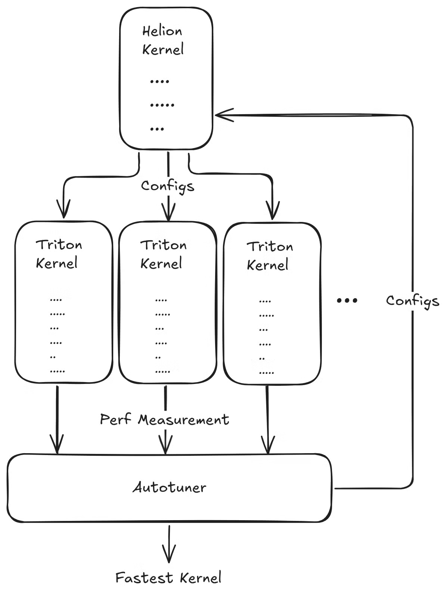

> 原文作者：Charles Yang  
> [AMD 官方教程](https://rocm.docs.amd.com/projects/ai-developer-hub/en/latest/notebooks/gpu_dev_optimize/helion_gpu_kernel_dev.html) · [固定版本源码](https://github.com/ROCm/gpuaidev/blob/0071bfd4bd3bd9525405c09a6ae69c983b09312a/docs/notebooks/gpu_dev_optimize/helion_gpu_kernel_dev.ipynb)  
> 上游版本：`0071bfd4bd3bd9525405c09a6ae69c983b09312a` · 同步日期：2026-10-12  
> 翻译状态：机器初译，待逐篇人工校对；代码与命令保持原文，未在 AMD GPU 上运行验证。

<!-- cell:1 -->

<a id="helion-dsl-for-gpu-kernel-development-and-assessment-on-amd-gpus"></a>

# 使用 Helion 开发与评估 GPU 内核
**作者**：Charles Yang
**知识水平**：中级

[Helion](https://github.com/pytorch/helion) 是来自 Meta 的 Python 嵌入式领域特定语言 (DSL)，用于编写机器学习内核。它编译为 [Triton](https://openai.com/index/triton/)，这是 OpenAI 的一个高性能后端，用于对 GPU 和其他设备进行编程。与 Triton 相比，Helion 旨在提高抽象级别，从而更容易编写正确且高效的内核，同时在自动调整过程中实现更高的自动化程度。

Helion 可以被视为带有图块的 PyTorch 或更高级别的 Triton 应用程序。与 Triton 相比，Helion 通过自动调整减少了手动编码工作。 Helion 花费更多时间（大约 10 分钟）进行自动调整，因为它评估从单个 Helion 内核生成的数百个潜在的 Triton 实现。这种更大的搜索空间还使内核在不同硬件之间具有更好的性能可移植性。

Helion 由 AMD GPU 支持。本教程演示如何设置 Helion 开发环境、实现 Helion 内核以及在 AMD Instinct™ GPU 上使用 Triton 和 Torch 进行性能基准测试。

<a id="the-helion-autotuner"></a>

## Helion 自动调谐器

Helion 的主要区别在于其自动化的提前 (AOT) 自动调谐引擎。在 Triton 中，开发人员负责手动定义优化的搜索空间。这需要显式枚举要测试的每个配置，这是一个乏味的过程，限制了探索的范围。

Helion 通过使用隐式搜索空间改变了这种动态。高级语言自动根据实现选择构建一个巨大的、多维的搜索空间。例如，单个 `hl.tile` 调用隐式指示自动调节器探索不同的块大小和循环顺序，并考虑是否将迭代空间展平为单一维度。因此，一个 Helion 内核定义可以映射到数千个 Triton 配置，从而允许自动调谐器创建更大、更丰富的搜索空间，在其中发现高级配置。

<a id="tutorial-workflow"></a>

## 教程工作流程

本教程包括以下内容：

1. [Docker和ROCm的环境设置](#env-setup)
2. [Helion GPU 内核 示例](#helion-example)
3. [softmax算法背景知识](#softmax-details)
4. [创建Helion softmax GPU内核](#helion-kernel)
5. [Helion、Triton 和 Torch 在 AMD GPU 上的性能基准测试和可视化](#performance-benchmark)

  

<details markdown="1">
<summary>查看英文原文 · 单元 1</summary>

# Helion DSL for GPU kernel development and assessment on AMD GPUs

**Author**: Charles Yang  
**Knowledge level**: Intermediate

[Helion](https://github.com/pytorch/helion) is a Python-embedded domain-specific language (DSL) from Meta for authoring machine learning kernels. It compiles down to [Triton](https://openai.com/index/triton/), a performant backend from OpenAI for programming GPUs and other devices. Helion aims to raise the level of abstraction compared to Triton, making it easier to write correct and efficient kernels, while enabling greater automation in the autotuning process.

Helion can be viewed as either PyTorch with tiles or as a higher-level Triton application. Compared to Triton, Helion reduces manual coding effort through autotuning. Helion spends more time (approximately 10 minutes) autotuning as it evaluates hundreds of potential Triton implementations generated from a single Helion kernel. This larger search space also makes kernels more performance portable between different hardware.

Helion is supported by AMD GPUs. This tutorial demonstrates how to set up the Helion development environment, implement a Helion kernel, and benchmark performance with Triton and Torch on AMD Instinct™ GPUs.

## The Helion autotuner

The key differentiator of Helion is its automated, ahead-of-time (AOT) autotuning engine. In Triton, developers are responsible for manually defining the search space for optimizations. This requires explicitly enumerating every configuration to be tested, a tedious process that limits the scope of exploration.

Helion changes this dynamic by using implicit search spaces. The high-level language automatically constructs a vast, multi-dimensional search space over the implementation choices. For example, a single `hl.tile` call implicitly instructs the autotuner to explore different block sizes and loop orderings and consider whether to flatten the iteration space into a single dimension. One Helion kernel definition can therefore map to thousands of Triton configurations, allowing the autotuner to create a much larger and richer search space in which to discover a superior configuration.

## Tutorial workflow

This tutorial includes the following:

1. [Environment setup with Docker and ROCm](#env-setup)
2. [Helion GPU kernel example](#helion-example)
3. [Background information about the softmax algorithm](#softmax-details)
4. [Creating Helion softmax GPU Kernels](#helion-kernel)
5. [Performance benchmarking and visualization of Helion, Triton, and Torch on AMD GPUs](#performance-benchmark)

  

</details>

<!-- cell:2 -->

<a id="prerequisites"></a>

## 前置条件

本教程是使用以下设置进行开发和测试的。

<a id="operating-system"></a>

### 操作系统

* **Ubuntu 22.04/24.04**：确保您的系统运行的是 Ubuntu 22.04 或 24.04。

<a id="hardware"></a>

### 硬件

* **AMD Instinct MI300X GPU**：本教程在 AMD Instinct MI300X GPU 上进行了测试。确保您使用的是支持 ROCm 的 AMD Instinct GPU，并且您的系统满足[官方要求](https://rocm.docs.amd.com/projects/install-on-linux/en/latest/reference/system-requirements.html)。

<a id="software"></a>

### 软件

* **ROCm 7.0**：按照 [ROCm 安装指南](https://rocm.docs.amd.com/projects/install-on-linux/en/latest/install/quick-start.html) 安装并验证 ROCm。安装后，使用以下命令确认您的设置：

    ``` bash
    amd-smi
    ```
 此命令列出您的 AMD GPU 以及相关详细信息。

    **注意**：对于 ROCm 6.4 及更早版本，请改用 `rocm-smi` 命令。

    AMD 还提供预构建的 ROCm Docker 映像，包括 [ROCm PyTorch 映像](https://hub.docker.com/r/rocm/pytorch)、[ROCm Ubuntu 22.04 映像](https://hub.docker.com/r/rocm/dev-ubuntu-22.04) 和 [ROCm Ubuntu 24.04 映像](https://hub.docker.com/r/rocm/dev-ubuntu-24.04)。您可以使用这些预构建的 Docker 映像来减少设置 ROCm 环境所需的工作量。

* **Docker**：确保 Docker 已正确安装和配置。请遵循适用于您的操作系统的 Docker 安装指南。

   **注意**：确保正确配置 Docker 权限。要配置权限以允许非 root 访问，请运行以下命令：

   ``` bash
   sudo usermod -aG docker $USER
   newgrp docker
   ```

   验证 Docker 是否正常工作：

   ``` bash
   docker run hello-world
   ```

<a id="hugging-face-api-access"></a>

### Hugging Face API 访问

* 从[Hugging Face](https://huggingface.co)获取API令牌用于下载模型。
* 确保 Hugging Face API 令牌具有必要的权限。

<details markdown="1">
<summary>查看英文原文 · 单元 2</summary>

## Prerequisites

This tutorial was developed and tested using the following setup.

### Operating system

* **Ubuntu 22.04/24.04**: Ensure your system is running Ubuntu 22.04 or 24.04.

### Hardware

* **AMD Instinct MI300X GPU**: This tutorial was tested on an AMD Instinct MI300X GPU. Ensure you are using an AMD Instinct GPU with ROCm support and that your system meets the [official requirements](https://rocm.docs.amd.com/projects/install-on-linux/en/latest/reference/system-requirements.html).

### Software

* **ROCm 7.0**: Install and verify ROCm by following the [ROCm install guide](https://rocm.docs.amd.com/projects/install-on-linux/en/latest/install/quick-start.html). After installation, confirm your setup using:

    ``` bash
    amd-smi
    ```
    This command lists your AMD GPUs with relevant details.

    **Note**: For ROCm 6.4 and earlier, use the `rocm-smi` command instead.

    AMD also provides prebuilt ROCm Docker images, including a [ROCm PyTorch image](https://hub.docker.com/r/rocm/pytorch), a [ROCm Ubuntu 22.04 image](https://hub.docker.com/r/rocm/dev-ubuntu-22.04), and a [ROCm Ubuntu 24.04 image](https://hub.docker.com/r/rocm/dev-ubuntu-24.04). You can use these prebuilt Docker images to reduce the effort required to set up a ROCm environment.

* **Docker**: Ensure Docker is installed and configured correctly. Follow the Docker installation guide for your operating system.

   **Note**: Ensure the Docker permissions are correctly configured. To configure permissions to allow non-root access, run the following commands:

   ``` bash
   sudo usermod -aG docker $USER
   newgrp docker
   ```

   Verify Docker is working correctly with:

   ``` bash
   docker run hello-world
   ```

### Hugging Face API access

* Obtain an API token from [Hugging Face](https://huggingface.co) for downloading models.
* Ensure the Hugging Face API token has the necessary permissions.

</details>

<!-- cell:3 -->

<a id="env-setup"></a>

<a id="1-environment-setup-with-docker-and-rocm"></a>

## 1. 使用 Docker 和 ROCm 设置环境

按照以下步骤设置环境、启动 Jupyter Notebooks 并安装依赖项。

<a id="launch-the-docker-container"></a>

### 启动 Docker 容器

启动 Docker 容器。从您的主机运行以下命令：

``` bash
docker run -it --rm \
  --privileged \
  --network=host \
  --device=/dev/kfd \
  --device=/dev/dri \
  --group-add=video \
  --ipc=host \
  --cap-add=SYS_PTRACE \
  --security-opt seccomp=unconfined \
  --shm-size 8G \
  -v $(pwd):/workspace \
  -w /workspace/notebooks \
  rocm/pytorch:latest bash
```

**注意**：该命令将当前目录挂载到容器中的`/workspace`目录中。确保在运行 Docker 命令之前将Notebook文件复制到此目录，或者在启动后上传到 Jupyter Notebook 环境。保存终端输出中提供的令牌或 URL，以便从 Web 浏览器访问Notebook。您可以从 [AI Developer Hub GitHub 存储库](https://github.com/ROCm/gpuaidev) 下载此Notebook。

<a id="launch-jupyter"></a>

<a id="launch-jupyter-notebooks-in-the-container"></a>

### 在容器中启动 Jupyter Notebooks

在 Docker 容器内，使用以下命令安装 Jupyter：

``` bash
pip install jupyter
```

启动 Jupyter 服务器：

``` bash
jupyter-lab --ip=0.0.0.0 --port=8888 --no-browser --allow-root
```

**注意**：在运行上述命令之前，请确保您的系统上尚未使用端口 `8888`。如果是，您可以通过将 `--port=8888` 替换为其他端口号来指定其他端口，例如 `--port=8890`。

<details markdown="1">
<summary>查看英文原文 · 单元 3</summary>

<a id="env-setup"></a>

## 1. Environment setup with Docker and ROCm

Follow these steps to set up the environment, launch Jupyter Notebooks, and install the dependencies.

### Launch the Docker container

Launch the Docker container. From your host machine, run this command:

``` bash
docker run -it --rm \
  --privileged \
  --network=host \
  --device=/dev/kfd \
  --device=/dev/dri \
  --group-add=video \
  --ipc=host \
  --cap-add=SYS_PTRACE \
  --security-opt seccomp=unconfined \
  --shm-size 8G \
  -v $(pwd):/workspace \
  -w /workspace/notebooks \
  rocm/pytorch:latest bash
```

**Note**: This command mounts the current directory to the `/workspace` directory in the container. Ensure the notebook file is either copied to this directory before running the Docker command or uploaded into the Jupyter Notebook environment after it starts. Save the token or URL provided in the terminal output to access the notebook from your web browser. You can download this notebook from the [AI Developer Hub GitHub repository](https://github.com/ROCm/gpuaidev).

<a id="launch-jupyter"></a>

### Launch Jupyter Notebooks in the container

Inside the Docker container, install Jupyter using the following command:

``` bash
pip install jupyter
```

Start the Jupyter server:

``` bash
jupyter-lab --ip=0.0.0.0 --port=8888 --no-browser --allow-root
```

**Note**: Ensure port `8888` is not already in use on your system before running the above command. If it is, you can specify a different port by replacing `--port=8888` with another port number, for example, `--port=8890`.

</details>

<!-- cell:4 -->

<a id="install-helion-and-triton"></a>

### 安装 Helion 和 Triton

强烈建议您在项目中使用最新版本的 Helion。 AMD 和其他供应商经常更新 [Helion](https://github.com/pytorch/helion) 中的优化过程和算法，这可以帮助提高您的 Helion 内核性能。

<a id="uninstall-older-versions-of-helion-and-triton"></a>

#### 卸载旧版本的 Helion 和 Triton

首先，卸载 Helion 和 Triton 的任何现有版本：

<details markdown="1">
<summary>查看英文原文 · 单元 4</summary>

### Install Helion and Triton

It's strongly recommended that you use the latest version of Helion in your project. AMD and other vendors frequently update their optimization passes and algorithms in [Helion](https://github.com/pytorch/helion), which can help improve your Helion kernel performance.

####  Uninstall older versions of Helion and Triton

First, uninstall any existing versions of Helion and Triton:

</details>

```python
!pip uninstall -y helion triton
```

<!-- cell:6 -->

<a id="install-helion-and-triton"></a>

#### 安装 Helion 和 Triton

使用以下命令安装 Helion、Triton 和其他要求。

<details markdown="1">
<summary>查看英文原文 · 单元 6</summary>

#### Install Helion and Triton

Use the following commands to install Helion, Triton, and other requirements.

</details>

```python
%%bash

pip install triton==3.5.1
pip install helion==0.2.6
pip install matplotlib

pip list | grep -E 'helion|triton|torch'

# Ignore the incompatibility error. It does not affect the execution of the examples in this notebook.
# Look for the string 'Successfully installed triton-xxx' to confirm Triton was installed successfully.
```

<!-- cell:8 -->

<a id="helion-example"></a>

<a id="2-helion-gpu-kernel-example"></a>

## 2. Helion GPU 内核 示例

此示例演示如何使用 Helion 实现逐元素指数 (exp) 函数。它具有使用 Helion 平铺系统进行并行计算的前向和后向传递功能。该实现与 PyTorch autograd 系统无缝集成，从而实现高性能、自动微分操作。该示例展示了如何根据具有完整梯度支持的本机 PyTorch 指数函数验证实现。

<details markdown="1">
<summary>查看英文原文 · 单元 8</summary>

<a id="helion-example"></a>

## 2. Helion GPU kernel example

This example demonstrates how to implement an element-wise exponential (exp) function using Helion. It features both forward and backward passes using Helion's tiling system for parallel computation. The implementation integrates seamlessly with the PyTorch autograd system, enabling high-performance, auto-differentiable operations. The example shows how to verify the implementation against the native PyTorch exponential function with full gradient support.

</details>

```python
import torch

import helion
from helion._testing import DEVICE
from helion._testing import run_example
import helion.language as hl

@helion.kernel()
def exp_fwd(x: torch.Tensor) -> torch.Tensor:
    """
    Computes the exponential of all elements in the input tensor.

    Args:
        x: Input tensor

    Returns:
        Output tensor with the exponential of each element in the input
    """
    out = torch.empty_like(x)
    for tile in hl.tile(x.size()):
        out[tile] = torch.exp(x[tile])
    return out

# %%
@helion.kernel()
def exp_bwd(dy: torch.Tensor, exp_x: torch.Tensor) -> torch.Tensor:
    """
    Computes the gradient of the exponential function with respect to the input tensor.

    Args:
        dy: Gradient of the output tensor
        exp_x: Saved activation from the forward pass

    Returns:
        Gradient of the input tensor
    """
    dx = torch.empty_like(exp_x)
    for tile in hl.tile(exp_x.size()):
        dx[tile] = dy[tile] * exp_x[tile]
    return dx
```

<!-- cell:10 -->

下一个单元定义了 exp 核函数的包装类。

<details markdown="1">
<summary>查看英文原文 · 单元 10</summary>

The next cell defines the wrapper class of the exp kernel function.

</details>

```python
# %%
class ExpFunction(torch.autograd.Function):
    @staticmethod
    def forward(
        ctx: object,
        x: torch.Tensor,
    ) -> torch.Tensor:
        """Forward pass for exp."""
        y = exp_fwd(x)
        ctx.save_for_backward(y)  # type: ignore[arg-type]
        return y

    @staticmethod
    def backward(  # type: ignore[override]
        ctx: object,
        grad_output: torch.Tensor,
    ) -> torch.Tensor:
        """Backward pass for exp."""
        (x,) = ctx.saved_tensors  # type: ignore[attr-defined]
        return exp_bwd(grad_output, x)
```

<!-- cell:12 -->

根据 PyTorch 的本机 `exp` 函数验证 exp 内核实现。

<details markdown="1">
<summary>查看英文原文 · 单元 12</summary>

Verify the exp kernel implementation against PyTorch's native `exp` function.

</details>

```python

# %%
def exp(x: torch.Tensor) -> torch.Tensor:
    """
    Exponential with forward and backward support.

    Args:
        x: Input tensor

    Returns:
        Output tensor with the exponential of each element in the input
    """
    return ExpFunction.apply(x)  # type: ignore[no-any-return]

# %%
def check(n: int) -> None:
    """
    Verify the exp kernel implementation against PyTorch's native exp function.

    Args:
        n: Size of the test tensor
    """
    x = torch.randn(n, device=DEVICE, dtype=torch.float32, requires_grad=True)
    run_example(exp, torch.exp, (x,), bwd=True)


check(1024 * 1024)
```

<!-- cell:14 -->

<a id="softmax-details"></a>

<a id="3-details-of-the-softmax-algorithm"></a>

## 3.softmax算法细节

softmax 函数经常用于分类 CNN 模型，甚至基于 Transformer 的 LLM 模型。它将原始输出分数（也称为 logits）转换为概率，方法是将每个值的指数除以所有指数的总和来标准化。此过程确保输出值在 (0,1) 范围内且总和为 1，从而使它们可以解释为概率。 PyTorch 已将 softmax 函数实现为[标准 API](https://pytorch.org/docs/stable/generated/torch.nn.Softmax.html)。

函数$y = Softmax(x)$的定义为：

$$
y_i = \frac{e^{x_i}}{\sum_{j=1}^{V} e^{x_j}} \tag{1}
$$

其中 $x,y \in \mathbb{R}^V$。

<a id="naive-version-safe-softmax"></a>

### 天真的版本：Safe Softmax

为了实现数值稳定性，请在取指数之前从每个输入元素中减去行向量的最大值。所以定义改为：

$$
y_i = 
\frac{e^{\left(x_i - \max_{k=1}^V x_k\right)}}
     {\sum_{j=1}^V e^{\left(x_j - \max_{k=1}^V x_k\right)}} \tag{2}
$$

其中 $x,y \in \mathbb{R}^V$。这称为安全 Softmax 算法。

根据 softmax 算法定义，Triton 内核实现了朴素版本（公式 2）。内核需要两个for循环来获取最大数据以及相应的所有指数之和，并需要一个额外的for循环来计算最终的softmax结果。所以它总共使用了三个循环。 Safe Softmax 算法在 [softmax 的在线归一化器计算](https://arxiv.org/pdf/1805.02867) 中有更全面的描述。

该内核在 8192x8192 张量上的性能计算如下：

- `col`维度的块大小为256。
- 输入张量的每一行分配一个程序。这意味着网格大小为 `n_rows`，其中 `n_rows` 等于输入张量的行数。
- 程序实例（线程块）扫描张量的一行，迭代处理当前行的数据块，计算当前行的最大值$m_k$。这是第一个 for 循环。
- 程序实例（线程块）扫描张量的一行，并迭代处理当前行的数据块，计算当前行的分母（指数和）值$d_j$。这是第二个 for 循环。
- 程序实例（线程块）扫描张量的一行，并迭代处理当前行的数据块，计算当前行的最终softmax值$y_i$。这是第三个 for 循环。

<details markdown="1">
<summary>查看英文原文 · 单元 14</summary>

<a id="softmax-details"></a>

## 3. Details of the softmax algorithm

The softmax function is often used in classification CNN models and even transformer-based LLM models. It converts raw output scores, also known as logits, into probabilities by normalizing the exponential of each value by dividing it by the sum of all the exponentials. This process ensures that the output values are in the range (0,1) and sum up to 1, making them interpretable as probabilities. PyTorch has implemented the softmax function as [a standard API](https://pytorch.org/docs/stable/generated/torch.nn.Softmax.html).

The definition of the function $y = Softmax(x)$ is:

$$
y_i = \frac{e^{x_i}}{\sum_{j=1}^{V} e^{x_j}} \tag{1}
$$

where $x,y \in \mathbb{R}^V$.

### Naive version: Safe Softmax

To achieve numerical stability, subtract the maximum value of the row vector from each input element before taking their exponentials. So the definition changes to:

$$
y_i = 
\frac{e^{\left(x_i - \max_{k=1}^V x_k\right)}}
     {\sum_{j=1}^V e^{\left(x_j - \max_{k=1}^V x_k\right)}} \tag{2}
$$

where $x,y \in \mathbb{R}^V$. This is known as the Safe Softmax algorithm.

According to the softmax algorithm definition, the Triton kernel implements the naive version (Equation 2). The kernel requires two for loops to obtain the maximum data and the corresponding sum of all the exponentials and an additional for loop to calculate the final softmax result. So it uses three loops altogether. The Safe Softmax algorithm is more fully described in [Online normalizer calculation for softmax](https://arxiv.org/pdf/1805.02867).

The performance of this kernel on an 8192x8192 tensor is calculated like this:

- The block size of the `col` dimension is 256.
- One program is allocated per row of the input tensor. This means the grid size is `n_rows`, where `n_rows` equals the number of rows of the input tensor.
- The program instance (thread block) scans one row of the tensor and iteratively processes the data blocks of the current row to calculate the maximum value $m_k$ of the current row. This is the first for loop.
- The program instance (thread block) scans one row of the tensor and iteratively processes the data blocks of the current row to calculate the denominator (sum of exponentials) value $d_j$ of the current row. This is the second for loop.
- The program instance (thread block) scans one row of the tensor and iteratively processes the data blocks of the current row to calculate the final softmax value $y_i$ of the current row. This is the third for loop.

</details>

<!-- cell:15 -->

<a id="helion-kernel"></a>

<a id="4-creating-a-helion-two-pass-softmax-kernel"></a>

## 4. 创建 Helion 两遍 softmax 内核

此示例演示了 softmax 函数的多个 Helion 内核实现，
包括 PyTorch softmax 实现的简单包装器和数值优化的两遍版本。
它还包括一个检查函数，用于将这些内核与内置 PyTorch softmax 函数进行比较，以验证正确性。

<details markdown="1">
<summary>查看英文原文 · 单元 15</summary>

<a id="helion-kernel"></a>

## 4. Creating a Helion two-pass softmax kernel

This example demonstrates multiple Helion kernel implementations of the softmax function,
including a simple wrapper around the PyTorch softmax implementation and a numerically optimized two-pass version.
It also includes a check function to compare these kernels against the built-in PyTorch softmax function to verify correctness.

</details>

```python
import os
import random
import torch
import helion
from helion._testing import run_example
import helion.language as hl

SEED = 42
os.environ["PYTHONHASHSEED"] = str(SEED)
random.seed(SEED)
torch.manual_seed(SEED)
torch.cuda.manual_seed_all(SEED)
torch.backends.cudnn.deterministic = True
torch.backends.cudnn.benchmark = False

# %%
@helion.kernel(autotune_effort="quick")
def softmax_two_pass(x: torch.Tensor) -> torch.Tensor:
    """
    Numerically optimized Helion kernel performing softmax in two passes.
    Args:
        x (torch.Tensor): Input tensor of shape [m, n].
    Returns:
        torch.Tensor: Softmax output tensor of the same shape.
    """
    m, n = x.size()
    out = torch.empty_like(x)
    block_size_m = hl.register_block_size(m)
    block_size_n = hl.register_block_size(n)
    for tile_m in hl.tile(m, block_size=block_size_m):
        mi = hl.full([tile_m], float("-inf"), dtype=torch.float32)
        di = hl.zeros([tile_m], dtype=torch.float32)
        for tile_n in hl.tile(n, block_size=block_size_n):
            values = x[tile_m, tile_n]
            local_amax = torch.amax(values, dim=1)
            mi_next = torch.maximum(mi, local_amax)
            di = di * torch.exp(mi - mi_next) + torch.exp(
                values - mi_next[:, None]
            ).sum(dim=1)
            mi = mi_next
        for tile_n in hl.tile(n, block_size=block_size_n):
            values = x[tile_m, tile_n]
            out[tile_m, tile_n] = torch.exp(values - mi[:, None]) / di[:, None]
    return out
```

<!-- cell:17 -->

通过将 Helion softmax 内核与 PyTorch softmax 函数进行比较来检查正确性。

<details markdown="1">
<summary>查看英文原文 · 单元 17</summary>

Check correctness by comparing the Helion softmax kernels against the PyTorch softmax function.

</details>

```python

# %%
def check(m: int, n: int) -> None:
    """
    Runs correctness checks comparing Helion softmax kernels against PyTorch's softmax.
    Args:
        m (int): Number of rows in input tensor.
        n (int): Number of columns in input tensor.
    """
    x = torch.randn([m, n], device="cuda", dtype=torch.float16)
    run_example(softmax_two_pass, lambda x: torch.nn.functional.softmax(x, dim=1), (x,))


# %%
def main() -> None:
    """
    Main function to run the softmax kernel correctness check with example input size.
    """
    check(4096, 2560)


# %%
if __name__ == "__main__":
    main()
```

<!-- cell:19 -->

<a id="performance-benchmark"></a>

<a id="5-performance-benchmark-and-visualization"></a>

## 5. 性能基准和可视化

本节将 Helion 与 Triton、PyTorch 和 Aiter 的性能进行比较。

<details markdown="1">
<summary>查看英文原文 · 单元 19</summary>

<a id="performance-benchmark"></a>

## 5. Performance benchmark and visualization

This section compares the performance of Helion with Triton, PyTorch, and Aiter.

</details>

<!-- cell:20 -->

<a id="control-group-triton-fused-softmax-and-aiter-softmax"></a>

### 对照组：Triton fused-softmax 和 Aiter softmax
此示例演示了如何使用 Triton 实现融合的 softmax 内核，并具有基于 CDNA 后端的 AMD ROCm 架构意识。

<a id="implementation-of-triton-fused-softmax"></a>

#### Triton fused-softmax 的实现
Triton 提供了一个名为 `fused-softmax` 的参考 softmax 样本。基于在线softmax，简化最大数据计算，去掉1个for循环。它还要求编译器通过增加扭曲数量来在每行使用更多线程。这通常是为了获得更好的性能而进行调整的。最后，它根据GPU硬件属性来制定内核启动方案，从而获得更高的GPU 内核占用率和更好的性能。

<details markdown="1">
<summary>查看英文原文 · 单元 20</summary>

### Control group: Triton fused-softmax and Aiter softmax
This example demonstrates how to implement a fused softmax kernel using Triton, with architectural awareness for AMD ROCm with CDNA-based backends.

#### Implementation of Triton fused-softmax
Triton provides a reference softmax sample named `fused-softmax`. Based on online softmax, it simplifies the maximum data calculation to remove one for loop. It also asks the compiler to use more threads per row by increasing the number of warps. This is often tuned for better performance. Finally, it bases the kernel launch scheme on the GPU hardware properties, resulting in higher GPU kernel occupancy and better performance.

</details>

```python
import os
import random
import torch
import triton
import triton.language as tl
from triton.runtime import driver

DEVICE = triton.runtime.driver.active.get_active_torch_device()

SEED = 42
os.environ["PYTHONHASHSEED"] = str(SEED)
random.seed(SEED)
torch.manual_seed(SEED)
torch.cuda.manual_seed_all(SEED)
torch.backends.cudnn.deterministic = True
torch.backends.cudnn.benchmark = False

def is_hip():
    return triton.runtime.driver.active.get_current_target().backend == "hip"


def is_cdna():
    return is_hip() and triton.runtime.driver.active.get_current_target().arch in ('gfx940', 'gfx941', 'gfx942',
                                                                                   'gfx90a', 'gfx908', 'gfx950')

@triton.jit
def fused_softmax_kernel(output_ptr, input_ptr, input_row_stride, output_row_stride, n_rows, n_cols, BLOCK_SIZE: tl.constexpr,
                   num_stages: tl.constexpr):
    # starting row of the program
    row_start = tl.program_id(0)
    row_step = tl.num_programs(0)
    for row_idx in tl.range(row_start, n_rows, row_step, num_stages=num_stages):
        # The stride represents how much we need to increase the pointer to advance 1 row
        row_start_ptr = input_ptr + row_idx * input_row_stride
        # The block size is the next power of two greater than n_cols, so we can fit each
        # row in a single block
        col_offsets = tl.arange(0, BLOCK_SIZE)
        input_ptrs = row_start_ptr + col_offsets
        # Load the row into SRAM, using a mask since BLOCK_SIZE may be > than n_cols
        mask = col_offsets < n_cols
        row = tl.load(input_ptrs, mask=mask, other=-float('inf'))
        # Subtract maximum for numerical stability
        row_minus_max = row - tl.max(row, axis=0)
        # Note that exponentiation in Triton is fast but approximate (i.e., think __expf in CUDA)
        numerator = tl.exp(row_minus_max)
        denominator = tl.sum(numerator, axis=0)
        softmax_output = numerator / denominator
        # Write back output to DRAM
        output_row_start_ptr = output_ptr + row_idx * output_row_stride
        output_ptrs = output_row_start_ptr + col_offsets
        tl.store(output_ptrs, softmax_output, mask=mask)
```

<!-- cell:22 -->

根据目标 GPU 平台的属性调整内核。

<details markdown="1">
<summary>查看英文原文 · 单元 22</summary>

Tune the kernel based on the properties of the target GPU platform.

</details>

```python

# To tune the kernel, first get some resource properties of the GPU by:
properties = driver.active.utils.get_device_properties(DEVICE.index)
NUM_SM = properties["multiprocessor_count"]
NUM_REGS = properties["max_num_regs"]
SIZE_SMEM = properties["max_shared_mem"]
WARP_SIZE = properties["warpSize"]
target = triton.runtime.driver.active.get_current_target()
kernels = {}
print(f"NUM_SM: {NUM_SM}, NUM_REGS: {NUM_REGS}, SIZE_SMEM: {SIZE_SMEM}, WARP_SIZE: {WARP_SIZE}, target: {target}")

# Then set up the kernel launch configuration
torch.manual_seed(0)
x = torch.randn(8192, 8192, device=DEVICE)
output_torch = torch.softmax(x, dim=-1)
n_rows, n_cols = x.shape
# Allocate output
y = torch.empty_like(x)

# The block size of each loop iteration is the smallest power of two greater than the number of columns in `x`
BLOCK_SIZE = triton.next_power_of_2(n_cols*2)

# Another trick is to ask the compiler to use more threads per row by
# increasing the number of warps (`num_warps`) over which each row is distributed.
num_warps = 8

# Number of software pipelining stages.
num_stages = 4 if SIZE_SMEM > 200000 else 2

print(f"BLOCK_SIZE: {BLOCK_SIZE}, num_warps: {num_warps}, num_stages: {num_stages}")

# The occupancy of the kernel is limited by register usage. To maximize the occupancy, warm up the kernel to get register usage, and calculate the proper programs number.

# pre-compile kernel to get register usage and compute thread occupancy.
kernel = fused_softmax_kernel.warmup(y, x, x.stride(0), y.stride(0), n_rows, n_cols, BLOCK_SIZE=BLOCK_SIZE,
                                   num_stages=num_stages, num_warps=num_warps, grid=(1, ))
kernel._init_handles()
n_regs = kernel.n_regs
size_smem = kernel.metadata.shared

if is_hip():
    if is_cdna():
        NUM_GPRS = NUM_REGS * 2
    MAX_NUM_THREADS = properties["max_threads_per_sm"]
    max_num_waves = MAX_NUM_THREADS // WARP_SIZE
    occupancy = min(NUM_GPRS // WARP_SIZE // n_regs, max_num_waves) // num_warps
else:
    occupancy = NUM_REGS // (n_regs * WARP_SIZE * num_warps)
    
occupancy = min(occupancy, SIZE_SMEM // size_smem)
num_programs = NUM_SM * occupancy

num_programs = min(num_programs, n_rows)

print(f"n_regs: {n_regs}, size_smem: {size_smem}, occupancy: {occupancy}, num_programs: {num_programs}")
```

<!-- cell:24 -->

####安装ROCm Aiter内核库

使用以下命令安装内置softmax内核函数的Aiter内核库：

<details markdown="1">
<summary>查看英文原文 · 单元 24</summary>

#### Install the ROCm Aiter kernel library

Use the following commands to install the Aiter kernel library for the built-in softmax kernel function:

</details>

```python
%%bash
git clone --recursive https://github.com/ROCm/aiter.git
cd aiter
python3 setup.py develop
```

<!-- cell:26 -->

<a id="run-the-benchmark-and-visualization"></a>

## 运行基准测试和可视化

现在运行所有版本的 softmax 内核的基准测试和可视化以获得结果。

<details markdown="1">
<summary>查看英文原文 · 单元 26</summary>

## Run the benchmark and visualization

Now run the benchmark and visualization for all versions of the softmax kernels to obtain the results.

</details>

```python
import os
import torch
import torch.nn.functional as F
import triton
import random
import triton.language as tl
import matplotlib.pyplot as plt

DEVICE = triton.runtime.driver.active.get_active_torch_device()

SEED = 42
os.environ["PYTHONHASHSEED"] = str(SEED)
random.seed(SEED)
torch.manual_seed(SEED)
torch.cuda.manual_seed_all(SEED)
torch.backends.cudnn.deterministic = True
torch.backends.cudnn.benchmark = False

# --- Helion Softmax ---
def softmax_helion(x: torch.Tensor, dim=-1):
    helion_output=softmax_two_pass(x)
    return helion_output

# --- Helper to run Triton Autotune ---
def softmax_triton(x: torch.Tensor):
    n_rows, n_cols = x.shape
    triton_output = torch.empty_like(x)
    kernel[(num_programs, 1, 1)](
        y, 
        x, 
        x.stride(0), 
        y.stride(0), 
        n_rows, 
        n_cols, 
        BLOCK_SIZE, 
        num_stages)
    return triton_output

# --- PyTorch Naive Softmax ---
def softmax_torch(x: torch.Tensor, dim=-1):
    """
    Compute softmax using PyTorch built-in function.
    Output is the same shape as input.
    """
    torch_output = F.softmax(x, dim=dim)
    return torch_output

# --- Aiter Softmax ---
from aiter.ops.triton.softmax import softmax
def softmax_aiter(x: torch.Tensor):
    aiter_output = softmax(x)
    return aiter_output

# --- Triton Benchmark ---
@triton.testing.perf_report(
    triton.testing.Benchmark(
        x_names=['N'],  # argument names to use as an x-axis for the plot
        x_vals=[128 * i for i in range(55, 95)],  # different possible values for `x_name`
        line_arg='provider',  # argument name whose value corresponds to a different line in the plot
        line_vals=['helion','triton', 'aiter','torch'],  # possible values for `line_arg`
        line_names=["Helion Softmax","Triton Softmax", "Aiter Softmax","Torch Softmax"],  # label name for the lines
        styles=[('red', 'solid'),('cyan', 'solid'), ('black', 'solid'), ('orange', 'dashdot')],  # line styles
        ylabel="GB/s",  # label name for the y-axis
        plot_name="Softmax Performance Benchamrk",  # name for the plot. Used also as a file name for saving the plot.
        args={'M': 4096},  # values for function arguments not in `x_names` and `y_name`
    ))
def benchmark(M, N, provider):
    # x = torch.randn(M, N, device=DEVICE, dtype=torch.float32)
    gen = torch.Generator(device=DEVICE).manual_seed(SEED)
    x = torch.randn(M, N, device=DEVICE, dtype=torch.float32, generator=gen)
    
    quantiles = [0.5, 0.2, 0.8]
    
    if provider == 'torch':
        ms, min_ms, max_ms = triton.testing.do_bench(
            lambda: torch.softmax(x, dim=-1), rep=10, quantiles=quantiles
        )

    elif provider == 'aiter':
        ms, min_ms, max_ms = triton.testing.do_bench(
            lambda: softmax_aiter(x), rep=10, quantiles=quantiles
        )
    elif provider == 'triton':
        ms, min_ms, max_ms = triton.testing.do_bench(
            lambda: softmax_triton(x), rep=10, quantiles=quantiles
        )
    elif provider == 'helion':
        ms, min_ms, max_ms = triton.testing.do_bench(
            lambda: softmax_helion(x), rep=10, quantiles=quantiles
        )
    # Calculate bandwidth: 2 * (read + write) * size / time
    gbps = lambda ms: 2 * x.numel() * x.element_size() * 1e-9 / (ms * 1e-3)
    return gbps(ms)

# --- Run benchmark ---
benchmark.run(show_plots=True, print_data=True)
```

<!-- cell:28 -->

<a id="summary"></a>

## 总结

恭喜！通过运行此 Helion GPU 内核 开发教程，您学习了如何在 AMD GPU 上开发和优化 Helion 内核。

根据最终的性能基准测试结果，Helion不仅简化了高性能GPU 内核的开发，而且还提供了接近最大的性能，甚至超越了基于Triton的GPU内核。

理想情况下，本教程鼓励您在 ROCm 和 AMD GPU 上编写、调整、测试 Helion 内核并为其做出贡献，从而帮助塑造 AI 加速的未来。

<details markdown="1">
<summary>查看英文原文 · 单元 28</summary>

## Summary

Congratulations! By running this Helion GPU kernel development tutorial, you learned how to develop and optimize Helion kernels on AMD GPUs.

According to the final performance benchmark results, Helion not only simplifies high-performance GPU kernel development, but also delivers near-maximum performance, even outperforming Triton-based GPU kernels.

Ideally, this tutorial encourages you to write, tune, test, and contribute to the Helion kernel on ROCm and AMD GPUs, helping shape the future of AI acceleration.

</details>
