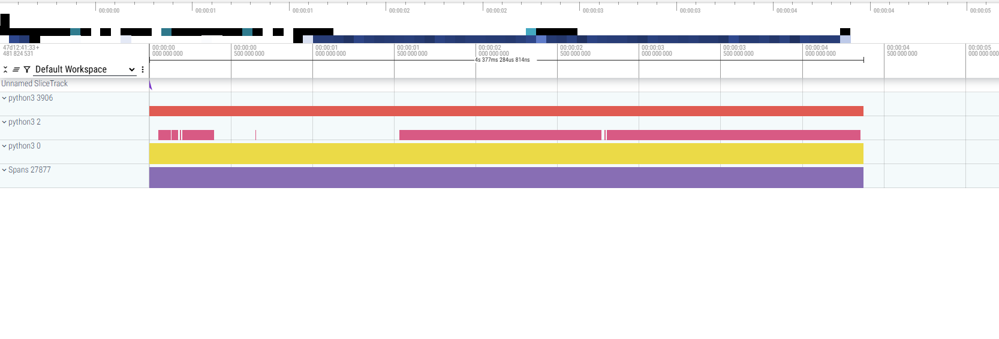
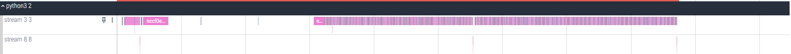
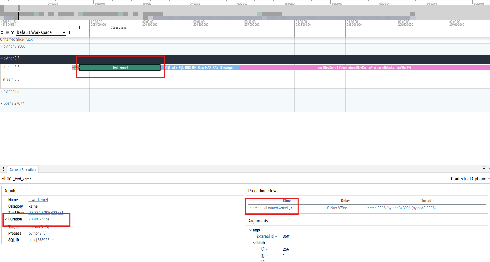
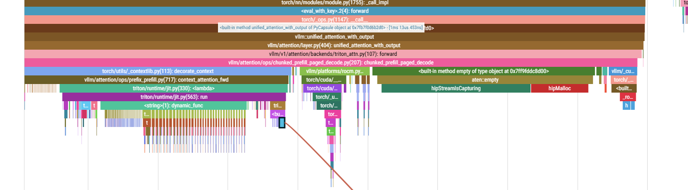
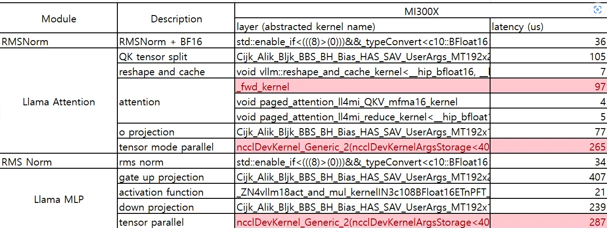

> 原文作者：Shekhar Pandey and Liz Li  
> [AMD 官方教程](https://rocm.docs.amd.com/projects/ai-developer-hub/en/latest/notebooks/gpu_dev_optimize/llama4_profiling_vllm.html) · [固定版本源码](https://github.com/ROCm/gpuaidev/blob/0071bfd4bd3bd9525405c09a6ae69c983b09312a/docs/notebooks/gpu_dev_optimize/llama4_profiling_vllm.ipynb)  
> 上游版本：`0071bfd4bd3bd9525405c09a6ae69c983b09312a` · 同步日期：2026-10-12  
> 翻译状态：机器初译，待逐篇人工校对；代码与命令保持原文，未在 AMD GPU 上运行验证。

<!-- cell:1 -->

<a id="profiling-llama-4-inference-with-vllm"></a>

# 使用 vLLM 分析 Llama-4 推理性能
**作者**：Shekhar Pandey and Liz Li
**知识水平**：中级

分析对于了解 大语言模型 推理 管道中的性能瓶颈至关重要。本教程将引导您完成在具有 ROCm 的 AMD GPU 上使用 vLLM 框架对 **Llama-4 Scout-17B-16E-Instruct** 模型进行分析的过程。您将捕获详细的内核跟踪，然后使用 Perfetto 将其可视化。

<a id="prerequisites"></a>

## 前置条件
在开始本教程之前，请确保您具备以下条件：

- 访问门控 **Llama-4 Scout-17B-16E-Instruct** 模型
- 访问 **Perfetto UI** 

<a id="hardware"></a>

### 硬件

* **AMD GPU**：确保您使用的是 AMD GPU，例如 Instinct™ MI300X 或 Radeon Pro W7900，支持 ROCm，并且您的系统满足[官方要求](https://rocm.docs.amd.com/projects/install-on-linux/en/latest/reference/system-requirements.html)。

<a id="software"></a>

### 软件

* **ROCm 6.3、6.4**：按照 [ROCm 安装指南](https://rocm.docs.amd.com/projects/install-on-linux/en/latest/install/quick-start.html) 安装并验证 ROCm。通过运行以下命令验证您的 ROCm 安装：

   ``` bash
   amd-smi
   ```
   
   此命令列出了您的 AMD GPU 以及相关详细信息。
   
   **注意**：对于 ROCm 6.4 及更早版本，请改用 `rocm-smi` 命令。

* **Docker**：确保 Docker 已正确安装和配置。更多信息请参见[Docker安装指南](https://docs.docker.com/get-docker/)。

<a id="prepare-the-training-environment"></a>

## 准备训练环境

请按照以下步骤配置您的教程环境：

<a id="1-pull-the-docker-image"></a>

### 1. 拉取 Docker 镜像

确保您的系统满足[系统要求](https://rocm.docs.amd.com/projects/install-on-linux/en/latest/reference/system-requirements.html)。

拉取本教程所需的 Docker 映像：

``` bash
docker pull rocm/vllm-dev:main
```

<a id="2-launch-the-docker-container"></a>

### 2.启动Docker容器

在服务器上的终端中启动 Docker 容器并映射必要的目录。

``` bash
docker run -it --rm \
  --network=host \
  --device=/dev/kfd \
  --device=/dev/dri \
  --group-add=video \
  --ipc=host \
  --cap-add=SYS_PTRACE \
  --security-opt seccomp=unconfined \
  --shm-size 8G \
  -v $(pwd):/workspace \
  -w /workspace/notebooks \
  rocm/vllm:latest
```

**注意**：该命令将当前目录挂载到容器中的`/workspace`目录中。确保在运行 Docker 命令之前将Notebook文件复制到此目录，或者在启动后上传到 Jupyter Notebook 环境。保存终端输出中提供的令牌或 URL，以便从 Web 浏览器访问Notebook。您可以从 [AI Developer Hub GitHub 存储库](https://github.com/ROCm/gpuaidev) 下载此Notebook。

<a id="3-install-and-launch-jupyter"></a>

### 3.安装并启动 Jupyter

在 Docker 容器内，使用以下命令安装 Jupyter：

``` bash
pip install jupyter
```

启动 Jupyter 服务器：

``` bash
jupyter-lab --ip=0.0.0.0 --port=8888 --no-browser --allow-root
```

<details markdown="1">
<summary>查看英文原文 · 单元 1</summary>

# Profiling Llama-4 inference with vLLM

**Authors**: Shekhar Pandey and Liz Li  
**Knowledge level**: Intermediate

Profiling is essential for understanding the performance bottlenecks in large language model inference pipelines. This tutorial walks you through the process of profiling the **Llama-4 Scout-17B-16E-Instruct** model using the vLLM framework on AMD GPUs with ROCm. You'll capture detailed kernel traces and later visualize them using Perfetto.

## Prerequisites
Before starting this tutorial, ensure you have the following:

- Access to the gated **Llama-4 Scout-17B-16E-Instruct** model
- Access to **Perfetto UI** 

### Hardware

* **AMD GPUs**: Ensure you are using an AMD GPU, such as the Instinct™ MI300X or Radeon Pro W7900, with ROCm support and that your system meets the [official requirements](https://rocm.docs.amd.com/projects/install-on-linux/en/latest/reference/system-requirements.html).

### Software

* **ROCm 6.3, 6.4**: Install and verify ROCm by following the [ROCm install guide](https://rocm.docs.amd.com/projects/install-on-linux/en/latest/install/quick-start.html). Verify your ROCm installation by running this command:

   ``` bash
   amd-smi
   ```
   
   This command lists your AMD GPUs with relevant details.
   
   **Note**: For ROCm 6.4 and earlier, use the `rocm-smi` command instead.

* **Docker**: Ensure Docker is installed and configured correctly. See the [Docker installation guide](https://docs.docker.com/get-docker/) for more information.

## Prepare the training environment

Follow these steps to configure your tutorial environment:

### 1. Pull the Docker image

Ensure your system meets the [system requirements](https://rocm.docs.amd.com/projects/install-on-linux/en/latest/reference/system-requirements.html).

Pull the Docker image required for this tutorial:

``` bash
docker pull rocm/vllm-dev:main
```

### 2. Launch the Docker container

Launch the Docker container in a terminal on your server and map the necessary directories.

``` bash
docker run -it --rm \
  --network=host \
  --device=/dev/kfd \
  --device=/dev/dri \
  --group-add=video \
  --ipc=host \
  --cap-add=SYS_PTRACE \
  --security-opt seccomp=unconfined \
  --shm-size 8G \
  -v $(pwd):/workspace \
  -w /workspace/notebooks \
  rocm/vllm:latest
```

**Note**: This command mounts the current directory to the `/workspace` directory in the container. Ensure the notebook file is either copied to this directory before running the Docker command or uploaded into the Jupyter Notebook environment after it starts. Save the token or URL provided in the terminal output to access the notebook from your web browser. You can download this notebook from the [AI Developer Hub GitHub repository](https://github.com/ROCm/gpuaidev).

### 3. Install and launch Jupyter

Inside the Docker container, install Jupyter using the following command:

``` bash
pip install jupyter
```

Start the Jupyter server:

``` bash
jupyter-lab --ip=0.0.0.0 --port=8888 --no-browser --allow-root
```

</details>

<!-- cell:2 -->

<a id="step-by-step-process"></a>

## 分步过程

按照以下步骤分析 Llama-4 模型并捕获内核跟踪。

<details markdown="1">
<summary>查看英文原文 · 单元 2</summary>

## Step-by-step process

Follow these steps to profile the Llama-4 model and capture the kernel traces.

</details>

<!-- cell:3 -->

<a id="step-1-logging-in-to-hugging-face"></a>

### 步骤一：登录Hugging Face
提供您的拥抱令牌

您需要 Hugging Face API 令牌才能访问 Llama-4。在 [Hugging Face Tokens](https://huggingface.co/settings/tokens) 生成您的令牌并请求访问 [Llama-4-Scout 17B-16E-Instruct](https://huggingface.co/meta-llama/Llama-4-Scout-17B-16E-Instruct)。令牌通常以“hf_”开头。 

在 Jupyter Notebook中运行以下交互式块来设置令牌：

**注意**：取消选中“添加令牌作为 Git 凭证”选项。

<details markdown="1">
<summary>查看英文原文 · 单元 3</summary>

### Step 1: Logging in to Hugging Face
Provide your Hugging Face token

You'll require a Hugging Face API token to access Llama-4. Generate your token at [Hugging Face Tokens](https://huggingface.co/settings/tokens) and request access for [Llama-4-Scout 17B-16E-Instruct](https://huggingface.co/meta-llama/Llama-4-Scout-17B-16E-Instruct). Tokens typically start with "hf_". 

Run the following interactive block in your Jupyter notebook to set up the token:

**Note**: Uncheck the "Add token as Git credential" option.

</details>

```python
from huggingface_hub import notebook_login, HfApi

# Prompt the user to log in
notebook_login()
```

<!-- cell:5 -->

验证您的令牌是否被正确接受：

<details markdown="1">
<summary>查看英文原文 · 单元 5</summary>

Verify that your token was accepted correctly:

</details>

```python
from huggingface_hub import HfApi

try:
    api = HfApi()
    user_info = api.whoami()
    print(f"Token validated successfully! Logged in as: {user_info['name']}")
except Exception as e:
    print(f"Token validation failed. Error: {e}")
```

<!-- cell:7 -->

<a id="step-2-start-the-vllm-server-with-a-profiler-configuration"></a>

### 步骤 2：使用分析器配置启动 vLLM 服务器
在 JupyterLab 会话中打开一个新的终端选项卡。
在这个新终端中，运行以下命令。保持终端打开。

``` bash
mkdir -p /profile
export VLLM_TORCH_PROFILER_DIR=/profile

<a id="start-the-vllm-server-with-standard-configs"></a>

# Start the vLLM server with standard configs
RCCL_MSCCL_ENABLE=0 \
VLLM_USE_V1=1 \
VLLM_WORKER_MULTIPROC_METHOD=spawn \
VLLM_USE_MODELSCOPE=False \
VLLM_USE_TRITON_FLASH_ATTN=0 \
vllm serve meta-llama/Llama-4-Scout-17B-16E-Instruct \
    --disable-log-requests \
    -tp 8 \
    --max-num-seqs 64 \
    --no-enable-prefix-caching \
    --max_num_batched_tokens=320000 \
    --max-model-len 32000
```

<details markdown="1">
<summary>查看英文原文 · 单元 7</summary>

### Step 2: Start the vLLM server with a profiler configuration
Open a new terminal tab inside your JupyterLab session.
In this new terminal, run the following commands. Keep the terminal open.

``` bash
mkdir -p /profile
export VLLM_TORCH_PROFILER_DIR=/profile

# Start the vLLM server with standard configs
RCCL_MSCCL_ENABLE=0 \
VLLM_USE_V1=1 \
VLLM_WORKER_MULTIPROC_METHOD=spawn \
VLLM_USE_MODELSCOPE=False \
VLLM_USE_TRITON_FLASH_ATTN=0 \
vllm serve meta-llama/Llama-4-Scout-17B-16E-Instruct \
    --disable-log-requests \
    -tp 8 \
    --max-num-seqs 64 \
    --no-enable-prefix-caching \
    --max_num_batched_tokens=320000 \
    --max-model-len 32000
```

</details>

<!-- cell:8 -->

<a id="step-3-run-the-benchmark-and-capture-the-trace"></a>

### 步骤 3：运行基准测试并捕获跟踪

在服务器运行时，触发综合基准测试请求以生成流量并收集分析数据：

<details markdown="1">
<summary>查看英文原文 · 单元 8</summary>

### Step 3: Run the benchmark and capture the trace

With the server running, trigger a synthetic benchmark request to generate traffic and collect the profiling data:

</details>

```python
!vllm bench serve \
    --model meta-llama/Llama-4-Scout-17B-16E-Instruct \
    --dataset-name random \
    --random-input-len 2000 \
    --random-output-len 10 \
    --max-concurrency 64 \
    --num-prompts 64 \
    --ignore-eos \
    --percentile_metrics ttft,tpot,itl,e2el \
    --profile
```

<!-- cell:10 -->

确保添加 `--profile` 标志，该标志会在基准测试开始之前启动探查器，然后在基准测试开始后停止并生成跟踪。

**注意：** 上述单元执行完成后，按 **Ctrl-C** 停止您在另一个终端中启动的 vLLM 服务器。

<details markdown="1">
<summary>查看英文原文 · 单元 10</summary>

Ensure you add the `--profile` flag, which starts the profiler before the benchmark starts and then stops it afterwards and generates the trace.

**NOTE:** After the execution of the cell above completes, stop the vLLM server you started in the other terminal by pressing **Ctrl-C**.

</details>

<!-- cell:11 -->

<a id="step-4--visualize-the-trace-using-perfetto-ui"></a>

### 第 4 步：使用 Perfetto UI 可视化跟踪数据

生成跟踪文件后，先将它解压。跟踪数据以 JSON 格式保存。可以使用 [Perfetto UI](https://ui.perfetto.dev/) 查看数据；它是一款面向大规模性能分析数据的强大跟踪查看器，有助于发现推理流水线中的延迟瓶颈、CPU 与 GPU 的执行重叠，以及内核层面的低效操作。按以下步骤打开跟踪文件：

1. 打开 [https://ui.perfetto.dev](https://ui.perfetto.dev/)。
2. 单击 **“Open trace file”**。
3. 上传 `.json` 文件。

打开后，界面大致如下：



<a id="understanding-the-prefill-and-decode-timelines"></a>

#### 理解预填充与解码时间线

放大跟踪视图，观察各个时间片如何反映 Llama-4 的执行阶段。下面是 Perfetto 中两个重要进程时间线的局部视图。

**注意：**本节主要关注前两条轨道：`python3 3906` 和 `python3 2`。

- `python3 3906`：异步 CPU 调用

  `python3 3906` 下方的**橙色时间片**表示 CPU 上高层模型代码的执行，其中包括：

  - `execute_model`、`forward` 和 `hipMemcpyWithStream` 等调用。
  - `aten::to` 和 `aten::copy_` 等 PyTorch 内部操作。
  - `Llama4ForCausalLM` 的实际前向传播和内存传输。

  该时间片反映了 CPU 对推理过程的组织与调度，从准备输入到将内核派发到 GPU。

- `python3 2`：GPU 内核时间线

  `python3 2` 下方的**粉色时间片**展示 GPU 内核的执行，表示 CPU 将任务加入队列后，GPU 实际完成的计算工作。

  这里有两个关键观察：

  - 两组密集的内核执行之间存在明显间隔。
  - 这个间隔将执行分为两个阶段：
    - **间隔之前**是“预填充”阶段：编码初始提示词，并填充注意力与缓存状态。
    - **间隔之后**是“解码”阶段：模型生成 Token，通常复用已经缓存的键值张量。

<a id="understanding-kernel-timelines"></a>

#### 理解内核时间线

在 Perfetto 中展开 `python3 2` 时间线，会看到两条不同的 GPU 流，分别对应设备上不同类型的操作。



**注意：**这个放大视图有助于区分计算内核和通信操作。

- 流 `3 3`：所有 GPU 内核

  流 `3 3` 是**主要计算流**，所有 GPU 内核的执行都在这里调度，包括：

  - `MatMul` 和 GEMM 操作。
  - 融合的 MLP 与注意力模块。
  - 位置编码与 LayerNorm。
  - 各种融合内核或逐元素内核。

  这条流上的内核十分密集，承载了模型的大部分推理活动。内核的执行节奏与间隔有助于诊断：

  - 张量并行各 rank 之间的负载是否均衡。
  - 内核启动之间的空隙。
  - 预填充与解码阶段的区别，可根据间隔前后的内核密度判断。

- 流 `3 8`：AllGather 内核

  流 `3 8` 专门执行 **AllGather** 操作，它们属于张量并行的通信过程。这些内核：

  - 在多 GPU 配置中同步设备之间的激活值。
  - 通常出现在层与层之间。
  - 在 `tp=8` 配置中至关重要，用于同步八个分片的局部输出。

<a id="step-5-zoom-in-to-analyze-the-attention-forward-kernel"></a>

### 第 5 步：放大视图，分析注意力前向内核

注意力是所有 Transformer 语言模型的核心，Llama-4 也不例外。分析它的**注意力前向内核**能够帮助我们深入了解计算效率。下面深入跟踪视图，在内核层面检查执行情况。

<a id="zoom-into-the-kernel-timeline"></a>

#### 放大内核时间线

- 在 Perfetto UI 中先找到 `python3 2`，再找到 `stream 3 3`。
- 用鼠标滚轮或拖动操作，放大一组密集的内核。
- 将鼠标悬停在一个显眼的内核上，应当能看到 `_fwd_kernel` 这样的标签。

下面是跟踪视图中的一个示例：



<a id="understanding-the-kernel-slice"></a>

#### 理解内核时间片

在跟踪视图下方的**详细信息**面板中，可以读取以下字段：

| 字段 | 值 |
| --- | --- |
| **名称** | `_fwd_kernel` |
| **类别** | `kernel` |
| **流** | `stream 3 (3)` |
| **进程** | `python3 (2)` |
| **持续时间** | `788µs 256ns` |
| **启动延迟** | 距 CPU 调用约 `~819µs` |

这个内核属于**多头注意力前向传播**，是推理中计算量最大的操作之一。

<a id="tracing-back-to-the-cpu"></a>

#### 回溯到 CPU

在内核详细信息中的前序流附近，可以找到 `hipModuleLaunchKernel`。

单击它可跳回发起该内核启动的 CPU 线程 `python3 3906`，如下图的蓝色部分所示。这个功能特别适合：

- 将 GPU 操作映射回 Python 或 C++ 调用栈。
- 找出派发或同步环节的瓶颈。
- 了解 CPU 将任务加入 GPU 队列所需的时间。



按照以上过程，可以追踪各内核在预填充和解码阶段分别耗费的时间。下图给出了某个内核的简要统计。



<a id="step-6-programmatic-analysis-and-extracting-the-gpu-kernel-timeline-with-python"></a>

### 第 6 步：使用 Python 进行程序化分析并提取 GPU 内核时间线

除了目视检查，还可以通过程序解析跟踪数据，列出全部 GPU 内核及其持续时间。这种方法有助于追踪：

- 内核启动模式。
- 持续时间的突增。
- 执行中的空隙或异常。

下面是一段简短的 Python 脚本，它读取 `trace.json` 文件，并按开始时间列出所有 GPU 内核：

<details markdown="1">
<summary>查看英文原文 · 单元 11</summary>

### Step 4 : Visualize the trace using Perfetto UI

After the trace is generated, unzip it. The trace is saved in the JSON format. To visualize it, use [Perfetto UI](https://ui.perfetto.dev/), a powerful trace viewer built for large-scale profiling data. This helps uncover latency bottlenecks, CPU–GPU overlap, and kernel-level inefficiencies in your inference pipeline. To visualize the trace, follow these steps:

1. Go to [https://ui.perfetto.dev](https://ui.perfetto.dev/).
2. Click **"Open trace file"**.
3. Upload the `.json` file.

After you open the trace, it will look somewhat like this:


#### Understanding the prefill and decode timelines

Now zoom into the trace to interpret what each slice reveals about the Llama-4 execution stages. Here's a close-up of two important process timelines captured in Perfetto:

**Note:** The focus of this section is on the first two tracks: `python3 3906` and `python3 2`.


-  `python3 3906`: Asynchronous CPU calls

   The **orange slice** under `python3 3906` shows the execution of high-level model code on the CPU. It includes:

   - Calls like `execute_model`, `forward`, and `hipMemcpyWithStream`
   - PyTorch internals such as `aten::to` and `aten::copy_`
   - The actual forward pass for `Llama4ForCausalLM` and memory transfers

   This slice reflects the CPU-side orchestration of inference, from input preparation to dispatching kernels to the GPU.


-  `python3 2`: GPU kernel timeline

   The **pink slice** under `python3 2` is where GPU kernel execution is visualized. This slice represents actual compute work being done by the GPU after the CPU enqueues the tasks.

   Here’s the key insight:

   -  There is a clear gap between two bursts of kernel execution.
   -  This gap separates two distinct phases:
      - **Before the gap**: This is the "prefill" stage, where the initial prompt is encoded, and attention and cache states are populated.
      - **After the gap**: This is the "decode" stage, where the model generates tokens, typically using cached key/value tensors.

#### Understanding kernel timelines

When you expand the `python3 2` timeline in Perfetto, you’ll see two distinct GPU streams representing different types of operations executed on the device:


**Note:** This zoomed-in view helps you distinguish between computation kernels and communication operations.

-  Stream `3 3`: All GPU kernels

   Stream `3 3` is the **primary compute stream**, where all GPU kernel executions are scheduled. This includes:
   - `MatMul` and GEMM operations
   - Fused MLP and attention blocks
   - Positional encodings and LayerNorms
   - Any fused or element-wise kernels

   This stream is densely packed, showing the bulk of the model inference activities The rhythm and spacing of these kernels help diagnose things like:

   - Load balancing across tensor parallel ranks
   - Gaps between kernel launches
   - Prefill versus decode phases (based on the density before and after the gaps)


-  Stream `3 8`: AllGather kernels

   Stream `3 8` is used specifically for **AllGather** operations, which are part of the tensor parallel communication process. These kernels:

   - Synchronize activations across devices in multi-GPU setups
   - Typically occur between layer boundaries
   - Are crucial in `tp=8` setups for syncing partial outputs across eight shards

### Step 5: Zoom in to analyze the attention forward kernel

Attention is at the heart of all Transformer-based language models and Llama-4 is no exception. Profiling its **attention forward kernel** gives us critical insights into its computational efficiency. Dive into the trace to inspect it at the kernel level.

#### Zoom into the kernel timeline

- Navigate to `python3 2` and then to `stream 3 3` in the Perfetto UI.
- Scroll with the mouse or drag to zoom into a cluster of dense kernels.
- Hover over one of the prominent kernels. You should see a label like `_fwd_kernel`.

Here’s an example image from the trace:


#### Understanding the kernel slice

From the **details** panel below the trace view, you can extract the following:

| Field | Value |
| --- | --- |
| **Name** | `_fwd_kernel` |
| **Category** | `kernel` |
| **Stream** | `stream 3 (3)` |
| **Process** | `python3 (2)` |
| **Duration** | `788µs 256ns` |
| **Launch delay** | `~819µs` from the CPU call |

This kernel is part of the **multi-head attention forward pass**, one of the most compute-heavy operations in inference.


#### Tracing back to the CPU

Inside the kernel details, near the preceding flows, you’ll find `hipModuleLaunchKernel`.

Click this to jump back to the CPU thread (`python3 3906`), shown in blue in the image below, which issued this kernel launch. This feature is incredibly useful for:

- Mapping GPU operations to their Python or C++ call stack
- Identifying bottlenecks in dispatch or synchronization
- Understanding how long the CPU takes to enqueue work on the GPU


Following the process above, you can track how much time each kernel takes in both the prefill and decode stage. A short summary for one kernel is shown in the chart below.


### Step 6: Programmatic analysis and extracting the GPU kernel timeline with Python

To go beyond visual inspection, you can also parse the trace programmatically to list all GPU kernels and their durations. This is helpful when you're tracking:

- Kernel launch patterns
- Duration spikes
- Gaps or anomalies in execution

Here’s a minimal Python script that reads the `trace.json` file and lists all GPU kernels sorted by start time:

</details>

<!-- cell:12 -->

将 `.gz` 跟踪文件解压缩为 `trace.json`。

<details markdown="1">
<summary>查看英文原文 · 单元 12</summary>

Decompress the `.gz` trace file into `trace.json`.

</details>

```python
!gunzip -c /profile/$(ls /profile | head -n 1) > trace.json
```

<!-- cell:14 -->

运行下面的单元，其中列出了按启动时间排序的所有 GPU 内核。

<details markdown="1">
<summary>查看英文原文 · 单元 14</summary>

Run the cell below, which lists all GPU kernels sorted by start time.

</details>

```python

import json

# Load the trace
with open("trace.json", "r") as f:
    trace = json.load(f)

gpu_kernels = []

# Extract GPU kernel events
for event in trace["traceEvents"]:
    if event.get("ph") != "X":
        continue

    cat = event.get("cat", "").lower()
    name = event.get("name", "")
    start_time = event["ts"]
    duration = event.get("dur", 0)

    if "cuda" in cat or "kernel" in cat:
        gpu_kernels.append({
            "name": name,
            "start": start_time,
            "duration": duration
        })

# Print all GPU kernels with their durations
print(f"{'GPU Kernel':<60} {'Start (us)':<15} {'Duration (us)':<15}")
print("-" * 90)
for k in sorted(gpu_kernels, key=lambda x: x["start"]):
    print(f"{k['name']:<60} {k['start']:<15} {k['duration']:<15}")
```

<!-- cell:16 -->

<a id="conclusion"></a>

## 结论

在本教程中，您演练了使用 vLLM 在 AMD GPU 上分析 Llama-4 推理 的端到端过程，包括：

- 使用 ROCm 和 vLLM 设置容器
- 启用并捕获详细的性能跟踪
- 使用 [Perfetto](https://ui.perfetto.dev/) 可视化 CPU-GPU 交互
- 放大注意力块的内核级活动
- 使用Python以编程方式分析跟踪日志

<details markdown="1">
<summary>查看英文原文 · 单元 16</summary>

## Conclusion

In this tutorial, you walked through the end-to-end process of profiling Llama-4 inference on AMD GPUs using vLLM, including:

- Setting up the container with ROCm and vLLM
- Enabling and capturing detailed performance traces
- Visualizing CPU-GPU interactions with [Perfetto](https://ui.perfetto.dev/)
- Zooming into kernel-level activity for attention blocks
- Programmatically analyzing trace logs using Python

</details>
