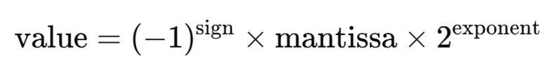

> 原文作者：Charles Yang  
> [AMD 官方教程](https://rocm.docs.amd.com/projects/ai-developer-hub/en/latest/notebooks/gpu_dev_optimize/mxfp4_quantization_quark_vllm.html) · [固定版本源码](https://github.com/ROCm/gpuaidev/blob/0071bfd4bd3bd9525405c09a6ae69c983b09312a/docs/notebooks/gpu_dev_optimize/mxfp4_quantization_quark_vllm.ipynb)  
> 上游版本：`0071bfd4bd3bd9525405c09a6ae69c983b09312a` · 同步日期：2026-10-12  
> 翻译状态：机器初译，待逐篇人工校对；代码与命令保持原文，未在 AMD GPU 上运行验证。

<!-- cell:1 -->

<a id="accelerating-llama33-70b-with-quark-mxfp4-quantization-for-vllm"></a>

# 使用 Quark MXFP4 量化运行 vLLM
**作者**：Charles Yang
**知识水平**：初学者

本教程介绍如何对 量化 使用 MXFP4（微缩放浮点 4）数据类型。

AMD [Quark](https://quark.docs.amd.com/latest/) 是一个灵活而强大的 量化 工具包，可以生成在 AMD GPU 上运行的高性能量化模型。 Quark 专门支持量化具有权重、激活和 kv 缓存 量化 的大型语言模型，以及 AWQ、GPTQ、Rotation 和 SmoothQuant 等尖端 量化 算法。

MXFP4 是一种低位表示格式，用于通过在值块之间共享缩放因子来压缩神经网络中的权重或激活。
具体来说，对于每个包含 32 个值的块（例如，`float32` 权重），
每个值都使用四位表示。它通常采用以下格式进行编码：

* 1位：符号
* 2位：指数
* 1 位：尾数



每块 32 个值存储一个共享的 8 位比例因子。
比例尺是块级共享的二次幂因子，用于近似原始浮点值。

本教程将指导您设置 Quark、将 LLM 模型量化为 MXFP4，以及使用 [ROCm](https://rocm.docs.amd.com/en/latest/index.html) 软件堆栈在 AMD Instinct™ GPU 上运行 MXFP4 模型。了解如何配置 Quark 参数以实现不同的模型精度，并使用不同的 量化 算法验证性能。

<details markdown="1">
<summary>查看英文原文 · 单元 1</summary>

# Accelerating Llama3.3-70B with Quark MXFP4 quantization for vLLM 

**Author**: Charles Yang  
**Knowledge level**: Beginner

This tutorial explains how to use MXFP4 (Microscaling Floating Point 4) data types for quantization.

AMD [Quark](https://quark.docs.amd.com/latest/) is a flexible and powerful quantization toolkit, which can produce performant quantized models to run on AMD GPUs. Quark has specialized support for quantizing large language models with weight, activation and kv-cache quantization, and cutting-edge quantization algorithms like AWQ, GPTQ, Rotation, and SmoothQuant.

MXFP4 is a low-bit representation format used to compress weights or activations in neural networks by sharing a scaling factor across a block of values.
Specifically, for every block of 32 values (for example, `float32` weights),
each value is represented using four bits. It's typically encoded in the following format:

*  1 bit: sign
*  2 bits: exponent
*  1 bit: mantissa


One shared 8-bit scale factor is stored per block of 32 values.
The scale is a block-level shared power-of-two factor, which is used to approximate the original float values.

This tutorial guides you through setting up Quark, quantizing LLM models to MXFP4, and running the MXFP4 model on AMD Instinct™ GPUs using the [ROCm](https://rocm.docs.amd.com/en/latest/index.html) software stack. Learn how to configure Quark parameters to achieve different model precisions and verify the performance with different quantization algorithms.

</details>

<!-- cell:2 -->

<a id="prerequisites"></a>

## 前置条件

本教程是使用以下设置进行开发和测试的。 

<a id="operating-system"></a>

### 操作系统

* **Ubuntu 24.04**：确保您的系统运行的是 Ubuntu 版本 24.04。

<a id="hardware"></a>

### 硬件

* **AMD Instinct™ MI355 GPU**：本教程需要 AMD Instinct MI355X GPU，它为 MXFP4 量化 格式提供本机支持，并确保最佳兼容性和性能。

<a id="software"></a>

### 软件

* **ROCm 7.0**：按照 [ROCm 安装指南](https://rocm.docs.amd.com/projects/install-on-linux/en/latest/install/quick-start.html) 安装并验证 ROCm。安装后，使用以下命令确认您的设置：

    ``` bash
    amd-smi
    ```

    此命令列出了您的 AMD GPU 以及相关详细信息。
    
    **注意**：对于 ROCm 6.4 及更早版本，请改用 `rocm-smi` 命令。

* **Docker**：确保 Docker 已正确安装和配置。请遵循适用于您的操作系统的 Docker 安装指南。

   **注意**：确保正确配置 Docker 权限。要配置权限以允许非 root 访问，请运行以下命令：

   ``` bash
   sudo usermod -aG docker $USER
   newgrp docker
   ```

   验证 Docker 是否正常工作：

   ``` bash
   docker run hello-world
   ```

<a id="hugging-face-api-access"></a>

### Hugging Face API 访问

* 从[Hugging Face](https://huggingface.co)获取API令牌用于下载模型。
* 确保 Hugging Face API 令牌具有访问 [Meta Llama 检查点](https://huggingface.co/meta-llama/Llama-3.3-70B-Instruct) 所需的权限和批准。

<details markdown="1">
<summary>查看英文原文 · 单元 2</summary>

## Prerequisites

This tutorial was developed and tested using the following setup. 

### Operating system

* **Ubuntu 24.04**: Ensure your system is running Ubuntu version 24.04.

### Hardware

* **AMD Instinct™ MI355 GPU**: This tutorial requires an AMD Instinct MI355X GPU, which provides native support for the MXFP4 quantization format and ensures optimal compatibility and performance.

### Software

* **ROCm 7.0**: Install and verify ROCm by following the [ROCm install guide](https://rocm.docs.amd.com/projects/install-on-linux/en/latest/install/quick-start.html). After installation, confirm your setup using:

    ``` bash
    amd-smi
    ```

    This command lists your AMD GPUs with relevant details.
    
    **Note**: For ROCm 6.4 and earlier, use the `rocm-smi` command instead.

* **Docker**: Ensure Docker is installed and configured correctly. Follow the Docker installation guide for your operating system.

   **Note**: Ensure the Docker permissions are correctly configured. To configure permissions to allow non-root access, run the following commands:

   ``` bash
   sudo usermod -aG docker $USER
   newgrp docker
   ```

   Verify Docker is working correctly with:

   ``` bash
   docker run hello-world
   ```

### Hugging Face API access

* Obtain an API token from [Hugging Face](https://huggingface.co) for downloading models.
* Ensure the Hugging Face API token has the necessary permissions and approval to access the [Meta Llama checkpoints](https://huggingface.co/meta-llama/Llama-3.3-70B-Instruct).

</details>

<!-- cell:3 -->

<a id="env-setup"></a>

<a id="environment-setup-with-docker-and-rocm"></a>

## 使用 Docker 和 ROCm 设置环境

按照以下步骤设置环境、启动 Jupyter Notebooks 并安装依赖项。

<a id="1-launch-the-docker-container"></a>

### 1.启动Docker容器

启动 Docker 容器。从您的主机运行以下命令：

``` bash
docker run -it --rm \
  --privileged \
  --network=host \
  --device=/dev/kfd \
  --device=/dev/dri \
  --group-add=video \
  --cap-add=SYS_PTRACE \
  --security-opt seccomp=unconfined \
  --shm-size 8G \
  -v $(pwd):/workspace \
  -w /workspace/notebooks \
  vllm/vllm-openai-rocm:v0.18.0 bash
```

**注意**：该命令将当前目录挂载到容器中的`/workspace`目录中。确保在运行 Docker 命令之前将Notebook文件复制到此目录，或者在启动后上传到 Jupyter Notebook 环境。保存终端输出中提供的令牌或 URL，以便从 Web 浏览器访问Notebook。您可以从 [AI Developer Hub GitHub 存储库](https://github.com/ROCm/gpuaidev) 下载此Notebook。

<a id="launch-jupyter"></a>

<a id="2-launch-jupyter-notebooks-in-the-container"></a>

### 2. 在容器中启动 Jupyter Notebooks

在 Docker 容器内，使用以下命令安装 Jupyter：

``` bash
pip install jupyter
```

启动 Jupyter 服务器：

``` bash
jupyter-lab --ip=0.0.0.0 --port=8888 --no-browser --allow-root
```

**注意**：在运行上述命令之前，请确保您的系统上尚未使用端口 `8888`。如果是，您可以通过将 `--port=8888` 替换为其他端口号来指定其他端口，例如 `--port=8890`。

<details markdown="1">
<summary>查看英文原文 · 单元 3</summary>

<a id="env-setup"></a>

## Environment setup with Docker and ROCm

Follow these steps to set up the environment, launch Jupyter Notebooks, and install the dependencies.

### 1. Launch the Docker container

Launch the Docker container. From your host machine, run this command:

``` bash
docker run -it --rm \
  --privileged \
  --network=host \
  --device=/dev/kfd \
  --device=/dev/dri \
  --group-add=video \
  --cap-add=SYS_PTRACE \
  --security-opt seccomp=unconfined \
  --shm-size 8G \
  -v $(pwd):/workspace \
  -w /workspace/notebooks \
  vllm/vllm-openai-rocm:v0.18.0 bash
```

**Note**: This command mounts the current directory to the `/workspace` directory in the container. Ensure the notebook file is either copied to this directory before running the Docker command or uploaded into the Jupyter Notebook environment after it starts. Save the token or URL provided in the terminal output to access the notebook from your web browser. You can download this notebook from the [AI Developer Hub GitHub repository](https://github.com/ROCm/gpuaidev).

<a id="launch-jupyter"></a>

### 2. Launch Jupyter Notebooks in the container

Inside the Docker container, install Jupyter using the following command:

``` bash
pip install jupyter
```

Start the Jupyter server:

``` bash
jupyter-lab --ip=0.0.0.0 --port=8888 --no-browser --allow-root
```

**Note**: Ensure port `8888` is not already in use on your system before running the above command. If it is, you can specify a different port by replacing `--port=8888` with another port number, for example, `--port=8890`.

</details>

<!-- cell:4 -->

<a id="install-deps"></a>

<a id="3-installing-dependencies"></a>

### 3.安装依赖项

接下来，安装 CMake 和 Quark。选择 PyTorch 的 CPU 轮，以便 Quark 可以在没有 GPU 的Notebook上运行。这种方法速度较慢，但​​适合尝试 Quark。从 PyPI 安装 Quark，它会引入所需的依赖项。

在 Docker 容器中运行的 Jupyter Notebook 中运行以下命令：

<details markdown="1">
<summary>查看英文原文 · 单元 4</summary>

<a id="install-deps"></a>

### 3. Installing dependencies

Next, install CMake and Quark. Select the CPU wheel of PyTorch so that Quark will run on laptops without GPUs. This approach is slower but is fine for trying out Quark. Install Quark from PyPI, which pulls in the required dependencies.

Run the following commands inside the Jupyter notebook running within the Docker container:

</details>

```python
%%bash
# Install basics
apt-get update
apt-get install -y unzip wget
pip install cmake jupyter ipython ipywidgets
pip install 'huggingface-hub<1.0' evaluate accelerate datasets pillow transformers zstandard lm-eval

# Download and unzip AMD Quark examples (config files and example scripts)
wget -O amd_quark-0.11.1.zip https://download.amd.com/opendownload/Quark/amd_quark-0.11.1.zip
unzip -o amd_quark-0.11.1.zip

# Install AMD Quark Python package from PyPI 
pip install amd-quark==0.11.1
```

<!-- cell:6 -->

<a id="4-provide-your-hugging-face-token"></a>

### 4. 提供您的拥抱令牌

您需要 Hugging Face API 令牌才能访问 Llama-3.3-70B。在 [Hugging Face Tokens](https://huggingface.co/settings/tokens) 生成您的令牌并请求访问 [Llama-3.3-70B-Instruct](https://huggingface.co/meta-llama/Llama-3.3-70B-Instruct)。令牌通常以“hf_”开头。

在 Jupyter Notebook中运行以下交互式块来设置令牌：

<details markdown="1">
<summary>查看英文原文 · 单元 6</summary>

### 4. Provide your Hugging Face token

You'll require a Hugging Face API token to access Llama-3.3-70B. Generate your token at [Hugging Face Tokens](https://huggingface.co/settings/tokens) and request access for [Llama-3.3-70B-Instruct](https://huggingface.co/meta-llama/Llama-3.3-70B-Instruct). Tokens typically start with "hf_".

Run the following interactive block in your Jupyter notebook to set up the token:

</details>

```python
from huggingface_hub import notebook_login, HfApi

# Prompt the user to log in
notebook_login()
```

<!-- cell:8 -->

验证您的令牌是否被正确接受：

<details markdown="1">
<summary>查看英文原文 · 单元 8</summary>

Verify that your token was accepted correctly:

</details>

```python
# Validate the token
try:
    api = HfApi()
    user_info = api.whoami()
    print(f"Token validated successfully! Logged in as: {user_info['name']}")
except Exception as e:
    print(f"Token validation failed. Error: {e}")
```

<!-- cell:10 -->

<a id="quantization-process"></a>

## 量化 流程

安装Quark后，请按照此示例学习如何使用Quark。
Quark 量化 流程由以下五个步骤组成，解释如下：

1. 加载模型。
2. 准备校准数据加载器。
3. 设置量化 配置。
4. 量化并导出模型。
5. 在 vLLM 中进行评估。

<details markdown="1">
<summary>查看英文原文 · 单元 10</summary>

## Quantization process

After installing Quark, follow this example to learn how to use Quark.
The Quark quantization process consists of the following five steps, as explained below:

1. Load the model.
2. Prepare the calibration dataloader.
3. Set the quantization configuration.
4. Quantize and export the model.
5. Evaluate in vLLM.

</details>

<!-- cell:11 -->

<a id="1-load-the-model"></a>

### 1.加载模型
Quark 使用 Transformer 来获取模型和分词器。

<details markdown="1">
<summary>查看英文原文 · 单元 11</summary>

### 1. Load the model
Quark uses Transformers to fetch the model and tokenizer.

</details>

```python
### Loading Model
from transformers import AutoTokenizer, AutoModelForCausalLM

MODEL_ID = "meta-llama/Llama-3.3-70B-Instruct"
MAX_SEQ_LEN = 512
GROUP_SIZE=32

model = AutoModelForCausalLM.from_pretrained(
    MODEL_ID, device_map="auto", torch_dtype="auto",
)
model.eval()

tokenizer = AutoTokenizer.from_pretrained(MODEL_ID, model_max_length=MAX_SEQ_LEN)
tokenizer.pad_token = tokenizer.eos_token
```

<!-- cell:13 -->

<a id="2-prepare-the-calibration-dataloader"></a>

### 2. 准备校准数据加载器
Quark 使用 PyTorch DataLoader 加载校准数据。更多如何高效使用标定数据集的详细信息，请参见[添加标定数据集](https://quark.docs.amd.com/latest/pytorch/calibration_datasets.html)。

<details markdown="1">
<summary>查看英文原文 · 单元 13</summary>

### 2. Prepare the calibration dataloader
Quark uses the PyTorch DataLoader to load calibration data. For more details about how to use calibration datasets efficiently, see [Adding Calibration Datasets](https://quark.docs.amd.com/latest/pytorch/calibration_datasets.html).

</details>

```python
### Dataset
from datasets import load_dataset
from torch.utils.data import DataLoader

BATCH_SIZE = 1
NUM_CALIBRATION_DATA = 512

# Load the dataset and get calibration data.
dataset = load_dataset("mit-han-lab/pile-val-backup", split="validation")
text_data = dataset["text"][:NUM_CALIBRATION_DATA]

tokenized_outputs = tokenizer(text_data, return_tensors="pt",
    padding=True, truncation=True, max_length=MAX_SEQ_LEN)
calib_dataloader = DataLoader(tokenized_outputs['input_ids'],
    batch_size=BATCH_SIZE, drop_last=True)
```

<!-- cell:15 -->

<a id="3-set-the-quantization-configuration"></a>

### 3.设置量化配置

下一步是设置 量化 配置。更多详情请参见[Quark配置指南](https://quark.docs.amd.com/latest/pytorch/basic_usage_pytorch.html)。此示例在权重、激活和 kv 缓存上使用 `FP8` 每张量 量化，而 量化 算法是 AutoSmoothQuant。

<details markdown="1">
<summary>查看英文原文 · 单元 15</summary>

### 3. Set the quantization configuration

The next step is to set the quantization configuration. See the [Quark configuration guide](https://quark.docs.amd.com/latest/pytorch/basic_usage_pytorch.html) for more details. This example uses `FP8` per-tensor quantization on weight, activation, and kv-cache, while the quantization algorithm is AutoSmoothQuant.

</details>

```python
### Quant Configuration
def FP4_PER_GROUP_SYM_SPEC(group_size, scale_format="e8m0", scale_calculation_mode="even", is_dynamic=True):
    return FP4PerGroupSpec(ch_axis=-1,
                           group_size=group_size,
                           scale_format=scale_format,
                           scale_calculation_mode=scale_calculation_mode,
                           is_dynamic=is_dynamic).to_quantization_spec()

from quark.torch.quantization import (Config, QuantizationConfig,
                                     FP4PerGroupSpec,
                                     OCP_MXFP4Spec,
                                     FP8E4M3PerTensorSpec,
                                     load_quant_algo_config_from_file)

# Define kv-cache fp8/per-tensor/static spec.
FP8_PER_TENSOR_SPEC = FP8E4M3PerTensorSpec(observer_method="min_max",
    is_dynamic=False).to_quantization_spec()

# Define global quantization config, input tensors and weight apply FP4_PER_GROUP_SYM_SPEC.
global_quant_config = QuantizationConfig(input_tensors=FP4_PER_GROUP_SYM_SPEC(GROUP_SIZE, "e8m0", "even", True), \
        weight=FP4_PER_GROUP_SYM_SPEC(GROUP_SIZE, "e8m0", "even", False))

# Define quantization config for kv-cache layers, output tensors apply FP8_PER_TENSOR_SPEC.
KV_CACHE_SPEC = FP8_PER_TENSOR_SPEC
kv_cache_layer_names_for_llama = ["*k_proj", "*v_proj"]
kv_cache_quant_config = {name :
    QuantizationConfig(input_tensors=global_quant_config.input_tensors,
                       weight=global_quant_config.weight,
                       output_tensors=KV_CACHE_SPEC)
    for name in kv_cache_layer_names_for_llama}
layer_quant_config = kv_cache_quant_config.copy()

# Define algorithm config by config file.
LLAMA_AUTOSMOOTHQUANT_CONFIG_FILE = './amd_quark-0.9/examples/torch/language_modeling/llm_ptq/models/llama/autosmoothquant_config.json'
algo_config = load_quant_algo_config_from_file(LLAMA_AUTOSMOOTHQUANT_CONFIG_FILE)

EXCLUDE_LAYERS = ["lm_head"]
quant_config = Config(
    global_quant_config=global_quant_config,
    layer_quant_config=layer_quant_config,
    kv_cache_quant_config=kv_cache_quant_config,
    exclude=EXCLUDE_LAYERS,
    algo_config=algo_config)
```

<!-- cell:17 -->

<a id="4-quantize-the-model"></a>

### 4. 量化模型
接下来，应用 量化。量化后，在导出之前冻结量化模型。

<details markdown="1">
<summary>查看英文原文 · 单元 17</summary>

### 4. Quantize the model
Next, apply the quantization. After quantizing, freeze the quantized model before exporting.

</details>

```python
### Quantization 
import torch
from quark.torch import ModelQuantizer
from quark.torch.export import JsonExporterConfig

# Apply quantization.
quantizer = ModelQuantizer(quant_config)
quant_model = quantizer.quantize_model(model, calib_dataloader)

# Freeze quantized model to export.
freezed_model = quantizer.freeze(model)
```

<!-- cell:19 -->

<a id="5-export-the-model"></a>

### 5.导出模型
使用 HuggingFace safetensors 格式导出模型。有关格式导出的更多详细信息，请参阅 HuggingFace safetensors [文档](https://github.com/huggingface/safetensors)。

<details markdown="1">
<summary>查看英文原文 · 单元 19</summary>

### 5. Export the model
Export the model using the HuggingFace safetensors format. See the HuggingFace safetensors [documentation](https://github.com/huggingface/safetensors) for more details about format exporting.

</details>

```python
### Model Exporting
from quark.torch.quantization.config.config import Config
from quark.torch.export.config.config import ExporterConfig
from quark.shares.utils.log import ScreenLogger
from quark.torch import ModelExporter
from transformers import AutoTokenizer
from torch import nn
from pathlib import Path
from typing import List, Optional, Dict, Any
import torch
import json
import sys
import os

logger = ScreenLogger(__name__)
# Define export config.
LLAMA_KV_CACHE_GROUP = ["*k_proj", "*v_proj"]
export_config = ExporterConfig(json_export_config=JsonExporterConfig())
export_config.json_export_config.kv_cache_group = LLAMA_KV_CACHE_GROUP
export_path= "/workspace/models/Llama-3.3-70B-Instruct-MXFP4"


#EXPORT_DIR = MODEL_ID.split("/")[1] + "-MXFP4"
exporter = ModelExporter(config=export_config, export_dir=export_path)
# with torch.no_grad():
#     exporter.export_safetensors_model(freezed_model,quant_config=quant_config, tokenizer=tokenizer)

model = exporter.get_export_model(freezed_model, quant_config=quant_config, custom_mode="quark", add_export_info_for_hf=True)
model.save_pretrained(export_path)
try:
    # TODO: Having trust_remote_code=True by default in our codebase is dangerous.
    model_type = 'llama'
    use_fast = True if model_type in ["grok", "cohere", "olmo"] else False
    tokenizer = AutoTokenizer.from_pretrained(MODEL_ID, trust_remote_code=True, use_fast=use_fast)
    tokenizer.save_pretrained(export_path)
except Exception as e:
    logger.error(f"An error occurred when saving tokenizer: {e}.  You can try to save the tokenizer manually")
exporter.reset_model(model=model)
logger.info(f"hf_format quantized model exported to {export_path} successfully.")
```

<!-- cell:21 -->

<a id="6-infer-the-quantized-model-in-vllm"></a>

### 6. 推断 vLLM 中的量化模型
您现在可以直接通过 LLM 入口点加载并运行 Quark 量化模型：

<details markdown="1">
<summary>查看英文原文 · 单元 21</summary>

### 6. Infer the quantized model in vLLM
You can now load and run the Quark quantized model directly through the LLM entrypoint:

</details>

```python
### Inference
from vllm import LLM, SamplingParams
import gc
import torch

def run(export_path: str):
    llm = LLM(
        model=export_path,
        kv_cache_dtype="fp8",
        quantization="quark",
        gpu_memory_utilization=0.8,   # mem usage limitation
    )
    return llm

if __name__ == "__main__":

    export_path = "/workspace/models/Llama-3.3-70B-Instruct-MXFP4"

    # Initialize LLM
    llm = run(export_path)
    print("LLM initialized.")

    # Input prompts
    prompts = [
        "Hello, my name is",
        "The president of the United States is",
        "The capital of France is",
        "The future of AI is",
    ]

    # Sampling parameters
    sampling_params = SamplingParams(temperature=0.8, top_p=0.95)
    print("Sampling params ready.")

    # Run inference
    outputs = llm.generate(prompts, sampling_params)
    print("\nGenerated Outputs:\n" + "-" * 60)
    for output in outputs:
        prompt = output.prompt
        generated_text = output.outputs[0].text
        print(f"Prompt:    {prompt!r}")
        print(f"Output:    {generated_text!r}")
        print("-" * 60)

# Release GPU memory
    del llm
    gc.collect()
    if torch.version.hip:   # ROCm backend
        torch.cuda.empty_cache()
        
```

<!-- cell:23 -->

<a id="quark-quantization-script"></a>

## Quark 量化 脚本
除了上面显示的Python API示例之外，Quark还提供了一个脚本来更方便地量化大型语言模型。它支持具有多种不同量化方案和优化算法的量化模型，并且可以导出量化模型并即时运行评估任务。使用脚本，上面的示例如下所示（您可以使用 `--output_dir` 选项更改输出目录）。运行此命令之前，请确保当前工作目录为 `./amd_quark-0.9/examples/torch/language_modeling/llm_ptq/`。

<details markdown="1">
<summary>查看英文原文 · 单元 23</summary>

## Quark quantization script
In addition to the Python API example shown above, Quark also offers a script to quantize large language models more conveniently. It supports quantizing models with a variety of different quantization schemes and optimization algorithms and can export the quantized model and run evaluation tasks on the fly. Using the script, the example above looks like this (you can change the output directory using the `--output_dir` option). Before running this command, ensure your current working directory is `./amd_quark-0.9/examples/torch/language_modeling/llm_ptq/`.

</details>

```python
import os
os.chdir("./amd_quark-0.9/examples/torch/language_modeling/llm_ptq/")
!python3 quantize_quark.py --model_dir /workspace/models/Llama-3.3-70B-Instruct  \
                          --model_attn_implementation "sdpa" \
                          --dataset /workspace/data/pile-val-backup \
                          --quant_scheme w_mxfp4_a_mxfp4 \
                          --group_size 32 \
                          --kv_cache_dtype fp8 \
                          --quant_algo autosmoothquant \
                          --min_kv_scale 1.0 \
                          --model_export hf_format \
                          --output_dir /workspace/models/Llama-3.3-70B-Instruct-MXFP4 \
                          --multi_gpu
```

<!-- cell:25 -->

以下命令排除某些图层以保留原始格式。确保您当前的工作目录是 `./amd_quark-0.9/examples/torch/language_modeling/llm_ptq/`。

<details markdown="1">
<summary>查看英文原文 · 单元 25</summary>

The following command excludes certain layers to preserve the original format. Ensure your current working directory is `./amd_quark-0.9/examples/torch/language_modeling/llm_ptq/`.

</details>

```python
exclude_layers="*lm_head *layers.0.mlp.down_proj"
!python3 quantize_quark.py --model_dir meta-llama/Llama-3.3-70B-Instruct \
                          --quant_scheme w_mxfp4_a_mxfp4 \
                          --exclude_layers $exclude_layers 
```

<!-- cell:27 -->

<a id="acceleration-evaluation"></a>

## 加速评估

使用 vLLM 基准脚本来评估 推理 速度改进：

<details markdown="1">
<summary>查看英文原文 · 单元 27</summary>

## Acceleration evaluation

Use the vLLM benchmark script to evaluate the inference speed improvement:

</details>

```python
!vllm bench latency \
--model /workspace/models/Llama-3.3-70B-Instruct-MXFP4 \
--tokenizer /workspace/models/Llama-3.3-70B-Instruct-MXFP4 \
--dataset-name random \
--input-len 4096 \
--output-len 1024 \
--num-prompts 80 \
--tensor-parallel 1 
```

<!-- cell:29 -->

<a id="accuracy-evaluation"></a>

## 准确度评估

您还可以使用 `lm_eval` 命令来评估准确性：

<details markdown="1">
<summary>查看英文原文 · 单元 29</summary>

## Accuracy evaluation

You can also use the `lm_eval` command to evaluate accuracy:

</details>

```python
!lm_eval --model vllm \
  --model_args pretrained=/workspace/models/Llama-3.3-70B-Instruct-MXFP4,kv_cache_dtype='fp8',quantization='quark' \
  --tasks gsm8k
```
