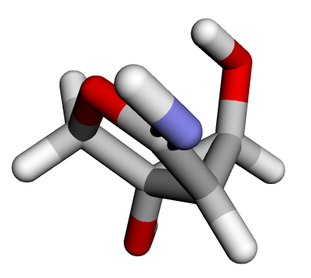
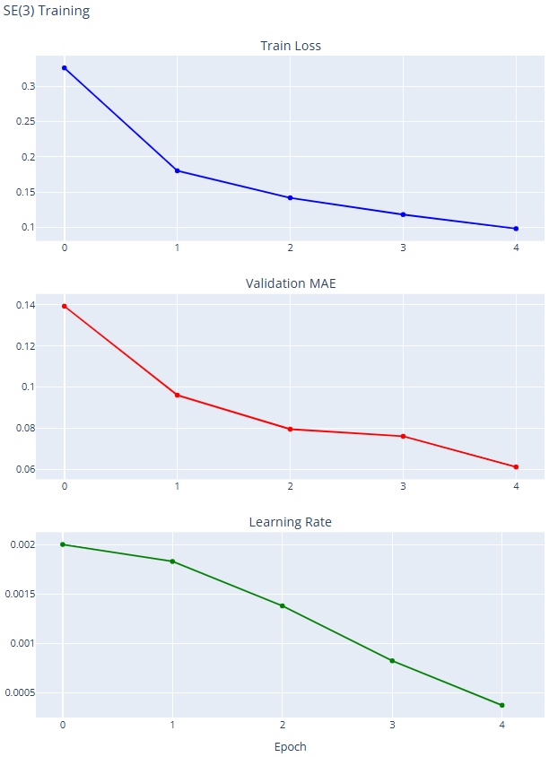

> 原文作者：Anuya Welling, James E. T. Smith, Diptorup Deb, Mukhil Azhagan Mallaiyan Sathiaseelan, Yao Liu, Phani Vaddadi, and Vish Vadlamani  
> [AMD 官方教程](https://rocm.docs.amd.com/projects/ai-developer-hub/en/latest/notebooks/pretrain/se3transform_intro.html) · [固定版本源码](https://github.com/ROCm/gpuaidev/blob/0071bfd4bd3bd9525405c09a6ae69c983b09312a/docs/notebooks/pretrain/se3transform_intro.ipynb)  
> 上游版本：`0071bfd4bd3bd9525405c09a6ae69c983b09312a` · 同步日期：2026-10-12  
> 翻译状态：机器初译，待逐篇人工校对；代码与命令保持原文，未在 AMD GPU 上运行验证。

<!-- cell:1 -->

<a id="se3-transformer-for-molecular-property-prediction"></a>

# SE(3)-Transformer 概览
**作者**：Anuya Welling, James E. T. Smith, Diptorup Deb, Mukhil Azhagan Mallaiyan Sathiaseelan, Yao Liu, Phani Vaddadi, and Vish Vadlamani
**知识水平**：中级

[SE(3)-Transformer](https://arxiv.org/pdf/2006.10503) 是一种图神经网络，它使用自注意力的变体进行 3D 点和图处理。
该模型在连续 3D 旋转平移下是等变的，这意味着当输入（图形或点集）在 3D 空间中旋转时
（或者更一般地经历适当的刚性变换），模型输出要么保持不变，要么随输入而变换。

在 SE(3)-Transformer 模型中，训练和 推理 都被构建为针对一组分子属性的回归任务。这些参数包括 μ、α、HOMO、LUMO、间隙、R²、ZPVE、U₀、U、H、G 和 Cv 等参数，以及它们的原子对应项和旋转常数 (A、B、C)。

虽然其中许多物理量的完整物理解释最好留给主题专家，但本教程重点介绍分子建模中常用的几个关键电子特性。 HOMO（最高占据分子轨道）是指仍被电子占据的最高能级。 LUMO（最低未占据分子轨道）是不含电子且可供占据的最低能级。 HOMO-LUMO 能隙，通常简称为“能隙”，是这两个轨道之间的能量差，是分子电子和化学行为的重要指标。

在药物发现中，SE(3)-Transformer 模型可以预测对真实生物行为至关重要的分子特性。好的药物必须与其靶标牢固结合，避免脱靶反应，并在体内保持稳定，同时在正确的位点发生反应。

HOMO 和 LUMO 抓住了这种平衡。它们表明分子给予或接受电子的倾向，这会影响它与蛋白质氨基酸的反应方式以及它是否有毒。 HOMO-LUMO 间隙充当反应性的代表——太小可能意味着不稳定和副作用，而太大可能意味着不活动。反应性差常常导致药物失败，即使结合看起来很有希望。

<a id="for-more-information"></a>

## 了解更多信息

要了解有关 DGL、SE(3)-Transformers 和 AMD ROCm 性能基准的更多信息，请参阅以下博客：

* [大规模图神经网络：AMD 硬件上具有 ROCm 的 DGL](https://rocm.blogs.amd.com/artificial-intelligence/why-graph-neural/README.html)  
   了解 DGL（深度图库）、其设计原理以及它如何在 AMD 硬件上实现可扩展的图神经网络。

* [现实世界中的 DGL：在真实用例上运行 GNN](https://rocm.blogs.amd.com/artificial-intelligence/dgl_blog2/README.html)  
   探索现实世界的 DGL 应用，包括用于电子商务推荐的 GNN-FiLM、ARGO、GATNE 以及用于神经系统疾病诊断的 EEG-GCNN。

* [深入了解 DGL：SE(3)-ROCm 7 上的变压器](https://rocm.blogs.amd.com/artificial-intelligence/dgl-in-depth/README.html)  
   查看此分步实施指南，了解基准测试结果，显示 AMD Instinct MI300X GPU 在 SE(3)-Transformer 工作负载上的出色 延迟 和 吞吐量 性能。

<a id="prerequisites"></a>

## 前置条件

本教程是使用以下设置进行开发和测试的。

<a id="hardware-requirements"></a>

### 硬件要求

* **GPU**：AMD Instinct™ MI300X 或 MI250X GPU。
**注意**：本教程已在 AMD Instinct MI300X GPU 上进行了测试和验证。有关支持的 GPU 的官方列表，请参阅 [DGL 兼容性文档](https://rocm.docs.amd.com/en/docs-7.2.4/compatibility/ml-compatibility/dgl-compatibility.html)。有关 AMD Instinct GPU 的性能指标，请参阅 [SE(3)-Transformer 性能报告博客](https://rocm.blogs.amd.com/artificial-intelligence/dgl-in-depth/README.html)。

<a id="software-requirements"></a>

### 软件要求

AMD 在 [Docker Hub](https://hub.docker.com/r/rocm/dgl) 上使用 ROCm 后端验证并发布 DGL 映像。下表显示了经过验证的软件堆栈配置：

|软件|支持的版本 |笔记|
|----------|-------------------|-------|
| **ROCm** | 6.4.0、6.4.3、7.0.0 | AMD GPU 计算平台 |
| **Python** | 3.10、3.12 |编程语言|
| **PyTorch** | 2.3.0、2.4.1、2.6.0、2.7.1、2.8.0 |深度学习框架（ROCm构建）|
| **DGL** | 2.4.0 | GNN 的深度图库 |
| **Ubuntu** | 22.04, 24.04 |操作系统 |
| **码头工人** | 20.10+ |容器运行时（推荐）|

<a id="validated-docker-images"></a>

### 已验证的 Docker 镜像

推荐的方法是使用 AMD 预构建的 Docker 映像。选择与您所需配置匹配的图像：

| Docker 镜像标签 | DGL 发布 | ROCm | PyTorch |乌班图 |蟒蛇 |
|------------------|-----|------|---------|--------|--------|
| `rocm/dgl:dgl-2.4.0.amd0_rocm7.0.0_ubuntu24.04_py3.12_pytorch_2.8.0` | 25.10 | 25.10 7.0.0 | 2.8.0 | 24.04 | 24.04 3.12 | 3.12
| `rocm/dgl:dgl-2.4.0.amd0_rocm7.0.0_ubuntu24.04_py3.12_pytorch_2.6.0` | 25.10 | 25.10 7.0.0 | 2.6.0 | 24.04 | 24.04 3.12 | 3.12
| `rocm/dgl:dgl-2.4.0.amd0_rocm7.0.0_ubuntu22.04_py3.10_pytorch_2.7.1` | 25.10 | 25.10 7.0.0 | 2.7.1 | 22.04 | 22.04 3.10 | 3.10
| `rocm/dgl:dgl-2.4.0.amd0_rocm6.4.3_ubuntu24.04_py3.12_pytorch_2.6.0` | 25.10 | 25.10 6.4.3 | 2.6.0 | 24.04 | 24.04 3.12 | 3.12
| `rocm/dgl:dgl-2.4_rocm6.4_ubuntu24.04_py3.12_pytorch_release_2.6.0` | 25.07 | 25.07 6.4.0 | 2.6.0 | 24.04 | 24.04 3.12 | 3.12
| `rocm/dgl:dgl-2.4_rocm6.4_ubuntu24.04_py3.12_pytorch_release_2.4.1` | 25.07 | 25.07 6.4.0 | 2.4.1 | 24.04 | 24.04 3.12 | 3.12
| `rocm/dgl:dgl-2.4_rocm6.4_ubuntu22.04_py3.10_pytorch_release_2.4.1` | 25.07 | 25.07 6.4.0 | 2.4.1 | 22.04 | 22.04 3.10 | 3.10
| `rocm/dgl:dgl-2.4_rocm6.4_ubuntu22.04_py3.10_pytorch_release_2.3.0` | 25.07 | 25.07 6.4.0 | 2.3.0 | 22.04 | 22.04 3.10 | 3.10


<a id="set-up-the-se3-transformer-environment"></a>

## 设置 SE(3)-Transformer 环境

在本教程中，您将使用预构建的 ROCm DGL 映像作为示例。您还可以使用上表中其他经过验证的 DGL 图像。

<a id="step-1-launch-the-docker-image"></a>

### 第 1 步：启动 Docker 镜像

启动 Docker 容器。将 `/path/to/workspace` 替换为主机上要克隆 DeepLearningExamples 代码并运行Notebook的目录的完整路径。从上面经过验证的 Docker 镜像表中选择与您所需的配置相匹配的镜像标签。

``` bash
docker run -it --rm --privileged \
  --network=host \
  --device=/dev/kfd \
  --device=/dev/dri \
  --group-add=video \
  --ipc=host \
  --cap-add=SYS_PTRACE \
  --security-opt seccomp=unconfined \
  -v /path/to/workspace:/workspace \
  -w /workspace \
  <IMAGE_TAG>
```

**注意**：此命令将您的主机目录挂载到容器中的 `/workspace` 中。确保Notebook文件位于此目录中或在 Jupyter 启动后上传。其余步骤应在 Docker 容器内运行。保存终端输出中的 URL（和令牌，如果显示），以便从浏览器访问 JupyterLab。

例如，要将 ROCm 7.0.0 与 PyTorch 2.7.1 一起使用：

``` bash
docker run -it --rm --privileged \
  --network=host \
  --device=/dev/kfd \
  --device=/dev/dri \
  --group-add=video \
  --ipc=host \
  --cap-add=SYS_PTRACE \
  --security-opt seccomp=unconfined \
  -v /path/to/workspace:/workspace \
  -w /workspace \
  rocm/dgl:dgl-2.4.0.amd0_rocm7.0.0_ubuntu22.04_py3.10_pytorch_2.7.1
```

<a id="step-2-install-and-launch-jupyter"></a>

### 步骤 2：安装并启动 Jupyter

在 Docker 容器内，安装 Jupyter 和此Notebook使用的可视化包：

``` bash
pip install jupyter
```

启动 Jupyter 服务器：

``` bash
jupyter-lab --ip=0.0.0.0 --port=8888 --no-browser --allow-root
```

**注意**：在运行上述命令之前，请确保您的系统上尚未使用端口 `8888`。如果是，您可以通过将 `--port=8888` 替换为其他端口号来指定其他端口，例如 `--port=8890`。


<a id="step-3-open-the-notebook"></a>

### 第三步：打开Notebook
JupyterLab 运行后，打开浏览器并转到终端中显示的 URL（通常为 `http://localhost:8888`）。在文件浏览器中，导航到 `DGLPyTorch/DrugDiscovery/SE3Transformer/` 并单击 **se3transformer.ipynb** （或此介绍Notebook）开始。或者，您可以通过 Jupyter 中的上传按钮将此Notebook上传到您的 Jupyter 实验室。


<a id="two-ways-to-use-this-notebook"></a>

## 使用此Notebook的两种方法

该Notebook支持两种模式：

* **快速 推理 模式**（约 10 分钟）
   - 使用经过 100 轮训练的预训练模型。
   - 跳过训练并直接转到 推理 和结果。
   - 非常适合快速探索模型功能。
   
* **训练模式**（约 30-60 分钟）
   - 从头开始训练五个时期。
   - 查看完整的流程：数据→模型→训练→评估。
   - 非常适合了解完整的工作流程。

要选择模式，请在下面的配置单元中设置 `USE_PRETRAINED = True`（对于 推理）或 `USE_PRETRAINED = False`（对于训练）。

**注意**：通过执行单元在 Jupyter 中运行此Notebook的其余部分。

<details markdown="1">
<summary>查看英文原文 · 单元 1</summary>

# SE(3)-Transformer for molecular property prediction

**Authors:** Anuya Welling, James E. T. Smith, Diptorup Deb, Mukhil Azhagan Mallaiyan Sathiaseelan, Yao Liu, Phani Vaddadi, and Vish Vadlamani  
**Knowledge level**: Intermediate

The [SE(3)-Transformer](https://arxiv.org/pdf/2006.10503) is a graph neural network that uses a variant of self-attention for 3D points and graphs processing.
This model is equivariant under continuous 3D roto-translations, which means that when the inputs (graphs or sets of points) rotate in 3D space
(or more generally experience a proper rigid transformation), the model outputs either stay invariant or transform with the input.

In the SE(3)-Transformer model, both training and inference are framed as regression tasks over a set of molecular properties. These include parameters such as μ, α, HOMO, LUMO, gap, R², ZPVE, U₀, U, H, G, and Cv, along with their atom-wise counterparts and rotational constants (A, B, C).

While the full physical interpretation of many of these quantities is best left to subject matter experts, this tutorial focuses on a few key electronic properties that are commonly used in molecular modeling. HOMO (Highest Occupied Molecular Orbital) refers to the highest energy level that is still occupied by electrons. LUMO (Lowest Unoccupied Molecular Orbital) is the lowest energy level that does not contain electrons and is available for occupation. The HOMO–LUMO gap, often simply called "the gap", is the energy difference between these two orbitals and is an important indicator of a molecule's electronic and chemical behavior.

In drug discovery, SE(3)-Transformer models predict molecular properties that matter for real biological behavior. A good drug must bind strongly to its target, avoid off-target reactions, and remain stable in the body while being reactive at the right site.

HOMO and LUMO capture this balance. They indicate a molecule's tendency to donate or accept electrons, which influences how it reacts with protein amino acids and whether it could be toxic. The HOMO–LUMO gap acts as a proxy for reactivity -- too small can mean instability and side effects, while too large can mean inactivity. Poor reactivity often leads to drug failure, even when binding looks promising.

## For more information

To find out more about DGL, SE(3)-Transformers, and AMD ROCm performance benchmarks, see the following blogs:

* [Graph Neural Networks at Scale: DGL with ROCm on AMD Hardware](https://rocm.blogs.amd.com/artificial-intelligence/why-graph-neural/README.html)  
   Learn about DGL (Deep Graph Library), its design principles, and how it enables scalable graph neural networks on AMD hardware.

* [DGL in the Real World: Running GNNs on Real Use Cases](https://rocm.blogs.amd.com/artificial-intelligence/dgl_blog2/README.html)  
   Explore real-world DGL applications including GNN-FiLM, ARGO, GATNE for e-commerce recommendations, and EEG-GCNN for neurological disease diagnosis.

* [DGL in Depth: SE(3)-Transformer on ROCm 7](https://rocm.blogs.amd.com/artificial-intelligence/dgl-in-depth/README.html)  
   Review this step-by-step implementation guide for benchmark results showing the great latency and throughput performance of the AMD Instinct MI300X GPU on SE(3)-Transformer workloads.

## Prerequisites

This tutorial was developed and tested using the following setup.

### Hardware requirements

* **GPU**: AMD Instinct™ MI300X or MI250X GPUs.

**Note**: This tutorial has been tested and validated on AMD Instinct MI300X GPUs. For the official list of supported GPUs, see the [DGL Compatibility Documentation](https://rocm.docs.amd.com/en/docs-7.2.4/compatibility/ml-compatibility/dgl-compatibility.html). For performance metrics on AMD Instinct GPUs, see the [SE(3)-Transformer performance report blog](https://rocm.blogs.amd.com/artificial-intelligence/dgl-in-depth/README.html).

### Software requirements

AMD validates and publishes DGL images with ROCm backends on [Docker Hub](https://hub.docker.com/r/rocm/dgl). The following table shows the validated software stack configurations:

| Software | Supported versions | Notes |
|----------|-------------------|-------|
| **ROCm** | 6.4.0, 6.4.3, 7.0.0 | AMD GPU compute platform |
| **Python** | 3.10, 3.12 | Programming language |
| **PyTorch** | 2.3.0, 2.4.1, 2.6.0, 2.7.1, 2.8.0 | Deep learning framework (ROCm build) |
| **DGL** | 2.4.0 | Deep Graph Library for GNNs |
| **Ubuntu** | 22.04, 24.04 | Operating system |
| **Docker** | 20.10+ | Container runtime (recommended) |

### Validated Docker images

The recommended approach is to use the prebuilt Docker images from AMD. Select the image that matches your desired configuration:

| Docker image tag | DGL release | ROCm | PyTorch | Ubuntu | Python |
|------------------|-----|------|---------|--------|--------|
| `rocm/dgl:dgl-2.4.0.amd0_rocm7.0.0_ubuntu24.04_py3.12_pytorch_2.8.0` | 25.10 | 7.0.0 | 2.8.0 | 24.04 | 3.12 |
| `rocm/dgl:dgl-2.4.0.amd0_rocm7.0.0_ubuntu24.04_py3.12_pytorch_2.6.0` | 25.10 | 7.0.0 | 2.6.0 | 24.04 | 3.12 |
| `rocm/dgl:dgl-2.4.0.amd0_rocm7.0.0_ubuntu22.04_py3.10_pytorch_2.7.1` | 25.10 | 7.0.0 | 2.7.1 | 22.04 | 3.10 |
| `rocm/dgl:dgl-2.4.0.amd0_rocm6.4.3_ubuntu24.04_py3.12_pytorch_2.6.0` | 25.10 | 6.4.3 | 2.6.0 | 24.04 | 3.12 |
| `rocm/dgl:dgl-2.4_rocm6.4_ubuntu24.04_py3.12_pytorch_release_2.6.0` | 25.07 | 6.4.0 | 2.6.0 | 24.04 | 3.12 |
| `rocm/dgl:dgl-2.4_rocm6.4_ubuntu24.04_py3.12_pytorch_release_2.4.1` | 25.07 | 6.4.0 | 2.4.1 | 24.04 | 3.12 |
| `rocm/dgl:dgl-2.4_rocm6.4_ubuntu22.04_py3.10_pytorch_release_2.4.1` | 25.07 | 6.4.0 | 2.4.1 | 22.04 | 3.10 |
| `rocm/dgl:dgl-2.4_rocm6.4_ubuntu22.04_py3.10_pytorch_release_2.3.0` | 25.07 | 6.4.0 | 2.3.0 | 22.04 | 3.10 |


## Set up the SE(3)-Transformer environment

In this tutorial, you will work on the prebuilt ROCm DGL image as an example. You can also use other validated DGL images from the table above.

### Step 1: Launch the Docker image

Launch the Docker container. Replace `/path/to/workspace` with the full path to the directory on your host machine where you want to clone the DeepLearningExamples code and run the notebook. Choose the image tag from the validated Docker images table above that matches your desired configuration.

``` bash
docker run -it --rm --privileged \
  --network=host \
  --device=/dev/kfd \
  --device=/dev/dri \
  --group-add=video \
  --ipc=host \
  --cap-add=SYS_PTRACE \
  --security-opt seccomp=unconfined \
  -v /path/to/workspace:/workspace \
  -w /workspace \
  <IMAGE_TAG>
```

**Note**: This command mounts your host directory to `/workspace` in the container. Ensure the notebook file is in this directory or upload it after Jupyter starts. The remaining steps should be run inside the Docker container. Save the URL (and token, if shown) from the terminal output to access JupyterLab from your browser.

For example, to use ROCm 7.0.0 with PyTorch 2.7.1:

``` bash
docker run -it --rm --privileged \
  --network=host \
  --device=/dev/kfd \
  --device=/dev/dri \
  --group-add=video \
  --ipc=host \
  --cap-add=SYS_PTRACE \
  --security-opt seccomp=unconfined \
  -v /path/to/workspace:/workspace \
  -w /workspace \
  rocm/dgl:dgl-2.4.0.amd0_rocm7.0.0_ubuntu22.04_py3.10_pytorch_2.7.1
```

### Step 2: Install and launch Jupyter

Inside the Docker container, install Jupyter and the visualization packages used by this notebook:

``` bash
pip install jupyter
```

Start the Jupyter server:

``` bash
jupyter-lab --ip=0.0.0.0 --port=8888 --no-browser --allow-root
```

**Note**: Ensure port `8888` is not already in use on your system before running the above command. If it is, you can specify a different port by replacing `--port=8888` with another port number, for example, `--port=8890`.


### Step 3: Open the notebook

Once JupyterLab is running, open your browser and go to the URL shown in the terminal (typically `http://localhost:8888`). In the file browser, navigate to `DGLPyTorch/DrugDiscovery/SE3Transformer/` and click **se3transformer.ipynb** (or this intro notebook) to begin. Alternatively, you can upload this notebook to your Jupyter lab via the upload button in Jupyter.


## Two ways to use this notebook

This notebook supports two modes:

* **Quick inference mode** (~10 minutes)
   - Use a pretrained model trained for 100 epochs.
   - Skip training and go straight to inference and results.
   - Perfect for exploring model capabilities quickly.
   
* **Training mode** (~30-60 minutes)
   - Train from scratch for five epochs.
   - See the full pipeline: data → model → train → evaluate.
   - Perfect for understanding the complete workflow.

To select a mode, set `USE_PRETRAINED = True` (for inference) or `USE_PRETRAINED = False` (for training) in the configuration cell below.

**Note**: Run the rest of this notebook in Jupyter by executing the cells.

</details>

<!-- cell:2 -->

<a id="loading-the-dependencies-and-repository"></a>

## 加载依赖项和存储库

本节介绍如何下载并安装所需的代码和依赖项。

<a id="install-dependencies"></a>

### 安装依赖项

<details markdown="1">
<summary>查看英文原文 · 单元 2</summary>

## Loading the dependencies and repository

This section explains how to download and install the required code and dependencies.

### Install dependencies

</details>

```python
!pip install plotly torchinfo rdkit py3Dmol
```

<!-- cell:4 -->

<a id="clone-the-deeplearningexamples-repository"></a>

### 克隆 DeepLearningExamples 存储库

使用稀疏签出克隆 ROCm DeepLearningExamples 存储库以仅下载 SE(3)-Transformer 代码。在 Docker 容器内运行以下命令（例如，在终端或Notebook代码单元中）：

<details markdown="1">
<summary>查看英文原文 · 单元 4</summary>

### Clone the DeepLearningExamples repository

Clone the ROCm DeepLearningExamples repository using sparse checkout to download only the SE(3)-Transformer code. Run the following inside the Docker container (for example, in a terminal or in a notebook code cell):

</details>

```python
%%bash
git clone --filter=blob:none --sparse https://github.com/ROCm/DeepLearningExamples.git
cd DeepLearningExamples
git sparse-checkout set DGLPyTorch/DrugDiscovery/SE3Transformer
cd DGLPyTorch/DrugDiscovery/SE3Transformer
pip install -r requirements.txt
pip install -e .
```

<!-- cell:6 -->

<a id="add-installed-packages-to-path"></a>

### 将已安装的包添加到路径

导入必要的包并将它们添加到路径中。

<details markdown="1">
<summary>查看英文原文 · 单元 6</summary>

### Add installed packages to path

Import the necessary packages and add them to the path.

</details>

```python
  import os
  import sys

  # Get current working directory and build the SE3 path
  base_dir = os.getcwd()
  se3_path = os.path.abspath(os.path.join(base_dir, "DeepLearningExamples/DGLPyTorch/DrugDiscovery/SE3Transformer"))

  # Verify it exists and add to path
  if os.path.exists(se3_path):
      if se3_path not in sys.path:
          sys.path.insert(0, se3_path)
      print(f"✅ Added {se3_path} to Python path")
      print(f"   Current working directory: {base_dir}")
  else:
      print(f"❌ Error: Path not found: {se3_path}")
      print(f"   Please check if the repository was cloned correctly")
```

<!-- cell:8 -->

<a id="what-happens-next"></a>

## 接下来会发生什么？

首先，选择 推理 或训练模式。

<details markdown="1">
<summary>查看英文原文 · 单元 8</summary>

## What happens next?

First, choose between inference or training mode.

</details>

```python
# ============================================
# 🎯 CONFIGURATION: Choose Your Path
# ============================================

USE_PRETRAINED = False  # Toggle: True = Inference only | False = Train from scratch

if USE_PRETRAINED:
    print("="*60)
    print("📊 MODE: Quick Inference with Pretrained Model")
    print("="*60)
    print("✅ Will load: model_qm9_100_epochs.pth")
    print("⏭️  Training cells will be skipped")
    print("⚡ Estimated time: ~10 minutes\n")
    CHECKPOINT_PATH = "model_qm9_100_epochs.pth"
    EPOCHS = None
else:
    print("="*60)
    print("🏋️ MODE: Training from Scratch")
    print("="*60)
    print("✅ Will train for 5 epochs")
    print("💾 Will save to: model_qm9_5_epochs.pth")
    print("⏱️  Estimated time: ~30-60 minutes\n")
    CHECKPOINT_PATH = "model_qm9_5_epochs.pth"
    EPOCHS = 5
```

<!-- cell:10 -->

根据您选择的设置，后续步骤会有所不同：

- 如果 `USE_PRETRAINED = True`（推理 模式）：
  1.导入库
  2. 加载数据集并检查分子
  3. 初始化模型架构
  4. 跳过训练、日志设置和可视化
  5.加载预训练的检查点（`model_qm9_100_epochs.pth`）
  6.运行推理并查看结果

- 如果 `USE_PRETRAINED = False`（训练模式）：
  1.导入库
  2. 加载数据集并检查分子
  3. 初始化模型架构
  4. 训练 5 个 epoch
  5. 可视化训练进度
  6.加载训练好的检查点（`model_qm9_5_epochs.pth`）
  7.运行推理并查看结果

<details markdown="1">
<summary>查看英文原文 · 单元 10</summary>

Depending on which setting you choose, the next steps vary somewhat:

- If `USE_PRETRAINED = True` (inference mode):
  1. Import the libraries
  2. Load the dataset and inspect the molecules
  3. Initialize the model architecture
  4. Skip training, logging setup, and visualization
  5. Load a pretrained checkpoint (`model_qm9_100_epochs.pth`)
  6. Run inference and see the results

- If `USE_PRETRAINED = False` (training mode):
  1. Import the libraries
  2. Load the dataset and inspect the molecules
  3. Initialize the model architecture
  4. Train for five epochs
  5. Visualize training progress
  6. Load your trained checkpoint (`model_qm9_5_epochs.pth`)
  7. Run inference and see the results

</details>

<!-- cell:11 -->

<a id="imports-for-training-and-evaluation"></a>

## 导入用于训练和评估

这些导入的模块在 QM9 分子数据集上建立了完整的 SE(3)-Transformer 训练和评估管道。它们涵盖数据加载、分布式训练、优化、日志记录和 推理。

<details markdown="1">
<summary>查看英文原文 · 单元 11</summary>

## Imports for training and evaluation

These imported modules set up the full SE(3)-Transformer training and evaluation pipeline on the QM9 molecular dataset. They cover data loading, distributed training, optimization, logging, and inference.

</details>

```python
# Core imports needed for both training and inference
import torch.nn as nn
import dgl

from se3_transformer.data_loading import QM9DataModule
from se3_transformer.model import SE3TransformerPooled
from se3_transformer.model.fiber import Fiber
from se3_transformer.runtime.arguments import PARSER
from se3_transformer.runtime.utils import (
    seed_everything,
    using_tensor_cores,
)
import logging
   
from se3_transformer.runtime.callbacks import (
    QM9MetricCallback,
    QM9LRSchedulerCallback,
)
from se3_transformer.runtime.loggers import (
    LoggerCollection,
    DLLogger,
)
from se3_transformer.runtime.training import train
    
print("✅ Loaded training modules")
```

<!-- cell:13 -->

<a id="using-the-cli-arguments-to-set-up-training"></a>

### 使用 CLI 参数来设置训练

DeepLearningExamples 存储库中的 SE(3)-Transformer 示例最初设计为作为命令行程序运行，但您可以轻松地将其调整为在 Jupyter Notebook 中使用。训练配置（包括模型、优化器和运行时设置）通过 argparse 解析器进行管理，您可以直接在Notebook中利用该解析器进行灵活的实验。

<details markdown="1">
<summary>查看英文原文 · 单元 13</summary>

### Using the CLI arguments to set up training

The SE(3)-Transformer example from the DeepLearningExamples repository was originally designed to run as a command-line program, but you can easily adapt it to use in a Jupyter notebook. The training configuration, including model, optimizer, and runtime settings, is managed through an argparse parser, which you can leverage directly within the notebook for flexible experimentation.

</details>

```python
if not USE_PRETRAINED:
    # Uncomment the line below to see all available training and runtime arguments
    # PARSER.print_help()

    # Training configuration - adjust these parameters as needed
    TRAINING_ARGS = [
        "--epochs", str(EPOCHS),              # Number of training epochs (5 for quick training)
        "--eval_interval", "1",               # Evaluate every N epochs
        "--batch_size", "240",                # Batch size per GPU
        "--num_workers", "16",                # Data loader workers
        "--precompute_bases",                 # Precompute geometric bases for speed
        "--use_layer_norm",                   # Use layer normalization
        "--norm",                             # Normalize features
        "--save_ckpt_path", CHECKPOINT_PATH,  # Where to save the trained model
        "--task", "homo",                     # Prediction task (homo, lumo, gap, etc.)
        "--amp",                              # Enable automatic mixed precision
        "--learning_rate", "0.002",           # Initial learning rate
        "--weight_decay", "0.1",              # L2 regularization
        "--seed", "42",                       # Random seed for reproducibility
    ]

    # Parse arguments
    args = PARSER.parse_args(TRAINING_ARGS)
    
    print("="*60)
    print("🔧 Training Configuration")
    print("="*60)
    print(f"Epochs: {args.epochs}")
    print(f"Batch Size: {args.batch_size}")
    print(f"Learning Rate: {args.learning_rate}")
    print(f"Weight Decay: {args.weight_decay}")
    print(f"Checkpoint Path: {args.save_ckpt_path}")
    print(f"Task: {args.task}")
    print(f"AMP Enabled: {args.amp}")
    print("="*60)
else:
    # For pretrained mode, we still need args for model initialization
    # but we won't use them for training
    args = PARSER.parse_args([
        "--epochs", "100",
        "--batch_size", "240",
        "--num_workers", "16",
        "--use_layer_norm",
        "--norm",
        "--task", "homo",
    ])
    print("⏭️  Skipping training configuration (using pretrained model)")
```

<!-- cell:15 -->

<a id="download-the-pretrained-model-from-hugging-face"></a>

## 从 Hugging Face 下载预训练模型

如果您使用预训练模式 (`USE_PRETRAINED = True`)，则 `model_qm9_100_epochs.pth` 检查点 必须在本地可用。此 检查点 托管在 Hugging Face Hub 上。要下载它，请按照下列步骤操作：

1.使用`pip install huggingface_hub`安装Hugging Face Hub客户端。
2. 登录 Hugging Face（建议进行门禁或限速访问）。在终端中运行 `huggingface-cli login` 并输入来自 [huggingface.co/settings/tokens](https://huggingface.co/settings/tokens) 的令牌。
3. 使用以下命令将模型下载到当前目录：

   ```bash
   huggingface-cli download amd/se3_transformers model_qm9_100_epochs.pth --local-dir .
   ```

当 `USE_PRETRAINED` 为 `True` 时，下面的单元格自动运行这些步骤。

<details markdown="1">
<summary>查看英文原文 · 单元 15</summary>

## Download the pretrained model from Hugging Face

If you are using pretrained mode (`USE_PRETRAINED = True`), the `model_qm9_100_epochs.pth` checkpoint must be available locally. This checkpoint is hosted on the Hugging Face Hub. To download it, follow these steps:

1. Install the Hugging Face Hub client using `pip install huggingface_hub`.
2. Log in to Hugging Face (recommended for gated or rate-limited access). Run `huggingface-cli login` in a terminal and enter your token from [huggingface.co/settings/tokens](https://huggingface.co/settings/tokens).
3. Download the model into the current directory with:

   ```bash
   huggingface-cli download amd/se3_transformers model_qm9_100_epochs.pth --local-dir .
   ```

The cell below automatically runs these steps when `USE_PRETRAINED` is `True`.

</details>

```python
if USE_PRETRAINED:
    # Install Hugging Face Hub if not already installed
    try:
        from huggingface_hub import hf_hub_download
    except ImportError:
        import subprocess
        import sys
        subprocess.check_call([sys.executable, "-m", "pip", "install", "-q", "huggingface_hub"])
        from huggingface_hub import hf_hub_download

    # Advise logging in for gated repos or to avoid rate limits
    print("💡 If the model is gated or you hit rate limits, log in first: huggingface-cli login")
    print("   Get a token at: https://huggingface.co/settings/tokens\n")

    # Download pretrained checkpoint to current directory
    print("📥 Downloading model_qm9_100_epochs.pth from amd/se3_transformers ...")
    path = hf_hub_download(
        repo_id="amd/se3_transformers",
        filename="model_qm9_100_epochs.pth",
        local_dir=".",
        local_dir_use_symlinks=False,
    )
    print(f"✅ Downloaded to: {path}")
else:
    print("⏭️  Skipping download (training from scratch)")
```

<!-- cell:17 -->

<a id="dataset-and-model-setup"></a>

## 数据集和模型设置

首先使用 QM9DataModule 加载 QM9 分子数据集，该模块处理数据预处理、批处理和分割以进行训练和评估。
接下来，使用定义几何和特征信息如何流经网络的输入、边缘和输出纤维初始化 SE(3)-Transformer 模型 (SE3TransformerPooled)。
最后，定义 L1 损失 (`nn.L1Loss`)——分子属性回归任务的一个简单而有效的选择。

<details markdown="1">
<summary>查看英文原文 · 单元 17</summary>

## Dataset and model setup

Start by loading the QM9 molecular dataset using QM9DataModule, which handles data preprocessing, batching, and splitting for training and evaluation.
Next, initialize the SE(3)-Transformer model (SE3TransformerPooled) with input, edge, and output fibers that define how geometric and feature information flows through the network.
Finally, define the L1 loss (`nn.L1Loss`) — a simple yet effective choice for molecular property regression tasks.

</details>

```python
datamodule = QM9DataModule(**vars(args))
model = SE3TransformerPooled(
    fiber_in=Fiber({0: datamodule.NODE_FEATURE_DIM}),
    fiber_out=Fiber({0: args.num_degrees * args.num_channels}),
    fiber_edge=Fiber({0: datamodule.EDGE_FEATURE_DIM}),
    output_dim=1,
    tensor_cores=using_tensor_cores(args.amp),  # use Tensor Cores more effectively
    **vars(args),
)
loss_fn = nn.L1Loss()
```

<!-- cell:19 -->

<a id="inspecting-the-molecules"></a>

## 检查分子
在开始训练之前，目视检查 QM9 数据集中的分子会很有帮助。

查看数据集中的分子之一：



<a id="basic-graph-information"></a>

### 基本图形信息

``` text
--- BASIC INFO ---
Nodes: 14
Edges: 28
```

该分子被表示为一个图，其中 14 个节点对应于原子，28 个边代表原子-原子相互作用。
边缘是基于原子间接近度而不是显式化学键构建的。

<a id="node-features-ndata"></a>

### 节点特征（ndata）

每个节点（原子）都与几何和化学特征相关。

<a id="atomic-positions"></a>

#### 原子位置

``` text
Key: pos
Shape: (14, 3)
Dtype: torch.float32

tensor([[ 0.6781, -0.0583,  0.7324],
        [-0.1432,  0.3297, -0.3889],
        [-1.5010, -0.2886, -0.2937],
        ...])

```
 每行表示分子中原子的 3D 笛卡尔坐标 `[x,y,z]`。

<a id="atomic-attributes"></a>

#### 原子属性

``` text
Key: attr
Shape: (14, 11)
Dtype: torch.float32

tensor([[0., 0., 0., 1., 0., 8., 0., 0., 0., 0., 1.],
        [0., 1., 0., 0., 0., 6., 0., 0., 0., 0., 2.],
        [0., 1., 0., 0., 0., 6., 0., 0., 0., 0., 0.],
        ...])
```
E每一行编码特定于原子的属性，例如原子类型和相关的分类或数字描述符，这允许模型区分不同的元素。

<a id="edge-features-edata"></a>

### 边缘特征（edata）

边捕获原子之间的成对关系。

``` text
Edge Attributes
Key: edge_attr
Shape: (28, 4)
Dtype: torch.float32

tensor([[1., 0., 0., 0.],
        [1., 0., 0., 0.],
        [1., 0., 0., 0.],
        ...])
```
E每一行表示与边缘关联的特征向量，通常编码用于模拟原子间相互作用的基于距离或径向信息。

<a id="raw-values-of-homo-lumo-and-gap"></a>

### HOMO、LUMO 和 GAP 的原始值

HOMO、LUMO 和 GAP 的原始值（以 eV 为单位）如下。

<a id="homo-highest-occupied-molecular-orbital-energy"></a>

#### HOMO（最高占据分子轨道）能量

```
Shape: torch.Size([1])
Value: tensor([-5.7987]) eV
```

<a id="lumo-lowest-unoccupied-molecular-orbital-energy"></a>

#### LUMO（最低未占分子轨道）能量

```
Shape: torch.Size([1])
Value: tensor([0.9905]) eV
```

<a id="gap-gap-between-homo-and-lumo"></a>

#### GAP（HOMO 和 LUMO 之间的差距）

```
Shape: torch.Size([1])
Value: tensor([6.7892]) eV
```

<details markdown="1">
<summary>查看英文原文 · 单元 19</summary>

## Inspecting the molecules
Before diving into training, it’s helpful to visually inspect the molecules from the QM9 dataset.

Review one of the molecules in the dataset:


### Basic graph information

``` text
--- BASIC INFO ---
Nodes: 14
Edges: 28
```

The molecule is represented as a graph with 14 nodes corresponding to atoms and 28 edges representing atom–atom interactions.
Edges are constructed based on interatomic proximity rather than explicit chemical bonds.

### Node features (ndata)

Each node (atom) is associated with geometric and chemical features.

#### Atomic positions

``` text
Key: pos
Shape: (14, 3)
Dtype: torch.float32

tensor([[ 0.6781, -0.0583,  0.7324],
        [-0.1432,  0.3297, -0.3889],
        [-1.5010, -0.2886, -0.2937],
        ...])

```
Each row represents the 3D Cartesian coordinates `[x,y,z]` of an atom in the molecule.

#### Atomic attributes

``` text
Key: attr
Shape: (14, 11)
Dtype: torch.float32

tensor([[0., 0., 0., 1., 0., 8., 0., 0., 0., 0., 1.],
        [0., 1., 0., 0., 0., 6., 0., 0., 0., 0., 2.],
        [0., 1., 0., 0., 0., 6., 0., 0., 0., 0., 0.],
        ...])
```
Each row encodes atom-specific properties, such as atomic type and related categorical or numerical descriptors, which allow the model to distinguish between different elements.

### Edge features (edata)

Edges capture pairwise relationships between atoms.

``` text
Edge Attributes
Key: edge_attr
Shape: (28, 4)
Dtype: torch.float32

tensor([[1., 0., 0., 0.],
        [1., 0., 0., 0.],
        [1., 0., 0., 0.],
        ...])
```
Each row represents a feature vector associated with an edge, typically encoding distance-based or radial information used to model interatomic interactions.

### RAW values of HOMO, LUMO, and GAP

The raw values of HOMO, LUMO and GAP in eV is as follows.

#### HOMO (Highest Occupied Molecular Orbital) energy

```
Shape: torch.Size([1])
Value: tensor([-5.7987]) eV
```

#### LUMO (Lowest Unoccupied Molecular Orbital) energy

```
Shape: torch.Size([1])
Value: tensor([0.9905]) eV
```

#### GAP (gap between HOMO and LUMO)

```
Shape: torch.Size([1])
Value: tensor([6.7892]) eV
```

</details>

<!-- cell:20 -->

<a id="view-the-model-summary"></a>

## 查看模型摘要

使用 `torchinfo.summary` 快速检查 SE(3)-Transformer 架构，该架构打印每层、其输入/输出形状和参数数量的详细概述。这可以帮助您在训练之前验证模型是否已正确构建。

<details markdown="1">
<summary>查看英文原文 · 单元 20</summary>

## View the model summary

Quickly inspect the SE(3)-Transformer architecture using `torchinfo.summary`, which prints a detailed overview of each layer, its input/output shapes, and the number of parameters. This helps you verify that the model has been built correctly before training.

</details>

```python
from torchinfo import summary

summary(model)
```

<!-- cell:22 -->

<a id="part-a-training-pipeline-optional"></a>

## A 部分：训练流程（可选）

使用此代码来配置训练管道。

**注意**：如果 `USE_PRETRAINED` 设置为 `True`，则将跳过下面的训练单元，您将直接进入 推理。

<a id="logging-and-callbacks"></a>

### 日志记录和回调

<details markdown="1">
<summary>查看英文原文 · 单元 22</summary>

## Part A: Training pipeline (optional)

Use this code to configure the training pipeline.

**Note**: If `USE_PRETRAINED` is set to `True`, the training cells below will be skipped, and you'll proceed directly to inference.

### Logging and callbacks

</details>

```python
# Initialize logging, set seed, configure loggers and training callbacks
logging.getLogger().setLevel(logging.INFO)

if args.seed is not None:
    logging.info(f"Using seed {args.seed}")
    seed_everything(args.seed)

logging.info(f"Saving info to {args.log_dir}/{args.dllogger_name}")
loggers = [DLLogger(save_dir=args.log_dir, filename=args.dllogger_name)]
logger = LoggerCollection(loggers)
callbacks = [
    QM9MetricCallback(logger, targets_std=datamodule.targets_std, prefix="validation"),
    QM9LRSchedulerCallback(logger, epochs=args.epochs),
]
logger.log_hyperparams(vars(args))
```

<!-- cell:24 -->

<a id="train"></a>

### 火车

一切配置完毕后，您就可以开始训练了。 `train()` 函数协调整个训练循环 - 运行前向和后向传递、计算损失、更新参数以及定期评估验证集。它使用您之前设置的数据加载器、回调和记录器来跟踪进度、记录指标并管理整个训练过程中的 学习率 计划。

<details markdown="1">
<summary>查看英文原文 · 单元 24</summary>

### Train

With everything configured, you’re ready to kick off training. The `train()` function orchestrates the entire training loop — running forward and backward passes, computing losses, updating parameters, and periodically evaluating the validation set. It uses the dataloaders, callbacks, and logger you set up earlier to track progress, log metrics, and manage learning rate schedules throughout the training process.

</details>

```python
if not USE_PRETRAINED:
    train(
        model,
        loss_fn,
        datamodule.train_dataloader(),
        datamodule.val_dataloader(),
        callbacks,
        logger,
        args,
    )
else:
    print("⏭️  Skipping training (USE_PRETRAINED=True)")
    print("📊 Will load pretrained checkpoint for inference")
```

<!-- cell:26 -->

<a id="visualizing-the-training-progress"></a>

### 可视化训练进度
训练后，您可以可视化并分析记录的结果。导入 Plotly 以进行交互式绘图，并导入 `dllogger` 以访问保存的训练日志。刷新记录器可确保所有指标在加载之前已写入磁盘。

<details markdown="1">
<summary>查看英文原文 · 单元 26</summary>

### Visualizing the training progress
After training, you can visualize and analyze the logged results. Import Plotly for interactive plotting and `dllogger` to access the saved training logs. Flushing the logger ensures all metrics have been written to disk before loading them.

</details>

```python
if not USE_PRETRAINED:
    import plotly.graph_objects as go
    import plotly.io as pio
    import pandas as pd
    from plotly.subplots import make_subplots
    import json
    import dllogger
    import os

    # If we're loading a checkpoint, we need to use the saved log file
    # otherwise, we'll use the current log file
    if args.load_ckpt_path is not None:
        LOG_FILE = os.path.join("results", "dllogger_results_100.json")
        if not os.path.exists(LOG_FILE):
            raise FileNotFoundError(f"Log file {LOG_FILE} does not exist, please copy the log file to the results directory or turn off checkpoint loading")
    else:
        LOG_FILE = os.path.join("results", args.dllogger_name)
        dllogger.flush()

    print(f"Using log file: {LOG_FILE}")
    pio.renderers.default = "notebook"
else:
    print("⏭️  Skipping training visualization (no training was performed)")
```

<!-- cell:28 -->

此步骤解析并组织来自 `dllogger_results.json` 的记录训练数据。它逐行读取文件，清除任何格式错误的条目，并过滤掉没有有效步骤的记录。然后，每个日志条目按其训练步骤进行分组，提取关键指标，例如训练损失、学习率 和验证平均绝对误差 (MAE)。结果被编译成整洁的 Pandas DataFrame，从而更容易可视化和分析模型性能和学习动态在整个训练过程中的演变情况。

<details markdown="1">
<summary>查看英文原文 · 单元 28</summary>

This step parses and organizes the logged training data from `dllogger_results.json`. It reads the file line by line, cleans up any malformed entries, and filters out records without valid steps. Each log entry is then grouped by its training step, extracting key metrics such as training loss, learning rate, and validation mean absolute error (MAE). The results are compiled into a tidy Pandas DataFrame, making it easier to visualize and analyze how model performance and learning dynamics evolved throughout training.

</details>

```python
if not USE_PRETRAINED:
    # Read and parse the data
    with open(LOG_FILE, "r") as f:
        logs = [json.loads(line.replace("DLLL", "")) for line in f.readlines()]

    # Filter out entries where step is an empty list
    logs = [log for log in logs if log.get("step") != []]

    # Create a dictionary to aggregate metrics by step
    metrics_by_step = {}

    for log in logs:
        if log.get("type") == "LOG":
            step = log.get("step")

            # Skip if step is not an integer or if it's the PARAMETER step
            if not isinstance(step, int):
                continue

            # Initialize the step if not exists
            if step not in metrics_by_step:
                metrics_by_step[step] = {
                    "step": step,
                    "train loss": None,
                    "learning rate": None,
                    "validation MAE": None,
                }

            # Update metrics for this step
            data = log.get("data", {})
            if "train loss" in data:
                metrics_by_step[step]["train loss"] = data["train loss"]
            if "learning rate" in data:
                metrics_by_step[step]["learning rate"] = data["learning rate"]
            if "validation MAE" in data:
                metrics_by_step[step]["validation MAE"] = data["validation MAE"]

    # Convert to DataFrame
    df = pd.DataFrame(list(metrics_by_step.values()))
    df = df.sort_values("step").reset_index(drop=True)

    print(df)
else:
    print("⏭️  Skipping training visualization (no training was performed)")
```

<!-- cell:30 -->

要清楚地了解训练是如何演变的，请使用 Plotly 绘制历元内的关键指标。下图在单独的子图中显示了训练损失、验证 MAE 和 学习率，可以轻松观察模型的收敛和学习动态。理想情况下，您应该看到随着 学习率 的调整，训练损失和验证 MAE 稳步下降，从而快速视觉确认训练进展顺利。

<details markdown="1">
<summary>查看英文原文 · 单元 30</summary>

To get a clear picture of how training evolved, plot the key metrics over epochs using Plotly. The figure below displays training loss, validation MAE, and learning rate in separate subplots, making it easy to observe the model’s convergence and learning dynamics. Ideally, you should see the training loss and validation MAE steadily decreasing as the learning rate adjusts, giving quick visual confirmation that training progressed smoothly.

</details>

```python
if not USE_PRETRAINED:
    # Create subplots
    fig = make_subplots(
        rows=3,
        cols=1,
        subplot_titles=("Train Loss", "Validation MAE", "Learning Rate"),
        vertical_spacing=0.08,
    )

    # Train Loss
    fig.add_trace(
        go.Scatter(
            x=df["step"],
            y=df["train loss"],
            mode="lines+markers",
            name="Train Loss",
            line=dict(color="blue"),
        ),
        row=1,
        col=1,
    )

    # Validation MAE
    fig.add_trace(
        go.Scatter(
            x=df["step"],
            y=df["validation MAE"],
            mode="lines+markers",
            name="Validation MAE",
            line=dict(color="red"),
        ),
        row=2,
        col=1,
    )

    # Learning Rate
    fig.add_trace(
        go.Scatter(
            x=df["step"],
            y=df["learning rate"],
            mode="lines+markers",
            name="Learning Rate",
            line=dict(color="green"),
        ),
        row=3,
        col=1,
    )

    fig.update_xaxes(title_text="Epoch", row=3, col=1)
    fig.update_layout(height=1000, showlegend=False, title_text="SE(3) Training")
    fig.show()
else:
    print("⏭️  Skipping training visualization (no training was performed)")
```

<!-- cell:32 -->

以下是输出图的示例：



<details markdown="1">
<summary>查看英文原文 · 单元 32</summary>

Here's an example of what the output graph might look like:


</details>

<!-- cell:33 -->

<a id="part-b-inference-and-evaluation"></a>

## B 部分：推理 和评估

本部分加载经过训练的模型 检查点 并在测试集上对其进行评估。

- 如果 `USE_PRETRAINED = True`：加载 100 epoch 预训练模型。
- 如果 `USE_PRETRAINED = False`：加载您刚刚训练了 5 个 epoch 的模型。

<a id="set-up-inference-configuration"></a>

### 设置 推理 配置

对于 推理，模型运行仅前向传递。这意味着不计算梯度，并且重点是进行预测而不是更新权重。

<details markdown="1">
<summary>查看英文原文 · 单元 33</summary>

## Part B: Inference and evaluation

This section loads a trained model checkpoint and evaluates it on the test set.

- If `USE_PRETRAINED = True`: Loads the 100-epoch pretrained model.
- If `USE_PRETRAINED = False`: Loads the model you just trained for five epochs.

### Set up inference configuration

For inference, the model runs a forward-only pass. This means no gradients are computed, and the focus is on making predictions rather than updating weights.

</details>

```python
import torch

# Get the major and minor compute capability of the current CUDA device
major_cc, minor_cc = torch.cuda.get_device_capability()
print(f"CUDA Compute Capability: {major_cc}.{minor_cc}")
```

<!-- cell:35 -->

<a id="set-up-inference-arguments"></a>

### 设置 推理 参数

如果您的 SE(3)-Transformer 代码使用 argparse 来管理配置，您可以在Notebook中模拟命令行参数：

<details markdown="1">
<summary>查看英文原文 · 单元 35</summary>

### Set up inference arguments

If your SE(3)-Transformer code uses argparse to manage configurations, you can simulate command-line arguments in the notebook:

</details>

```python
args_inference = PARSER.parse_args([
    "--amp",                # Enable automatic mixed precision (faster inference)
    "true",
    "--batch_size",         # Number of molecules to process at once
    "240",
    "--use_layer_norm",     # Enable layer normalization
    "--norm",               # Use normalization in the model
    "--load_ckpt_path",     # Path to the trained model checkpoint
    CHECKPOINT_PATH,
    "--task",               # Prediction task (e.g., HOMO/LUMO energies)
    "homo",
])
```

<!-- cell:37 -->

<a id="get-local-gpu-info"></a>

### 获取本地GPU信息

在运行 推理 之前，请检查 GPU 并准备设备特定的设置：

<details markdown="1">
<summary>查看英文原文 · 单元 37</summary>

### Get local GPU info

Before running inference, check the GPU and prepare the device-specific settings:

</details>

```python
from se3_transformer.runtime.utils import init_distributed, get_local_rank

# Initialize distributed utilities (still works for single-GPU)
is_distributed = init_distributed()  # False for single-GPU
local_rank = get_local_rank()        # GPU index, usually 0
print(f"Running on GPU: {local_rank}, Distributed: {is_distributed}")
```

<!-- cell:39 -->

<a id="initialize-the-model"></a>

### 初始化模型

为 推理 创建 SE3Transformer：

<details markdown="1">
<summary>查看英文原文 · 单元 39</summary>

### Initialize the model

Create the SE3Transformer for inference:

</details>

```python
from se3_transformer.model import SE3TransformerPooled, Fiber

model = SE3TransformerPooled(
    fiber_in=Fiber({0: datamodule.NODE_FEATURE_DIM}),         # Node feature dimensions
    fiber_out=Fiber({0: args.num_degrees * args.num_channels}),  # Output fiber dimensions
    fiber_edge=Fiber({0: datamodule.EDGE_FEATURE_DIM}),      # Edge features
    output_dim=1,                                            # Single target prediction
    tensor_cores=(args.amp and major_cc >= 7) or major_cc >= 8, # Use tensor cores if available
    **vars(args)                                             # Other parser arguments
)
```

<!-- cell:41 -->

<a id="set-up-evaluation-callbacks"></a>

### 设置评估回调
这会在 推理 期间计算相关 QM9 指标，并使用数据集标准化来正确缩放预测。

<details markdown="1">
<summary>查看英文原文 · 单元 41</summary>

### Set up evaluation callbacks
This computes relevant QM9 metrics during inference and uses dataset normalization to scale predictions properly.

</details>

```python
callbacks = [
    QM9MetricCallback(logger, targets_std=datamodule.targets_std, prefix='test'),
    QM9LRSchedulerCallback(logger, epochs=args.epochs),
]
```

<!-- cell:43 -->

<a id="load-the-pretrained-checkpoint"></a>

### 加载预训练的检查点

以下代码加载您之前下载的 检查点。

<details markdown="1">
<summary>查看英文原文 · 单元 43</summary>

### Load the pretrained checkpoint

The following code loads the checkpoint you previously downloaded.

</details>

```python
print(f"📂 Loading checkpoint: {CHECKPOINT_PATH}")

import torch

checkpoint = torch.load(
    str(args_inference.load_ckpt_path),
    map_location=f'cuda:{local_rank}',  # Map weights to the active GPU
    weights_only=True                   # Only load model parameters
)

model.load_state_dict(checkpoint['state_dict'])
torch.set_float32_matmul_precision('high')
test_dataloader = datamodule.test_dataloader()
device = torch.cuda.current_device()
model.to(device)
```

<!-- cell:45 -->

完成此步骤后，模型已准备好用于 推理。

<details markdown="1">
<summary>查看英文原文 · 单元 45</summary>

After this step, the model is ready for inference.

</details>

<!-- cell:46 -->

<a id="running-evaluation-on-the-test-set"></a>

### 在测试集上运行评估

模型加载并准备就绪后，您可以对测试数据集运行评估。

<details markdown="1">
<summary>查看英文原文 · 单元 46</summary>

### Running evaluation on the test set

After the model is loaded and ready, you can run evaluation on the test dataset.

</details>

```python
from se3_transformer.runtime.training import evaluate
# Run the evaluation function
evaluate(model, test_dataloader, callbacks, args_inference)

# Trigger the 'on_validation_end' hook for all callbacks
for callback in callbacks:
    callback.on_validation_end()
```

<!-- cell:48 -->

<a id="post-inference-analysis"></a>

## 推理 后分析

参考前面的示例，您现在可以检查分子，检查其回归目标，并将其与预测进行比较。


要获取这些值，请为每个任务运行单独的训练和 推理 会话，并将 `--task` 参数指定为 `homo`、`lumo` 或 `gap`。

**HOMO（最高占据分子轨道）能量**
```
TARGET: tensor([1.2334])
PREDICTION: tensor([1.2236], dtype=torch.float16)
```

**LUMO（最低未占据分子轨道）能量**
```
TARGET : tensor([0.5246])
PREDICTION : tensor([0.5127], dtype=torch.float16)
```
**能隙（HOMO和LUMO之间的能量差）**
```
TARGET: tensor([-0.0547])
PRED: tensor([-0.1097], dtype=torch.float16)
```

<details markdown="1">
<summary>查看英文原文 · 单元 48</summary>

## Post-inference analysis

Referring to the previous example, you can now inspect the molecule, examine its regression targets, and compare it with the prediction.


To obtain these values, run separate training and inference sessions for each task, specifying the `--task` argument as `homo`, `lumo`, or `gap`.

**HOMO (Highest Occupied Molecular Orbital) energy**
```
TARGET: tensor([1.2334])
PREDICTION: tensor([1.2236], dtype=torch.float16)
```

**LUMO (Lowest Unoccupied Molecular Orbital) energy**
```
TARGET : tensor([0.5246])
PREDICTION : tensor([0.5127], dtype=torch.float16)
```
**Gap (Energy difference between HOMO and LUMO)**
```
TARGET: tensor([-0.0547])
PRED: tensor([-0.1097], dtype=torch.float16)
```

</details>

<!-- cell:49 -->

<a id="conclusion"></a>

## 结论

本Notebook引导您完成在 QM9 分子数据集上训练和评估 SE(3)-Transformer 模型的端到端工作流程。您探索了如何设置最初为 CLI 使用而设计的训练配置，将其改编为交互式 Jupyter 工作流程，并直接从图形数据中可视化分子以验证预处理。然后，您构建并训练了 SE(3)-Transformer，记录其性能，并使用交互式绘图来分析随着时间的推移损失、MAE 和 学习率 等关键指标。

通过现已验证的工作流程，此设置为扩大实验、基准测试性能以及使 SE(3)-Transformer 适应更复杂或特定领域的数据集提供了坚实的基础。

<details markdown="1">
<summary>查看英文原文 · 单元 49</summary>

## Conclusion

This notebook walked you through the end-to-end workflow for training and evaluating an SE(3)-Transformer model on the QM9 molecular dataset. You explored how to set up training configurations originally designed for CLI use, adapted them for an interactive Jupyter workflow, and visualized molecules directly from graph data to validate preprocessing. You then built and trained the SE(3)-Transformer, logged its performance, and used interactive plots to analyze key metrics like loss, MAE, and learning rate over time.

With the workflow now validated, this setup provides a strong foundation for scaling up experiments, benchmarking performance, and adapting the SE(3)-Transformer to more complex or domain-specific datasets.

</details>
