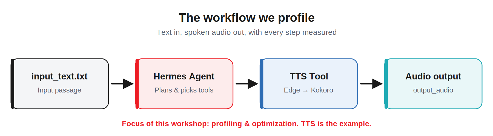
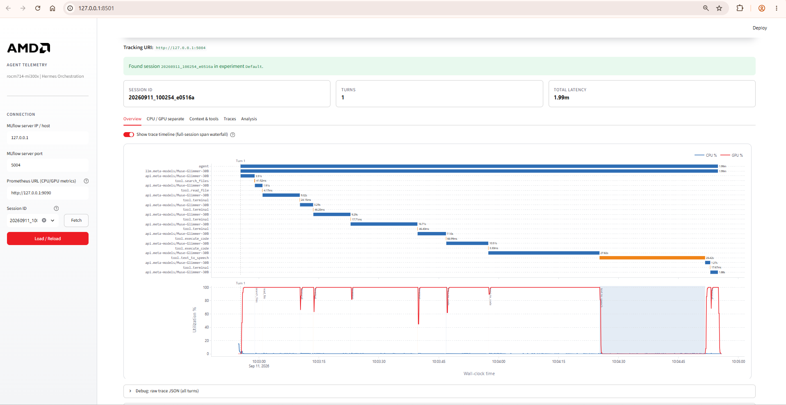
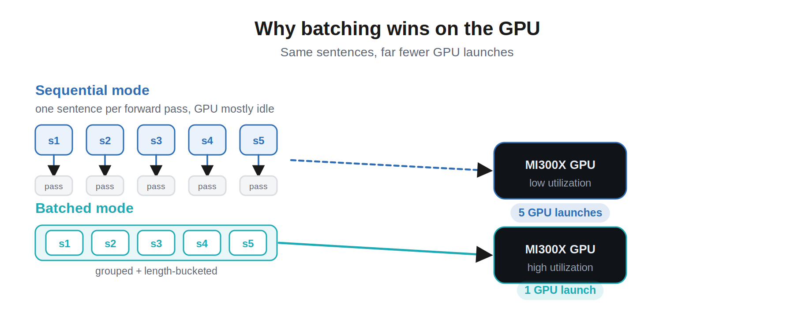
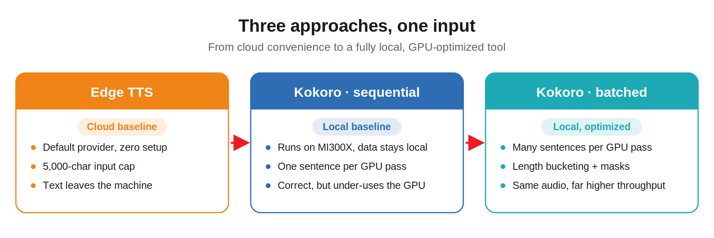
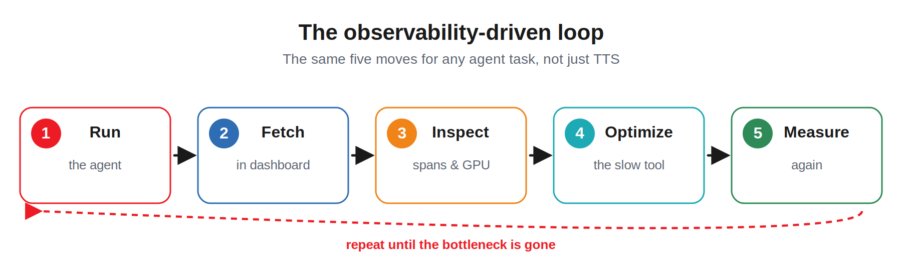

> 原文作者：Shailen Sobhee, Jereshea John Mary, Sabira Shaik  
> [AMD 官方教程](https://rocm.docs.amd.com/projects/ai-developer-hub/en/latest/notebooks/inference/agentic_ai_profiling.html) · [固定版本源码](https://github.com/ROCm/gpuaidev/blob/0071bfd4bd3bd9525405c09a6ae69c983b09312a/docs/notebooks/inference/agentic_ai_profiling.ipynb)  
> 上游版本：`0071bfd4bd3bd9525405c09a6ae69c983b09312a` · 同步日期：2026-10-12  
> 翻译状态：机器初译，待逐篇人工校对；代码与命令保持原文，未在 AMD GPU 上运行验证。

[中文 Notebook](../../notebooks/inference/agentic_ai_profiling.ipynb) · [英文原文](../../original/inference/agentic_ai_profiling.md) · [中英对照](../../bilingual/inference/agentic_ai_profiling.md)

---

<a id="profiling-and-optimizing-an-ai-agent-on-amd-instinct-gpus"></a>

# 在 AMD Instinct GPU 上分析并优化 AI 智能体性能
**作者**：Shailen Sobhee, Jereshea John Mary, Sabira Shaik
**知识水平**：中级  
**发布日期：** 2026 年 9 月 28 日 

在本实践教程中，您将学习分析和优化 AI 智能体。你会跑
一个真正的人工智能智能体，观察它把时间花在哪里，识别和优化缓慢的步骤， 
并通过硬件遥测证明加速效果。不假设之前有分析经验。

<a id="background"></a>

## 背景

本节介绍本教程中使用的关键概念和工具。

<a id="agentic-ai"></a>

### 智能体人工智能

与普通聊天机器人不同，**智能体**可以在其上**计划并完成多步骤任务
拥有**。智能体还决定使用哪些**工具**以及以什么顺序调用它们来实现其目标。

> **对于那些刚接触智能体人工智能的人来说，**这里有两个术语需要了解：
>
> **工具**：智能体可以执行的单个操作，作为可调用函数公开（例如，“将此文本转换为语音”或“读取文件”）。在每一步中，智能体都会选择合适的工具。   
>
> **技能：** 更高级别、可重复使用的能力。它是一组打包的指令，可以组合多个工具来处理更大的任务。

[**爱马仕智能体**](https://hermes-agent.nousresearch.com/docs/getting-started/quickstart)
是 [**Nous Research**](https://nousresearch.com/) 的开源自主 AI 智能体框架。它附带内置工具，您可以添加**自定义工具**，例如本教程中使用的 [**Kokoro TTS**](https://kokorottsai.com/) 工具。 

<a id="why-profiling-matters"></a>

### 为什么分析很重要

当智能体运行时，有些步骤快，有些步骤慢。分析会衡量每个步骤，以便您可以准确了解智能体将时间花在哪里。

智能体的速度取决于它调用的工具。即使驱动它的人工智能模型很快，单个慢速工具也会减慢整个运行的速度。找到并修复这个缓慢的工具通常会导致反应迟缓的智能体和反应灵敏的智能体之间的区别。

<a id="what-you-will-learn"></a>

## 你将学到什么

在本教程中，您将学习分析文本转语音 (TTS) 工作流程，如下图所示：

<p align="center">

</p>
在本课程结束时，您将能够：

- 运行 Hermes 智能体并捕获其遥测数据
- 阅读遥测仪表板以发现速度慢的工具
- 更换该工具的优化版本
- 比较之前和之后，看看硬件使用情况如何变化

<a id="prerequisites"></a>

## 前置条件

本教程是使用以下设置进行开发和测试的。

<a id="operating-system"></a>

### 操作系统
**Ubuntu 24.04：** 确保这是您的系统运行的 Linux 发行版。

<a id="hardware"></a>

### 硬件
**AMD Instinct™ GPU：** 本教程在单个 MI300X GPU（192 GB VRAM）上进行了测试，该 GPU 可以轻松地同时托管 Muse-Glimmer-30B 模型和 Kokoro TTS 模型。确保您使用的是 AMD Instinct GPU 或支持 ROCm 的兼容硬件，并且您的系统满足[官方要求](https://rocm.docs.amd.com/projects/install-on-linux/en/latest/reference/system-requirements.html)。

<a id="software"></a>

### 软件

**ROCm 7.14.1 或更高版本**：按照 [ROCm 安装指南](https://rocm.docs.amd.com/projects/install-on-linux/en/latest/install/quick-start.html) 安装并验证 ROCm。安装后，使用以下命令确认您的设置：

```bash
amd-smi
```

此命令列出了您的 AMD GPU 以及相关详细信息。

**vLLM ROCm 映像：** 智能体的模型由 vLLM 推理 提供服务，并使用 `vllm/vllm-openai-rocm` 映像提供服务引擎，其中包括 Muse-Glimmer-30B 支持。这不是AMD发布的镜像，而是由开源社区构建并在AMD工程师帮助下维护的上游镜像。

**Python 3.12：** 它运行 Kokoro 服务器、MLflow 和此Notebook。

<a id="environment-setup"></a>

## 环境设置

整个教程在一个容器内运行，该容器从官方上游 `vllm/vllm-openai-rocm` 镜像开始。该映像已提供 vLLM、PyTorch、AITER 和 ROCm 库。本教程所需的所有其他内容都通过运行下面的单元安装在该Notebook中，因此无需提取或构建自定义映像。

<a id="1-launch-the-container-and-open-jupyterlab"></a>

### 1.启动容器并打开JupyterLab

从主机 shell 运行这个命令。它启动官方映像，在其中安装 JupyterLab，并为该Notebook提供服务：

```bash
docker run -d --name amd-agentic-ai-profiling \
  --device=/dev/kfd --device=/dev/dri \
  --security-opt seccomp=unconfined --group-add video \
  --ipc=host --shm-size 16G --network=host \
  -v "$HOME/hf_cache:/root/.cache/huggingface" \
  --entrypoint bash \
  vllm/vllm-openai-rocm:latest -c \
  'python3 -m pip install --break-system-packages -q jupyterlab==4.5.7 && \
   jupyter lab --ip=0.0.0.0 --port=8888 --no-browser --allow-root \
     --ServerApp.root_dir=/root'
```
> **为什么挂载 `$HOME/hf_cache`？** 如果目录尚不存在，Docker 将创建当前用户拥有的绑定挂载的主机端。安装新的 `$HOME/hf_cache` 意味着 Hugging Face 缓存从一开始就是用户拥有的，因此即使在无法 `sudo chown` 根创建的 `~/.cache/huggingface` 的集群上，模型下载也可以工作。容器将其视为 `/root/.cache/huggingface`。

然后使用以下命令从容器日志中读取 JupyterLab URL（及其访问令牌）：

```bash
docker logs amd-agentic-ai-profiling 2>&1 | grep -m1 'http://127.0.0.1:8888'
```

在浏览器中打开该链接，然后使用 JupyterLab 文件浏览器打开此Notebook (`agentic_ai_profiling.ipynb`)，并从那里运行其余教程。

> **如果 GPU 位于通过 SSH 访问的远程计算机上**，请在本地系统上打开第二个终端并 
> 转发端口，以便您可以从本地浏览器访问远程计算机及其浏览器 UI：
>
> ```bash
> ssh -L 8888:localhost:8888 <user>@<gpu-host>
> ```
> 在浏览器中打开 JupyterLab URL（及其访问令牌），然后使用 JupyterLab 的 **上传文件** 按钮
> 将此Notebook（`agentic_ai_profiling.ipynb`）上传到远程环境。打开上传的Notebook并运行
> 本教程的其余部分从那里开始。

此Notebook可从 [AI Developer Hub GitHub 存储库](https://github.com/ROCm/gpuaidev/blob/main/docs/notebooks/inference/agentic_ai_profiling.ipynb) 获取。

<a id="2-fetch-the-tutorials-support-files"></a>

### 2. 获取教程的支持文件

本教程使用一些支持文件：后端设置脚本 (`utils/setup_backend.sh`)、分析 **仪表板** (`utils/hermes_profiler.py`)、本地 **Kokoro TTS 服务器** (`utils/kokoro_server.py`) 及其启动/清除脚本、仪表板主题和自定义 **`kokoro_tts` 智能体工具** (`custom_tools/kokoro_tts_tool.py`)。下面的单元格将它们从社区公共存储库提取到该Notebook旁边的文件夹 `utils/` 和 `custom_tools/` 中。

运行以下单元格一次。它会打印它获取的每个文件，并且可以安全地重新运行。

```python
%%bash
set -euo pipefail

REPO_URL="https://github.com/shailensobhee/amd-agentic-ai-profiling-workshop.git"
BRANCH="single-container"
CLONE_DIR=".nb_support_checkout"

# Fetch only the support files the later cells import or deploy, not the whole repo.
rm -rf "$CLONE_DIR"
git clone --quiet --depth 1 --branch "$BRANCH" --filter=blob:none --sparse "$REPO_URL" "$CLONE_DIR"
( cd "$CLONE_DIR" && git sparse-checkout set utils custom_tools >/dev/null )

# Place the files the notebook uses. setup_backend.sh is the backend plumbing
# (downloads and launches Prometheus, Grafana, MLflow, vLLM, and the Hermes
# agent); its tutorial-facing configuration is set in the next cell.
mkdir -p utils/.streamlit custom_tools
cp "$CLONE_DIR/utils/setup_backend.sh"         utils/
cp "$CLONE_DIR/utils/hermes_profiler.py"        utils/
cp "$CLONE_DIR/utils/kokoro_server.py"          utils/
cp "$CLONE_DIR/utils/start_kokoro_server.sh"    utils/
cp "$CLONE_DIR/utils/clear_cache.sh"            utils/
cp "$CLONE_DIR/utils/.streamlit/config.toml"    utils/.streamlit/
cp "$CLONE_DIR/custom_tools/kokoro_tts_tool.py" custom_tools/
rm -rf "$CLONE_DIR"

echo "[OK] Support files ready:"
echo "     utils/setup_backend.sh           (backend setup: services + telemetry)"
echo "     utils/hermes_profiler.py         (profiling dashboard)"
echo "     utils/kokoro_server.py           (local Kokoro TTS server)"
echo "     utils/start_kokoro_server.sh     (starts the Kokoro server)"
echo "     utils/clear_cache.sh             (clears the GPU kernel cache)"
echo "     utils/.streamlit/config.toml     (dashboard theme)"
echo "     custom_tools/kokoro_tts_tool.py  (custom kokoro_tts agent tool)"
```

<a id="3-configure-the-backend"></a>

### 3.配置后端

后端由您在上一个单元中下载的 `utils/setup_backend.sh` 设置。设置逻辑有意保留在Notebook之外，以避免出现一长串 shell 代码。相反，下面的单元格显示了您最有可能自定义的设置：智能体使用的模型、服务端口、GPU 内存比例以及官方映像中缺少的 Python 包。该脚本从环境变量中读取这些值，使该单元格成为调整配置的唯一位置。其他一切，包括下载和启动 Prometheus、Grafana、MLflow、vLLM 和 Hermes 智能体，都是保留在脚本中的实现细节。

要随时检查完整脚本，请在 JupyterLab 文件浏览器中打开 `utils/setup_backend.sh` 或在新单元中运行 `!cat utils/setup_backend.sh`。

```python
# ---------------------------------------------------------------------------
# Configure the backend
# ---------------------------------------------------------------------------
# These are the knobs the tutorial cares about. utils/setup_backend.sh reads
# them from the environment, so this is the one place you change the model, the
# service ports, or the GPU memory fraction.
import os

# --- Service configuration (the setup script reads these) ------------------
os.environ["HERMES_MODEL"]           = "meta-models/Muse-Glimmer-30B"  # agent model, served by vLLM
os.environ["VLLM_PORT"]              = "8001"   # vLLM OpenAI-compatible API
os.environ["MLFLOW_PORT"]            = "5004"   # MLflow tracking server (traces)
os.environ["PROM_PORT"]              = "9090"   # Prometheus (metrics store, OTLP receiver)
os.environ["GRAFANA_PORT"]           = "3000"   # Grafana (metrics UI)
os.environ["GPU_MEMORY_UTILIZATION"] = "0.80"   # fraction of VRAM vLLM may use

# --- Python packages the official image does not ship ----------------------
# OpenTelemetry must stay a coherent 1.40.0 set: the image ships otel 1.40.0 and
# lmcache caps opentelemetry-api at <=1.40.0, so bumping only part of the stack
# breaks 'pip check'. The setup script reuses OTEL_PINS for its plugin install.
os.environ["OTEL_PINS"] = (
    "opentelemetry-api==1.40.0 opentelemetry-sdk==1.40.0 opentelemetry-proto==1.40.0 "
    "opentelemetry-semantic-conventions==0.61b0 "
    "opentelemetry-exporter-otlp-proto-common==1.40.0 "
    "opentelemetry-exporter-otlp-proto-grpc==1.40.0 "
    "opentelemetry-exporter-otlp-proto-http==1.40.0 "
    "opentelemetry-exporter-otlp==1.40.0"
)

os.environ["PIP_BREAK_SYSTEM_PACKAGES"] = "1"
os.environ["PIP_ROOT_USER_ACTION"]      = "ignore"

# Install the tutorial's Python packages. setup_backend.sh installs these too
# when they are missing (so it still runs standalone), but doing it here keeps
# the dependency list visible.
get_ipython().system(
    'python3 -m pip install -q '
    'kokoro soundfile fastapi "uvicorn[standard]" '
    '"streamlit>=1.30" "mlflow>=3.0.0" plotly pandas ipywidgets matplotlib kaleido '
    '$OTEL_PINS '
    'psutil requests'
)
print("[OK] Backend configuration set and Python packages installed.")
```

<a id="4-start-the-tutorial-backend"></a>

### 4.启动教程后端

下面的单元使用预览单元中设置的配置运行 `utils/setup_backend.sh`。它启动教程中介绍的服务：vLLM 服务的智能体模型、用于执行跟踪的 MLflow 以及用于 CPU 和 GPU 指标的 Prometheus 和 Grafana。第一次运行会下载智能体模型（大约 60 GB），因此可能需要几分钟才能完成。当一切正常时，单元会打印 `Backend ready`。重新运行单元是安全的。

```python
# Start the tutorial backend inside this container.
#
# The configuration and Python packages were set in the cell above. This cell
# runs utils/setup_backend.sh (fetched from the repository earlier), which
# downloads and starts the services the tutorial profiles:
#   * vLLM (the agent's model)    : the model that plans and picks tools
#   * MLflow                      : stores the agent's execution traces
#   * Prometheus (upstream)       : stores CPU/GPU metrics; ingests them over
#                                   OTLP directly (no separate collector)
#   * Grafana (upstream)          : the metrics UI
#   * Hermes + hermes-otel plugin : the agent and its telemetry
#   * Streamlit dashboard         : the profiling view over traces and metrics
#
# It is safe to re-run; each service is restarted cleanly.
get_ipython().system('bash utils/setup_backend.sh')
```

以下是设置启动的每项服务的详细信息：

|服务 |角色 |
| :--- | :--- |
| **Hermes 后端** (vLLM·Muse-Glimmer-30B) |智能体的“大脑”：规划和选择工具的模型。 |
| **爱马仕OTel** |检测智能体的插件。该设置使用两个 OpenTelemetry 后端写入其配置文件：它将执行**跟踪**（跨度、计时、令牌）发送到 MLflow 跟踪服务器，并将硬件**指标**发送到 Prometheus。该设置将其配置为每 100 毫秒采样一次 `psutil` (CPU) 和 `amdsmi` (GPU)（比插件的默认值精细得多），因此时间线具有查看每个工具活动的分辨率。 |
| **MLflow 跟踪服务器** |存储仪表板可视化的执行**跟踪**。 |
| **普罗米修斯 + Grafana** |通过 OTLP 接收 CPU/GPU **指标**并将其存储在 Prometheus 中，仪表板查询利用率时间线：系统范围的 GPU%、Hermes 进程（加上子进程）CPU% 和每个工具的 CPU/GPU%。 |
| **遥测仪表板** |自定义 Streamlit 页面，可读取来自 MLflow 的跟踪和来自 Prometheus 的指标，以提供每次运行的清晰视图。 |

> **关于 LLM 模型：Muse-Glimmer-30B** 是一个专为智能体工作而构建的密集 视觉语言模型，经过 100 多个训练 
> 语言。它具有 52 层文本解码器（隐藏大小 6656）和约 1.8B 参数 ViT-G/14 感知编码器，具有 
> 训练后的上下文长度为 128K 个标记。该模型使用 BF16 精度并获得 Apache 2.0 许可 
> 开源许可证。其知识截止日期为 2026 年 1 月 4 日。

<a id="5-check-your-setup"></a>

### 5. 检查您的设置

确认 `hermes` 命令可用 
此Notebook的环境。下面的单元格将常用的安装位置添加到
`PATH`，打印 Hermes 二进制文件的路径，然后打印 `Hermes is ready.`

**如果没有打印任何内容，**表示Notebook找不到 Hermes。确保上面的后端设置单元已完成，并且 Hermes 已安装在此容器中。

```python
import os

# Hermes may live in either location depending on how it was installed:
#   /usr/local/bin  -> install performed by the backend setup cell
#   ~/.local/bin    -> per-user pip install
# A JupyterLab kernel does not always inherit the login shell's PATH, so add
# both and let `which` report the one actually in use.
for _p in ("/usr/local/bin", os.path.expanduser("~/.local/bin")):
    if _p not in os.environ["PATH"].split(os.pathsep):
        os.environ["PATH"] += os.pathsep + _p

!which hermes && echo "Hermes is ready."
```

<a id="6-prepare-your-input-text"></a>

### 6. 准备输入文本

TTS 是要分析的示例用例，因此是一段语音 
需要合成。运行下面的单元格，让 Hermes 自己写入输入段落并保存
它到 `input_text.txt`，然后传递到 TTS 工具。

```python
!hermes chat --yolo --oneshot -q "Write ONE single continuous paragraph of about 1,000 words (roughly 8000 characters) on the topic of AMD GPUs. It must be a single block of flowing prose: do NOT number the sentences, do NOT put each sentence on its own line, and do NOT use any line breaks, headings, bullet points, lists, quotes, code, or special symbols. Use normal sentence punctuation (periods and commas) so it reads naturally for text-to-speech. Write the whole passage as one block with no newline characters. Save it to 'input_text.txt' in the current directory, overwriting existing content, using your write/file tool. Do not read any other file."
```

文本准备完成后，单元格会打印生成的段落的简短摘要，以及有关创建该段落的 Hermes 会话的信息。 

> **让它成为你自己的：**随意创建你自己的段落并
> 改变其长度并将其保存为 `input_text.txt`。更长的输入可以通过批处理提高性能 
>（稍后在Notebook中实现）更加明显。

<a id="step-1-establish-a-baseline-with-edge-tts"></a>

## 步骤 1：使用 Edge TTS 建立基线

分析练习从运行 **Edge TTS** 开始，
Hermes 默认使用的文本转语音提供程序。

以下命令要求智能体读取生成的 `input_text.txt` 并说话
它。

```python
!hermes chat --yolo --oneshot -q "Convert the entire text in input_text.txt to audio and save it in output_audio.mp3"
```

Hermes 完成音频生成后，单元会打印运行摘要等内容，并将输出保存为 `output_audio.mp3`（如果音频剪辑很长，则保存为多个文件）。

<a id="step-2-profiling"></a>

## 步骤 2：分析

在最后一个单元格的输出中，您会注意到类似于以下内容的日志条目：

```text
[hermes-otel] ✓ mlflow at http://127.0.0.1:5004/v1/traces (traces only)
[hermes-otel] ✓ lgtm at http://127.0.0.1:9090/api/v1/otlp/v1/traces (metrics only)
[hermes-otel] ✓ Live dashboard store active
[hermes-otel] ✓ Host metrics sampler on (every 100 ms, gpu=amd)
[hermes-otel] Registered 13 hooks
```

这些出现是因为 `utils/setup_backend.sh` 配置 `hermes-otel` 插件来发送此
会话的执行跟踪到 MLflow 服务器（其 CPU/GPU 指标转到
普罗米修斯单独）。下一节中的遥测仪表板显示
两者：来自 MLflow 的跟踪和来自 Prometheus 的指标。

<a id="launching-the-profiling-dashboard"></a>

### 启动分析仪表板

为了使 MLflow 数据更易于阅读，有一个自定义的 Streamlit 仪表板
端口 `8501`，由 `utils/setup_backend.sh` 为您启动。下面的单元格显示仪表板的 **概述** 选项卡，以及 
解析您的服务器地址，为您提供完整仪表板的直接链接。

```python
# NOTE: Skip this cell if you are using the default AMD hosted-notebook proxy.
# If you are running locally or using a custom proxy, uncomment the next line to set the appropriate base below:
# os.environ["HERMES_PROXY_BASE"] = ""  # Use "" for local 127.0.0.1 links, or "https://your-custom-proxy"
```

```python
# This cell shows an overview tab alone; for a detailed view, click on the links provided when running this cell.
import importlib, sys, os, logging
sys.path.insert(0, os.path.abspath("utils"))
logging.disable(logging.WARNING)          # mute Streamlit's import-time warnings
import hermes_profiler
importlib.reload(hermes_profiler)          # pick up edits without a kernel restart
logging.disable(logging.NOTSET)

SESSION_ID = None   # a run ID, or None to auto-fetch the latest session
hermes_profiler.show_session_overview(SESSION_ID)
```

> **关于此单元格打印的链接。** 在默认的 AMD 托管Notebook代理上
> 单元格直接打印两个服务链接（仪表板和原始 MLflow
> view），这些就是要使用的。如果您在本地运行教程后端或转发
> 通过设置端口（`ssh -L 8501:localhost:8501`）
> `os.environ["HERMES_PROXY_BASE"] = ""`，该单元还显示
> `localhost` 链接，您应该使用该链接。如果您在远程运行教程后端
> 您直接访问的机器并且可以从您的网络访问端口 `8501`，请使用
> 服务器 IP 链接。如果链接未加载，请参阅 **[疑难解答](#troubleshooting)** 部分
> 在本Notebook的末尾。

**仪表板有五个选项卡：**

1. **概述：** 绘制智能体流程以及 CPU 和资源的跨度瀑布图
   每个跨度的 GPU 利用率。独立 CPU/GPU 之间的切换开关
   时间线（默认）和与其相关的完整会话瀑布。一个
   工具分解表位于图表下方。
2. **CPU / GPU 分离：** 分别显示 CPU 和 GPU 图表，并带有
   选项可查看用于生成**概述**图表的原始 `.csv` 文件。
3. **上下文和工具：** 显示整个会话中的上下文增长、每轮细分以及每个工具调用的结果，包括失败的调用。
4. **跟踪：** 为会话中的每个回合提供直接的 MLflow 链接。
5. **分析：** 将 MLflow 跟踪加上每个工具的执行时间提供给
   本地 `hermes` CLI 并报告如何改进智能体。取决于
   根据痕迹的长度，这可能需要大约五分钟。

> 除了仪表板的链接之外，上面的单元格还生成 MLflow 跟踪的链接。
> 以下步骤打开原始 MLflow 界面，您可以在其中浏览详细的跟踪和日志（如果 
> 您只需要仪表板为您提供的高级概述）：
> 
> 1. 使用提供的链接打开 MLflow 界面。
> 2. 打开左侧面板中的 **Traces** 选项卡，找到您最近的请求。
> 3. 同时，打开 **Evaluation Runs** 选项卡并在其中找到您的会话 ID。会话 ID
每次 Hermes 运行后，> 都会打印在单元输出中，位于 `[hermes-otel]` 旁边。

<a id="step-3-analyzing-the-run"></a>

## 步骤 3：分析运行

每次执行 Hermes 后，查看遥测数据以了解时间在哪里
花费以及驱动 延迟 的工具：

- 每次 Hermes 跑步都被记录为具有唯一会话 ID 的会话：其
  执行跟踪记录到 MLflow，其 CPU/GPU 指标记录到 `otel-lgtm`。
- 在仪表板的左侧窗格中，单击“**获取**”以加载记录的运行的 ID。最新的
  run 出现在顶部，后面是较旧的。
- 在**会话 ID** 下选择您想要的运行（通常是最新的），然后单击 **加载/重新加载**。
  仪表板绘制了发生的情况的图片。

> 循环始终相同：运行智能体，单击 **Fetch**，选择
> 最新运行，单击**加载/重新加载**，然后检查。

运行加载后，探索仪表板显示的此执行内容：

- 跑步的时间表
- TTS 工具何时运行以及运行了多长时间
- 随着时间的推移硬件指标（GPU 和 CPU 利用率）
- 总体执行 延迟

以下是示例运行的遥测仪表板的 **概述** 选项卡的屏幕截图：

<div align="center">



</div>

橙色的 `text_to_speech` 跨度是最长的单步，利用率图表显示 GPU 在运行时大部分处于空闲状态。这个差距就是您将在第 5 步中解决的瓶颈。

> **这在幕后是如何工作的**
>
> 仪表板从两个来源构建此视图：会话的跨度来自
> MLflow 跟踪，并从存储在中的指标中查询 CPU/GPU 时间线
> `otel-lgtm`（普罗米修斯）。它将两者编译成一份人类可读的摘要。

<a id="edge-tts-observations"></a>

### 边缘 TTS 观察

在遥测仪表板中，找到您运行的 Edge TTS 的 Hermes 会话 ID
刚刚完成，然后查看 Edge 生成的音频并注意以下几点：

- **无需本地设置。** Edge 是基于云的。 Hermes 向服务发送文本并
  接收回音频，这使其成为方便的基线：无需安装，
  无需配置。
- **输入长度限制。** Edge TTS 的输入长度限制为 5,000 个字符。的
  Hermes 包装器通过将较长的输入分成块（a
  10K 字符输入变成两个块，依此类推，具体取决于分块
  逻辑）。
- **音频拼接。** 这些块通常会组合成一个输出，但对于
  非常大的输入可能无法成功拼接，从而产生多个音频文件
  对于单个请求。
- **短输入。** 对于较短的输入，Edge TTS 效果很好并且很方便。
- **隐私。** 边缘基于云。在大多数实际部署中，文本是从 
本地机器传输到云端进行处理。对于隐私敏感的工作负载，本地模型更可取。

> **为什么此步骤会产生混乱、重复的工具调用。**
> `text_to_speech` 工具仅接受文本*内联*（没有文件路径
> 参数）。对于很长的一段文字，智能体无法在一次调用中传递整个文本，
> 因此它经常临时增加额外的步骤（分块文件读取，`wc`/`head`/`cat`，
> 临时副本、Python 小片段等），同时解决该限制。

长度限制、缝合边缘情况、隐私考虑以及
每个请求的网络往返都是迁移到本地的原因
接下来的模型。

<a id="step-4-local-tts-with-kokoro"></a>

## 步骤 4：使用 Kokoro 进行本地 TTS

**Kokoro** 是一种文本转语音模型，完全在本地机器上的本地 GPU 上运行。由于 推理 发生在本地，因此您的文本永远不会离开系统，因此非常适合
适用于隐私敏感的工作负载。这也意味着性能将取决于
工具使用本地硬件，这是分析的瓶颈。

虽然整个教程在单个容器内的单个机器上运行，但这个
步骤说明如何将 Kokoro 安装为本地 TTS 以及如何更改
工作流程的分析和优化策略。在一处运行所有内容
（模型服务器、本地 TTS 和遥测堆栈）是有意教学
设置：它使得本地与云的瓶颈可以在一个 GPU 上端到端地观察到。在
在生产部署中，您通常会将 TTS 作为其自己的服务运行，而不是
将其注册为 Hermes 后端工具，但是您在此处学习的分析循环（测量、
找到瓶颈，优化，再次测量）是完全一样的。

<a id="kokoro-ships-as-a-python-package-not-as-a-service"></a>

### Kokoro 作为 Python 包而不是服务提供

Kokoro 以 `pip` 包的形式发布。您安装它，导入它，然后调用它
在你自己的流程中：

```python
from kokoro import KPipeline
pipeline = KPipeline(lang_code="a")      # loads the model
audio = pipeline(text)                   # synthesizes
```

那是一个图书馆。它非常适合合成一些文本的一次性脚本
并退出，但它不太适合本教程，因为每次进程启动时模型都会重新加载。 
`KPipeline(...)` 调用将 Kokoro-82M 加载到 GPU 内存中，因此每个新进程都会再次支付模型初始化成本。
由于智能体重复调用 TTS，初始化开销将包含在每次测量中，从而模糊了实际的合成性能。

<a id="wrapping-kokoro-in-a-server"></a>

### 将 Kokoro 封装到服务器中

`utils/kokoro_server.py` 是围绕 Kokoro 库的轻量级 FastAPI + Uvicorn 包装器。它将库转变为长期运行的服务，避免了重复的模型初始化开销。

<a id="install-kokoro-and-start-the-server"></a>

### 安装 Kokoro 并启动服务器

下面的单元安装 `kokoro` 软件包和服务器的 Web 依赖项，然后下一个单元启动服务器。重新运行是安全的。

```python
!python3 -m pip install -q kokoro soundfile fastapi uvicorn
!python3 -c "import kokoro; print('kokoro', kokoro.__version__)"
```

现在使用 `utils/start_kokoro_server.sh` 在端口 8092 上启动服务器。它
将模型加载到 VRAM 一次并使其驻留，因此以后的综合调用会执行
不必支付模型初始化开销。

```python
!bash utils/start_kokoro_server.sh
```

<a id="the-custom-tool-kokoro_tts"></a>

### 自定义工具：`kokoro_tts`

`kokoro_tts`是Hermes添加的自定义工具。它将文本发送到本地 Kokoro
服务器并以 `WAV` 文件形式返回语音音频（未压缩，保留
原始品质）。 Hermes 是可扩展的：您可以向其中添加自定义工具和技能。 `kokoro_tts` 工具就是一个例子。

下面的单元格将该工具安装到 Hermes 中。该工具必须位于 Hermes 内部
`tools` 封装，因为下面的单元执行 `from tools.registry import ...`。复印
它在其他任何地方（例如 `~/.hermes/tools/`）都会留下
工具无法导入。然后智能体循环而不调用它，没有错误
消息来解释问题。该代码找到真正的包并验证该工具
已注册，而不是假设复制文件就足够了。

```python
%%bash
set -uo pipefail

SRC="./custom_tools/kokoro_tts_tool.py"
if [ ! -f "$SRC" ]; then
    echo "[ERROR] $SRC not found. Run this from the repository root."
    exit 1
fi

# Resolve the Hermes installation, whichever layout this machine uses:
# a per-user install (~/.hermes/hermes-agent) or a system one (/usr/local).
# Require both tools/ and venv/bin/python, since the verification step below
# runs that interpreter.
HERMES_ROOT=""
for cand in "$HOME/.hermes/hermes-agent" /usr/local/lib/hermes-agent; do
    if [ -x "$cand/venv/bin/python" ] && [ -d "$cand/tools" ]; then
        HERMES_ROOT="$cand"
        break
    fi
done

if [ -z "$HERMES_ROOT" ]; then
    echo "[ERROR] Could not find a complete Hermes install (tools/ + venv/)."
    echo "        Has hermes finished installing?"
    exit 1
fi

echo "[INFO] Deploying custom Kokoro TTS tool to $HERMES_ROOT/tools ..."
cp "$SRC" "$HERMES_ROOT/tools/"
echo "[OK] Copied kokoro_tts_tool.py -> $HERMES_ROOT/tools/"

# Verify the tool registers, not just that the file copied.
"$HERMES_ROOT/venv/bin/python" -c "
import sys; sys.path.insert(0, '$HERMES_ROOT')
from tools.registry import registry
import tools.kokoro_tts_tool
names = getattr(registry, 'tools', None) or getattr(registry, '_tools', {})
assert 'kokoro_tts' in names, f'kokoro_tts NOT registered; found {sorted(names)}'
print('[OK] kokoro_tts is registered and callable by the agent.')
"
```

<a id="parameters-of-the-kokoro_tts-tool"></a>

#### `kokoro_tts`工具的参数

|参数|目的|
| :--- | :--- |
| `text` |一次调用即可合成全文。 |
| `text_file` |要合成的 UTF-8 文件的路径。首选长文本，因此智能体会传递路径而不是内联的整个段落。 |
| `mode` | 推理 策略、`sequential` 或 `batched`。 `sequential` 是原生 Kokoro 基线； `batched` 是我们将在[步骤 5](#step-5-optimize-the-tool-with-batching) 中应用的优化。这个参数让我们可以比较两种模式。默认值为 `sequential`。 |
| `voice` |语音名称（默认 `af_heart`）。 |
| `batch_size` |当 `mode` 为 `batched`（默认 `24`）时，每个 GPU 前向传递的句子。在 `sequential` 模式下被忽略。 |
| `output_path` | WAV 的保存位置（默认为 `~/.hermes/audio_cache/`）。 |

该工具在 `custom_tools/kokoro_tts_tool.py` 中定义并由
`utils/kokoro_server.py`。下面的单元格在输入文本上运行该工具并分析其执行方式。

```python
!hermes chat --yolo --oneshot -q "Use the kokoro_tts tool and pass the file path 'input_text.txt' as the text_file parameter to convert the text to speech. Do not read the file yourself"
```

下面的单元格显示仪表板的**概述**选项卡，并生成指向完整仪表板和 MLflow 跟踪视图的链接。

```python
import importlib, sys, os, logging, warnings

sys.path.insert(0, os.path.abspath("utils"))

logging.disable(logging.WARNING)   # mute Streamlit's "missing ScriptRunContext" etc.
warnings.filterwarnings("ignore")  # mute plotly/mlflow UserWarning/FutureWarning etc.

import hermes_profiler
importlib.reload(hermes_profiler)          # pick up edits without a kernel restart

SESSION_ID = None   # a run ID, or None to auto-fetch the latest session
hermes_profiler.show_session_overview(SESSION_ID)

logging.disable(logging.NOTSET)
```

> **注意：** 第一个 Kokoro 运行会为您的输入形状编译 GPU 内核，这可能需要几分钟的时间。稍后的运行会重用已编译的内核并且速度更快。

<a id="how-kokoro_tts-works-and-why-the-first-run-is-slow"></a>

### `kokoro_tts` 的工作原理以及为什么第一次运行很慢

`kokoro_tts` 在 AMD MI300X GPU 上本地运行 Kokoro TTS 模型。在默认情况下
模式它一次处理输入一个句子并将结果保存为 WAV
文件。

按照与之前相同的方式在仪表板中加载此运行：单击 **Fetch**，选择
列表顶部的运行，然后单击 **加载/重新加载**。你应该看到：

- `kokoro_tts` 跨度占据时间线的最大部分，因此它是
  端到端 延迟 的主要贡献者。
- 在运行的大部分时间里，GPU 利用率保持较低水平。 MI300X 尚未完全
  被利用。
- 因为句子一次处理一个，所以每个 推理 只给 GPU 一个
  工作量小，效率低。
- 随着句子数量的增加，该工具运行更多的 推理 遍，因此 延迟
  **几乎线性**。

因此，`kokoro_tts` 可以工作并产生正确的音频，但它显然没有充分利用 GPU。
这就是仪表板揭示的瓶颈，它提供了优化的动力
工具，这是下一步。

<a id="step-5-optimize-the-tool-with-batching"></a>

## 步骤 5：通过批处理优化工具

仪表板显示了瓶颈：该工具一次向 GPU 提供一个句子
时间。为了解决这个问题，`kokoro_tts` 通过 `utils/kokoro_server.py` 扩展了优化的 `batched` 模式。

不是一次处理一个句子（`sequential` 模式），
新的 `batched` 模式将许多句子组合在一起，然后将它们发送到 GPU 
前向传递，让硬件同时完成更多工作。下图说明了两种模式之间的区别：

<p align="center">

</p>

下面的单元格重新运行完全相同的输入，这次要求 `mode='batched'` 进行比较。

```python
!hermes chat --yolo --oneshot -q "Use the kokoro_tts tool with the mode parameter set to 'batched', and pass the file path 'input_text.txt' as the text_file parameter. Do not read the file yourself"
```

下面的单元格显示了用于重新运行的仪表板的**概述**选项卡，并生成指向完整仪表板和 MLflow 跟踪视图的链接。

```python
# This cell shows an overview tab alone; for a detailed view, click on the links provided when running this cell.
import importlib, sys, os, logging
sys.path.insert(0, os.path.abspath("utils"))
logging.disable(logging.WARNING)          # mute Streamlit's import-time warnings
import hermes_profiler
importlib.reload(hermes_profiler)          # pick up edits without a kernel restart
logging.disable(logging.NOTSET)

SESSION_ID = None   # a run ID, or None to auto-fetch the latest session
hermes_profiler.show_session_overview(SESSION_ID)
```

按照与之前相同的方式在仪表板中加载此运行：单击 **Fetch**，选择
运行此运行（它显示在顶部），然后单击“**加载/重新加载**”。然后比较一下
与顺序运行并排。

<a id="what-changed-under-the-hood"></a>

### 引擎盖下发生了什么变化

Kokoro 不支持本机批处理，因此 `mode='batched'` 是重新实现
模型的前向传播。涉及三个想法：

- **批处理：** 多个句子被分组，因此 GPU 每个句子处理更多的工作
  前向传递，提高硬件利用率。
- **长度分桶：**长度相似的句子被分到同一批次，
  减少浪费的填料。
- **正确的批量处理：** 填充和注意掩模保留每个句子
  独立，最终音频被修剪回其真实长度。
  
`utils/kokoro_server.py` 中的三个函数实现了这个想法：

|功能|责任|
|---|---|
| `KokoroEngine._run_batched()` |优化的运行程序，用于代替顺序循环。它按标记长度对句子进行排序（分桶），将它们分成 `batch_size` 批次，将每批次填充到一个张量中，然后将生成的音频提取回单个句子输出。 |
| `batched_forward()` |替补前传，代替 `KModel.forward_with_tokens`。它根据真实序列长度构建真实的填充掩码，打包持续时间 LSTM，将填充持续时间归零，并构造每个句子的对齐矩阵。 |
| `_batched_f0n_train()` |该型号 `F0Ntrain` 的批量安全替换。它按帧数打包共享 LSTM，因此一个句子中的填充不会泄漏到下一个句子中。 |

<a id="what-you-should-see-in-the-dashboard"></a>

### 您应该在仪表板中看到什么

- 使用 `mode='batched'`，`kokoro_tts` 的完成速度明显快于 
  顺序模式。
- GPU 在每次前向传递中执行更多工作，因此利用率更高且开销更大
  较低。
- 总体上更少的 GPU 启动，因为句子是一起处理的，而不是
  一次一个。
- CPU 活动保持相对较低，确认工作负载在期间受 GPU 限制
  合成。
- 音频输出相同；只是执行时间下降了。

> **要点：** 批处理提高了 吞吐量 和 GPU 利用率，这使其成为
> 较长输入的首选模式。

<a id="step-6-visualize-the-improvement"></a>

## 步骤 6：可视化改进

该图表使进展一目了然。工具执行时间会影响所有方面的整体性能
三种方法，不仅仅是比较顺序执行和批量执行。从基于云的 Edge TTS 迁移到
本地 Kokoro 模型，然后批量 Kokoro 克服了基于云的方法的缺点，并提供了更好的性能，同时将所有处理保留在本地硬件上。

<p align="center">

</p>

下面的单元格使用 **Matplotlib** 绘制工具执行时间
三种方法并存，因此云到本地的迁移和
顺序到批处理的优化显示在单个视图中。

> **使用您自己的号码：** `edge_time`、`seq_time` 和 `batched_time` 是
> 预先填充示例值，因此即使您没有这样做，图表也会有意义地呈现 
> 进行任何运行。将数据替换为您自己运行的执行秒数（每个
> 工具的输出线和分析仪表板）。请注意，对于长输入，Edge
> 截断其输出，因此显示的执行时间只是为了提供基于云的上下文 
> 基线而不是与其他方法进行直接比较。

```python
%matplotlib inline

import os
import matplotlib.pyplot as plt
from matplotlib import font_manager

# --- Tool execution time (seconds) for each approach ---
# Default values; replace them with the execution seconds from your own runs,
# taken from each tool's output line and the profiling dashboard.
edge_time = 11.1      # Edge TTS (cloud) - note: truncates long text (~5 min cap)
seq_time = 83.8      # Kokoro, sequential mode (local, unoptimized)
batched_time = 7.0    # Kokoro, batched mode (local, optimized)

for _f in ("Arial", "Liberation Sans", "DejaVu Sans"):
    if any(_f in f.name for f in font_manager.fontManager.ttflist):
        plt.rcParams["font.family"] = _f
        break

AMD_RED = "#ED1C24"
INK     = "#1A1A1A"
SUBINK  = "#5B6270"
EDGE_C  = "#F08418"   # cloud Edge (dashboard orange)
SEQ_C   = "#2E6DB4"   # local sequential (dashboard blue)
BATCH_C = "#1EAAB4"   # local batched (teal)

labels = ["Edge\n(cloud)", "Sequential\n(local)", "Batched\n(local, optimized)"]
times  = [edge_time, seq_time, batched_time]
colors = [EDGE_C, SEQ_C, BATCH_C]

fig, ax = plt.subplots(figsize=(7.6, 4.8))
fig.patch.set_facecolor("white")
ax.set_facecolor("white")

bars = ax.bar(labels, times, color=colors, width=0.62, zorder=3,
              edgecolor="white", linewidth=1.2)
ax.grid(axis="y", linestyle="--", alpha=0.35, zorder=0)
ax.set_ylabel("Tool execution time (seconds)", fontsize=12, color=INK)
ax.set_title("TTS tool execution time: cloud Edge vs local Kokoro",
             fontsize=14, fontweight="bold", color=INK, pad=30)
ax.text(0.5, 1.045, "lower is better", transform=ax.transAxes, ha="center",
        va="bottom", fontsize=10.5, color=SUBINK, style="italic")
ax.set_ylim(0, max(times) * 1.32)
ax.bar_label(bars, fmt="%.1f s", padding=4, fontweight="bold",
             fontsize=12, color=INK)
ax.tick_params(colors=INK, labelsize=11)

notes = []
if seq_time and batched_time:
    notes.append(f"batched is {seq_time / batched_time:.1f}x faster than sequential")
if edge_time and batched_time:
    notes.append(f"batched is {edge_time / batched_time:.1f}x faster than Edge")
if notes:
    ax.text(0.98, 0.96, "\n".join(notes), transform=ax.transAxes,
            ha="right", va="top", fontsize=11.5, fontweight="bold",
            color=AMD_RED,
            bbox=dict(boxstyle="round,pad=0.5", facecolor="#FDECEC",
                      edgecolor=AMD_RED, linewidth=1.0))

for side in ("top", "right"):
    ax.spines[side].set_visible(False)
for side in ("left", "bottom"):
    ax.spines[side].set_color("#C9CDD6")

plt.tight_layout()
os.makedirs("outputs", exist_ok=True)
plt.savefig("outputs/tts_execution_comparison.png", dpi=150, bbox_inches="tight",
            facecolor="white")
plt.show()

print(f"Edge: {edge_time:.1f}s | Sequential: {seq_time:.1f}s | "
      f"Batched: {batched_time:.1f}s")
```

<a id="applying-the-profiling-loop-to-other-workloads"></a>

## 将分析循环应用于其他工作负载

您现在已经运行了单个示例的完整工作流程。同样的可观测性驱动
工作流程适用于 TTS 之外的各种 AI 工作负载。

<p align="center">

</p>

**为此 TTS 示例尝试不同的输入**

1. 通过重新运行 [准备输入文本](#6-prepare-your-input-text) 单元格来重新生成 `input_text.txt`
   新主题，或直接编辑 `input_text.txt` 文件。较长的多句文本使得
   批处理的加速效果更加明显。
2. 重新运行两个合成单元：[步骤 4](#step-4-local-tts-with-kokoro) 中默认（顺序）模式下的 `kokoro_tts`，
   然后在[步骤5](#step-5-optimize-the-tool-with-batching)中使用`mode='batched'`。
3. 在仪表板中，单击 **Fetch**，选择最新的运行，单击
   **加载/重新加载**，然后用您自己的执行更新[步骤6](#step-6-visualize-the-improvement)中的Matplotlib单元
   次进行比较。

> **重新运行 Edge 基线：** 安装 `kokoro_tts` 后，智能体将
> 通常更喜欢它，因此[步骤1](#step-1-establish-a-baseline-with-edge-tts)中的单元不再测量 
> 边缘。要再次运行 Edge，请先删除自定义工具，然后再重新运行单元：
>
> ```bash
> rm -f ~/.hermes/hermes-agent/tools/kokoro_tts_tool.py # 每个用户安装
> rm -f /usr/local/lib/hermes-agent/tools/kokoro_tts_tool.py # 容器镜像
> ```
>
> 要切换回 `kokoro_tts`，请重新运行 [步骤 4](#step-4-local-tts-with-kokoro) 中的自定义工具安装单元。

**在您自己的用例中尝试**

文本转语音只是一个例子。将相同的工作流程指向**任何** Hermes 任务：
研究查询、编码任务、多工具工作流程，以便：

- **在仪表板中分析运行**（单击 **Fetch**，选择运行，然后
  **加载/重新加载**）以查看 CPU 和 GPU 时间线，以及哪个工具占主导地位。
- **检查 MLflow 跟踪**（**跟踪**视图）以深入了解每个会话，
  LLM 调用和工具调用并准确查看时间花在哪里。
- **找到瓶颈，优化它，然后再次测量**，遵循您在此处经历的相同循环。

> **提示。** 工作量越大，优化越清晰。让仪表板和
> 痕迹消除了猜测并指出了缓慢的步骤。

<a id="cleanup"></a>

## 清理

该研讨会编写了一些工件，包括音频文件、输入文本和遥测数据。 
此外，容器将保持运行状态直至停止。 
完成教程后，请按照以下步骤进行清理：

- 删除工作目录中生成的文件：

    ```bash
    rm -f input_text.txt output_audio.mp3  # if Edge TTS produced multiple audio files, remove them manually
    rm -rf outputs
    ```

- 停止并移除容器：

    ```bash
    docker stop amd-agentic-ai-profiling
    docker rm amd-agentic-ai-profiling
    ```

- 如果您不打算再次运行容器映像，则可以选择删除容器映像以回收磁盘空间：

    ```bash
    docker rmi vllm/vllm-openai-rocm
    ```

通过这些步骤，`$HOME/hf_cache` 中的 Hugging Face 缓存将被保留，以便将来的运行不会重新下载
模型。如果您想回收磁盘空间，也请删除模型：

```bash
rm -rf "$HOME/hf_cache"
```

<a id="conclusion-and-key-takeaways"></a>

## 结论和要点

本练习演练了可观察性驱动的优化工作流程
将基于云的 Edge TTS 与本地 Kokoro TTS 进行比较，确定瓶颈
通过遥测，优化本地实施，并衡量改进情况。

|相|工具|执行 |结果|
| :--- | :--- | :--- | :--- |
| **1 · 边缘 TTS** | `text_to_speech` |基于云 |方便短输入，但将文本发送到机器之外，并且 延迟 比本地模型更高。 |
| **2 · Kokoro，顺序** | `kokoro_tts` |本地MI300X，一句话/通 |完整输出，但 GPU 利用率较低，速度较慢。 |
| **3 · Kokoro，批量** | `kokoro_tts` (`mode='batched'`) |本地MI300X，多句/通|相同的输出，执行时间和 GPU 利用率显着提高。 |

<a id="what-we-learned"></a>

### 我们学到了什么

- **云到本地：** 从 Edge TTS 迁移到本地 Kokoro 模型删除了
  输入长度限制并在机器上保留文本处理。
- **建立基线：** 顺序 Kokoro 实现建立了基线
  用于本地 TTS 性能。
- **测量，不要猜测：** 可观察性仪表板清楚地表明
  本地模型未充分利用 GPU。
- **通过批处理进行优化：** 批处理模式一起处理多个句子，
  削减 推理 和启动开销并更好地使用 GPU。
- **验证改进：** 重新运行工作流程和分析证实，批处理 Kokoro 模式大幅优于顺序模式，并且比 Edge TTS 有了显着改进。
- **迭代：**切换到本地模型，建立基线，找到瓶颈，
  优化，然后再次测量。

<a id="diving-deeper"></a>

## 深入研究

本节为想要进一步探索的用户提供可选实验和背景信息。

<a id="extra-experiments"></a>

### 额外实验

- **原始 MLflow UI（高级）：** 直接浏览所有内容
  `http://<server-ip>:5004`，在**跟踪**和**运行**选项卡下。
- **分析选项卡：** 单击仪表板中的 **使用 Hermes 分析** 以进行自动分析，
  基于运行的 `tool_breakdown.csv` 的简单语言建议。

<a id="understanding-the-kokoro-kernel-cache"></a>

### 了解 Kokoro 内核缓存

当 Kokoro 运行时，它会针对遇到的特定输入形状编译 GPU 内核。以下部分解释了此编译过程的工作原理以及内核缓存如何影响性能。

<a id="kernel-compilation-and-reuse"></a>

#### 内核编译和复用

对于 Kokoro 的特定输入：

- **首次运行（冷运行）：** 第一次执行编译所需的 GPU 内核。
  这种编译开销会增加执行时间。
- **后续运行：** 从第二次运行开始，已编译的内核将被重用
  缓存，提供更快的执行速度和更低的 延迟。
- **清除缓存：** 对于基于Python的执行，内核缓存可以是
  用 `utils/clear_cache.sh` 清除。然而，在这个研讨会上，Kokoro 作为一个
  持久服务器，因此清除缓存意味着停止服务器，删除
  缓存，并在再次进行基准测试之前重新启动。

<a id="understanding-the-cache"></a>

##### 了解缓存
MIOpen 将编译和调整的 GPU 内核存储在其缓存中。与
`MIOPEN_FIND_MODE=FAST`，MIOpen 在以后的运行中跳过昂贵的内核搜索，
重用最好的缓存内核。代码对象管理器 (COMGR) 缓存 LLVM 编译工件， 
避免在未来执行时重新编译 GPU 代码。

<a id="is-the-cache-reused-for-all-subsequent-input"></a>

##### 缓存是否会重新用于所有后续输入？

并非总是如此。缓存是为依赖于特定内核配置而构建的
输入形状等因素，包括序列长度和张量维度。如果有新的输入
需要之前没有编译过的配置，MIOpen编译并缓存
在执行期间。一旦编译的内核被缓存，稍后就可以重用相同的配置运行
它。

<a id="troubleshooting"></a>

### 故障排除

可能会出现一些问题，最有可能与权限和访问服务有关
从远程浏览器。

**模型下载或 Kokoro 安装因权限错误而失败：** 会发生这种情况
当 `~/.cache/huggingface` 是由 root 进程创建时，您不能
`sudo chown` 它返回给您自己（在共享 GPU 集群上常见）。使用容器启动
上面的命令带有一个新的、用户拥有的缓存目录：
`-v "$HOME/hf_cache:/root/.cache/huggingface"`。 Docker 创建 `$HOME/hf_cache`
归您所有，因此无需任何 `chown` 即可下载。

**仪表板或 MLflow 链接未在我的计算机上加载：** 链接指向
运行后端的主机。如果这是远程服务器：

- 通过 SSH 转发端口并使用 `localhost` 链接：
  `ssh -L 8501:localhost:8501 -L 5004:localhost:5004 <user>@<server>`，然后设置
  `os.environ["HERMES_PROXY_BASE"] = ""` 在运行之前位于 [启动分析仪表板](#launching-the-profiling-dashboard) 下的第一个单元格中。
- 或者，如果端口 `8501`/`5004` 在您的网络上可直接访问，请使用
  服务器 IP 链接单元格打印。
- 在 AMD 托管Notebook代理上，使用与打印和链接完全相同的代理链接
  保留 `HERMES_PROXY_BASE` 未设置。

**`which hermes` 不打印任何内容：** JupyterLab 内核可能没有继承
登录 shell 的 `PATH`。重新运行 [第 5 步：检查您的设置](#5-check-your-setup)，这会添加
`/usr/local/bin` 和 `~/.local/bin` 至 `PATH`。如果Notebook仍然找不到Hermes，
确保后端已完成启动。

<a id="further-reading"></a>

## 进一步阅读

有关更深入的服务器参考和故障排除说明，请参阅研讨会存储库的 `README`，网址为 
<https://github.com/shailensobhee/amd-agentic-ai-profiling-workshop>。
