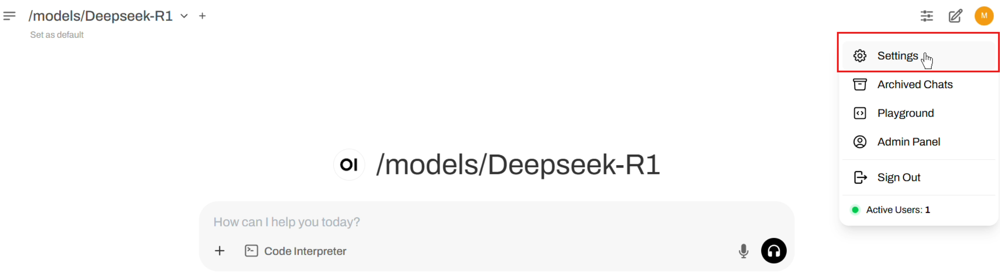
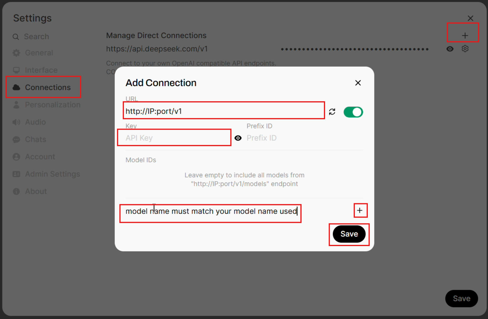
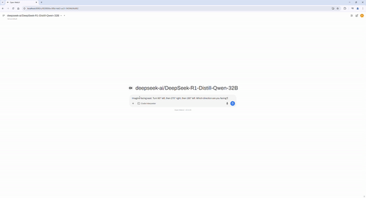
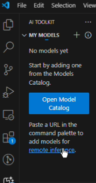
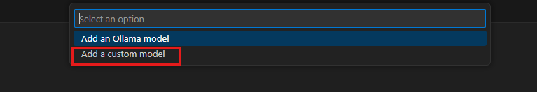
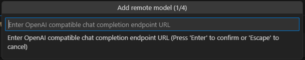
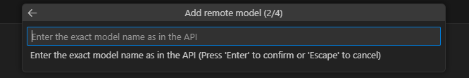
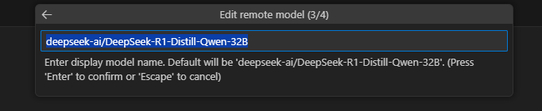
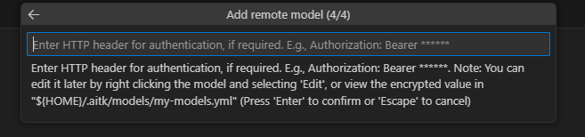
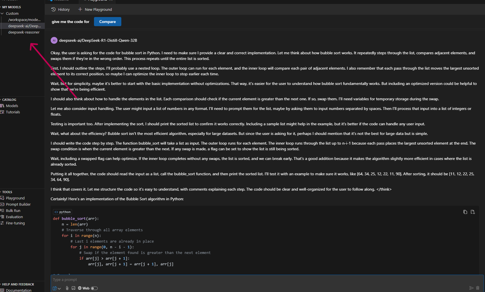

> 原文作者：Mahdi Ghodsi  
> [AMD 官方教程](https://rocm.docs.amd.com/projects/ai-developer-hub/en/latest/notebooks/inference/deepseekr1_sglang.html) · [固定版本源码](https://github.com/ROCm/gpuaidev/blob/0071bfd4bd3bd9525405c09a6ae69c983b09312a/docs/notebooks/inference/deepseekr1_sglang.ipynb)  
> 上游版本：`0071bfd4bd3bd9525405c09a6ae69c983b09312a` · 同步日期：2026-10-12  
> 翻译状态：机器初译，待逐篇人工校对；代码与命令保持原文，未在 AMD GPU 上运行验证。

[中文 Notebook](../../notebooks/inference/deepseekr1_sglang.ipynb) · [英文原文](../../original/inference/deepseekr1_sglang.md) · [中英对照](../../bilingual/inference/deepseekr1_sglang.md)

---

<a id="deepseek-r1-with-sglang-and-example-applications"></a>

# 使用 SGLang 运行 DeepSeek-R1
**作者**：Mahdi Ghodsi
**知识水平**：初学者

在本教程中，您将利用 AMD GPU 来部署强大的语言模型 [DeepSeek-R1-Distill-Qwen-32B](https://huggingface.co/deepseek-ai/DeepSeek-R1-Distill-Qwen-32B)。本教程涵盖了设置人工智能开发环境并探讨了两个主要的实际应用：

* **高级聊天机器人：** 使用 Open WebUI 创建具有 Web 搜索和文件交互功能的复杂聊天机器人。
* **代码开发助手：** 安装并利用 AI Toolkit Code 扩展来执行代码分析和结对编程任务。

让我们深入了解吧！

**注意**：可以应用相同的步骤在单个 AMD MI300X 节点上为 DeepSeek-R1(671B) 提供服务。有关运行此模型的更多信息，请参阅[此博客文章](https://rocm.blogs.amd.com/artificial-intelligence/DeepSeekR1-Part2/README.html)。 

<a id="prerequisites"></a>

## 前置条件

本教程是使用以下设置进行开发和测试的。 

<a id="operating-system"></a>

### 操作系统

* **Ubuntu 22.04**：确保您的系统运行的是 Ubuntu 版本 22.04。

<a id="hardware"></a>

### 硬件

* **AMD Instinct™ GPU**：本教程在 AMD Instinct MI300X GPU 上进行了测试。确保您使用的是 AMD Instinct GPU 或支持 ROCm 的兼容硬件，并且您的系统满足[官方要求](https://rocm.docs.amd.com/projects/install-on-linux/en/latest/reference/system-requirements.html)。

<a id="software"></a>

### 软件

* **ROCm 6.2 或 6.3**：按照 [ROCm 安装指南](https://rocm.docs.amd.com/projects/install-on-linux/en/latest/install/quick-start.html) 安装并验证 ROCm。安装后，使用以下命令确认您的设置：

    ``` bash
    amd-smi
    ```

    此命令列出了您的 AMD GPU 以及相关详细信息。
    
    **注意**：对于 ROCm 6.4 及更早版本，请改用 `rocm-smi` 命令。

* **Docker**：确保 Docker 已正确安装和配置。请遵循适用于您的操作系统的 Docker 安装指南。

   **注意**：确保正确配置 Docker 权限。要配置权限以允许非 root 访问，请运行以下命令：

   ``` bash
   sudo usermod -aG docker $USER
   newgrp docker
   ```

   验证 Docker 是否正常工作：

   ``` bash
   docker run hello-world
   ```

* **Visual Studio Code**：确保已下载 Visual Studio Code (VS Code)。您可以从[官方下载页面](https://code.visualstudio.com/Download)下载VS Code。 


<a id="launch-jupyter-notebooks"></a>

## 启动 Jupyter Notebook 

使用以下命令安装 Jupyter：

``` bash
pip install jupyter
```

启动 Jupyter 服务器：

``` bash
jupyter-lab --ip=0.0.0.0 --port=8888 --no-browser --allow-root
```

**注意**：在运行上述命令之前，请确保您的系统上尚未使用端口 `8888`。如果是，您可以通过将 `--port=8888` 替换为其他端口号来指定其他端口，例如 `--port=8890`。

**注意**：成功启动 Jupyter 服务器后，应在 Jupyter Notebook中执行以下步骤。

<a id="launching-the-sglang-server-on-amd-gpus"></a>

## 在 AMD GPU 上启动 SGLang 服务器

以下命令拉取指定的 SGLang Docker 映像，启动容器，然后运行 `sglang.launch_server` 命令来启动服务器。

**重要**：必须从[其官方 Docker Hub 页面](https://hub.docker.com/r/lmsysorg/sglang/tags) 检索最新版本的 SGLang Docker 映像标签。

```python
%%bash
export INFERENCE_PORT=30000
export INFERENCE_MODEL=deepseek-ai/DeepSeek-R1-Distill-Qwen-32B
export CUDA_VISIBLE_DEVICES=0
export DEBUG_HIP_BLOCK_SYNC=1024
export API_KEY="abc-123"
export GPU_FORCE_BLIT_COPY_SIZE=6
export SGLANG_DIMG="lmsysorg/sglang:v0.4.5.post3-rocm630"

docker run -d --rm \
    --ipc=host \
    --privileged \
    --shm-size 16g \
    --device=/dev/kfd \
    --device=/dev/dri \
    --group-add video \
    --cap-add=SYS_PTRACE \
    --cap-add=CAP_SYS_ADMIN \
    --security-opt seccomp=unconfined \
    --security-opt apparmor=unconfined \
    --env "HIP_VISIBLE_DEVICES=$CUDA_VISIBLE_DEVICES" \
    -p 30000:30000 \
    -v ~/.cache/huggingface:/root/.cache/huggingface \
    --name sglang_server "lmsysorg/sglang:v0.4.5.post3-rocm630" \
    python3 -m sglang.launch_server \
    --model deepseek-ai/DeepSeek-R1-Distill-Qwen-32B \
    --port 30000 \
    --trust-remote-code \
    --disable-radix-cache \
    --host 0.0.0.0 \
    --api-key "abc-123"
```

**注意：** 选择向公众开放的适当端口号。确保网络和防火墙设置允许通过所选端口号连接到您的服务器。

验证模型是否已加载并且服务器是否已成功启动。以下脚本旨在持续检查，直到服务器准备就绪或命令超时。 

**注意**：下载和加载模型可能需要几分钟的时间。

```python
import os, time, requests, sys, subprocess

# ---------- tweakables ------------------------------------------------------
PORT          = int(os.getenv("INFERENCE_PORT", 30000))
URL           = f"http://localhost:{PORT}/health_generate"
HEADERS       = {"Authorization": f"Bearer {os.getenv('API_KEY', 'abc-123')}"}

SLEEP         = 30          # seconds between polls
TIMEOUT       = 20 * 60     # give up after 20 min  (0 ⇢ wait forever)
CONTAINER_NAME = "sglang_server"   # <-- the one you used in docker run
# ---------------------------------------------------------------------------

def dump_logs(container, lines=100):
    """Print the last *lines* of docker logs for *container*."""
    try:
        result = subprocess.run(
            ["docker", "logs", "--tail", str(lines), container],
            stdout=subprocess.PIPE,
            stderr=subprocess.STDOUT,
            text=True,
            check=False,
        )
        print("\n--- docker logs (tail) -----------------------------")
        print(result.stdout or "(no output)")
        print("--- end docker logs --------------------------------\n")
    except FileNotFoundError:
        print("\n Docker CLI not found—cannot show logs\n")

start = time.time()
print(f"Polling {URL} every {SLEEP}s (timeout: {TIMEOUT or '∞'} s)…")

while True:
    elapsed = time.time() - start

    # --- timeout handling ----------------------------------------------------
    if TIMEOUT and elapsed >= TIMEOUT:
        print(f"\n Timeout: model didn’t load within {TIMEOUT/60:.1f} min")
        dump_logs(CONTAINER_NAME)
        sys.exit(1)

    try:
        if requests.get(URL, headers=HEADERS, timeout=10).ok:
            print(f"\n✅  Model is ready! Total load time: {elapsed:.1f}s")
            break
        else:
            status = "server up, model still loading"
    except requests.exceptions.RequestException:
        status = "server not responding yet"

    print(f"[{elapsed:5.0f}s] {status}. Retrying in {SLEEP}s …")
    time.sleep(SLEEP)
```

成功启动后，您的服务器应该通过 OpenAI 兼容的 API 接受传入流量。检索服务器的公共 IP 地址：

```python
!curl ifconfig.me
```

现在，您可以在自己的本地设备上继续学习本教程的其余部分。通过使用上一个单元的 IP 地址从本地设备执行以下命令，验证端点是否可访问。当您执行 SGLang 服务器单元时，`PORT_NUMBER` 的值设置为 `INFERENCE_PORT`。

```python
!curl http://YOUR_SERVER_PUBLIC_IP:PORT_NUMBER/v1/models -H "Authorization: Bearer abc-123"
```

<a id="advanced-chatbot-with-openwebui"></a>

## 使用 OpenWebUI 的高级聊天机器人 

**注意**：本教程的其余部分旨在在您自己的本地设备上执行。

按照 [打开 WebUI GitHub 存储库](https://github.com/open-webui/open-webui) 中的安装说明进行操作。

安装后，在 Open WebUI 客户端中配置端点 URL，如下所示：

- 导航至 `Settings`，如下图所示：

  

- 从左侧选项卡中选择 `Connections`。
  - 输入 `URL`，使其与以下格式匹配：`http://YOUR_SERVER_PUBLIC_IP:PORT_NUMBER/v1`。
  - 输入 `Key` 以匹配您传递给 `sglang.launch_server` 的 API 密钥。
  - 输入与传递给 `sglang.launch_server` 的参数完全匹配的型号名称（在 `Model IDs` 下）。例如，`deepseek-ai/DeepSeek-R1-Distill-Qwen-32B`。 
  - 单击 `+` 按钮。
  - 单击 `Save` 按钮。 

  


<a id="chatbot-testing-with-deepseek-r1"></a>

## 使用 DeepSeek-R1 进行聊天机器人测试

使用 Open WebUI 与您的聊天机器人交互。这是一个示例提示：

```
Imagine facing east. Turn 90° left, then 270° right, then 180° left. Which direction are you facing?
```

跟进代码可视化请求：

```
Can you give me a simple Python code without importing external libraries to visualize this step-by-step with Unicode arrows?
```




<a id="code-development-assistant-using-the-vs-code-ai-toolkit"></a>

## 使用 VS Code AI Toolkit 的代码开发助手

请按照以下步骤在 VS Code 中安装 AI Toolkit for VS Code 扩展：

- 打开 VS 代码。
- 导航至**扩展** (`Ctrl+Shift+X`)。
- 搜索并安装 **VS Code AI Toolkit**。
- 点击`remote inference`，如下图所示：

  

- 选择 `Add a custom model`。

  

- 输入与此格式匹配的 Open AI 兼容 URL：`http://YOUR_SERVER_PUBLIC_IP:PORT_NUMBER/v1/chat/completions`。

  

- 输入型号名称，使其与传递给 `sglang.launch_server` 的参数完全匹配，例如 `deepseek-ai/DeepSeek-R1-Distill-Qwen-32B`。

  

- 按 **Enter** 显示型号名称。 

  

- 输入完全按照指定匹配此格式 `Authorization: Bearer API KEY` 的授权 HTTP 标头，其中 `API KEY` 必须与您传递给 `sglang.launch_server` 的密钥匹配。如果您使用本教程中提供的完全相同的命令，请输入 `Authorization: Bearer abc-123`。

  

完成上述步骤后，您的型号应列在左侧的 `MY MODELS` 下。单击您的模型即可启动相应的 Playground。

  


<a id="build-a-snake-game"></a>

## 构建一个贪吃蛇游戏 

在 VS Code 中，发出以下请求：

```
"Can you build a classic snake game? Include 'Powered by DeepSeek-R1 on AMD MI300X' in the corner. Use Python."
```

<a id="optional-advanced-challenge-pac-man"></a>

## 可选的高级挑战：吃豆人
尝试构建一个最多包含三个提示的吃豆人游戏。


快乐编码！如果您遇到问题或有疑问，请随时在我们的 [Github 页面](https://github.com/ROCm/gpuaidev)!
