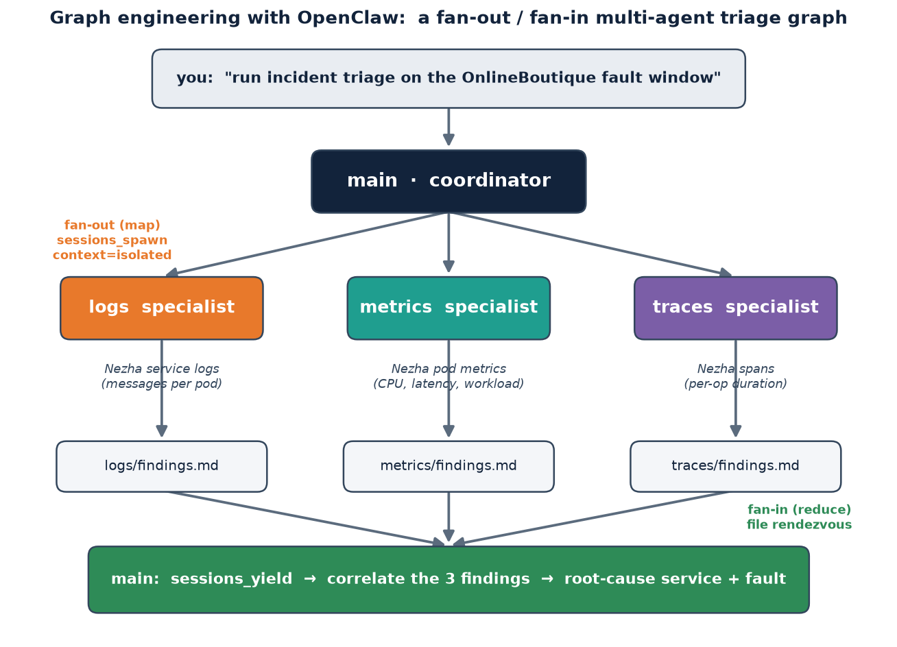

> 原文作者：Kalyan Archakam  
> [AMD 官方教程](https://rocm.docs.amd.com/projects/ai-developer-hub/en/latest/notebooks/inference/graph_multiagent_openclaw.html) · [固定版本源码](https://github.com/ROCm/gpuaidev/blob/0071bfd4bd3bd9525405c09a6ae69c983b09312a/docs/notebooks/inference/graph_multiagent_openclaw.ipynb)  
> 上游版本：`0071bfd4bd3bd9525405c09a6ae69c983b09312a` · 同步日期：2026-10-12  
> 翻译状态：机器初译，待逐篇人工校对；代码与命令保持原文，未在 AMD GPU 上运行验证。

[中文 Notebook](../../notebooks/inference/graph_multiagent_openclaw.ipynb) · [英文原文](../../original/inference/graph_multiagent_openclaw.md) · [中英对照](../../bilingual/inference/graph_multiagent_openclaw.md)

---

<a id="multi-agent-incident-triage-with-openclaw"></a>

# 使用 OpenClaw 构建多智能体事件分诊系统
**作者**：Kalyan Archakam
**知识水平:** 中级  
**发布日期：** 2026 年 8 月 20 日 

本教程展示了如何构建在单个智能体上运行的多智能体事件分类系统
AMD Instinct™ MI300X GPU 使用 [OpenClaw](https://docs.openclaw.ai/) 和 [vLLM](https://docs.vllm.ai/)。
您将提供本地 Qwen3.6-35B-A3B 模型，使用三个专业智能体配置图表，并运行它们
对照来自微服务故障注入研究的真实可观测性数据。

<a id="from-prompt-engineering-to-graph-engineering"></a>

## 从提示工程到图形工程

随着时间的推移，从业者构建人工智能工作负载的方式经历了几个阶段的演变：

**即时工程**：单个模型调用，由精心设计的输入文本形成。该模型是一个黑匣子，杠杆是您的输入。

**上下文工程**：模型调用与提示工程相同，但周围的上下文是经过精心设计的：
检索增强生成 (RAG)、系统提示、工具说明、少量示例等。
上下文窗口的大小决定了输出的质量。

**循环工程**：单个智能体运行计划→行动→观察循环，重试直到
满足终止条件。这是当今大多数人工智能编码智能体的默认模式。

**图工程**：用显式图代替循环。多个智能体运行
并行处理不同的子问题，它们的输出收敛到一个协调器，该协调器使得
决定。节点之间的结构（例如，哪个智能体查看哪些数据以及以什么顺序）变得
与智能体人本身一样重要。

从循环工程到图形工程的转变并不是为了增加复杂性。这是关于将方法与结构相匹配的问题
的问题。事件分类自然是并行的：日志、指标和跟踪是独立的
可以同时读取的信号。循环按顺序处理它们并询问一个智能体
同时将这三个内容放在上下文中。另一方面，图表将每个信号分配给专家并使用
协调员将结果关联起来，这类似于经验丰富的站点可靠性工程 (SRE) 团队通常的工作方式。

<a id="what-youll-build"></a>

## 你将构建什么

该图说明了本教程针对多智能体分类所采用的图形工程方法。



**图表如何映射到 OpenClaw：**

|图形元素| OpenClaw 原始 |配置于 |
|---|---|---|
|节点| `openclaw agents`，每位专家一个工作空间 | [第5.1部分](#51-add-the-graph-nodes) |
|打字边缘 |各智能体商`AGENTS.md`简报| [第5.2部分](#52-define-the-typed-edges) |
|扇出 | `sessions_spawn`×3，先于第一产量| [第5.4部分](#54-define-the-control-flow) |
|扇入| `sessions_yield` + 每个智能体 `findings.md` | [第5.4部分](#54-define-the-control-flow) |
|邻接表| `agents.defaults.subagents.allowAgents` | [第5.3部分](#53-define-the-adjacency-list) |
|有界循环|协调器协议中的一次重试规则 | [第5.4部分](#54-define-the-control-flow) |

以下是本教程将指导您完成的步骤的摘要：
- 确保此项目的所有 前置条件 均得到满足 ([前置条件](#prerequisites))。
- 准备好 vLLM 和 OpenClaw（[第 1 部分](#part-1-start-the-vllm-server) 到 [第 3 部分](#part-3-connect-openclaw-to-the-model-and-start-the-gateway)）。
- 获取要分类的事件数据，并整理不同智能体的输入（[第 4 部分](#part-4-fetch-the-incident-data)）。
- 配置扇出/扇入多智能体分类图（[第 5 部分](#part-5-configure-the-graph)）。
- 运行分类图（[第 6 部分](#part-6-run-the-triage-in-the-tui)）。
- 运动后清理（[第7部分](#part-7-summary-and-cleanup)）。

<a id="prerequisites"></a>

## 前置条件

本教程是使用以下设置进行开发和测试的。

<a id="operating-system"></a>

### 操作系统

Ubuntu 22.04 或 24.04。

<a id="hardware"></a>

### 硬件

**AMD Instinct GPU**：本教程在单个 AMD Instinct MI300X GPU (192 GB HBM3) 上进行了测试。确保您使用的是 AMD Instinct GPU 或支持 ROCm 的兼容硬件，并且您的系统满足[官方要求](https://rocm.docs.amd.com/projects/install-on-linux/en/latest/reference/system-requirements.html)。

您还需要大约 **70 GB 的可用磁盘空间** 用于模型权重。

<a id="software"></a>

### 软件

**ROCm 7.0 或更高版本**：按照 [ROCm 安装指南](https://rocm.docs.amd.com/projects/install-on-linux/en/latest/install/quick-start.html) 安装并验证 ROCm。本教程在 ROCm 7.2.3 上进行了测试。安装后，使用以下命令确认您的设置：

```bash
amd-smi
```

此命令列出了您的 AMD GPU 以及相关详细信息。

**Docker**：确保 Docker 已正确安装和配置。请按照适用于您的操作系统的[Docker 安装指南](https://docs.docker.com/engine/install/) 进行操作。

> **注意**：确保正确配置 Docker 权限。要允许非 root 访问，请运行：
>
> ```bash
> sudo usermod -aG docker $USER
> newgrp 码头工人
> ```
>
> 验证 Docker 是否正常工作：
>
> ```bash
> docker 运行 hello-world
> ```

**安装并启动 JupyterLab：** 您在主机（droplet）上运行 JupyterLab。该模型在您从以下位置启动的容器中运行
[第 1 部分](#part-1-start-the-vllm-server) 中的Notebook单元，[第 2 部分](#part-2-ensure-openclaw-is-installed) 中的 OpenClaw 安装在主机上。Notebook、OpenClaw 网关和 vLLM 服务器都在 `localhost` 上运行，因此它们可以通过 `127.0.0.1` 进行通信。

在 Droplet 终端中，创建虚拟环境并安装 JupyterLab：

```bash
python3 -m venv .venv
source .venv/bin/activate
pip install jupyterlab
```

在同一终端中启动 Jupyter 服务器：

```bash
jupyter-lab --ip=0.0.0.0 --port=8888 --no-browser --allow-root
```

> **注意**：确保端口 `8888` 尚未在使用中。如果是，请将 `--port=8888` 替换为另一个
> 端口，例如 `--port=8890`。

运行 `jupyter-lab` 命令后，单击终端中的链接打开 JupyterLab。的
链接的形式为 `http://127.0.0.1:<PORT>/lab?token=<TOKEN_VALUE>`。

> **注意**：确保此Notebook位于您启动 Jupyter 的目录中，或者上传它
> Jupyter 启动后。您可以从 [AI Developer Hub GitHub 存储库](https://github.com/ROCm/gpuaidev) 下载此Notebook。

Jupyter 服务器启动后，**从此Notebook（或 JupyterLab 终端）**运行本教程中的其余步骤。

<a id="part-1-start-the-vllm-server"></a>

## 第 1 部分：启动 vLLM 服务器

运行下面的单元格来启动一个为 Qwen3.6-35B-A3B 模型提供服务的 Docker 容器，其中包含
ROCm 的最新 vLLM 版本。 `vllm/vllm-openai-rocm` 使用 `vllm serve` 作为其入口点，因此
模型和服务标志作为图像名称后面的参数传递。 `-v $(pwd)/hf-cache:/root/.cache/huggingface` 标志在容器的 Hugging Face 缓存上挂载本地目录，以便下载的权重在容器重新启动后仍然存在。

`vllm/vllm-openai-rocm:latest` 是为 ROCm 构建的最新官方 vLLM 映像，包括对
Qwen3.6架构（`Qwen3_5MoeForCausalLM`）。 `rocm/vllm` 图像用于其他一些
教程早于此架构，并且不支持它。

> **注意**：将下面的 `abc-123` 替换为安全、唯一的 API 密钥。

```python
%%bash
docker run -d \
    --name vllm-server \
    --ipc=host \
    --privileged \
    --device=/dev/kfd \
    --device=/dev/dri \
    -p 8000:8000 \
    -v $(pwd)/hf-cache:/root/.cache/huggingface \
    vllm/vllm-openai-rocm:latest \
    Qwen/Qwen3.6-35B-A3B \
    --served-model-name Qwen3.6-35B-A3B \
    --host 0.0.0.0 --port 8000 \
    --api-key abc-123 \
    --max-model-len 32768 \
    --reasoning-parser qwen3 \
    --enable-auto-tool-choice \
    --tool-call-parser qwen3_xml \
    --trust-remote-code
```

通过执行下面的单元格验证服务器正在运行。加载可能需要几分钟
第一次建模。您还可以在终端中查看进度
`docker logs -f vllm-server` 并查找 `Application startup complete`。

```python
import urllib.request, json, time

# Poll the server until it is ready (up to 5 minutes)
print("Waiting for server to be ready", end="", flush=True)
deadline = time.time() + 300
ready = False
while time.time() < deadline:
    try:
        req = urllib.request.Request(
            "http://localhost:8000/v1/models",
            headers={"Authorization": "Bearer abc-123"},
        )
        with urllib.request.urlopen(req, timeout=3) as r:
            models = json.loads(r.read())
        ready = True
        break
    except Exception:
        print(".", end="", flush=True)
        time.sleep(5)

if ready:
    print("\n✅ Server is ready")
    for m in models.get("data", []):
        print(f"   Model: {m['id']}")
else:
    print("\n❌ Server did not become ready within 5 minutes")
    print("   Check logs with: docker logs vllm-server")
```

**故障排除**

如果服务器未准备就绪，请检查以下常见问题：

- **容器名称已在使用中**：上次运行的容器仍然存在。删除它并
  重新运行启动单元：

  ```bash
  docker rm -f vllm-server
  ```

- **内存不足 (OOM)**：模型需要大约 70 GB 的 GPU 内存。使用此命令检查可用内存，并在需要时通过关闭其他 GPU 密集型应用程序来释放一些内存：

  ```bash
  amd-smi monitor
  ```

- **启动错误：** 检查容器日志：

  ```bash
  docker logs vllm-server
  ```

<a id="part-2-ensure-openclaw-is-installed"></a>

## 第 2 部分：确保已安装 OpenClaw

OpenClaw 将您的智能体作为名为 **网关** 的本地服务运行。如果 `openclaw` CLI 已经存在，您**不需要**需要安装任何东西。仅当 OpenClaw 丢失时才运行安装程序。首先运行下面的单元格进行检查：

```python
!command -v openclaw >/dev/null 2>&1 && openclaw --version \
  || echo "OpenClaw not found - install it in a Jupyter terminal (see above), then re-run this cell."
```

如果打印出版本，则 OpenClaw 已准备就绪。继续[第 3 部分](#part-3-connect-openclaw-to-the-model-and-start-the-gateway)。

如果打印 `OpenClaw not found`，请打开 **Jupyter 终端**（单击 **启动器**中的 **终端**）并在那里安装 OpenClaw。安装程序运行一个简短的交互式 **doctor** 步骤，因此它需要一个真正的终端，并且无法从Notebook单元运行：

  ```bash
  curl -fsSL --proto '=https' --tlsv1.2 https://openclaw.ai/install.sh | bash
  ```

出现提示时接受建议的配置修复，然后重新运行上述检查以验证安装是否成功。

<a id="part-3-connect-openclaw-to-the-model-and-start-the-gateway"></a>

## 第 3 部分：将 OpenClaw 连接到模型并启动网关

这部分将 OpenClaw 连接到正在运行的 vLLM 服务器并启动网关进程。

<a id="31-connect-openclaw-to-the-vllm-endpoint"></a>

### 3.1 将 OpenClaw 连接到 vLLM 端点

通过将本地 vLLM 端点注册到 OpenClaw 并将其与模型关联来载入本地 vLLM 端点。模型 ID 和 api-key 必须分别与[第 1 部分](#part-1-start-the-vllm-server) 中为 `--served-model-name` 和 `--api-key` 指定的值匹配。

```python
%%bash
openclaw onboard --non-interactive --mode local \
  --auth-choice custom-api-key \
  --custom-base-url "http://localhost:8000/v1" \
  --custom-model-id "Qwen3.6-35B-A3B" --custom-provider-id "vllm" \
  --custom-compatibility openai --custom-api-key "abc-123" \
  --secret-input-mode plaintext \
  --skip-channels --skip-search --skip-hooks --skip-ui --skip-health --accept-risk
```

<a id="32-keep-the-full-tool-surface-lean-mode-off"></a>

### 3.2 保持完整的工具表面（精益模式关闭）

将此图表的 **精益模式关闭**。精益模式会缩小工具表面并移动工具，例如 
`sessions_spawn` 和 `sessions_yield` 在 `tool_search` 步骤后面。小型本地模型可能无法发现这些工具，从而阻止协调器散开并导致诸如 `sessions_spawn tool is not available` 之类的错误。保持整个表面暴露允许 `main` 直接调用生成和生成工具。

```python
%%bash
openclaw config set agents.defaults.experimental.localModelLean false
echo "lean mode off (sessions_spawn/yield stay directly available)"
```

<a id="33-start-the-gateway-in-the-background"></a>

### 3.3 后台启动网关

该容器没有`systemd`，因此直接使用`nohup`运行网关。

```python
%%bash
pkill -f openclaw-gateway 2>/dev/null || true
sleep 1
nohup openclaw gateway run > ~/gateway.log 2>&1 &
sleep 3
tail -n 8 ~/gateway.log
```

<a id="34-test-the-model"></a>

### 3.4 测试模型

通过运行以下命令执行冒烟测试：

```python
!openclaw agent --local --session-id smoke --message "Reply with exactly: pong" --thinking off
```

它应该回复 `pong`。

<a id="part-4-fetch-the-incident-data"></a>

## 第 4 部分：获取事件数据

本教程使用一个故障窗口
[Nezha](https://github.com/IntelligentDDS/Nezha) 可观测性数据集：真实日志、指标、
以及在受控期间从 **OnlineBoutique** 微服务应用程序捕获的跟踪
故障注入实验。错误仅被注入到一项服务中。所有三个信号
带有痕迹，但没有任何单一信号足以确定原因。

每分钟原始 CSV 文件大小为 4–15 MB。下面的单元格首先配置故障窗口
和下载帮助程序，然后将每个信号（指标、跟踪和日志）整理成 `/workspace/incident/` 中紧凑的模型可读文件。

<a id="41-configure-the-fault-window-and-download-helper"></a>

### 4.1 配置故障窗口并下载帮助程序

首先，将事件固定到哪吒数据集中的特定日期和特定的三分钟故障窗口，
列出十个 OnlineBoutique pod，并定义一个小的 `fetch()` 帮助程序，用于从中提取原始 CSV 文件
GitHub。该单元仅进行设置，不下载或写入任何数据。

```python
import os, io, csv, json, urllib.request

NEZHA_DATE   = "2022-08-22"
FAULT_WINDOW = ["04:44", "04:45", "04:46"]   # fault injected at 04:44:16
BASELINE_MIN = "04_36"
FAULT_MIN    = "04_45"
INCIDENT_DIR = "/workspace/incident"
RAW = f"https://raw.githubusercontent.com/IntelligentDDS/Nezha/main/rca_data/{NEZHA_DATE}/"

PODS = [
    "adservice-5f6585d649-fnmft",        "cartservice-579f59597d-wc2lz",
    "checkoutservice-578fcf4766-9csqn",  "currencyservice-cf787dd48-vpjrd",
    "emailservice-55fdc5b988-f6xth",     "frontend-579b9bff58-t2dbm",
    "paymentservice-9cdb6588f-554sm",    "productcatalogservice-668d5f85fb-wckp8",
    "recommendationservice-6cfdd55578-gfj6q", "shippingservice-7b598fc7d-lmggd",
]
svc = lambda pod: pod.split("-")[0]
os.makedirs(INCIDENT_DIR, exist_ok=True)

def fetch(path):
    req = urllib.request.Request(RAW + path, headers={"User-Agent": "notebook"})
    return urllib.request.urlopen(req, timeout=180).read().decode("utf-8", "replace")
```

<a id="42-curate-the-metrics-signal"></a>

### 4.2 管理指标信号

下载每个服务的每分钟指标 CSV 文件，仅保留故障窗口内的行，并且
提取 CPU 使用率、server-延迟 P95 和工作负载。整理的结果写入
`/workspace/incident/metrics.csv`，完成后单元格会打印文件的大小。

```python
# Metrics: CPU usage, server-latency 95th-percentile (P95), and workload for each service across the fault window.
rows = []
for pod in PODS:
    for r in csv.DictReader(io.StringIO(fetch(f"metric/{pod}_metric.csv"))):
        if r["Time"][11:16] in FAULT_WINDOW:
            rows.append([svc(pod), r["Time"][11:19],
                         round(float(r["CpuUsageRate(%)"]), 1),
                         round(float(r["PodServerLatencyP95(s)"]), 3),
                         round(float(r["PodWorkload(Ops)"]), 1)])
with open(f"{INCIDENT_DIR}/metrics.csv", "w") as f:
    f.write("service,time,cpu_usage_rate_pct,server_latency_p95_s,workload_ops\n")
    f.write("\n".join(",".join(map(str, r)) for r in rows) + "\n")
print(f"metrics.csv  {os.path.getsize(f'{INCIDENT_DIR}/metrics.csv')} bytes")
```

<a id="43-curate-the-traces-signal"></a>

### 4.3 管理跟踪信号

下载故障分钟和捕获八分钟的基线分钟的跟踪 CSV 文件
之前，计算每个服务的 span-延迟 P95，并将每个服务的减速写入
`/workspace/incident/traces.csv`。

```python
# Traces: span-latency P95 per service: fault minute vs a baseline minute.
def p95(vals): return sorted(vals)[int(len(vals) * 0.95)] if vals else 0

def p95_by_svc(minute):
    d = {}
    for r in csv.DictReader(io.StringIO(fetch(f"trace/{minute}_trace.csv"))):
        d.setdefault(svc(r["PodName"]), []).append(int(r["Duration"]))
    return {s: p95(v) for s, v in d.items()}

base, fault = p95_by_svc(BASELINE_MIN), p95_by_svc(FAULT_MIN)
with open(f"{INCIDENT_DIR}/traces.csv", "w") as f:
    f.write("service,baseline_p95_ms,fault_p95_ms,slowdown_x\n")
    for s in sorted(set(base) | set(fault)):
        b, x = base.get(s, 0) / 1e6, fault.get(s, 0) / 1e6
        f.write(f"{s},{round(b,2)},{round(x,2)},{round(x/b,1) if b else 0}\n")
print(f"traces.csv   {os.path.getsize(f'{INCIDENT_DIR}/traces.csv')} bytes")
```

<a id="44-curate-the-logs-signal"></a>

### 4.4 管理日志信号

最后，下载故障分钟日志 CSV 文件并按服务进行汇总，包括行数、
错误和警告计数以及示例消息。总结写到
`/workspace/incident/logs.txt`。

```python
# Logs: per-service line count, error/warning count, and one sample message.
counts, errors, sample = {}, {}, {}
for r in csv.DictReader(io.StringIO(fetch(f"log/{FAULT_MIN}_log.csv"))):
    s = svc(r["PodName"]); counts[s] = counts.get(s, 0) + 1
    if any(k in r["Log"].lower() for k in ('"error"','"warn"',"exception","failed","panic")):
        errors[s] = errors.get(s, 0) + 1
    if s not in sample:
        try:    sample[s] = json.loads(json.loads(r["Log"])["log"])["message"][:100]
        except: sample[s] = r["Log"][:100]
with open(f"{INCIDENT_DIR}/logs.txt", "w") as f:
    f.write(f"# OnlineBoutique logs: fault minute {FAULT_MIN.replace('_',':')}\n")
    f.write("# service: lines | errors/warnings | sample\n\n")
    for s in sorted(counts, key=lambda k: -counts[k]):
        f.write(f"{s}: {counts[s]} lines | {errors.get(s,0)} err/warn | {sample.get(s,'')}\n")
print(f"logs.txt     {os.path.getsize(f'{INCIDENT_DIR}/logs.txt')} bytes")
```

<a id="what-the-data-looks-like"></a>

### 数据是什么样的

运行上述单元格后，`/workspace/incident/` 包含三个文件。每一个都足够小
语言模型可以完整阅读，但又足够丰富，需要交叉信号推理。

**`metrics.csv`**记录CPU使用率(%)、服务器端延迟 P95(秒)、请求
三分钟故障窗口内所有 10 个服务的工作负载（操作/秒）：

```
service,time,cpu_usage_rate_pct,server_latency_p95_s,workload_ops
adservice,04:44:19,2.7,0.04,4.9
checkoutservice,04:44:19,7.6,0.242,0.4
checkoutservice,04:45:19,98.8,4.5,0.2
checkoutservice,04:46:19,100.8,4.625,0.3
frontend,04:45:19,25.2,0.935,7.9
...
```

**`traces.csv`** 与基线相比，故障分钟内每项服务的跨度为 延迟 P95
8 分钟前拍摄的分钟：

```
service,baseline_p95_ms,fault_p95_ms,slowdown_x
checkoutservice,0.3,1.8,5.9
frontend,0.22,0.18,0.8
productcatalogservice,0.01,0.01,1.0
...
```

**`logs.txt`** 总结每个服务的日志活动，包括行计数、错误/警告计数和
示例消息：

```
<a id="onlineboutique-logs---fault-minute-0445"></a>

# OnlineBoutique logs - fault minute 04:45
<a id="service-lines--errorswarnings--sample"></a>

# service: lines | errors/warnings | sample

productcatalogservice: 9964 lines | 0 err/warn | Query product with name and description successfully
currencyservice: 7383 lines | 0 err/warn | Get currency data successful
checkoutservice: 416 lines | 0 err/warn | PlaceOrder user_id="45bf39a9..." ...
paymentservice: 32 lines | 0 err/warn | Transaction processed: visa ending ...
```

在运行图表之前需要注意以下几点：

- `productcatalogservice` 大幅生成最多日志行，但错误为零。
- `checkoutservice` CPU 在 04:44 时正常，从 04:45 开始接近 100%。
- 跟踪表显示 `checkoutservice` 的速度减慢了 5.9 倍；其他所有服务都接近 1.0 倍。
- 在故障窗口期间没有服务记录任何错误或警告。

**以下是智能体应从数据中发现的基本事实：** 在 **04:44:16**，**CPU 争用**故障被注入 **`checkoutservice`**。看起来，随着 CPU 利用率上升到接近 100%，服务器 延迟 P95 在指标数据中从约 0.24 秒增加到约 4.5 秒，跟踪数据显示跨度 延迟 增加了约 6 倍。没有生成错误日志，表明是资源问题而不是应用程序错误。 `productcatalogservice` 上的高日志量是噪音，服务保持正常运行。该图必须将所有三个信号关联起来，以将 `checkoutservice` 识别为问题的根本原因，而不是错误地关注最嘈杂的服务。

<a id="part-5-configure-the-graph"></a>

## 第 5 部分：配置图表

这部分将图结构定义为 OpenClaw 配置：参与智能体、每个智能体可用的上下文、向协调器公开的工具以及管理协作的控制流。

<a id="51-add-the-graph-nodes"></a>

### 5.1 添加图节点

在有向图中，**节点**是一个计算单元，具有自己的状态和定义的
界面。每个专家智能体都是一个节点：它有一个独立的工作区（其状态），读取
恰好一个信号（其输入接口），并写入固定的 `findings.md` 文件（其输出
接口）。

保持工作区隔离会强制执行下面 [5.2](#52-define-the-typed-edges) 中定义的类型化边缘。能够访问每个信号的节点不再是专家，而是通用智能体。隔离性赋予了图结构。

以下单元添加三个名为 `logs`、`metrics` 和 `traces` 的节点。它们通过[5.3](#53-define-the-adjacency-list)中定义的边连接在一起。

```python
%%bash
for name in logs metrics traces; do
  openclaw agents add "$name" --non-interactive --workspace "/root/.openclaw/workspace/$name"
  rm -f "/root/.openclaw/workspace/$name/BOOTSTRAP.md"
done
openclaw agents list
```

<a id="52-define-the-typed-edges"></a>

### 5.2 定义类型边缘

在图术语中，**类型化边**带有一个标签，限制沿其流动的内容。在这种情况下，标签是智能体的简报，它指定智能体读取的信号以及它忽略的内容。更改简报会更改边类型，即重写图表而不更改任何代码。

您可以通过向智能体提供简报来定义每条边缘。该简报成为客服人员的 `AGENTS.md`，它会在每次会话开始时持续存在并加载。
 
为下面的**每位**专家打开**Jupyter 终端**。对于每位专家来说，要遵循的步骤都是相同的，首先打开 OpenClaw 文本用户界面 (TUI)：

```bash
openclaw tui
```

使用 `/agent <name>` 切换到专家，然后粘贴简报。智能体将写下其
`AGENTS.md` 并确认。完成后键入 `/exit`，然后转到下一个。

> **重要提示：** 简报以“现在不分析任何内容”结束，因为您正在配置
> 智能体，尚未运行。如果您省略该行，智能体可能会立即尝试读取文件 
> 尚不存在。

---

####日志专家：`/agent logs`

```
You are the Logs Specialist for an incident-triage graph. Your job:
- When given a task, read ONLY the file /workspace/incident/logs.txt: a per-service log
  summary from the OnlineBoutique microservices system showing line counts, error/warning
  counts, and a sample message per service.
- Report: which services (if any) show error or warning lines, which is noisiest by volume,
  and whether the evidence points to a code bug or a resource issue. High volume alone is
  NOT a fault. Ignore metrics and traces.
- Save your findings to /root/.openclaw/workspace/logs/findings.md and reply concisely.

Save this as your AGENTS.md so it persists. Do not analyze anything now: wait for a task.
```

---

<a id="logs-specialist-agent-logs"></a>

#### 指标专家：`/agent metrics`

```
You are the Metrics Specialist for an incident-triage graph. Your job:
- When given a task, read ONLY the file /workspace/incident/metrics.csv: a cross-service
  table of CPU usage (%), server-latency P95 (s), and workload (ops) for a fault window in
  the OnlineBoutique system.
- Report: which service's CPU and/or latency deviates most from the rest, at what time, and
  which services look normal. Name the standout service clearly. Ignore logs and traces.
- Save your findings to /root/.openclaw/workspace/metrics/findings.md and reply concisely.

Save this as your AGENTS.md so it persists. Do not analyze anything now: wait for a task.
```

---

####痕迹专家：`/agent traces`

```
You are the Traces Specialist for an incident-triage graph. Your job:
- When given a task, read ONLY the file /workspace/incident/traces.csv: a per-service
  span-latency comparison table with baseline P95, fault-window P95, and a slowdown factor
  (x) for the OnlineBoutique system.
- Report: which service has the highest slowdown_x, which stayed near 1.0x, and what that
  pattern implies about where the fault is localised. Ignore logs and metrics.
- Save your findings to /root/.openclaw/workspace/traces/findings.md and reply concisely.

Save this as your AGENTS.md so it persists. Do not analyze anything now: wait for a task.
```

---

在所有三个智能体确认他们已写入 `AGENTS.md` 文件后，**运行 [5.5](#55-restart-the-gateway)** 中的网关重新启动单元，然后继续 [5.3](#53-define-the-adjacency-list)。 `AGENTS.md` 文件在会话开始时加载，因此必须先刷新网关，然后分类才会使用您的新简报。

<a id="53-define-the-adjacency-list"></a>

### 5.3 定义邻接表

在有向图中，**邻接表**记录每个节点，通过其出边可到达的节点。 `allowAgents` 是 `main` 的列表：它指定协调员是哪些智能体
允许产卵。无法联系到不在列表中的智能体。图拓扑是通过配置而不是信任来强制执行的。

`tools.alsoAllow` 将 `sessions_spawn` 和 `sessions_yield` 原语添加到 `main` 的工具中
表面。没有它们，协调器就没有扇出或等待结果的机制。

通过运行以下单元格定义邻接列表：

```python
%%bash
openclaw config set agents.defaults.subagents.allowAgents '["logs","metrics","traces"]' --strict-json
openclaw config set tools.alsoAllow '["sessions_spawn","sessions_yield","subagents"]' --strict-json
echo "main may now spawn: logs, metrics, traces"
```

<a id="54-define-the-control-flow"></a>

### 5.4 定义控制流

协调器协议是在图的边缘上运行的程序：它激活（扇出）节点，等待它们的输出（扇入），组合结果，并决定如果智能体不同意该怎么办（有界重试）。它被编写为附加到 `main` 的 `AGENTS.md` 的自然语言 - 用于单个节点简报的相同机制也应用于
拥有图结构的协调器。

该单元是幂等的：重新运行它会替换以前的版本。

```python
import os

def write_file(path, content):
    path = os.path.expanduser(path)
    os.makedirs(os.path.dirname(path), exist_ok=True)
    with open(path, "w") as f:
        f.write(content)
    print("wrote", path)
    return path

PROTOCOL = """

## Incident Triage Protocol

You coordinate three specialist agents: "logs", "metrics", and "traces". You analyze NOTHING
yourself. Each specialist writes to a fixed file in ITS OWN workspace (the only place the sandbox
lets it write): logs -> /root/.openclaw/workspace/logs/findings.md,
metrics -> /root/.openclaw/workspace/metrics/findings.md,
traces -> /root/.openclaw/workspace/traces/findings.md. You can READ these files but must NOT try
to create or delete them yourself. Each specialist OVERWRITES its own findings file every run, so no
pre-cleaning is needed. These files are the source of truth; on every wake, check which files exist.

The incident signals live in /workspace/incident/: logs.txt, metrics.csv, traces.csv.

When the user says "run incident triage on <DIR>":

1. Inputs are <DIR>/logs.txt, <DIR>/metrics.csv, <DIR>/traces.csv.
2. Spawn ALL THREE specialists back-to-back, THEN yield once. Use context "isolated":
   - sessions_spawn agentId="logs"    context="isolated" task="Analyze the log summary <DIR>/logs.txt. Overwrite your findings to /root/.openclaw/workspace/logs/findings.md and reply."
   - sessions_spawn agentId="metrics" context="isolated" task="Analyze the metrics table <DIR>/metrics.csv. Overwrite your findings to /root/.openclaw/workspace/metrics/findings.md and reply."
   - sessions_spawn agentId="traces"  context="isolated" task="Analyze the trace-latency table <DIR>/traces.csv. Overwrite your findings to /root/.openclaw/workspace/traces/findings.md and reply."
   - sessions_yield with no parameters.
3. On EVERY wake: exec `ls /root/.openclaw/workspace/logs/findings.md /root/.openclaw/workspace/metrics/findings.md /root/.openclaw/workspace/traces/findings.md 2>/dev/null | wc -l`.
   If 3, go to step 4. If less than 3, call sessions_yield again (do not reply yet).
4. CORRELATE: cat the three files and give the SINGLE root cause consistent with ALL THREE signals:
   - Root cause: the culprit SERVICE and the fault type (one sentence)
   - Evidence: one line each from logs, metrics, traces
   - Confidence: high/medium/low
   - Remediation
   - Other suspects considered and why rejected (e.g. a noisy-but-healthy service).
5. If the signals do NOT converge, repeat step 2 EXACTLY ONCE with the other agents' findings added
   to each task, then always finish (termination guard).

Rules: context MUST be "isolated"; spawn all three before the first yield; never analyze a signal
yourself; never create or delete the specialists' files yourself; at most ONE re-run.
"""

AGENTS_MAIN = "/root/.openclaw/workspace/AGENTS.md"
existing = open(AGENTS_MAIN).read() if os.path.exists(AGENTS_MAIN) else ""
# Idempotent: drop any previous protocol block, then append the current one,
# so re-running this cell always installs the latest version.
idx = existing.find("## Incident Triage Protocol")
if idx != -1:
    existing = existing[:idx].rstrip() + "\n"
with open(AGENTS_MAIN, "w") as f:
    f.write(existing + PROTOCOL)
print("Triage Protocol written (idempotent)")
```

<a id="55-restart-the-gateway"></a>

### 5.5 重启网关

网关在启动时加载`AGENTS.md`。重新启动即可获取[5.2](#52-define-the-typed-edges)中编写的简报
以及[5.4](#54-define-the-control-flow)中编写的协调器协议：

```python
%%bash
pkill -f openclaw-gateway 2>/dev/null || true
sleep 1
nohup openclaw gateway run > ~/gateway.log 2>&1 &
sleep 3
openclaw agents list
```

<a id="part-6-run-the-triage-in-the-tui"></a>

## 第 6 部分：在 TUI 中运行分类

这部分按顺序演示了三种交互：冷分类请求、对结论的故意挑战以及对专家的可选直接询问。每个步骤都会对您构建的图表执行不同的功能。  

<a id="61-the-investigation"></a>

### 6.1 调查

您是待命工程师。 OnlineBoutique 刚刚将三个信号发送到您的收件箱
系统在 3 分钟内出现问题。你的图表已经准备好了。

打开 **Jupyter 终端**，启动 TUI，切换到 `main`，并发出警报。开头为：

```bash
openclaw tui
```

1. 您可能会进入 **Crestodian** 设置助手；使用 `/agent main` 切换到您的协调器。
2. 输入 `/reset` 以获得干净的上下文。
3. 发送警报：

```
Three signals just came in from the OnlineBoutique system: logs, metrics, and traces for a
3-minute fault window starting around 04:44 UTC. Run incident triage on /workspace/incident
and tell me: which service is the culprit, what type of fault it is, and how confident you are.
```

当 `main` 向三位专家扇出时，观察工具卡出现，然后等待
`sessions_yield`。当所有三个结果都输入后，`main` 会进行关联并报告。将图表的答案与 
**基本事实**在上面的[数据是什么样的](#what-the-data-looks-like)中描述。

仅凭日志就会让您责怪错误的服务。只有关联所有三个智能体的输出才能给出正确的答案，这就是图表的全部要点。

<a id="62-challenge-the-result"></a>

### 6.2 挑战结果

一旦 `main` 给出答案，就反驳它。日志信号包含故意误导的线索 
分散调查人员对真正根本原因的注意力。使用线索来质疑结果：

```
productcatalogservice had the most log lines by far: nearly 10,000 in that minute.
Are you sure it's not the culprit? Justify using evidence from all three specialists.
```

`main` 磁盘上已经有三个 `findings.md` 文件：不需要重新生成
专家。它可以直接读取它们并解释*为什么*高日志量本身并不能证明错误。
协调员可以使用磁盘上已有的三个调查结果文件来捍卫其结论。不需要重新生成，只需阅读并给出合理的响应即可。

<a id="63-query-a-specialist-directly-optional"></a>

### 6.3 直接查询专家（可选）

专家是坚持不懈的智能体人。您可以随时独立查询其中任何一个。例如，您可以直接从 **Jupyter 终端** 向指标专家询问更精确的后续问题（无需 TUI）：

```bash
openclaw agent --agent metrics \
  --message "At exactly which minute did checkoutservice's CPU cross 50%? What was its workload at that moment?"
```

或者要求跟踪专家按减速程度对所有服务进行排名：

```bash
openclaw agent --agent traces \
  --message "Rank all services from highest to lowest slowdown_x. Which ones are clearly within normal range?"
```

<a id="part-7-summary-and-cleanup"></a>

## 第 7 部分：总结和清理

<a id="what-you-built"></a>

### 你构建了什么

您实现了在单个 AMD Instinct™ MI300X GPU 上运行的**扇出/扇入多智能体图**：

```
you  ──►  main (coordinator)
           ├──sessions_spawn──►  logs    ──► logs/findings.md
           ├──sessions_spawn──►  metrics ──► metrics/findings.md
           └──sessions_spawn──►  traces  ──► traces/findings.md
                sessions_yield
           └──────────────────────────────►  correlate  ──►  root cause
```

每个部分都映射到您在 OpenClaw 中定义的具体基元。它们形成一个图表，帮助您对事件进行分类。 

此练习的主要见解是：**单个信号并不总是足以识别问题**。有时，您需要关联不同的信号。它可以通过类型推理的并行性来实现，而不是由单个智能体执行跨信号关联：图结构内的每个节点恰好看到一个信号并将其发现报告给协调器，协调器将结果关联起来以得出正确的结论。 

<a id="cleanup"></a>

### 清理

完成后，停止并从主机终端删除 vLLM 服务器容器：

```bash
docker rm -f vllm-server
```

模型权重保留在 `hf-cache/`（第 1 部分安装）的主机上，因此下次运行会重用
它们而不是再次下载它们。 OpenClaw 及其工作区位于 `~/.openclaw/` 下的主机上，
所以它们也会在运行中持续存在。

<a id="further-exploration"></a>

### 进一步探索
- **添加第四个信号**：添加读取节点级 CPU 和内存列的 `node` 智能体
  来自 Nezha 指标 CSV 文件；将其连接到 `allowAgents` 和协议中。
- **尝试不同的故障**：将[第4部分](#part-4-fetch-the-incident-data)中的`FAULT_WINDOW`和`FAULT_MIN`更改为其他19个Nezha窗口之一（例如04:27的`cartservice` `network_delay`，或`paymentservice` `cpu_contention`
  at 06:01）并重新运行图表。专家的简报可以保持不变；仅更改数据。
- **添加修复智能体**：关联后，生成第四个智能体，其工作是提出建议并进行修复
  根据协调器的故障类型编写具体的修复程序（例如，配置补丁或横向扩展命令）
  确定。
- **交换模型**：将 [第 1 部分](#part-1-start-the-vllm-server) 发射单元中的 `Qwen/Qwen3.6-35B-A3B` 替换为另一个
  通过调整`--tool-call-parser`和`--reasoning-parser`来支持vLLM的模型。


<a id="further-reading"></a>

## 进一步阅读

- [OpenClaw 文档](https://docs.openclaw.ai/): 解释智能体、工作区、网关、`sessions_spawn` 和 
  `sessions_yield`，并提供该工具的完整文档。
- [图形工程 2026：OpenClaw 和 Codex 实用指南](https://flowtivity.ai/blog/graph-engineering-2026-guide-openclaw-codex/): 构建本教程中使用的提示 → 上下文 → 循环 → 图形进程的博客文章。
- 【哪吒：多模态微服务的可解释细粒度根本原因分析
  可观测性数据](https://dl.acm.org/doi/10.1145/3611643.3616249): ESEC/FSE(ACM联合欧洲软件        
  工程会议和软件工程基础研讨会）2023论文落后
  本教程中使用的数据集。
- [IntelligentDDS/哪吒](https://github.com/IntelligentDDS/Nezha): 注入了19个的数据集存储库
  跨 10 个 OnlineBoutique 服务、四个捕获日期和多种故障类型的故障
  （`cpu_contention`、`network_delay`、`return`、`exception`）进行探索。

```python

```
