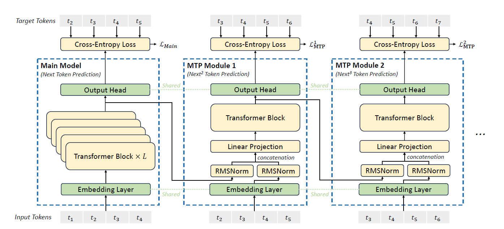
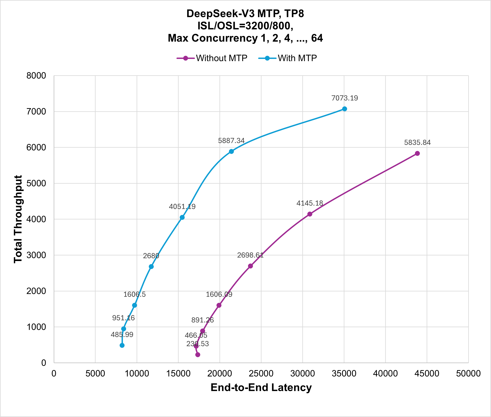

> 原文作者：Chang Liu  
> [AMD 官方教程](https://rocm.docs.amd.com/projects/ai-developer-hub/en/latest/notebooks/inference/mtp.html) · [固定版本源码](https://github.com/ROCm/gpuaidev/blob/0071bfd4bd3bd9525405c09a6ae69c983b09312a/docs/notebooks/inference/mtp.ipynb)  
> 上游版本：`0071bfd4bd3bd9525405c09a6ae69c983b09312a` · 同步日期：2026-10-12  
> 翻译状态：机器初译，待逐篇人工校对；代码与命令保持原文，未在 AMD GPU 上运行验证。

[中文 Notebook](../../notebooks/inference/mtp.ipynb) · [英文原文](../../original/inference/mtp.md) · [中英对照](../../bilingual/inference/mtp.md)

---

<a id="accelerating-deepseek-v3-inference-using-multi-token-prediction-in-sglang"></a>

# 使用 SGLang 多 Token 预测加速 DeepSeek-V3 推理
**作者**：Chang Liu
**知识水平**：中级

DeepSeek-V3 和 DeepSeek-R1 是两个最受欢迎的法学硕士。然而，由于涉及大量参数，为如此大的模型提供服务非常耗时。 投机解码 使用较小的 草稿模型 来预测一些未来的草稿代币，这减少了直接利用大型基础模型进行每个代币预测的时间和成本。这是加速LLM服务效率最可行、最有效的技术之一。

您可能想知道DeepSeek-V3/R1 推理是否可以采用投机解码模块，答案是肯定的。 多 Token 预测 (MTP) 模块是最合适的选择之一。它最初是为了增强 DeepSeek-V3 和 DeepSeek-R1 的训练性能而引入的，其权重随着相应 DeepSeek 模型的预训练而进行了优化。这节省了额外的训练资源，例如 GPU 使用率和数据集准备所需的时间。 

在本分步教程中，您将了解如何在启用 MTP 的情况下启动 LLM 服务。通过比较启用和未启用 MTP 的服务的 推理 性能，您可以观察 MTP 如何更加高效。


<a id="prerequisites-and-setting-up-the-environment"></a>

## 前置条件 并设置环境
本教程是使用以下设置创建和测试的，建议使用 AMD Instinct™ GPU 重现相同的性能增益。

<a id="operating-system"></a>

### 操作系统

* **Ubuntu 22.04**：确保您的系统运行的是 Ubuntu 22.04 或更高版本。

<a id="hardware"></a>

### 硬件
- **AMD Instinct™ GPU**：本教程已在八个 AMD Instinct MI300X GPU 上进行了测试。确保您使用的是 AMD Instinct GPU 或支持 ROCm 的兼容硬件，并且您的系统满足[官方要求](https://rocm.docs.amd.com/projects/install-on-linux/en/latest/reference/system-requirements.html)。


<a id="software"></a>

### 软件
* **ROCm 6.3+**：按照[ROCm安装指南](https://rocm.docs.amd.com/projects/install-on-linux/en/latest/install/quick-start.html)安装并验证ROCm 6.3或更高版本。安装后，使用以下命令确认您的设置：

   ``` bash
   amd-smi
   ```

   此命令列出了您的 AMD GPU 以及相关详细信息。
   
   **注意**：对于 ROCm 6.4 及更早版本，请改用 `rocm-smi` 命令。

* **Docker**：确保 Docker 已正确安装和配置。请遵循适用于您的操作系统的 Docker 安装指南。

   **注意**：确保正确配置 Docker 权限。要配置权限以允许非 root 访问，请运行以下命令：

   ``` bash
   sudo usermod -aG docker $USER
   newgrp docker
   ```

   验证 Docker 是否正常工作：

   ``` bash
   docker run hello-world
   ```

<a id="preparing-the-serving-environment"></a>

## 准备服务环境

按照以下步骤下载并运行 Docker 容器和 Jupyter Notebook。

<a id="pull-the-docker-image"></a>

### 拉取 Docker 镜像

确保您的系统满足[系统要求](https://rocm.docs.amd.com/projects/install-on-linux/en/latest/reference/system-requirements.html)。

拉取本教程所需的 Docker 映像：

``` bash
docker pull lmsysorg/sglang:v0.5.0rc0-rocm630-mi30x
```

**注意**：您可能需要访问[官方 SGLang Docker Hub](https://hub.docker.com/r/lmsysorg/sglang/tags) 来查找最适合您的系统的 Docker 镜像。

<a id="launch-the-docker-container"></a>

### 启动 Docker 容器

启动 Docker 容器并映射必要的目录。 

```bash
docker run -it --rm \
  --network=host \
  --ipc=host \
  --privileged \
  --cap-add=CAP_SYS_ADMIN \
  --device=/dev/kfd \
  --device=/dev/dri \
  --device=/dev/mem \
  --group-add render \
  --cap-add=SYS_PTRACE \
  --security-opt seccomp=unconfined \
  --name sglang_base \
  -v $(pwd):/work \
  lmsysorg/sglang:v0.5.0rc0-rocm630-mi30x \
  bash
```

**注意**：该命令将当前目录挂载到容器中的`/work`目录中。确保在运行 Docker 命令之前将Notebook文件复制到此目录，或者在启动后上传到 Jupyter Notebook 环境。保存终端输出中提供的令牌或 URL，以便从 Web 浏览器访问Notebook。您可以从 [AI Developer Hub GitHub 存储库](https://github.com/ROCm/gpuaidev) 下载此Notebook。

<a id="install-and-launch-jupyter"></a>

### 安装并启动 Jupyter

在 Docker 容器内，使用以下命令安装 Jupyter：

``` bash
pip install jupyter
```

启动 Jupyter 服务器：

``` bash
jupyter-lab --ip=0.0.0.0 --port=8888 --no-browser --allow-root
```

**注意**：在运行上述命令之前，请确保您的系统上尚未使用端口 `8888`。如果是，您可以通过将 `--port=8888` 替换为其他端口号来指定其他端口，例如 `--port=8890`。

<a id="step-1-starting-the-baseline-server"></a>

## 步骤1：启动基线服务器

您可以使用SGLang的在线服务模式来比较禁用和启用MTP之间的性能差异。

使用以下命令在未启用 MTP 的情况下启动服务器。

```python
import os
from sglang.utils import launch_server_cmd

cmd = "python3 -m sglang.launch_server \
    --model-path deepseek-ai/DeepSeek-V3 \
    --attention-backend aiter \
    --host 0.0.0.0 \
    --trust-remote-code \
    --tp-size 8 \
    --enable-metrics \
    --mem-fraction-static 0.85 \
    --chunked-prefill-size 131072"

server_process, port = launch_server_cmd(cmd)

os.environ["SERVER_PORT"] = str(port)
```

此命令还会下载模型，这可能需要一些时间。等待服务器打印消息 `"The server is fired up and ready to roll!"`，这表明它已经启动，然后再继续。您可以使用以下 `curl` 命令测试服务器是否准备就绪：

```python
!curl http://localhost:$SERVER_PORT/v1/models
```

<a id="step-2-sending-requests-to-the-baseline-server"></a>

## 步骤2：向基线服务器发送请求

启动服务器后，启动客户端发送请求。使用以下命令在客户端上对不使用 MTP 的服务器容器的性能进行基准测试：

```python
!python3 -m sglang.bench_serving \
  --backend sglang \
  --dataset-name random \
  --num-prompt 300 \
  --request-rate 1.0 \
  --random-input 3200 \
  --random-output 800 \
  --port $SERVER_PORT \
  > /work/sglang_base_log
```

客户端命令运行后，会生成名为 `sglang_base_log` 的日志文件。

通过终止服务器来释放 GPU 资源。

**警告**：仅在日志生成完成后继续：

```python
from sglang.utils import terminate_process
terminate_process(server_process)
```

<a id="step-3-enabling-mtp-in-serving"></a>

## 步骤 3：在服务中启用 MTP

现在使用以下命令启动启用 MTP 的服务器。

```python
cmd = "python3 -m sglang.launch_server \
    --model-path deepseek-ai/DeepSeek-V3 \
    --attention-backend aiter \
    --host 0.0.0.0 \
    --trust-remote-code \
    --tp-size 8 \
    --enable-metrics \
    --mem-fraction-static 0.85 \
    --chunked-prefill-size 131072 \
    --speculative-algorithm NEXTN \
    --speculative-draft-model-path lmsys/DeepSeek-V3-NextN \
    --speculative-num-steps 2 \
    --speculative-eagle-topk 1 \
    --speculative-num-draft-tokens 3 \
    --speculative-accept-threshold-single=0.001"

server_process, port = launch_server_cmd(cmd)

os.environ["SERVER_PORT"] = str(port)
```

此命令还会下载模型，这可能需要一些时间。等待服务器打印消息 `"The server is fired up and ready to roll!"`，这表明它已经启动，然后再继续。您可以使用以下 `curl` 命令测试服务器是否准备就绪：

```python
!curl http://localhost:$SERVER_PORT/v1/models
```

<a id="step-4-sending-requests-to-the-mtp-server"></a>

## 步骤4：向MTP服务器发送请求

启动服务器后，启动客户端发送请求。使用以下命令在客户端通过 MTP 对服务器容器的性能进行基准测试：

```python
!python3 -m sglang.bench_serving \
  --backend sglang \
  --dataset-name random \
  --num-prompt 300 \
  --request-rate 1.0 \
  --random-input 3200 \
  --random-output 800 \
  --port $SERVER_PORT \
  > /work/sglang_mtp_log
```

为了更深入地探索MTP，您可以修改上述命令中的各个参数的值（例如`request-rate`）来观察性能变化。

对性能进行基准测试后，使用以下命令释放资源。

**警告**：仅在完成生成日志后才能继续：

```python
from sglang.utils import terminate_process
terminate_process(server_process)
```

<a id="log-interpretation"></a>

## 日志解释

运行基准测试后生成的日志格式如下：

```
============ Serving Benchmark Result ============
Backend:                                 sglang
Traffic request rate:                    inf
Max request concurrency:                 x
Successful requests:                     x
Benchmark duration (s):                  xxx.xx
Total input tokens:                      xxxxx
Total generated tokens:                  xxxx
Total generated tokens (retokenized):    xxxx
Request throughput (req/s):              x.xx
Input token throughput (tok/s):          xxx.xx
Output token throughput (tok/s):         xx.xx
Total token throughput (tok/s):          xxx.xx
Concurrency:                             x.xx
----------------End-to-End Latency----------------
Mean E2E Latency (ms):                   xxxxx.xx
Median E2E Latency (ms):                 xxxxx.xx
---------------Time to First Token----------------
Mean TTFT (ms):                          xxx.xx
Median TTFT (ms):                        xxx.xx
P99 TTFT (ms):                           xxx.xx
---------------Inter-Token Latency----------------
Mean ITL (ms):                           xx.xx
Median ITL (ms):                         xx.xx
P95 ITL (ms):                            xx.xx
P99 ITL (ms):                            xx.xx
Max ITL (ms):                            xx.xx
==================================================
```

本教程重点关注两个关键指标：`Mean E2E Latency` 和 `Total token throughput`。 `Mean E2E Latency` 测量从开始到结束处理整个请求所需的平均时间，反映端到端响应能力。 `Total token throughput` 测量每秒处理的令牌总数（输入加输出），反映系统效率和服务能力。


可以查看日志内容如下：

```python
!cat /work/sglang_base_log
!cat /work/sglang_mtp_log
```

<a id="understanding-the-mtp-module"></a>

## 了解MTP模块

在 DeepSeek-V3 中，多 Token 预测 (MTP) 的目标是将模型的预测范围扩展到每个位置的多个未来代币。这种方法不仅丰富了训练信号，还增强了模型的内部表示，从而可以更准确地预测未来的代币。

  


<p align="center">
  <em>图1：MTP模块架构。</em>
</p>

如图 1 所示，MTP 采用 $D$ 顺序模块来预测下一个 $D$ 令牌。每个MTP模块由四个组件组成：共享嵌入层$E(\cdot)$、共享输出头$Out(\cdot)$、变压器块$T_k(\cdot)$和投影矩阵$M_k$。

对于预测深度 $k$ 处的第 $i$ 个输入标记 $t_i$，该模型将来自先前深度 $h_i^{k-1}$ 的隐藏表示与通过 $M_k$ 投影的真实未来标记 $E(t_{i+k})$ 的嵌入相结合。这会产生一个中间表示 $\hat{h}_i^k$，然后由变压器块 $T_k(\cdot)$ 处理以生成更新的隐藏状态 $h_i^k$。

最后，输出头 $Out(\cdot)$ 将 $h_i^k$ 映射到词汇表上的概率分布，使用 Softmax 层从中获得第 $k$ 标记预测。

<a id="performance-gain"></a>

## 性能提升

图 2 比较了在禁用和启用 MTP 的情况下使用 SGLang 服务 DeepSeek-R1 的性能。重现本教程中的实验时，请使用此插图作为参考。如前所述，本教程将最大并发数设置为 `1`、`2`、`4`、... 和 `64`，并将输入序列和输出序列长度设置为 `3200` 和 `800`。该图显示，在启用 MTP 的情况下为 DeepSeek-V3 提供服务可将 延迟 和 吞吐量 提升 1.2 至 2.1 倍。

  

<p align="center">
  <em>图 2：DeepSeek-V3 服务禁用和启用 MTP 与总 吞吐量/端到端 延迟.</em> 的性能比较
</p>

<a id="summary"></a>

## 总结

启用 多 Token 预测 (MTP) 后，投机解码 的该变体可支持 DeepSeek-R1 的服务。 MTP 模块（投机解码 中的 草稿模型）首先用于起草多个未来代币，而不是利用 DeepSeek-R1 基本模型来预测每个未来代币。 MTP 的轻量级特性导致计算资源消耗较低。收到草稿令牌后，将利用基本模型（例如本例中的 DeepSeek-R1）通过一次传递来验证这些草稿候选者的正确性。此工作流程通过使用较轻的 草稿模型 通过多次传递来预测多个草稿令牌并利用基础模型进行一次性验证，从而节省了重基础模型预测每个令牌所需的时间。遵循本教程并启用此功能后，您应该能够观察到与图 2 中所示类似的性能提升。欢迎您提供有关本教程的反馈和评论。
