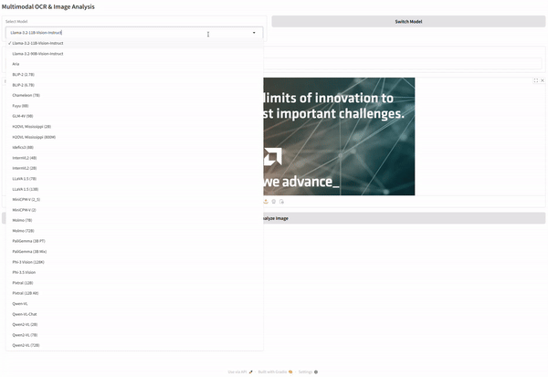

> 原文作者：Mahdi Ghodsi  
> [AMD 官方教程](https://rocm.docs.amd.com/projects/ai-developer-hub/en/latest/notebooks/inference/ocr_vllm.html) · [固定版本源码](https://github.com/ROCm/gpuaidev/blob/0071bfd4bd3bd9525405c09a6ae69c983b09312a/docs/notebooks/inference/ocr_vllm.ipynb)  
> 上游版本：`0071bfd4bd3bd9525405c09a6ae69c983b09312a` · 同步日期：2026-10-12  
> 翻译状态：机器初译，待逐篇人工校对；代码与命令保持原文，未在 AMD GPU 上运行验证。

[中文 Notebook](../../notebooks/inference/ocr_vllm.ipynb) · [英文原文](../../original/inference/ocr_vllm.md) · [中英对照](../../bilingual/inference/ocr_vllm.md)

---

<a id="ocr-with-vision-language-models-with-vllm"></a>

# 使用 vLLM 与视觉语言模型进行 OCR
**作者**：Mahdi Ghodsi
**知识水平**：初学者

[](https://notebooks.amd.com/tutorials/ocr_vllm.ipynb)

本Notebook提供了构建 OCR 系统的分步指南
将视觉语言模型与 vLLM 和 Gradio 用于 推理。
 
光学字符识别 (OCR) 对于从图像、扫描文档和手写内容中提取文本至关重要。
视觉语言模型 (VLM) 通过利用基于转换器的架构来增强 OCR，从而实现上下文感知文本识别。
 
本教程探讨如何使用 LLaVA、BLIP-2 和 Qwen-VL 等模型进行 OCR。它涵盖以下主题：

[使用 Docker 和 ROCm 进行环境设置](#env-setup)  
[启动容器中的 Jupyter Notebooks](#launch-jupyter)  
[安装依赖项](#install-deps)  
[使用 vLLM 构建 OCR](#cli-ocr)  
[将 OCR 转换为具有多种型号选择的 GUI 系统](#gradio-gui)


本教程对 大语言模型 (LLM) 推理 使用 vLLM。 vLLM 通过有效批处理请求和利用 GPU 资源来优化文本生成工作负载，提供高 吞吐量 和低 延迟，非常适合聊天机器人。


---

<a id="prerequisites"></a>

## 前置条件

本教程是使用以下设置进行开发和测试的。 

<a id="operating-system"></a>

### 操作系统

* **Ubuntu 22.04**：确保您的系统运行的是 Ubuntu 版本 22.04。

<a id="hardware"></a>

### 硬件

* **AMD Instinct™ GPU**：本教程在 AMD Instinct MI300X GPU 上进行了测试。确保您使用的是 AMD Instinct GPU 或支持 ROCm 的兼容硬件，并且您的系统满足[官方要求](https://rocm.docs.amd.com/projects/install-on-linux/en/latest/reference/system-requirements.html)。

<a id="software"></a>

### 软件

* **ROCm 6.2 或 6.3**：按照 [ROCm 安装指南](https://rocm.docs.amd.com/projects/install-on-linux/en/latest/install/quick-start.html) 安装并验证 ROCm。安装后，使用以下命令确认您的设置：

    ``` bash
    amd-smi
    ```

    此命令列出了您的 AMD GPU 以及相关详细信息。
    
    **注意**：对于 ROCm 6.4 及更早版本，请改用 `rocm-smi` 命令。

* **Docker**：确保 Docker 已正确安装和配置。请遵循适用于您的操作系统的 Docker 安装指南。

   **注意**：确保正确配置 Docker 权限。要配置权限以允许非 root 访问，请运行以下命令：

   ``` bash
   sudo usermod -aG docker $USER
   newgrp docker
   ```

   验证 Docker 是否正常工作：

   ``` bash
   docker run hello-world
   ```

<a id="hugging-face-api-access"></a>

### Hugging Face API 访问

* 从[Hugging Face](https://huggingface.co)获取API令牌用于下载模型。
* 确保 Hugging Face API 令牌具有访问 [Meta Llama 检查点](https://huggingface.co/meta-llama/Llama-3.2-11B-Vision-Instruct) 所需的权限和批准。

<a id="env-setup"></a>
<a id="1-environment-setup-with-docker-and-rocm"></a>

## 1. 使用 Docker 和 ROCm 设置环境

启动 Docker 容器。从您的主机运行以下命令：

``` bash
docker run -it --rm \
  --network=host \
  --device=/dev/kfd \
  --device=/dev/dri \
  --group-add=video \
  --ipc=host \
  --cap-add=SYS_PTRACE \
  --security-opt seccomp=unconfined \
  --shm-size 8G \
  --hostname=ROCm-FT \
  --env HUGGINGFACE_HUB_CACHE=/workspace \
  -v $(pwd):/workspace \
  -w /workspace \
  --entrypoint /bin/bash \
  rocm/vllm-dev:main
```

**注意**：该命令将当前目录挂载到容器中的`/workspace`目录中。确保在运行 Docker 命令之前将Notebook文件复制到此目录，或者在启动后上传到 Jupyter Notebook 环境。保存终端输出中提供的令牌或 URL，以便从 Web 浏览器访问Notebook。您可以从 [AI Developer Hub GitHub 存储库](https://github.com/ROCm/gpuaidev) 下载此Notebook。

<a id="launch-jupyter"></a>
<a id="2-launch-jupyter-notebooks-in-the-container"></a>

## 2. 在容器中启动 Jupyter Notebooks

在 Docker 容器内，使用以下命令安装 Jupyter：

``` bash
pip install jupyter
```

启动 Jupyter 服务器：

``` bash
jupyter-lab --ip=0.0.0.0 --port=8888 --no-browser --allow-root
```

**注意**：在运行上述命令之前，请确保您的系统上尚未使用端口 `8888`。如果是，您可以通过将 `--port=8888` 替换为其他端口号来指定其他端口，例如 `--port=8890`。

<a id="install-deps"></a>
<a id="3-installing-dependencies"></a>

## 3.安装依赖项

安装本教程所需的库。在 Docker 容器中运行的 Jupyter Notebook 中运行以下命令：

```python
!pip install "huggingface-hub>=0.26.0,<1.0" gradio requests
```

<a id="provide-your-hugging-face-token"></a>

### 提供您的拥抱令牌

您需要 Hugging Face API 令牌才能访问 Llama-3.2-11B-Vision-Instruct。在 [Hugging Face Tokens](https://huggingface.co/settings/tokens) 生成您的令牌并请求访问 [Llama-3.2-11B-Vision-Instruct](https://huggingface.co/meta-llama/Llama-3.2-11B-Vision-Instruct)。令牌通常以“hf_”开头。

在 Jupyter Notebook中运行以下交互式块来设置令牌：

```python
from huggingface_hub import notebook_login, HfApi

# Prompt the user to log in
notebook_login()
```

验证您的令牌是否被正确接受：

```python
# Validate the token
try:
    api = HfApi()
    user_info = api.whoami()
    print(f"Token validated successfully! Logged in as: {user_info['name']}")
except Exception as e:
    print(f"Token validation failed. Error: {e}")
```

<a id="cli-ocr"></a>
<a id="4-building-an-ocr-with-vllm"></a>

## 4. 使用 vLLM 构建 OCR

首先，定义 `ImageInference` 推理 类。此类提供了一个构造函数来初始化 推理 的模型。此外，它还定义了另一个在您提供的映像上运行 推理 的函数。

```python
from vllm import LLM, SamplingParams
from transformers import AutoTokenizer
from PIL import Image
from vllm.multimodal.utils import fetch_image
import sys

current_model = "meta-llama/Llama-3.2-11B-Vision-Instruct"

class ImageInference:
    def __init__(self, model_name=current_model):
        # Initialize the model and tokenizer
        self.llm = LLM(model=model_name, max_model_len=4096, max_num_seqs=16, enforce_eager=True)
        self.tokenizer = AutoTokenizer.from_pretrained(model_name)
    
    def generate_image_output(self, image: Image) -> str:
        # Prepare the prompt and the image for the model
        messages_og = [{'role': 'user', 'content': "<|image|> What is in this image?"}]
        messages = [{
            'role': 'user',
            'content': (
                "Act as an OCR assistant. Analyze the provided <|image|> image and:\n"
                "1. Identify and transcribe all visible text in the image exactly as it appears.\n"
                "2. Preserve the original line breaks, spacing, and formatting from the image.\n"
                "3. Output only the transcribed text, line by line, without adding any commentary or explanations or special characters.\n"
            )
        }]
        prompt = self.tokenizer.apply_chat_template(messages, tokenize=False, add_generation_prompt=True)

        sampling_params = SamplingParams(max_tokens=512, temperature=0.7)

        # Generate output from the model
        outputs = self.llm.generate({
            "prompt": prompt,
            "multi_modal_data": {"image": image},
        }, sampling_params=sampling_params)

        # Extract and return generated text
        generated_text = outputs[0].outputs[0].text if outputs else "No output generated."
        return generated_text
```

<a id="testing-the-ocr-system"></a>

### 测试 OCR 系统
通过运行以下命令下载[此测试图像](https://github.com/ROCm/gpuaidev/tree/main/docs/notebooks/assets/together_we_advance_.png)：

```python
import requests

url = "https://raw.githubusercontent.com/ROCm/gpuaidev/main/docs/notebooks/assets/together_we_advance_.png"
filename = "together_we_advance_.png"

response = requests.get(url)
with open(filename, "wb") as file:
    file.write(response.content)

print("Download complete:", filename)
```

现在是时候测试您的 OCR 系统了。首先阅读图像，然后查看它。

```python
pil_image = Image.open("together_we_advance_.png")
pil_image = pil_image.convert("RGB")  # Ensure the image is in RGB format
pil_image
```

接下来，初始化 `ImageInference` 类的实例。

```python
# Initialize the inference class
inference = ImageInference()
```

现在将图像传递给 推理 模型并打印结果。

```python

# Generate output for the image
output = inference.generate_image_output(pil_image)

# Print the result
print("Model Output:")
print(output)
```

恭喜。您刚刚构建了一个 OCR 系统。创建一个类似 OCR 的系统来转录给定图像中的文本就是如此简单。 

<a id="gradio-gui"></a>
<a id="5-transforming-the-ocr-to-a-gui-enabled-system-with-multiple-model-choices"></a>

## 5. 将 OCR 转换为具有多种模型选择的 GUI 系统

要为您的聊天机器人提供图形界面，请使用 [Gradio](https://www.gradio.app/) 创建基于 Web 的交互式 UI。

<a id="import-gradio-and-define-a-list-of-vlm-models-to-access"></a>

### 导入 Gradio 并定义要访问的 VLM 模型列表 

您将创建一个精心挑选的可以分析图像的模型的候选列表。完整列表可在[此处](https://docs.vllm.ai/en/latest/models/supported_models.html) 获取。

```python
import gradio as gr

# Define available models and their Hugging Face model IDs
MODEL_OPTIONS = {
    "Llama-3.2-11B-Vision-Instruct": "meta-llama/Llama-3.2-11B-Vision-Instruct",
    "BLIP-2 (2.7B)": "Salesforce/blip2-opt-2.7b",
    "BLIP-2 (6.7B)": "Salesforce/blip2-opt-6.7b",
    "Fuyu (8B)": "adept/fuyu-8b",
    "GLM-4V (9B)": "THUDM/glm-4v-9b",
    "H2OVL Mississippi (2B)": "h2oai/h2ovl-mississippi-2b",
    "H2OVL Mississippi (800M)": "h2oai/h2ovl-mississippi-800m",
    "InternVL2 (4B)": "OpenGVLab/InternVL2-4B",
    "InternVL2 (2B)": "OpenGVLab/Mono-InternVL-2B",
    "LLaVA 1.5 (7B)": "llava-hf/llava-1.5-7b-hf",
    "LLaVA 1.5 (13B)": "llava-hf/llava-1.5-13b-hf",
    "MiniCPM-V (2_5)": "openbmb/MiniCPM-Llama3-V-2_5",
    "MiniCPM-V (2)": "openbmb/MiniCPM-V-2",
    "Molmo (7B)": "allenai/Molmo-7B-D-0924",
    "PaliGemma (3B PT)": "google/paligemma-3b-pt-224",
    "PaliGemma (3B Mix)": "google/paligemma-3b-mix-224",
    "Phi-3 Vision (128K)": "microsoft/Phi-3-vision-128k-instruct",
    "Phi-3.5 Vision": "microsoft/Phi-3.5-vision-instruct",
    "Pixtral (12B)": "mistralai/Pixtral-12B-2409",
    "Qwen-VL": "Qwen/Qwen-VL",
    "Qwen-VL-Chat": "Qwen/Qwen-VL-Chat",
    "Qwen2-VL (2B)": "Qwen/Qwen2-VL-2B-Instruct",
    "Qwen2-VL (7B)": "Qwen/Qwen2-VL-7B-Instruct",
}
```

<a id="create-the-gradio-interface"></a>

### 创建Gradio界面

接下来，定义两个简单的辅助函数，用于切换模型并使用之前定义的类运行 推理，后面是 Gradio 块：

```python
def switch_model(model_name):
    global inference
    try:
        inference = ImageInference(model_name=model_name)
        return f"Switched to model: {model_name}"
    except Exception as e:
        return f"Failed to switch model: {str(e)}"

def analyze_image(image):
    try:
        pil_image = image.convert("RGB")
        result = inference.generate_image_output(pil_image)
        return result
    except Exception as e:
        return f"Error processing the image: {str(e)}"

with gr.Blocks() as interface:
    gr.Markdown("## Multimodal OCR & Image Analysis")
    
    with gr.Row():
        model_dropdown = gr.Dropdown(
            choices=list(MODEL_OPTIONS.keys()),
            value="Llama-3.2-11B-Vision-Instruct",
            label="Select Model",
        )
        switch_button = gr.Button("Switch Model")

    model_status = gr.Textbox(value=f"Current Model: {current_model}", label="Model Status")

    image_input = gr.Image(type="pil", label="Upload Image")
    analyze_button = gr.Button("Analyze Image")
    # output_box = gr.Textbox(label="Model Output", lines=10)
    output_box = gr.Markdown(label="Model Output")

    switch_button.click(
        fn=lambda selected_model: (switch_model(MODEL_OPTIONS[selected_model]), f"Current Model: {MODEL_OPTIONS[selected_model]}"),
        inputs=[model_dropdown],
        outputs=[model_status, model_status],
    )
    analyze_button.click(fn=analyze_image, inputs=image_input, outputs=output_box)
```

<a id="run-the-gradio-application"></a>

### 运行 Gradio 应用程序

执行下面的代码块来启动 GUI。该界面显示在您的浏览器中，让您与 OCR 系统进行交互。

```python
interface.launch()
```

<a id="conclusion"></a>

## 结论

在本教程中，您完成了以下任务：

* 使用 ROCm 6.2 或 6.3 和 vLLM 配置 Docker 环境。
* 使用 vLLM 构建 OCR 类。
* 通过添加 GUI 和多种不同型号的选择来扩展功能。
