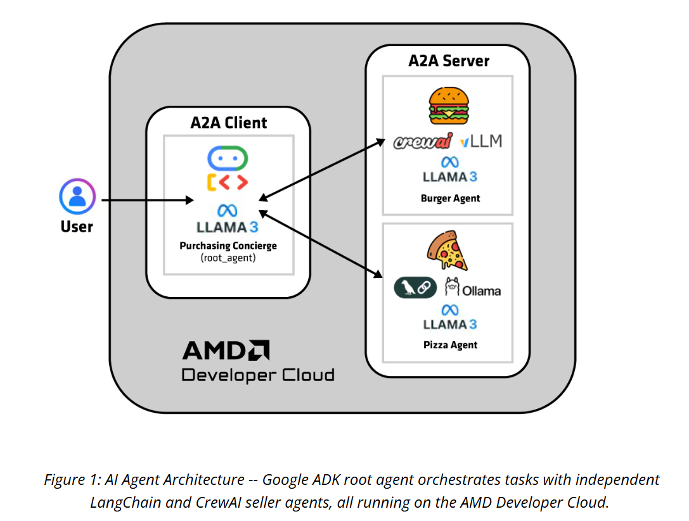

> 原文作者：Google；由 Shailen Sobhee 修改以支持 AMD GPU。  
> [AMD 官方教程](https://rocm.docs.amd.com/projects/ai-developer-hub/en/latest/notebooks/inference/power-Google-ADK-on-AMD-platform-and-local-LLMs.html) · [固定版本源码](https://github.com/ROCm/gpuaidev/blob/0071bfd4bd3bd9525405c09a6ae69c983b09312a/docs/notebooks/inference/power-Google-ADK-on-AMD-platform-and-local-LLMs.ipynb)  
> 上游版本：`0071bfd4bd3bd9525405c09a6ae69c983b09312a` · 同步日期：2026-10-12  
> 翻译状态：机器初译，待逐篇人工校对；代码与命令保持原文，未在 AMD GPU 上运行验证。

[中文 Notebook](../../notebooks/inference/power-Google-ADK-on-AMD-platform-and-local-LLMs.ipynb) · [英文原文](../../original/inference/power-Google-ADK-on-AMD-platform-and-local-LLMs.md) · [中英对照](../../bilingual/inference/power-Google-ADK-on-AMD-platform-and-local-LLMs.md)

---

<a id="ai-multi-agents-with-google-adk-and-amd-instinct-gpus"></a>

# 使用 Google ADK 与 A2A 协议构建多智能体
**作者**：[Google](https://codelabs.developers.google.com/intro-a2a-purchasing-concierge)；由 Shailen Sobhee 修改以支持 AMD GPU。
**知识水平**：中级

本教程将引导您为采购礼宾构建一个真实的智能体对智能体 (A2A) 系统，其中多个专业智能体（根、汉堡和披萨）可以无缝协作。

以下是您将实施的智能体：

**采购智能体**：（[Google ADK](https://google.github.io/adk-docs/) 和 [Ollama](https://ollama.com/)) 这是主智能体 (`root_agent`)，它使用 LiteLLM 和本地托管的 Ollama 模型来编排对话并路由用户请求。  
**汉堡卖家智能体**：（[CrewAI](https://www.crewai.com/) 和 vLLM）该智能体提供汉堡菜单、提供定价并处理订单创建，由 vLLM 托管模型提供支持。  
**披萨卖家智能体**：（[LangGraph](https://www.langchain.com/langgraph) 和 Ollama）该智能体专门从事披萨订购。它是在 Ollama 之上使用 LangGraph 构建的。

根智能体通过开放的 A2A 协议将任务委托给卖家智能体（披萨和汉堡）来协调订单，从而实现跨框架的无缝协作。

该系统在 AMD GPU 上本地运行，并包括交互式 Gradio UI，展示了真实世界智能体的互操作性和跨框架集成。

  

<a id="prerequisites"></a>

## 前置条件

使用以下设置来运行本教程。

<a id="hardware"></a>

### 硬件

对于本教程，您需要一个配备 AMD Instinct™ GPU 的系统。要在 CPU 上运行模型并使用 AMD [ZenDNN](https://www.amd.com/en/developer/zendnn.html)，您需要 AMD EPYC CPU。 

本教程在以下硬件上进行了测试：
* AMD 本能 MI100
* AMD 本能 MI210
* AMD Instinct MI300X
* 第四代 AMD EPYC（热那亚）
* 第五代 AMD EPYC（都灵）

<a id="software"></a>

### 软件

* **Ubuntu 22.04**：确保您的系统运行的是 Ubuntu 22.04 或更高版本。
* **ROCm 6.3+**：这仅是 GPU 执行所必需的。按照[ROCm安装指南](https://rocm.docs.amd.com/projects/install-on-linux/en/latest/install/quick-start.html)安装并验证ROCm。
* **PyTorch 2.6**（或更高版本）
* **vLLM**：用于在 Docker 容器中提供您选择的模型（需要 `sudo` 权限）。
* **Ollama**：这可用于服务您选择的其他模型。
  
<a id="install-and-launch-jupyter-notebooks"></a>

### 安装并启动 Jupyter Notebooks
如果您的系统上尚未安装 Jupyter，请安装它并使用以下命令启动 JupyterLab：

```
pip install jupyter
```

要启动 Jupyter 服务器，请运行以下命令：

```
jupyter-lab --ip=0.0.0.0 --port=8888 --no-browser --allow-root
```

**注意**：在运行上述命令之前，请确保您的系统上尚未使用端口 `8888`。如果是，您可以通过将 `--port=8888` 替换为其他端口号来指定其他端口，例如 `--port=8890`。

命令执行后，终端输出将显示 URL 和令牌。复制此 URL 并将其粘贴到主机上的 Web 浏览器中以访问 JupyterLab。启动 JupyterLab 后，将此Notebook上传到环境并继续按照本教程中的步骤进行操作。

<a id="tutorial-overview"></a>

## 教程概述

本教程分为五个部分，如下：

* **第 1 部分**：这是对 Agentic AI 的介绍，涵盖了理解接下来三个部分中介绍的概念所需的基础知识。本节介绍 A2A 协议、智能体卡、会话和内存等关键概念，以及安全和身份验证的基础知识。
* **第 2 部分**：您将使用 CrewAI 构建您的第一个智能体 - 汉堡销售智能体，并了解它如何与 LLM（由 vLLM 提供服务）一起运作。
* **第 3 部分**：使用 LangGraph 构建您的第二个智能体 - 披萨销售智能体，并由 Ollama 提供法学硕士学位。
* **第 4 部分**：使用 Google ADK 构建您的第三个也是最后一个智能体 - 采购礼宾智能体，并了解这三个智能体如何结合在一起。 
* **第 5 部分**：生成 Gradio UI 实例并在 GUI 中与您的采购礼宾交互。

<a id="part-1-a-quick-primer-for-agentic-ai-google-adk-and-key-concepts"></a>

## 第 1 部分：Agentic AI、Google ADK 和关键概念的快速入门

要创建 A2A 系统，您首先需要的是*智能体*。智能体是一种智能计算机程序，旨在代表个人行事，就像个人助理一样。智能体使用大型语言模型（LLM）作为他们的“大脑”。该模型感知输入，对其进行推理，并采取行动以实现目标。

在智能体之后，下一个组件是*智能体卡*。这是一个简单的 JSON 元数据文档，描述了智能体的身份、功能和端点。这就像智能体人的“名片”。它告诉其他人智能体是谁、它可以做什么以及如何与其交互。智能体卡是智能体在 A2A 生态系统中发现彼此并相互交谈的基础。

*A2A 协议* 允许智能体进行通信和协作。这是一个开放标准，为使用不同框架或不同供应商构建的智能体提供通用语言。它引入了两个关键角色：

**A2A 客户端**：代表用户发起请求的应用程序或智能体。在此项目中，*根智能体* (ADK) 在联系卖家智能体时扮演此角色。  

**A2A 服务器**：公开 HTTP 端点以接受请求、处理任务并返回结果的智能体或智能体系统。在这个项目中，汉堡智能体（CrewAI）和披萨智能体（LangChain）作为A2A服务器。  

这些智能体通过交换*任务*进行通信。任务是由多条消息组成的工作单元，例如下汉堡订单。

智能体、智能体卡和 A2A 协议（具有客户端和服务器角色）共同构成了构建互连智能体系统的基础。借助*智能体开发套件* (ADK) 等框架，您可以轻松创建自己的智能体并将它们连接到更大的生态系统，在该生态系统中根智能体可以发现、调用和协调在 A2A 服务器后面运行的远程智能体。

<a id="how-ai-agents-keep-your-conversation-alive"></a>

### AI 智能体如何让您的对话保持活跃

就像人类依靠记忆来维持连贯的对话一样，人工智能智能体也需要一种方法来跟踪多个交流中的上下文。如果没有这种能力，每次交互都将是一个孤立的事件。想象一下，与一个在你说完之后就忘记了一切的人交谈。

智能体开发工具包 (ADK) 通过三个核心组件解决了这个问题：

- **会话**：维护当前对话线程并从开始到结束跟踪正在进行的对话，包括在特定聊天期间交换的每条消息和采取的操作。
- **状态**：充当对话的“便笺簿”。它保存仅与您当前对话线程相关的临时数据，例如您已添加到购物车的商品或您当前提到的首选项。当对话结束时，这些数据将被清除。
- **记忆**：充当可搜索的知识库，涵盖您过去的所有会话，让客服人员回忆和参考当前对话之外的信息或上下文。

这些组件协同工作来创建可以引用以前的对话并随着时间的推移构建有意义的对话上下文的智能体。

<a id="security-considerations-in-a-multi-agent-system"></a>

### 多智能体系统中的安全注意事项

A2A协议以企业标准为核心设计，确保智能体能够安全、大规模地协作。它不是建立在新标准的基础上，而是建立在广泛采用的企业实践的基础上。

- **安全**：所有通信均通过 HTTPS 进行，具有现代 TLS、证书验证以及防窃听或篡改保护。
- **身份验证**：每个智能体服务器使用标准 Web 方法（OAuth2、OpenID Connect 和 API 密钥）强制进行身份验证，凭证在 HTTP 标头中传递并在协议外部进行管理。
- **授权**：强制实施细粒度、基于技能和最低权限的访问控制，确保智能体仅执行允许的操作。
- **可观察性**：与跟踪、日志记录和监视工具集成，以提供可见性、调试和审核。
- **API 管理**：可以使用智能体卡发现智能体端点，支持集中治理和轻松加入新智能体。

<a id="notebook-preparation"></a>

### Notebook准备

要在本地运行此Notebook，您首先需要几个实用程序，其中包括：Google A2A 类型的定义、解析智能体卡的逻辑以及用于任务管理的其他一些文件。这些实用程序文件使本项目中使用的第三方智能体框架（例如 CrewAI 和 LangGraph）能够与 Google A2A 协议兼容。

首先，下载实用程序并将克隆的文件移至上一级文件夹，以便您可以在本教程中轻松使用它们：

```python
%%bash

# Define the repository URL and branch
REPO_URL="https://github.com/shailensobhee/google-adk-agentic-ai-tutorial.git"
BRANCH_NAME="utils"
REPO_FOLDER="google-adk-agentic-ai-tutorial"

# Check if the repository folder already exists
if [ -d "$REPO_FOLDER" ]; then
  echo "The repository already exists. Updating it..."
  cd "$REPO_FOLDER"
  git pull origin "$BRANCH_NAME"
else
  echo "Cloning the repository for the first time..."
  git clone --single-branch --branch "$BRANCH_NAME" "$REPO_URL"
fi
cp -r $REPO_FOLDER/* .
rm -rf $REPO_FOLDER
```

然后安装本教程其余部分所需的所有 Python 包：

<a id="set-up-a-virtual-environment"></a>

## 设置虚拟环境

如果 `python3-venv` 尚不可用，请安装它（例如 `sudo apt install python3-venv`），然后创建一个虚拟环境以避免修改系统包：

```python
!python3 -m venv $HOME/.venv-google-adk
```

```python
# The cloned requirements.txt pins langgraph==1.0.4 but not langgraph-prebuilt, which then
# resolves to a release that needs langgraph>=1.1.5. Bump langchain/langgraph to a matching pair.
!sed -i -e 's/^langchain==1.1.0$/langchain==1.2.15/' -e 's/^langgraph==1.0.4$/langgraph==1.1.10/' requirements/requirements.txt
!. $HOME/.venv-google-adk/bin/activate && pip install -r requirements/requirements.txt
```

<a id="part-2-building-the-first-agent-burger-seller-with-crewai-and-vllm"></a>

## 第 2 部分：使用 CrewAI 和 vLLM 构建第一个智能体（汉堡销售商）

该智能体是使用 CrewAI 构建的，其核心 LLM 使用 vLLM 提供服务。它提供汉堡菜单、提供定价并通过 A2A 协议处理订单创建。标准的CrewAI智能体结构和组件定义如下：

**智能体→任务→人员→输出**

- **智能体**：专门实体（角色、目标、背景故事、工具或法学硕士）。  
- **任务**：智能体将执行的具体工作，包含详细说明和预期输出格式。  
- **Crew**：将智能体和任务链接在一起、定义流程并执行工作流的编排器。  

在 CrewAI 中，任务必须始终通过工作人员链接到智能体才能运行。

此外，在此示例中，您将创建一个自定义工具 `create_burger_order` 来处理确定性订单创建。现在您已准备好逐步实施汉堡智能体。

<a id="step-1-serve-a-vllm-model"></a>

### 第 1 步：提供 vLLM 模型

要开始使用 vLLM 提供您选择的模型，您需要在单独的终端中运行一些命令。以下步骤将指导您完成该过程，其中涉及运行 vLLM Docker 容器并为具有工具调用智能体的特定配置的模型提供服务。

`docker run -d -p 8088:8088 -it --ipc=host --network=host --privileged --cap-add=CAP_SYS_ADMIN --device=/dev/kfd --device=/dev/dri --device=/dev/mem --group-add render --cap-add=SYS_PTRACE --security-opt seccomp=unconfined -e HF_TOKEN=$HF_TOKEN --name vllm_server  rocm/vllm:latest`

接下来，使用 `docker attach vllm_server` 命令附加到容器。

<a id="step-1a-serve-the-model-with-tool-calling-capabilities"></a>

#### 步骤 1a：为模型提供工具调用功能

您可以从容器内部为您的模型提供服务。提供的命令使用工具调用解析器和特定的聊天模板，这对于需要结构化函数调用的代理人工智能应用程序至关重要。

导出您的 Hugging Face 令牌以允许访问门控模型。

```
export HF_TOKEN=<your HF token>
```

运行`vllm serve`命令启动模型。本示例使用 `meta-llama/Llama-3.1-8B-Instruct`，但您可以将其替换为您喜欢的任何型号。命令中添加了以下选项：
 
- `--enable-auto-tool-choice`：使模型能够自动选择合适的工具。  
- `--tool-call-parser llama3_json`：指定用于解释工具调用输出的解析器，这对于处理结构化 JSON 响应至关重要。  
- `--chat-template`：指向特定的 Jinja 模板文件。该模板以模型能够理解的方式格式化对话历史记录，以生成工具调用响应。

最后启动服务器如下：

`vllm serve meta-llama/Llama-3.1-8B-Instruct \`  
`--enable-auto-tool-choice \`  
`--tool-call-parser llama3_json \`  
`--port 8088 \`  
`--chat-template vllm/examples/tool_chat_template_llama3.1_json.jinja`

<a id="step-2-set-environment-variables"></a>

### 步骤2：设置环境变量

运行以下命令来配置变量：

```python
import os

# Set these to the correct values for your setup
os.environ["VLLM_MODEL"] = "hosted_vllm/meta-llama/Llama-3.1-8B-Instruct"
os.environ["OPENAI_API_BASE"] = "http://localhost:8088/v1" # vLLM serve URL
```

<a id="step-3-define-a-tool-to-create-the-burger-order"></a>

### 第 3 步：定义一个工具来创建汉堡订单

法学硕士擅长决定做什么，但工具才是他们实际执行行动的方式。  
`create_burger_order` 工具将模型的意图转变为确定性的、可审计的操作。

该工具获取用户想要的汉堡商品，生成唯一的订单 ID，并构建干净、结构化的订单。

```python
import subprocess, sys
venv_site_packages = subprocess.check_output(
    '. $HOME/.venv-google-adk/bin/activate && python3 -c "import site; print(site.getsitepackages()[0])"',
    shell=True, text=True,
).strip()
if venv_site_packages not in sys.path:
    sys.path.insert(0, venv_site_packages)
```

```python
from typing import Literal
from pydantic import BaseModel
import uuid
from crewai.tools import tool

class ResponseFormat(BaseModel):
    """Respond to the user in this format."""

    status: Literal["input_required", "completed", "error"] = "input_required"
    message: str


class OrderItem(BaseModel):
    name: str
    quantity: int
    price: int


class Order(BaseModel):
    order_id: str
    status: str
    order_items: list[OrderItem]


@tool("create_order")
def create_burger_order(order_items: list[OrderItem]) -> str:
    """
    Creates a new burger order with the given order items.

    Args:
        order_items: List of order items to be added to the order.

    Returns:
        str: A message indicating that the order has been created.
    """
    try:
        order_id = str(uuid.uuid4())
        order = Order(order_id=order_id, status="created", order_items=order_items)
        print("===")
        print(f"order created: {order}")
        print("===")
    except Exception as e:
        print(f"Error creating order: {e}")
        return f"Error creating order: {e}"
    return f"Order {order.model_dump()} has been created"
```

<a id="step-4-define-the-burgerselleragent-class"></a>

### 步骤 4：定义 BurgerSellerAgent 类  

回想一下标准的 CrewAI 智能体结构：智能体 → 任务 → 人员 → 输出。

`BurgerSellerAgent` 类本质上是智能体-任务-人员管道的包装器。它构建智能体、任务和人员。 

`BurgerSellerAgent` 类定义了汉堡店智能体的核心智能和业务规则。它：

* 封装了法学硕士必须遵循的说明、上下文和规则（菜单、定价、确认流程和错误处理）。  
* 将 LLM（通过 CrewAI）与 `create_burger_order` 工具连接起来，以便订单创建具有确定性和安全性。  
* 生成下游系统（如 A2A 服务器）可以可靠使用的结构化响应格式 (`ResponseFormat`)。  
* 处理不同的状态（`input_required`、`error`、`completed`）并将它们转换为服务器的统一响应。  
* 充当用户查询和A2A服务器之间的桥梁，这样服务器就不需要知道会话逻辑来托管智能体。

```python
from crewai import Agent as crewagent
from crewai import Crew as crewcrew
from crewai import LLM as crewllm
from crewai import Task as crewtask
from crewai import Process as crewprocess

class BurgerSellerAgent:
    TaskInstruction = """
# INSTRUCTIONS

You are a specialized assistant for a burger store.
Your sole purpose is to answer questions about what is available on burger menu and price also handle order creation.
If the user asks about anything other than burger menu or order creation, politely state that you cannot help with that topic and can only assist with burger menu and order creation.
Do not attempt to answer unrelated questions or use tools for other purposes.

# CONTEXT

Received user query: {user_prompt}
Session ID: {session_id}

Provided below is the available burger menu and it's related price:
- Classic Cheeseburger: IDR 85K
- Double Cheeseburger: IDR 110K
- Spicy Chicken Burger: IDR 80K
- Spicy Cajun Burger: IDR 85K

# RULES

- If user want to do something, you will be following this order:
    1. Always ensure the user already confirmed the order and total price. This confirmation may already given in the user query.
    2. Use `create_burger_order` tool to create the order
    3. Finally, always provide response to the user about the detailed ordered items, price breakdown and total, and order ID
    
- Set response status to input_required if asking for user order confirmation.
- Set response status to error if there is an error while processing the request.
- Set response status to completed if the request is complete.
- DO NOT make up menu or price, Always rely on the provided menu given to you as context.
"""
    SUPPORTED_CONTENT_TYPES = ["text", "text/plain"]

    def invoke(self, query, sessionId) -> str:
        burger_agent = crewagent(
            role="Burger Seller Agent",
            goal=(
                "Help user to understand what is available on burger menu and price also handle order creation."
            ),
            backstory=("You are an expert and helpful burger seller agent."),
            verbose=False,
            allow_delegation=False,
            tools=[create_burger_order],
            llm=crewllm(
                model="hosted_vllm/meta-llama/Llama-3.1-8B-Instruct", # os.getenv("VLLM_MODEL"), #VLLM_MODEL
                api_base="http://localhost:8088/v1" # os.getenv("OPENAI_API_BASE") # OPENAI_API_BASE
                )
        )

        agent_task = crewtask(
            description=self.TaskInstruction,
            output_pydantic=ResponseFormat,
            agent=burger_agent,
            expected_output=(
                "A JSON object with 'status' and 'message' fields."
                "Set response status to input_required if asking for user order confirmation."
                "Set response status to error if there is an error while processing the request."
                "Set response status to completed if the request is complete."
            ),
        )

        crew = crewcrew(
            tasks=[agent_task],
            agents=[burger_agent],
            verbose=False,
            process=crewprocess.sequential,
        )

        inputs = {"user_prompt": query, "session_id": sessionId}
        response = crew.kickoff(inputs)
        return self.get_agent_response(response)

    def get_agent_response(self, response):
        response_object = response.pydantic
        if response_object and isinstance(response_object, ResponseFormat):
            if response_object.status == "input_required":
                return {
                    "is_task_complete": False,
                    "require_user_input": True,
                    "content": response_object.message,
                }
            elif response_object.status == "error":
                return {
                    "is_task_complete": False,
                    "require_user_input": True,
                    "content": response_object.message,
                }
            elif response_object.status == "completed":
                return {
                    "is_task_complete": True,
                    "require_user_input": False,
                    "content": response_object.message,
                }

        return {
            "is_task_complete": False,
            "require_user_input": True,
            "content": "We are unable to process your request at the moment. Please try again.",
        }
```

<a id="step-5-start-the-burger-agent-a2a-server"></a>

### 步骤5：启动汉堡智能体A2A服务器

现在启动汉堡智能体作为 A2A 服务器。
这将 CrewAI 管道（智能体 → 任务 → 工作人员 → 输出）包装在 A2A 服务器内，因此智能体作为可发现的 A2A 服务公开。

在后台线程中运行它允许服务器：

- 持续侦听来自其他智能体（如根智能体）的传入请求。
- 让 Jupyter Notebook保持响应以执行进一步的步骤。

```python
from utils.server import A2AServer
from utils.a2a_types import AgentCard, AgentCapabilities, AgentSkill, AgentAuthentication
from utils.push_notification_auth import PushNotificationSenderAuth
from utils.task_manager import AgentTaskManager
import logging
import threading
import time
import logging

logging.basicConfig(level=logging.INFO)
logger = logging.getLogger(__name__)

AUTH_USERNAME="burgeruser123"
AUTH_PASSWORD="burgerpass123"

def main(host, port):   

    """Starts the Burger Seller Agent server."""
    try:
        capabilities = AgentCapabilities(pushNotifications=True)
        skill = AgentSkill(
            id="create_burger_order",
            name="Burger Order Creation Tool",
            description="Helps with creating burger orders",
            tags=["burger order creation"],
            examples=["I want to order 2 classic cheeseburgers"],
        )
        agent_card = AgentCard(
            name="burger_seller_agent",
            description="Helps with creating burger orders",
            # The URL provided here is for the sake of demo,
            # in production you should use a proper domain name
            url=f"http://{host}:{port}/",
            version="1.0.0",
            authentication=AgentAuthentication(schemes=["Basic"]),
            defaultInputModes=BurgerSellerAgent.SUPPORTED_CONTENT_TYPES,
            defaultOutputModes=BurgerSellerAgent.SUPPORTED_CONTENT_TYPES,
            capabilities=capabilities,
            skills=[skill],
        )


        notification_sender_auth = PushNotificationSenderAuth()
        notification_sender_auth.generate_jwk()
        server = A2AServer(
            agent_card=agent_card,
            task_manager=AgentTaskManager(
                agent=BurgerSellerAgent(),
                notification_sender_auth=notification_sender_auth,
            ),
            host=host,
            port=port,
            auth_username=AUTH_USERNAME,
            auth_password=AUTH_PASSWORD,
        )

        server.app.add_route(
            "/.well-known/jwks.json",
            notification_sender_auth.handle_jwks_endpoint,
            methods=["GET"],
        )

        logger.info(f"Starting server on {host}:{port}")
        server.start()
    except Exception as e:
        logger.error(f"An error occurred during server startup: {e}")
        exit(1)
```

<a id="how-it-works"></a>

#### 它是如何工作的
- 它定义了汉堡智能体的主机（`0.0.0.0`）和唯一端口（`10001`）。启动后，智能体准备好响应采购智能体的 A2A 请求。

<a id="why-use-a-thread"></a>

#### 为什么要使用线程？

在后台线程中运行服务器意味着：

- 您可以继续与Notebook互动
- 其他智能体或客户端组件仍然可以在其他单元中启动

这对于在 Jupyter 等交互式环境中使用多智能体系统至关重要。

```python

# --- Global variable to hold the server thread reference ---
# This allows you to stop it later from another cell if needed
global server_thread
server_thread = None

# --- Main execution in the Jupyter cell ---
if server_thread is not None and server_thread.is_alive():
    print("Server is already running.")
else:
    # Define host and port
    server_host = "0.0.0.0"
    server_port = 10001

    # Create and start the thread
    server_thread = threading.Thread(target=main, args=(server_host, server_port))
    server_thread.daemon = True # Allows the main program to exit even if the thread is still running
    server_thread.start()

    print(f"Server thread started. Waiting a moment for server to initialize on http://{server_host}:{server_port}")
    time.sleep(5) # Give it a few seconds to boot up
```

###第6步：测试汉堡卖家智能体

现在，您可以向汉堡智能体端点发送示例请求并验证：

- 它返回一个结构良好的响应。
- 智能体商提供汉堡优惠。

这确认智能体运行正常。

```python
agent = BurgerSellerAgent()
print(agent) 
result = agent.invoke("1 classic cheeseburger pls", "default_session")
print(result)
```

<a id="part-3-building-the-second-agent-pizza-seller-with-langgraph-and-ollama"></a>

## 第 3 部分：使用 LangGraph 和 Ollama 构建第二个智能体（披萨卖家）

该智能体是使用 LangGraph 构建的，其核心 LLM 使用 Ollama 提供服务。它提供披萨菜单、提供定价并通过 A2A 协议处理订单创建。 LangGraph 将智能体创建为 ReAct 智能体图，实现推理、行动和观察的循环模式。

在 LangGraph 中，ReAct 模式支持循环的所有阶段：

- **原因**：分析客户请求和菜单选项。
- **行动**：通过调用适当的工具来执行操作。
- **观察**：处理结果以提供结构化响应。

在此示例中，您将创建一个自定义 `create_pizza_order` 工具来处理确定性订单创建。

<a id="step-1-serve-a-model-with-ollama"></a>

### 第 1 步：为 Ollama 提供模型

要使用该模型，您需要下载并安装 Ollama。为此，请在单独的终端中输入以下命令：

```
curl -fsSL https://ollama.com/install.sh | sh
ollama run llama3.1
```

<a id="step-2-define-the-create_pizza_order-tool"></a>

### 步骤 2：定义 create_pizza_order 工具

法学硕士非常擅长理解用户意图并确定要采取哪些操作，但由于他们本身不执行这些操作，因此您必须使用工具。

`create_pizza_order` 工具获取用户想要的披萨项目列表，生成唯一的订单 ID，并构建结构化的 `Order` 对象。

```python
from langchain_ollama import ChatOllama
from langchain_core.tools import tool
from langchain.agents import create_agent
from langgraph.checkpoint.memory import MemorySaver
from typing import Literal
from pydantic import BaseModel
import uuid

memory = MemorySaver()

class ResponseFormat(BaseModel):
    """Respond to the user in this format."""

    status: Literal["input_required", "completed", "error"] = "input_required"
    message: str


class OrderItem(BaseModel):
    name: str
    quantity: int
    price: int


class Order(BaseModel):
    order_id: str
    status: str
    order_items: list[OrderItem]


@tool
def create_pizza_order(order_items: list[OrderItem]) -> str:
    """
    Creates a new pizza order with the given order items.

    Args:
        order_items: List of order items to be added to the order.

    Returns:
        str: A message indicating that the order has been created.
    """
    try:
        order_id = str(uuid.uuid4())
        order = Order(order_id=order_id, status="created", order_items=order_items)
        print("===")
        print(f"order created: {order}")
        print("===")
    except Exception as e:
        print(f"Error creating order: {e}")
        return f"Error creating order: {e}"
    return f"Order {order.model_dump()} has been created"
```

<a id="step-3-define-the-pizzaselleragent-class"></a>

### 步骤 3：定义 PizzaSellerAgent 类  

如前所述，LangGraph 将智能体创建为 ReAct 智能体图。

`PizzaSellerAgent` 类是构建智能体的 ReAct 图的包装器。它定义了披萨店智能体的核心智能和业务规则。它执行以下操作：

- 封装了法学硕士必须遵循的说明、上下文和规则（菜单、定价、确认流程和错误处理）。  
- 将LLM（使用LangChain）与`create_pizza_order`工具连接起来，以便订单创建具有确定性和安全性。  
- 生成下游系统（如 A2A 服务器）可以可靠使用的结构化响应格式 (`ResponseFormat`)。  
- 处理不同的状态（`input_required`、`error`、`completed`）并将它们转换为服务器的统一响应。  
- 充当用户查询和A2A服务器之间的桥梁，因此服务器不需要知道托管智能体的对话逻辑。

```python
class PizzaSellerAgent:
    SYSTEM_INSTRUCTION = """
# INSTRUCTIONS

You are a specialized assistant for a pizza store.
Your sole purpose is to answer questions about what is available on pizza menu and price also handle order creation.
If the user asks about anything other than pizza menu or order creation, politely state that you cannot help with that topic and can only assist with pizza menu and order creation.
Do not attempt to answer unrelated questions or use tools for other purposes.

# CONTEXT

Provided below is the available pizza menu and it's related price:
- Margherita Pizza: IDR 100K
- Pepperoni Pizza: IDR 140K
- Hawaiian Pizza: IDR 110K
- Veggie Pizza: IDR 100K
- BBQ Chicken Pizza: IDR 130K

# RULES

- If user want to do something, you will be following this order:
    1. Always ensure the user already confirmed the order and total price. This confirmation may already given in the user query.
    2. Use `create_pizza_order` tool to create the order
    3. Finally, always provide response to the user about the detailed ordered items, price breakdown and total, and order ID

- Set response status to input_required if asking for user order confirmation.
- Set response status to error if there is an error while processing the request.
- Set response status to completed if the request is complete.
- DO NOT make up menu or price, Always rely on the provided menu given to you as context.
"""
    SUPPORTED_CONTENT_TYPES = ["text", "text/plain"]

    def __init__(self):

        self.model = ChatOllama(
            model="llama3.1:latest" 
        )

        self.tools = [create_pizza_order]
        self.graph = create_agent(
            self.model,
            tools=self.tools,
            checkpointer=memory,
            system_prompt=self.SYSTEM_INSTRUCTION,
        )
        # Produce the structured response in a separate final call over the finished
        # conversation. Passing response_format to create_agent instead asks the model
        # to emit it inside the tool loop, which local models like llama3.1 often skip.
        self.response_model = self.model.with_structured_output(ResponseFormat)

    def invoke(self, query, sessionId) -> str:
        config = {"configurable": {"thread_id": sessionId}}
        result = self.graph.invoke({"messages": [("user", query)]}, config)
        structured_response = self.response_model.invoke(result["messages"])
        return self.get_agent_response(structured_response)

    def get_agent_response(self, structured_response):
        if structured_response and isinstance(structured_response, ResponseFormat):
            if structured_response.status == "input_required":
                return {
                    "is_task_complete": False,
                    "require_user_input": True,
                    "content": structured_response.message,
                }
            elif structured_response.status == "error":
                return {
                    "is_task_complete": False,
                    "require_user_input": True,
                    "content": structured_response.message,
                }
            elif structured_response.status == "completed":
                return {
                    "is_task_complete": True,
                    "require_user_input": False,
                    "content": structured_response.message,
                }

        return {
            "is_task_complete": False,
            "require_user_input": True,
            "content": "We are unable to process your request at the moment. Please try again.",
        }
```

<a id="step-4-set-environment-variables"></a>

### 第四步：设置环境变量

运行以下命令来配置变量：

```python
import os

# Set these to the correct values for your setup
os.environ["API_KEY"] = "pizza123"
os.environ["OLLAMA_MODEL"] = "ollama_chat/llama3.1:latest"
os.environ["OLLAMA_BASE_URL"] = "http://localhost:11434"
```

<a id="step-5-start-the-pizza-agent-server"></a>

### 步骤5：启动披萨智能体服务器

现在启动披萨智能体作为 A2A 服务器。这将智能体图包装在 A2AServer 内，因此智能体作为可发现的 A2A 服务公开。

```python
from utils.server import A2AServer
from utils.a2a_types import AgentCard, AgentCapabilities, AgentSkill, AgentAuthentication
from utils.push_notification_auth import PushNotificationSenderAuth
from utils.task_manager import AgentTaskManager
import click
import logging
import os
import threading
import time
import os
import logging


logging.basicConfig(level=logging.INFO)
logger = logging.getLogger(__name__)

def main(host, port):
    """Starts the Pizza Seller Agent server."""
    try:
        capabilities = AgentCapabilities(pushNotifications=True)
        skill = AgentSkill(
            id="create_pizza_order",
            name="Pizza Order Creation Tool",
            description="Helps with creating pizza orders",
            tags=["pizza order creation"],
            examples=["I want to order 2 pepperoni pizzas"],
        )
        agent_card = AgentCard(
            name="pizza_seller_agent",
            description="Helps with creating pizza orders",
            # The URL provided here is for the sake of demo,
            # in production you should use a proper domain name
            url=f"http://{host}:{port}/",
            version="1.0.0",
            authentication=AgentAuthentication(schemes=["Bearer"]),
            defaultInputModes=PizzaSellerAgent.SUPPORTED_CONTENT_TYPES,
            defaultOutputModes=PizzaSellerAgent.SUPPORTED_CONTENT_TYPES,
            capabilities=capabilities,
            skills=[skill],
        )

        notification_sender_auth = PushNotificationSenderAuth()
        notification_sender_auth.generate_jwk()
        server = A2AServer(
            agent_card=agent_card,
            task_manager=AgentTaskManager(
                agent=PizzaSellerAgent(),
                notification_sender_auth=notification_sender_auth,
            ),
            host=host,
            port=port,
            api_key=os.environ.get("API_KEY"),
        )

        server.app.add_route(
            "/.well-known/jwks.json",
            notification_sender_auth.handle_jwks_endpoint,
            methods=["GET"],
        )

        logger.info(f"Starting server on {host}:{port}")
        server.start()
    except Exception as e:
        logger.error(f"An error occurred during server startup: {e}")
        exit(1)
```

<a id="how-it-works"></a>

#### 它是如何工作的
- 它定义了披萨智能体的主机 (`0.0.0.0`) 和唯一端口 (`10000`)。启动后，该智能体已准备好响应采购智能体的 A2A 请求。

<a id="why-use-a-thread"></a>

#### 为什么要使用线程？
在后台线程中运行服务器意味着：

- 服务器可以持续侦听来自其他智能体（如根智能体）的传入请求。
- 您可以继续与Notebook交互，Notebook仍保持响应。
- 其他智能体或客户端组件仍可以在其他单元中启动。

这对于在 Jupyter 等交互式环境中使用多智能体系统至关重要。

```python
global server_thread
server_thread = None

# --- Main execution in the Jupyter cell ---
if server_thread is not None and server_thread.is_alive():
    print("Server is already running.")
else:
    # Define host and port
    server_host = "0.0.0.0"
    server_port = 10000

    # Create and start the thread
    server_thread = threading.Thread(target=main, args=(server_host, server_port))
    server_thread.daemon = True # Allows the main program to exit even if the thread is still running
    server_thread.start()

    print(f"Server thread started. Waiting a moment for server to initialize on http://{server_host}:{server_port}")
    time.sleep(5) # Give it a few seconds to boot up
```

###第6步：测试披萨卖家智能体

现在，您可以向披萨智能体端点发送示例请求并检查：

- 它返回一个结构良好的响应。
- 智能体商提供披萨优惠。

这确认智能体运行正常。

```python
agent = PizzaSellerAgent()
print(agent) 
result = agent.invoke("I want to order 2 pepperoni pizzas", "default_session")
print(result)
```

<a id="part-4-building-the-agent-purchasing-concierge-agent-with-google-adk-and-ollama"></a>

## 第 4 部分：使用 Google ADK 和 Ollama 构建智能体采购礼宾智能体

该智能体是使用 Google ADK 构建的，其核心 LLM 使用 Ollama 提供服务，它通过开放的 A2A 协议将任务委托给这些卖家智能体来协调订单。您可以使用 LiteLLM 在 ADK 中创建智能体，而无需使用 Google 或 Gemini 模型。

<a id="step-1-set-environment-variables"></a>

### 第1步：设置环境变量

运行以下命令来配置变量：

```python
import sys
import os

os.environ["OLLAMA_MODEL"] = "ollama_chat/llama3.1:latest"
os.environ["OLLAMA_BASE_URL"] = "http://localhost:11434"


os.environ["PIZZA_SELLER_AGENT_AUTH"] = "pizza123"
os.environ["PIZZA_SELLER_AGENT_URL"] = "http://localhost:10000"
os.environ["BURGER_SELLER_AGENT_AUTH"] = "burgeruser123:burgerpass123"
os.environ["BURGER_SELLER_AGENT_URL"] = "http://localhost:10001"
```

<a id="step-2-remote-agent-connections"></a>

### 第 2 步：远程智能体连接

根智能体通过A2A协议将任务委托给远程智能体。

`RemoteAgentConnections` 类是一个通信包装器，用于管理与 A2A 生态系统中的远程智能体的交互。它：

- 通过智能体特定的身份验证（API 密钥和基本身份验证）建立 A2A 客户端连接。
- 使用 `send_task()` 方法将任务发送到远程智能体，并支持实时更新的回调。
- 管理元数据传播和消息 ID 跟踪以保持对话连续性。
- 通过回调函数处理任务生命周期事件（状态更新和工件更改）。
- 通过对话上下文和待处理任务跟踪维护会话状态。

```python
from typing import Callable
import uuid
from utils.a2a_types import (
    AgentCard,
    Task,
    TaskSendParams,
    TaskStatusUpdateEvent,
    TaskArtifactUpdateEvent,
)
from utils.client import A2AClient
import os

TaskCallbackArg = Task | TaskStatusUpdateEvent | TaskArtifactUpdateEvent
TaskUpdateCallback = Callable[[TaskCallbackArg, AgentCard], Task]

KNOWN_AUTH = {
    "pizza_seller_agent": os.getenv("PIZZA_SELLER_AGENT_AUTH", "api_key"),
    "burger_seller_agent": os.getenv("BURGER_SELLER_AGENT_AUTH", "user:pass"),
}


class RemoteAgentConnections:
    """A class to hold the connections to the remote agents."""

    def __init__(self, agent_card: AgentCard, agent_url: str):
        auth = KNOWN_AUTH.get(agent_card.name, None)
        self.agent_client = A2AClient(agent_card, auth=auth, agent_url=agent_url)
        self.card = agent_card

        self.conversation_name = None
        self.conversation = None
        self.pending_tasks = set()

    def get_agent(self) -> AgentCard:
        return self.card

    async def send_task(
        self,
        request: TaskSendParams,
        task_callback: TaskUpdateCallback | None,
    ) -> Task | None:
        response = await self.agent_client.send_task(request.model_dump())
        merge_metadata(response.result, request)
        # For task status updates, we need to propagate metadata and provide
        # a unique message id.
        if (
            hasattr(response.result, "status")
            and hasattr(response.result.status, "message")
            and response.result.status.message
        ):
            merge_metadata(response.result.status.message, request.message)
            m = response.result.status.message
            if not m.metadata:
                m.metadata = {}
            if "message_id" in m.metadata:
                m.metadata["last_message_id"] = m.metadata["message_id"]
            m.metadata["message_id"] = str(uuid.uuid4())

        if task_callback:
            task_callback(response.result, self.card)
        return response.result


def merge_metadata(target, source):
    if not hasattr(target, "metadata") or not hasattr(source, "metadata"):
        return
    if target.metadata and source.metadata:
        target.metadata.update(source.metadata)
    elif source.metadata:
        target.metadata = dict(**source.metadata)
```

<a id="step-3-define-the-purchasingagent-class"></a>

### 步骤 3：定义 PurchasingAgent 类 

如前所述，您将使用 LiteLLM 创建智能体，而不是使用 Google 或 Gemini 模型。 

`PurchasingAgent` 类是智能体卡和智能体组件的包装器。此类定义了核心编排和委托逻辑。它：

- 通过解析智能体卡、建立经过身份验证的连接以及维护卖家智能体注册表来发现远程智能体。
- 通过智能路由、会话管理和异步任务处理来协调任务委派。
- 通过聚合卖家输出、格式化用户消息和处理状态转换来管理响应。
- 通过跟踪智能体分配、管理元数据传播和协调多智能体交互来控制对话流。
- 通过错误处理、干净的会话管理和结构化响应验证提供可靠性。

```python
import json
import uuid
from typing import List
import httpx
import os

from google.adk.models.lite_llm import LiteLlm 
from google.adk import Agent
from google.adk.agents.readonly_context import ReadonlyContext
from google.adk.agents.callback_context import CallbackContext
from google.adk.tools.tool_context import ToolContext
from utils.card_resolver import A2ACardResolver
from utils.a2a_types import (
    AgentCard,
    Message,
    TaskState,
    Task,
    TaskSendParams,
    TextPart,
    Part,
)


class PurchasingAgent:
    """The purchasing agent.

    This is the agent responsible for choosing which remote seller agents to send
    tasks to and coordinate their work.
    """

    def __init__(
        self,
        remote_agent_addresses: List[str],
        task_callback: TaskUpdateCallback | None = None,
    ):
        self.task_callback = task_callback
        self.remote_agent_connections: dict[str, RemoteAgentConnections] = {}
        self.cards: dict[str, AgentCard] = {}
        for address in remote_agent_addresses:
            card_resolver = A2ACardResolver(address)
            try:
                card = card_resolver.get_agent_card()
                # The URL accessed here should be the same as the one provided in the agent card
                # However, in this demo we are using the URL provided in the key arguments
                remote_connection = RemoteAgentConnections(
                    agent_card=card, agent_url=address
                )
                self.remote_agent_connections[card.name] = remote_connection
                self.cards[card.name] = card
            except httpx.ConnectError:
                print(f"ERROR: Failed to get agent card from : {address}")
        agent_info = []
        for ra in self.list_remote_agents():
            agent_info.append(json.dumps(ra))
        self.agents = "\n".join(agent_info)

    def create_agent(self) -> Agent:
        return Agent(
            model=LiteLlm(model=os.getenv("OLLAMA_MODEL")), 
            name="purchasing_agent",
            instruction=self.root_instruction,
            before_model_callback=self.before_model_callback,
            description=(
                "This purchasing agent orchestrates the decomposition of the user purchase request into"
                " tasks that can be performed by the seller agents."
            ),
            tools=[
                self.send_task,
            ],
        )

    def root_instruction(self, context: ReadonlyContext) -> str:
        current_agent = self.check_active_agent(context)
        return f"""You are an expert purchasing delegator that can delegate the user product inquiry and purchase request to the
appropriate seller remote agents.

Execution:
- For actionable tasks, you can use `send_task` to assign tasks to remote agents to perform.
- When the remote agent is repeatedly asking for user confirmation, assume that the remote agent doesn't have access to user's conversation context. 
    So improve the task description to include all the necessary information related to that agent
- Never ask user permission when you want to connect with remote agents. If you need to make connection with multiple remote agents, directly
    connect with them without asking user permission or asking user preference
- Always show the detailed response information from the seller agent and propagate it properly to the user. 
- If the remote seller is asking for confirmation, rely the confirmation question to the user if the user haven't do so. 
- If the user already confirmed the related order in the past conversation history, you can confirm on behalf of the user
- Do not give irrelevant context to remote seller agent. For example, ordered pizza item is not relevant for the burger seller agent
- Never ask order confirmation to the remote seller agent 

Please rely on tools to address the request, and don't make up the response. If you are not sure, please ask the user for more details.
Focus on the most recent parts of the conversation primarily.

If there is an active agent, send the request to that agent with the update task tool.

Agents:
{self.agents}

Current active seller agent: {current_agent["active_agent"]}
"""

    def check_active_agent(self, context: ReadonlyContext):
        state = context.state
        if (
            "session_id" in state
            and "session_active" in state
            and state["session_active"]
            and "active_agent" in state
        ):
            return {"active_agent": f"{state['active_agent']}"}
        return {"active_agent": "None"}

    def before_model_callback(self, callback_context: CallbackContext, llm_request):
        state = callback_context.state
        if "session_active" not in state or not state["session_active"]:
            if "session_id" not in state:
                state["session_id"] = str(uuid.uuid4())
            state["session_active"] = True

    def list_remote_agents(self):
        """List the available remote agents you can use to delegate the task."""
        if not self.remote_agent_connections:
            return []

        remote_agent_info = []
        for card in self.cards.values():
            print(f"Found agent card: {card.model_dump()}")
            print("=" * 100)
            remote_agent_info.append(
                {"name": card.name, "description": card.description}
            )
        return remote_agent_info

    async def send_task(self, agent_name: str, task: str, tool_context: ToolContext):
        """Sends a task to remote seller agent

        This will send a message to the remote agent named agent_name.

        Args:
            agent_name: The name of the agent to send the task to.
            task: The comprehensive conversation context summary
                and goal to be achieved regarding user inquiry and purchase request.
            tool_context: The tool context this method runs in.

        Yields:
            A dictionary of JSON data.
        """
        if agent_name not in self.remote_agent_connections:
            raise ValueError(f"Agent {agent_name} not found")
        state = tool_context.state
        state["active_agent"] = agent_name
        client = self.remote_agent_connections[agent_name]
        if not client:
            raise ValueError(f"Client not available for {agent_name}")
        if "task_id" in state:
            taskId = state["task_id"]
        else:
            taskId = str(uuid.uuid4())
        sessionId = state["session_id"]
        task: Task
        messageId = ""
        metadata = {}
        if "input_message_metadata" in state:
            metadata.update(**state["input_message_metadata"])
            if "message_id" in state["input_message_metadata"]:
                messageId = state["input_message_metadata"]["message_id"]
        if not messageId:
            messageId = str(uuid.uuid4())
        metadata.update(**{"conversation_id": sessionId, "message_id": messageId})
        request: TaskSendParams = TaskSendParams(
            id=taskId,
            sessionId=sessionId,
            message=Message(
                role="user",
                parts=[TextPart(text=task)],
                metadata=metadata,
            ),
            acceptedOutputModes=["text", "text/plain"],
            # pushNotification=None,
            metadata={"conversation_id": sessionId},
        )
        task = await client.send_task(request, self.task_callback)
        # Assume completion unless a state returns that isn't complete
        state["session_active"] = task.status.state not in [
            TaskState.COMPLETED,
            TaskState.CANCELED,
            TaskState.FAILED,
            TaskState.UNKNOWN,
        ]
        if task.status.state == TaskState.INPUT_REQUIRED:
            # Force user input back
            tool_context.actions.escalate = True
        elif task.status.state == TaskState.COMPLETED:
            # Reset active agent is task is completed
            state["active_agent"] = "None"

        response = []
        if task.status.message:
            # Assume the information is in the task message.
            response.extend(convert_parts(task.status.message.parts, tool_context))
        if task.artifacts:
            for artifact in task.artifacts:
                response.extend(convert_parts(artifact.parts, tool_context))
        return response


def convert_parts(parts: list[Part], tool_context: ToolContext):
    rval = []
    for p in parts:
        rval.append(convert_part(p, tool_context))
    return rval


def convert_part(part: Part, tool_context: ToolContext):
    # Currently only support text parts
    if part.type == "text":
        return part.text

    return f"Unknown type: {part.type}"
```

```python
import os

root_agent = PurchasingAgent(
    remote_agent_addresses=[
        os.getenv("PIZZA_SELLER_AGENT_URL", "http://localhost:10000"),
        os.getenv("BURGER_SELLER_AGENT_URL", "http://localhost:10001"),
    ]
).create_agent()
```

<a id="part-5-running-the-purchasing-concierge-agent-from-a-ui"></a>

## 第 5 部分：从 UI 运行采购礼宾智能体

为了更轻松地测试智能体，您可以构建一个简单的 Gradio 界面。它在您的浏览器中本地运行，地址为 `http://localhost:8095`。

现在就索取菜单来尝试一下吧！所有智能体运行后，您可以通过询问以下内容来测试他们的响应：

> “今天的披萨菜单是什么？” 

或  

>“请给我一份您拥有的汉堡和披萨的清单，包括要点价格”

每个卖家智能体（汉堡和披萨）都会回复他们的可用商品和价格。  
这是测试智能体是否可访问并正确响应的好方法，并且有助于测试完整的多智能体系统如何工作。

```python
!pip list | grep google
```

````python
import gradio as gr
from typing import List, Dict, Any
from google.adk.sessions import InMemorySessionService
from google.adk.runners import Runner
from google.adk.events import Event
from typing import AsyncIterator
from google.genai import types
from pprint import pformat
import logging
logging.getLogger("opentelemetry.context").setLevel(logging.CRITICAL)

purchasing_agent = root_agent

APP_NAME = "purchasing_concierge_app"
USER_ID = "default_user"
SESSION_ID = "default_session"
SESSION_SERVICE = InMemorySessionService()

PURCHASING_AGENT_RUNNER = Runner(
    agent=purchasing_agent,  # The agent we want to run
    app_name=APP_NAME,  # Associates runs with our app
    session_service=SESSION_SERVICE,  # Uses our session manager
)

async def get_response_from_agent(
    message: str,
    history: List[Dict[str, Any]],
) -> str:
    """Send the message to the backend and get a response.

    Args:
        message: Text content of the message.
        history: List of previous message dictionaries in the conversation.

    Returns:
        Text response from the backend service.
    """
    # try:
    events_iterator: AsyncIterator[Event] = PURCHASING_AGENT_RUNNER.run_async(
        user_id=USER_ID,
        session_id=SESSION_ID,
        new_message=types.Content(role="user", parts=[types.Part(text=message)]),
    )

    responses = []
    async for event in events_iterator:  # event has type Event
        if event.content.parts:
            for part in event.content.parts:
                if part.function_call:
                    formatted_call = f"```python\n{pformat(part.function_call.model_dump(), indent=2, width=80)}\n```"
                    responses.append(
                        gr.ChatMessage(
                            role="assistant",
                            content=f"{part.function_call.name}:\n{formatted_call}",
                            metadata={"title": "🛠️ Tool Call"},
                        )
                    )
                elif part.function_response:
                    formatted_response = f"```python\n{pformat(part.function_response.model_dump(), indent=2, width=80)}\n```"

                    responses.append(
                        gr.ChatMessage(
                            role="assistant",
                            content=formatted_response,
                            metadata={"title": "⚡ Tool Response"},
                        )
                    )

        # Key Concept: is_final_response() marks the concluding message for the turn
        if event.is_final_response():
            if event.content and event.content.parts:
                # Extract text from the first part
                final_response_text = event.content.parts[0].text
            elif event.actions and event.actions.escalate:
                # Handle potential errors/escalations
                final_response_text = (
                    f"Agent escalated: {event.error_message or 'No specific message.'}"
                )
            responses.append(
                gr.ChatMessage(role="assistant", content=final_response_text)
            )
            yield responses
            break  # Stop processing events once the final response is found

        yield responses

if __name__ == "__main__":
    
    session = await SESSION_SERVICE.create_session(
    app_name=APP_NAME, 
    user_id=USER_ID, 
    session_id=SESSION_ID)

    print(session)
    demo = gr.ChatInterface(
        get_response_from_agent,
        title="Purchasing Concierge",
        description="This assistant can help you to purchase food from remote sellers.",
    )
    print(SESSION_ID)

    demo.launch(
        server_name="0.0.0.0",
        server_port=8095,
        share=True
    )
````
