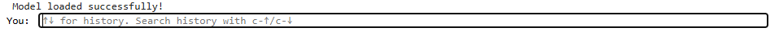
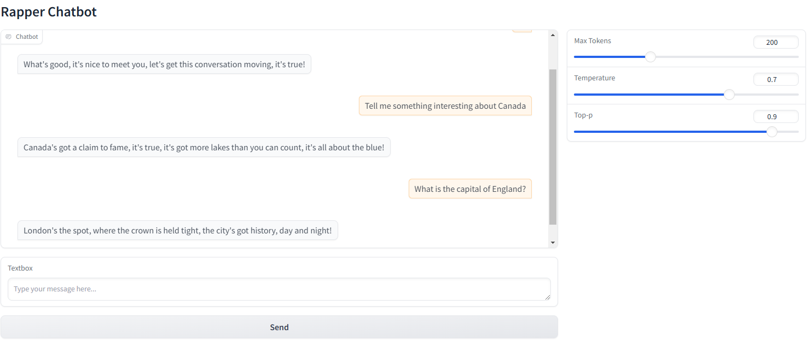

> 原文作者：Mahdi Ghodsi  
> [AMD 官方教程](https://rocm.docs.amd.com/projects/ai-developer-hub/en/latest/notebooks/inference/rapbot_vllm.html) · [固定版本源码](https://github.com/ROCm/gpuaidev/blob/0071bfd4bd3bd9525405c09a6ae69c983b09312a/docs/notebooks/inference/rapbot_vllm.ipynb)  
> 上游版本：`0071bfd4bd3bd9525405c09a6ae69c983b09312a` · 同步日期：2026-10-12  
> 翻译状态：机器初译，待逐篇人工校对；代码与命令保持原文，未在 AMD GPU 上运行验证。

[中文 Notebook](../../notebooks/inference/rapbot_vllm.ipynb) · [英文原文](../../original/inference/rapbot_vllm.md) · [中英对照](../../bilingual/inference/rapbot_vllm.md)

---

<a id="building-your-own-chatbot-and-rap-bot-with-vllm"></a>

# 使用 vLLM：从聊天机器人到说唱机器人
**作者**：Mahdi Ghodsi
**知识水平**：初学者

本教程介绍如何创建聊天机器人和说唱机器人，并涵盖以下主题：

1. [Docker和ROCm的环境设置](#env-setup)  
2. [在 Docker 容器中启动 Jupyter Notebooks](#launch-jupyter)  
3. [安装并配置Hugging Face和vLLM](#hugging-face-token)  
4. [使用 vLLM 构建基本聊天机器人](#basic-chatbot)  
5. [将聊天机器人改造成说唱机器人](#rap-bot)  
6. [通过几次提示增强响应](#few-shot)
7. [使用 Gradio 启动 GUI：可选](#gradio-gui)

本教程使用 vLLM 进行 大语言模型 (LLM) 推理。 vLLM 通过有效批处理请求和利用 GPU 资源来优化文本生成工作负载，提供高 吞吐量 和低 延迟，非常适合聊天机器人。

---

<a id="prerequisites"></a>

## 前置条件

本教程是使用以下设置进行开发和测试的。 

<a id="operating-system"></a>

### 操作系统

* **Ubuntu 22.04**：确保您的系统运行的是 Ubuntu 版本 22.04。

<a id="hardware"></a>

### 硬件

* **AMD Instinct™ GPU**：本教程在 AMD Instinct MI300X GPU 上进行了测试。确保您使用的是 AMD Instinct GPU 或支持 ROCm 的兼容硬件，并且您的系统满足[官方要求](https://rocm.docs.amd.com/projects/install-on-linux/en/latest/reference/system-requirements.html)。

<a id="software"></a>

### 软件

* **ROCm 6.2 或 6.3**：按照 [ROCm 安装指南](https://rocm.docs.amd.com/projects/install-on-linux/en/latest/install/quick-start.html) 安装并验证 ROCm。安装后，使用以下命令确认您的设置：

    ``` bash
    amd-smi
    ```

    此命令列出了您的 AMD GPU 以及相关详细信息。
    
    **注意**：对于 ROCm 6.4 及更早版本，请改用 `rocm-smi` 命令。

* **Docker**：确保 Docker 已正确安装和配置。请遵循适用于您的操作系统的 Docker 安装指南。

   **注意**：确保正确配置 Docker 权限。要配置权限以允许非 root 访问，请运行以下命令：

   ``` bash
   sudo usermod -aG docker $USER
   newgrp docker
   ```

   验证 Docker 是否正常工作：

   ``` bash
   docker run hello-world
   ```

<a id="hugging-face-api-access"></a>

### Hugging Face API 访问

* 从[Hugging Face](https://huggingface.co)获取API令牌用于下载模型。
* 确保 Hugging Face API 令牌具有访问 [Meta 的 Llama 检查点](https://huggingface.co/meta-llama/Llama-3.1-8B) 所需的权限和批准。

<a id="env-setup"></a>
<a id="1-environment-setup-with-docker-and-rocm"></a>

## 1. 使用 Docker 和 ROCm 设置环境

启动 Docker 容器。从您的主机运行以下命令：

``` bash
docker run -it --rm \
  --network=host \
  --device=/dev/kfd \
  --device=/dev/dri \
  --group-add=video \
  --ipc=host \
  --cap-add=SYS_PTRACE \
  --security-opt seccomp=unconfined \
  --shm-size 8G \
  --hostname=ROCm-FT \
  --env HUGGINGFACE_HUB_CACHE=/workspace \
  -v $(pwd):/workspace \
  -w /workspace/notebooks \
  --entrypoint /bin/bash \
  rocm/vllm:rocm6.2_mi300_ubuntu20.04_py3.9_vllm_0.6.4
```

**注意**：该命令将当前目录挂载到容器中的`/workspace`目录中。确保在运行 Docker 命令之前将Notebook文件复制到此目录，或者在启动后上传到 Jupyter Notebook 环境。保存终端输出中提供的令牌或 URL，以便从 Web 浏览器访问Notebook。您可以从 [AI Developer Hub GitHub 存储库](https://github.com/ROCm/gpuaidev) 下载此Notebook。

<a id="launch-jupyter"></a>
<a id="2-launch-jupyter-notebooks-in-the-container"></a>

## 2. 在容器中启动 Jupyter Notebooks

在 Docker 容器内，使用以下命令安装 Jupyter：

``` bash
pip install jupyter
```

启动 Jupyter 服务器：

``` bash
jupyter-lab --ip=0.0.0.0 --port=8888 --no-browser --allow-root
```

**注意**：在运行上述命令之前，请确保您的系统上尚未使用端口 `8888`。如果是，您可以通过将 `--port=8888` 替换为其他端口号来指定其他端口，例如 `--port=8890`。

<a id="hugging-face-token"></a>
<a id="3-provide-your-hugging-face-token"></a>

## 3. 提供您的拥抱令牌

您需要 Hugging Face API 令牌才能访问 Llama-3.1-8B。在 [Hugging Face Tokens](https://huggingface.co/settings/tokens) 生成您的令牌并请求访问 [Llama-3.1-8B](https://huggingface.co/meta-llama/Llama-3.1-8B)。令牌通常以“hf_”开头。

在 Jupyter Notebook中运行以下交互式块来设置令牌：

```python
from huggingface_hub import notebook_login, HfApi

# Prompt the user to log in
notebook_login()
```

验证您的令牌是否被正确接受：

```python
# Validate the token
try:
    api = HfApi()
    user_info = api.whoami()
    print(f"Token validated successfully! Logged in as: {user_info['name']}")
except Exception as e:
    print(f"Token validation failed. Error: {e}")
```

<a id="basic-chatbot"></a>
<a id="4-building-a-basic-chatbot-with-vllm"></a>

## 4. 使用 vLLM 构建基本聊天机器人

首先，定义一个`Chatbot`类。

```python
from vllm import LLM, SamplingParams
import gc
import torch
import time

class Chatbot:
    def __init__(self):
        self.history = []
        self.system_instruction = (
            "You are a helpful and professional chatbot. "
            "Keep your responses concise, friendly, and relevant."
        )
        self.llm = self.load_model()

    def load_model(self):
        model_name = "meta-llama/Meta-Llama-3-8B-Instruct"  # Adjust if using another model
        print("Loading the model. Please wait...")
        llm = LLM(model=model_name)
        print("Model loaded successfully!")
        return llm

    def construct_prompt(self, user_input):
        recent_history = self.history[-4:]
        conversation = [{"role": "system", "content": self.system_instruction}] +                        recent_history +                        [{"role": "user", "content": user_input}]
        return conversation

    def generate_response(self, conversation, max_tokens=200):
        sampling_params = SamplingParams(
            temperature=0.7,
            top_p=0.9,
            max_tokens=max_tokens
        )
        outputs = self.llm.chat(conversation, sampling_params)
        reply = outputs[0].outputs[0].text
        return reply

    def get_response(self, user_input):
        conversation = self.construct_prompt(user_input)
        bot_response = self.generate_response(conversation)
        self.history.append({"role": "user", "content": user_input})
        self.history.append({"role": "bot", "content": bot_response})
        return bot_response
    
    def cleanup(self):
        """
        Clean up resources and release GPU memory.
        """
        if hasattr(self, "llm") and self.llm:
            print("Cleaning up GPU memory...")
            del self.llm  # Delete the LLM object
            gc.collect()
            torch.cuda.empty_cache()  # Clear CUDA cache
            time.sleep(5)  # Add a 2-second wait before the final message
            print("Cleanup complete!")
```

<a id="testing-the-chatbot"></a>

### 测试聊天机器人

现在测试聊天机器人。此代码生成一个文本框以与聊天机器人交互：

```python
chatbot = Chatbot()
while True:
    user_input = input("You: ")
    if user_input.lower() in ["exit", "quit"]:
        print("Exiting chatbot...")
        break
    response = chatbot.get_response(user_input)
    print(f"Bot: {response}")

chatbot.cleanup()
```

**注意**：模型加载后，会出现一个类似于下图所示的文本框。在继续下一部分之前，输入 `exit` 或 `quit` 退出聊天。 



<a id="rap-bot"></a>
<a id="5-transforming-the-chatbot-into-a-rap-bot"></a>

## 5. 将聊天机器人转变为说唱机器人

现在创建聊天机器人的子类或变体，指示模型以“说唱风格”进行响应：

```python
class RapChatbot(Chatbot):
    def __init__(self):
        super().__init__()
        self.system_instruction = (
            "You are a skilled rapper chatbot. "
            "All your responses should rhyme, flow, and contain rap-like lyrics. "
            "Keep it concise yet rhythmic."
        )
```

<a id="testing-the-rap-bot"></a>

### 测试说唱机器人

现在测试说唱机器人。以下代码生成一个文本框以与说唱机器人交互：

```python
rapbot = RapChatbot()
while True:
    user_input = input("You: ")
    if user_input.lower() in ["exit", "quit"]:
        print("Exiting chatbot...")
        break
    response = rapbot.get_response(user_input)
    print(f"Bot: {response}")

rapbot.cleanup()
```

**注意**：模型加载后，会出现一个类似于下图所示的文本框。在继续下一部分之前，输入 `exit` 或 `quit` 退出聊天。 


<a id="few-shot"></a>
<a id="6-enhancing-responses-with-few-shot-prompting"></a>

## 6. 通过几次提示来增强响应

说唱机器人即将准备就绪。本节通过提供预期行为的示例，利用少量提示来显着提高机器人的质量。以前，答案较长，而且都是以“哟”开头。通过提供更多示例，您可以提高响应的质量。修改聊天机器人初始化以包含以下示例：

```python
class EnhancedRapChatbot(RapChatbot):
    def __init__(self):
        super().__init__()
        self.system_instruction = (
            "You are a talented rapper. Every response you give should be in a short rap style, "
            "with rhymes, rhythm, and flow. Keep it engaging and fun but concise! DO NOT START your conversation with 'Yo, listen up.'"
        )
        self.few_shot_examples = [
            {"role": "user", "content": "Hi?"},
            {"role": "bot", "content": "Hey, what's good, my friend? Let's chat it up, the rhymes won't end!"},
            {"role": "user", "content": "Tell me about the weather today."},
            {"role": "bot", "content": "The sun's out bright, no clouds in sight, it's a perfect day to feel all right!"},
            {"role": "user", "content": "What's the capital of France?"},
            {"role": "bot", "content": "Paris is the name, yeah, that's the place, where the Eiffel Tower lights up the space!"},
        ]

    def construct_prompt(self, user_input):
        conversation = [
            {"role": "system", "content": self.system_instruction}
        ] + self.few_shot_examples + self.history[-4:] + [
            {"role": "user", "content": user_input}
        ]
        return conversation
```

<a id="testing-the-enhanced-rap-bot"></a>

### 测试增强的说唱机器人

现在测试增强的说唱机器人。此代码生成一个文本框以与说唱机器人交互：

```python
enhanced_rapbot = EnhancedRapChatbot()
while True:
    user_input = input("You: ")
    if user_input.lower() in ["exit", "quit"]:
        print("Exiting chatbot...")
        break
    response = enhanced_rapbot.get_response(user_input)
    print(f"Bot: {response}")

enhanced_rapbot.cleanup()
```

**注意**：模型加载后，会出现一个类似于下图所示的文本框。在继续下一部分之前，输入 `exit` 或 `quit` 退出聊天。 


<a id="gradio-gui"></a>
<a id="7-launching-a-gui-with-gradio-optional"></a>

## 7. 使用 Gradio 启动 GUI（可选）

如果您想为聊天机器人提供图形界面，请使用 [Gradio](https://www.gradio.app/) 创建基于 Web 的交互式 UI。

<a id="install-gradio"></a>

### 安装Gradio

在容器或 Python 环境中，运行以下命令：

```python
!pip install gradio
```

<a id="create-the-gradio-interface"></a>

### 创建Gradio界面

将此代码添加到您的Notebook或脚本中：

```python
import gradio as gr
enhanced_rapbot = EnhancedRapChatbot()

# Define the function to interact with Gradio
def chat(user_input, max_tokens, temperature, top_p):
    response = enhanced_rapbot.get_response(user_input)
    return response

# Create the Gradio interface
with gr.Blocks() as demo:
    gr.Markdown("# Enhanced RapBot")
    with gr.Row():
        with gr.Column(scale=0.7):
            chatbot_ui = gr.Chatbot()
            user_input = gr.Textbox(placeholder="Type your message here...")
            submit_button = gr.Button("Send")
        with gr.Column(scale=0.3):
            max_tokens = gr.Slider(50, 500, value=200, step=10, label="Max Tokens")
            temperature = gr.Slider(0.0, 1.0, value=0.7, step=0.1, label="Temperature")
            top_p = gr.Slider(0.0, 1.0, value=0.9, step=0.1, label="Top-p")

    def respond(message, chat_history, max_tokens, temperature, top_p):
        bot_response = chat(message, max_tokens, temperature, top_p)
        chat_history.append((message, bot_response))
        return chat_history, ""

    submit_button.click(respond, [user_input, chatbot_ui, max_tokens, temperature, top_p], [chatbot_ui, user_input])

# Launch the Gradio app
demo.launch(share=True)
```

<a id="run-the-gradio-application"></a>

### 运行 Gradio 应用程序

执行上面的代码块来启动 GUI。该界面显示在浏览器中，让您可以使用滑块与聊天机器人交互以调整 `max_tokens`、`temperature` 和 `top-p` 等参数。



<a id="conclusion"></a>

## 结论

在本教程中，您完成了以下任务：

* 使用 ROCm 6.2 或 6.3 和 vLLM 配置 Docker 环境。
* 使用 vLLM 构建了一个聊天机器人类。
* 将聊天机器人扩展为说唱风格的聊天机器人。
