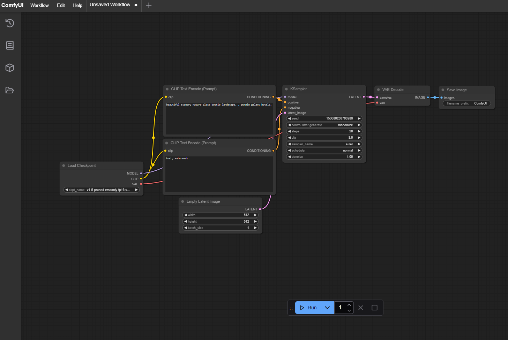
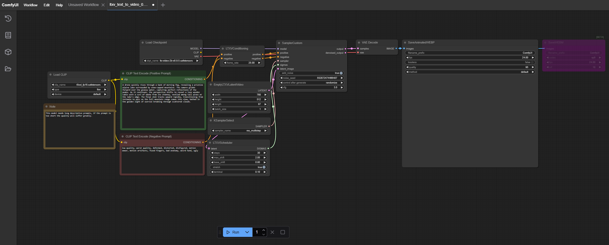

> 原文作者：Xun Wang  
> [AMD 官方教程](https://rocm.docs.amd.com/projects/ai-developer-hub/en/latest/notebooks/inference/t2v_comfyui_radeon.html) · [固定版本源码](https://github.com/ROCm/gpuaidev/blob/0071bfd4bd3bd9525405c09a6ae69c983b09312a/docs/notebooks/inference/t2v_comfyui_radeon.ipynb)  
> 上游版本：`0071bfd4bd3bd9525405c09a6ae69c983b09312a` · 同步日期：2026-10-12  
> 翻译状态：机器初译，待逐篇人工校对；代码与命令保持原文，未在 AMD GPU 上运行验证。

[中文 Notebook](../../notebooks/inference/t2v_comfyui_radeon.ipynb) · [英文原文](../../original/inference/t2v_comfyui_radeon.md) · [中英对照](../../bilingual/inference/t2v_comfyui_radeon.md)

---

<a id="text-to-video-generation-with-comfyui-and-an-amd-radeon-gpu"></a>

# 使用 ComfyUI 生成视频
**作者**：Xun Wang
**知识水平**：初学者

随着人工智能生成内容（AIGC）技术的进步，文本到视频和图像到视频生成领域引起了视觉设计师、艺术爱好者和媒体创作者的广泛关注。

[ComfyUI](https://github.com/comfyanonymous/ComfyUI)是一个专为扩散模型设计的基于节点的图形界面，使用户能够通过模块化操作直观地构建AI图像/视频生成工作流程。其模块化节点设计、效率、兼容性和工作流程优势使其成为媒体创作者提高生产力的完美选择。

本教程将指导您使用 ROCm™ 软件在 AMD Radeon™ GPU 上设置和运行 ComfyUI。了解如何配置环境、安装 ComfyUI 工具以及在 AMD 消费类 GPU 上从文本生成视频。

**注意**：AMD 为 ROCm 提供了 ComfyUI 的特殊实现（仅在 Instinct™ GPU 上）。欲了解更多信息，请参阅
[ROCm 文档上的 ComfyUI](https://rocm.docs.amd.com/projects/comfyui/en/docs-26.04/index.html)。

<a id="prerequisites"></a>

## 前置条件

本教程是使用以下设置进行开发和测试的。

<a id="operating-system"></a>

### 操作系统

- **Ubuntu 22.04/24.04**：确保您的系统运行的是 Ubuntu 22.04 或 24.04。

<a id="hardware"></a>

### 硬件

- **AMD Radeon GPU**：本教程在 AMD Radeon RX 7900 XTX GPU 上进行了测试。确保您使用的是 AMD Radeon GPU 或支持 ROCm 的兼容硬件，并且您的系统满足[官方要求](https://rocm.docs.amd.com/projects/install-on-linux/en/latest/reference/system-requirements.html)。

<a id="software"></a>

### 软件

- **ROCm 6.3**：按照 [ROCm 安装指南](https://rocm.docs.amd.com/projects/install-on-linux/en/latest/install/quick-start.html) 安装并验证 ROCm。安装后，使用以下命令确认您的设置：

    ```bash
    amd-smi
    ```

    此命令列出了您的 AMD GPU 以及相关详细信息。
    
    **注意**：对于 ROCm 6.4 及更早版本，请改用 `rocm-smi` 命令。

<a id="comfyui-setup"></a>

## ComfyUI 设置

要设置 ComfyUI 推理 环境，请按照以下步骤操作。

<a id="prepare-the-inference-environment"></a>

### 准备推理环境
使用 `conda` 或 `venv` 创建并激活虚拟环境。

```bash
conda create -n comfyui_env_test python=3.12
conda activate comfyui_env_test
```

<a id="pytorch-installation"></a>

### PyTorch 安装

在虚拟环境中安装 PyTorch ROCm 轮。请参阅[安装适用于 Radeon GPU 的 PyTorch](https://rocm.docs.amd.com/projects/radeon/en/latest/docs/install/native_linux/install-pytorch.html) 了解安装说明。


<a id="install-and-launch-jupyter"></a>

### 安装并启动 Jupyter

在 Python 虚拟环境中，使用以下命令安装 Jupyter：

```bash
pip install jupyter
```

然后启动Jupyter服务器：

```bash
jupyter-lab --ip=0.0.0.0 --port=8888 --no-browser --allow-root
```

**注意**：在运行上述命令之前，请确保您的系统上尚未使用端口 `8888`。如果是，您可以通过将 `--port=8888` 替换为其他端口号来指定其他端口，例如 `--port=8890`。

<a id="verify-the-pytorch-installation"></a>

### 验证 PyTorch 安装

验证 PyTorch 是否已正确安装。

**步骤 1**：验证 PyTorch 是否已安装并且可以检测到 GPU 计算设备。

```python
!python3 -c 'import torch' 2> /dev/null && echo 'Success' || echo 'Failure'
```

预期结果是 `Success`。

**步骤 2**：确认 GPU 可用。

```python
!python3 -c 'import torch; print(torch.cuda.is_available())'
```

预期结果是 `True`。

**步骤3**：显示已安装的GPU设备名称。

```python
!python3 -c "import torch; print(f'device name [0]:', torch.cuda.get_device_name(0))"
```

预期结果应类似于：`device name [0]: Radeon RX 7900 XTX`

``` bash
device name[0]: <Supported AMD GPU>
```

<a id="comfyui-installation"></a>

### ComfyUI 安装

在具有 AMD GPU 的系统上从源代码安装 ComfyUI。

克隆以下存储库：

```python
!git clone https://github.com/comfyanonymous/ComfyUI.git
```

确保 PyTorch 不会随 CUDA 版本一起重新安装：

```python
%cd ComfyUI
!sed -i.bak -E '/^(torch|torchaudio|torchvision)([<>=~!0-9.]*)?$/s/^/# /' requirements.txt
```

安装依赖项：

```python
!pip3 install -r requirements.txt
```

<a id="running-text-to-video-generation"></a>

## 运行文本到视频生成

请按照以下步骤从文本生成视频。

<a id="model-preparation"></a>

### 模型准备

LTX Video 是 Lightricks 的高效视频模型。本教程使用 `Ltx-video-2B-v0.9.5`。

下载 LTX 视频模型 [ltx-video-2b-v0.9.5.safetensors](https://huggingface.co/Lightricks/LTX-Video/blob/main/ltx-video-2b-v0.9.5.safetensors) 和文本编码器模型 [t5xxl_fp16.safetensors](https://huggingface.co/Comfy-Org/mochi_preview_repackaged/blob/main/split_files/text_encoders/t5xxl_fp16.safetensors) 文件。将这些模型文件放置在 `ComfyUI/models/checkpoints` 和 `ComfyUI/models/text_encoders` 文件夹中。使用以下代码来自动化该过程：

```python
import os
import requests

# Define the URLs and destination paths
models = {
    "https://huggingface.co/Lightricks/LTX-Video/resolve/main/ltx-video-2b-v0.9.5.safetensors":
        "models/checkpoints/ltx-video-2b-v0.9.5.safetensors",
    "https://huggingface.co/Comfy-Org/mochi_preview_repackaged/resolve/main/split_files/text_encoders/t5xxl_fp16.safetensors":
        "models/text_encoders/t5xxl_fp16.safetensors"
}

# Create target directories if they don't exist
for path in models.values():
    os.makedirs(os.path.dirname(path), exist_ok=True)

# Download files
for url, path in models.items():
    print(f"Downloading {url} to {path}...")
    response = requests.get(url, stream=True)
    response.raise_for_status()
    with open(path, "wb") as f:
        for chunk in response.iter_content(chunk_size=8192):
            f.write(chunk)
    print(f"✅ Downloaded to {path}")
 
```

不同的扩散模型管道可能包含不同的子模型，这些子模型应放置在 `ComfyUI/models` 下的正确子文件夹中。

<a id="launch-the-server"></a>

### 启动服务器

启动 ComfyUI 服务器：

```python
!python3 main.py
```

服务器启动后，日志将显示以下条目：

```
Starting server

To see the GUI go to: http://127.0.0.1:8188
```

复制地址 `http://127.0.0.1:8188` 并将其粘贴到浏览器中。生成的网页显示默认工作流程，如下所示：



<a id="load-the-workflow"></a>

### 加载工作流程

ComfyUI 工作流程定义了用于生成图像或视频的完整管道和参数。它采用 JSON 文件格式或编码为 WebP 动画图像 (`*.webp`)。您可以从头开始构建自己的工作流程，也可以从第三方定制工作流程。

从[示例页面](https://comfyanonymous.github.io/ComfyUI_examples/ltxv/) 下载 LTX Video 文本到视频工作流程（`*.json` 或 `*.webp` 格式），然后将其加载或拖动到 ComfyUI GUI 上。加载的工作流程如下图所示：



工作流由不同的节点组成，每个节点具有不同的功能。

- `Load Checkpoint` 节点处理扩散模型加载。如果有其他可用的扩散模型，则可以更改 `ckpt_name` 字段。

- `Load Image` 节点处理加载输入图像。使用此节点上传所需的图像。

- `CLIP TEXT Encode (Positive Prompt)` 节点是肯定提示的占位符。您可以将其更改为您自己的提示。以下是本教程的推荐提示：

  > 一架无人机迅速穿过晨雾升起，露出了被雪山环绕的原始高山湖泊。相机在玻璃般的水面上向前滑动，捕捉到山峰的完美倒影。随着故事的继续，视角发生了转变，露出了一座孤独的木屋，烟囱里冒着袅袅的烟雾，坐落在湖边高大的松树之中。最后一个镜头迅速向上移动，整个山脉映入眼帘，沐浴在日出的金色光芒中，从亲密的场景过渡到史诗般的场景。

- `EmptyLTXVLatentVideo` 节点用于控制生成视频的帧大小和长度。

有关 ComfyUI 节点的更多信息，请参阅 [ComfyUI wiki](https://comfyui-wiki.com/en/comfyui-nodes)。

<a id="run-inference"></a>

### 运行 推理

工作流程准备就绪后，单击“**运行**”启动整个管道进行处理。 推理 的输出日志将如下所示：

```
 got prompt
 model weight dtype torch.bfloat16, manual cast: None
 model_type FLUX
 VAE load device: cuda:0, offload device: cpu, dtype: torch.float32
 no CLIP/text encoder weights in checkpoint, the text encoder model will not be loaded.
 CLIP/text encoder model load device: cuda:0, offload device: cpu, current: cpu, dtype: torch.float16
 Requested to load MochiTEModel_
 loaded completely 23280.8 9083.38671875 True
 Requested to load LTXV
 loaded completely 10667.71279296875 3667.902587890625 True
 100%|███████████████████████████████████████████████████████████████████████████████████████████████████████████████████████████████████████████████████████████████████████████████████████████████████████████████████████████████████████████████████████████████████████████████████████████████| 30/30 [00:43<00:00,  1.46s/it]
 Requested to load VideoVAE
 loaded completely 5763.6171875 4756.450138092041 True
 Warning: Ran out of memory when regular VAE decoding, retrying with tiled VAE decoding.
 Prompt executed in 66.29 seconds
```

最终输出视频显示在 `SaveAnimatedWEBP` 节点中，而 `*.webp` 文件输出可以在 `ComfyUI/output/` 文件夹中找到。


