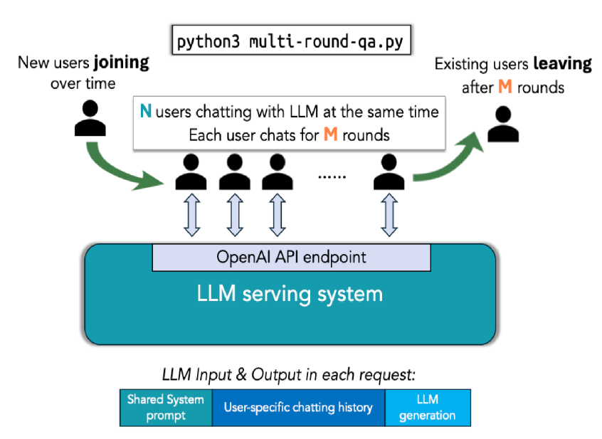
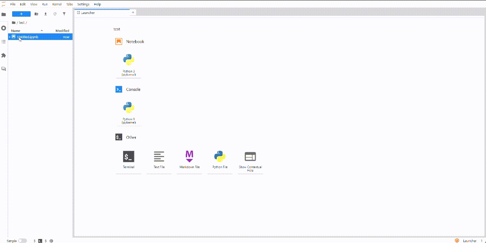
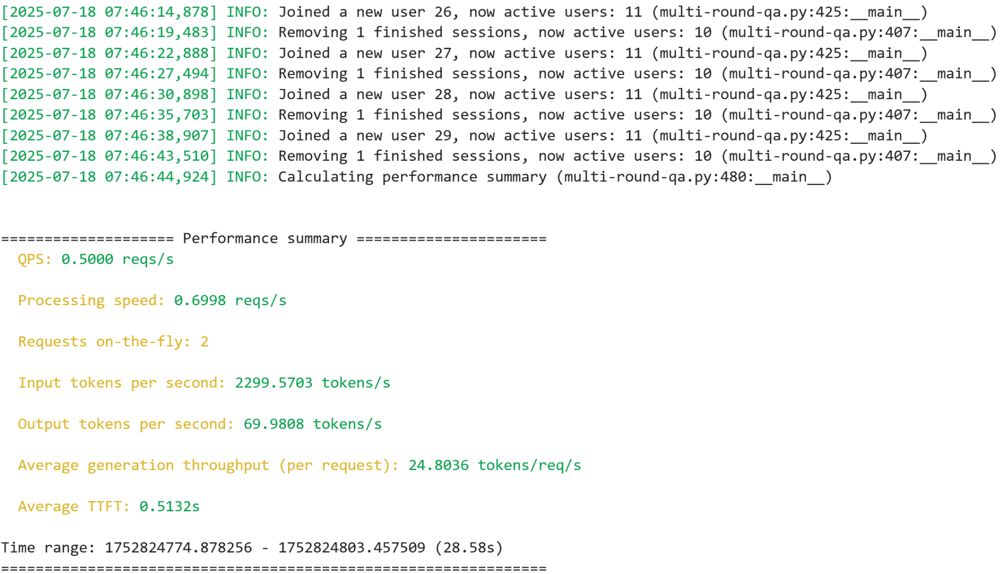
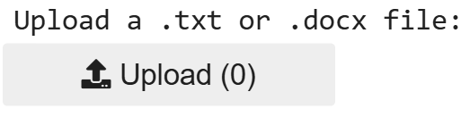
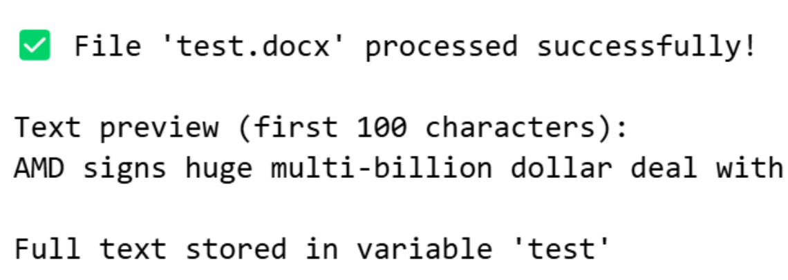

> 原文作者：Haichen Zhang  
> [AMD 官方教程](https://rocm.docs.amd.com/projects/ai-developer-hub/en/latest/notebooks/inference/vllm_v1_DSR1.html) · [固定版本源码](https://github.com/ROCm/gpuaidev/blob/0071bfd4bd3bd9525405c09a6ae69c983b09312a/docs/notebooks/inference/vllm_v1_DSR1.ipynb)  
> 上游版本：`0071bfd4bd3bd9525405c09a6ae69c983b09312a` · 同步日期：2026-10-12  
> 翻译状态：机器初译，待逐篇人工校对；代码与命令保持原文，未在 AMD GPU 上运行验证。

[中文 Notebook](../../notebooks/inference/vllm_v1_DSR1.ipynb) · [英文原文](../../original/inference/vllm_v1_DSR1.md) · [中英对照](../../bilingual/inference/vllm_v1_DSR1.md)

---

<a id="deploy-deepseek-r1-with-the-vllm-v1-engine-and-build-an-ai-powered-office-assistant"></a>

# 使用 vLLM V1 运行 DeepSeek-R1
**作者**：Haichen Zhang
**知识水平**：初学者

想象一下，在 AMD Instinct™ MI300X GPU 上启动 DeepSeek-R1（一台超过 600 亿个参数的推理机），并观察它每秒生成超过 200 个令牌。现在想象一下使用单个命令行执行此操作并且没有驱动程序问题。

从 vLLM v0.9.2 开始，V1 引擎为您提供低 延迟 和开箱即用的 吞吐量。

在本次深入实践中，您将：

- 通过实时基准比较 V1 与 V0 性能。
- 使用量化安全张量在生产就绪模式下部署 DeepSeek-R1。
- 使用 OpenAI 兼容端点构建本机 Microsoft Word 和 Microsoft Excel AI 助手。

**V1 与 V0 挑战**

您将运行多轮对话系统来进行并行实时基准测试并记录实时 延迟 和吞吐量。结果将确认 V1 引擎的调度程序和分页注意力内核可提供更高的每秒查询次数 (QPS) 和更低的首次令牌时间 (TTFT)。

**在生产中部署 DeepSeek-R1**

从量化安全张量到 OpenAI 兼容的 `/v1/chat/completions` 端点，DeepSeek-R1 具有针对具有 128 GB HBM3 的 MI300X 进行调整的自动缩放、批处理和 KV 缓存卸载功能。

**打造人工智能办公助手**

使用部署的 DeepSeek-R1 后端启用位于桌面应用程序中的本机 Microsoft Word 和 Excel 副驾驶，立即压缩多页文档并将数小时的文书工作转变为几分钟的对话。

是时候推出 Instinct MI300X 了。现在您知道接下来会发生什么，启动Notebook并开始吧！

<a id="prerequisites"></a>

## 前置条件

本教程是使用以下设置进行开发和测试的。 

<a id="operating-system"></a>

### 操作系统

* **Ubuntu 22.04/24.04**：确保您的系统运行的是 Ubuntu 22.04 或 24.04。

<a id="hardware"></a>

### 硬件

* **AMD Instinct™ GPU**：本教程在具有八个 AMD Instinct MI300X GPU 的单个节点上进行了测试。确保您使用的是 AMD Instinct GPU 或支持 ROCm 的兼容硬件，并且您的系统满足[官方要求](https://rocm.docs.amd.com/projects/install-on-linux/en/latest/reference/system-requirements.html)。

<a id="software"></a>

### 软件

* **ROCm 6.3 或 6.4**：按照 [ROCm 安装指南](https://rocm.docs.amd.com/projects/install-on-linux/en/latest/install/quick-start.html) 安装并验证 ROCm。安装后，使用以下命令确认您的设置：

    ``` bash
    amd-smi
    ```

    此命令列出了您的 AMD GPU 以及相关详细信息。
    
    **注意**：对于 ROCm 6.4 及更早版本，请改用 `rocm-smi` 命令。

* **Docker**：确保 Docker 已正确安装和配置。请遵循适用于您的操作系统的 Docker 安装指南。

   **注意**：确保正确配置 Docker 权限。要配置权限以允许非 root 访问，请运行以下命令：

   ``` bash
   sudo usermod -aG docker $USER
   newgrp docker
   ```

   验证 Docker 是否正常工作：

   ``` bash
   docker run hello-world
   ```

<a id="environment-setup"></a>

## 环境设置

请按照以下步骤设置开发环境。

<a id="step-1-pull-the-rocm-vllm-image"></a>

### 第 1 步：拉取 ROCm vLLM 映像

在服务器上打开一个新的终端窗口并运行以下命令：

``` bash
docker pull rocm/vllm-dev:nightly_0624_rc2_0624_rc2_20250620
```

<a id="step-2-launch-the-docker-container"></a>

### 步骤 2：启动 Docker 容器

使用此命令运行 Docker 容器。

``` bash
docker run -it --rm \
  --cap-add=SYS_PTRACE \
  -e SHELL=/bin/bash \
  --network=host \
  --security-opt seccomp=unconfined \
  --device=/dev/kfd \
  --device=/dev/dri \
  -v $(pwd):/workspace \
  --group-add video \
  --ipc=host \
  --name vllm_V1_demo_01 \
  -w /workspace \
  rocm/vllm-dev:nightly_0624_rc2_0624_rc2_20250620
```

<a id="step-3-install-and-launch-jupyter-notebooks"></a>

### 步骤 3：安装并启动 Jupyter Notebooks

上一步启动了一个交互式 Docker shell。在 Docker 容器内，使用以下命令安装 JupyterLab：

``` bash
pip install jupyter
```

启动 Jupyter 服务器：

``` bash
jupyter-lab --ip=0.0.0.0 --port=8888 --no-browser --allow-root
```

**注意**：在运行上述命令之前，请确保您的系统上尚未使用端口 `8888`。如果是，您可以通过将 `--port=8888` 替换为其他端口号来指定其他端口，例如 `--port=8890`。


本教程的其余部分旨在在 Jupyter Notebook中运行。将此文件上传到您刚刚启动的 JupyterLab 实例，然后按照以下步骤操作。

<a id="demo-1-multi-turn-question-answering-with-the-deepseek-r1-v1-and-v0-engines"></a>

## 演示 1：使用 DeepSeek-R1 V1 和 V0 引擎进行多轮问答

DeepSeek-R1 提供了用于评估模型性能的强大工具包。它专注于多轮问答，模拟现实的多用户对话场景，其中新用户不断加入，而现有用户退出。 `multi-round-qa.py` 脚本启动大量并行用户会话，每个会话都与模型进行多轮对话。此设置提供了服务 延迟 和整体 吞吐量 的清晰视图。

<a id="understanding-the-vllm-performance-testing-toolkit"></a>

### 了解 vLLM 性能测试工具包

该脚本的高级流程如下所示： 



该脚本重播了真实的多轮 QA 模式：

- 每个用户都拥有一个有状态的聊天会话（并保留对话历史记录）。

- 每轮，用户都会提出一个后续问题，其长度随着上下文的积累而增长。

- 脚本在 延迟（TTFT、ITL）和 吞吐量（有效 QPS）上强调引擎，而 KV 缓存 正在被重用、驱逐或卸载。

现在就按照以下步骤开始测试吧！

<a id="step-1-clean-the-cache-space"></a>

### 第1步：清理缓存空间

首先清理 pip 安装缓存空间以避免潜在的编译问题。

```python
!pip cache purge
```

<a id="step-2-download-the-repository"></a>

### 第 2 步：下载存储库

运行这些命令来下载存储库并安装要求。

```python
%%bash
cd /app 
git clone https://github.com/vllm-project/production-stack.git
cd /app/production-stack/benchmarks/multi-round-qa
pip install -r requirements.txt
```

<a id="step-3-prepare-the-hugging-face-models"></a>

### 步骤 3：准备Hugging Face模型

按照以下步骤安装 Hugging Face CLI 并下载模型。

首先安装 Hugging Face CLI。

```python
!pip install -U "huggingface_hub[cli]"
```

然后通过运行以下单元下载 DeepSeek-R1 模型：

**注意**：这是一个非常大的模型，因此下载过程可能需要几分钟的时间。如果连接中断，请重新运行此单元。

```python
%%bash
MODEL_DIR=/workspace/models/DeepSeek-R1   # single, consistent path
mkdir -p "$MODEL_DIR"

huggingface-cli download \
    deepseek-ai/DeepSeek-R1 \
    --local-dir "$MODEL_DIR"
```

<a id="step-4-run-the-deepseek-v1-engine"></a>

### 步骤 4：运行 DeepSeek-V1 引擎

启动一个新终端来运行 DeepSeek-V1 引擎。要启动新终端，请单击活动Notebook选项卡旁边的 **+** 符号。以下动画演示了如何在 Jupyter 环境中打开新终端并自定义视图。



将以下命令复制并粘贴到终端窗口：

``` bash
SAFETENSORS_FAST_GPU=1 \
VLLM_ROCM_USE_AITER=1 \
VLLM_USE_V1=1 \
vllm serve /workspace/models/DeepSeek-R1 \
  -tp 8 \
  --max-model-len 32768 \
  --block-size 1 \
  --max_seq_len_to_capture 32768 \
  --no-enable-prefix-caching \
  --max-num-batched-tokens 32768 \
  --gpu-memory-utilization 0.95 \
  --trust-remote-code \
  --port 8000
```

在终端中成功运行上述命令后，输出应如下例所示。确认服务器准备就绪后，返回 Jupyter Notebook并继续执行单元。


<a id="running-the-multi-round-benchmark"></a>

#### 运行多轮基准测试

通过运行以下单元来启动多轮问答基准测试。

```python
!python3 /app/production-stack/benchmarks/multi-round-qa/multi-round-qa.py \
    --num-users 10 \
    --num-rounds 5 \
    --qps 0.5 \
    --shared-system-prompt 1000 \
    --user-history-prompt 2000 \
    --answer-len 100 \
    --model /workspace/models/DeepSeek-R1 \
    --base-url http://localhost:8000/v1
```

上面的脚本应该产生类似于下图的输出。



**注意**：现场演示将继续运行，直到您手动停止它，因此您可以随意观察它。  

要开始测试V0引擎，请单击**中断内核**，如下图所示，停止当前进程，然后继续运行剩余的单元。

**重要**：⚠️ 在进行下一步之前必须手动停止脚本。


<a id="step-5-run-the-deepseek-v0-engine"></a>

### 步骤 5：运行 DeepSeek-V0 引擎：  

在上一节中用于运行 `vllm serve` 命令的同一终端中，按 **Ctrl-C** 两次以停止 V1 引擎。然后使用以下命令运行 V0 引擎。

将以下命令复制并粘贴到终端窗口：

``` bash
SAFETENSORS_FAST_GPU=1 \
VLLM_ROCM_USE_AITER=1 \
VLLM_USE_V1=0 \
vllm serve /workspace/models/DeepSeek-R1 \
  -tp 8 \
  --max-model-len 32768 \
  --block-size 1 \
  --max-seq-len-to-capture 32768 \
  --no-enable-prefix-caching \
  --max-num-batched-tokens 32768 \
  --gpu-memory-utilization 0.95 \
  --trust-remote-code \
  --port 8000
```

在终端中成功运行上述命令后，输出应如下例所示。确认服务器准备就绪后，返回 Jupyter Notebook并继续执行单元。


<a id="running-the-multi-round-benchmark"></a>

#### 运行多轮基准测试

通过运行以下单元来启动多轮问答基准测试。

```python
!python3 /app/production-stack/benchmarks/multi-round-qa/multi-round-qa.py \
    --num-users 10 \
    --num-rounds 5 \
    --qps 0.5 \
    --shared-system-prompt 1000 \
    --user-history-prompt 2000 \
    --answer-len 100 \
    --model /workspace/models/DeepSeek-R1 \
    --base-url http://localhost:8000/v1
```

上面的脚本应该产生类似于下图的输出。


**注意**：现场演示将继续运行，直到您手动停止它，因此您可以随意观察它。  

要继续进行第二个演示，请单击“**中断内核**”，如下图所示，停止当前进程，然后继续运行剩余的单元。

**重要**：⚠️ 在进行下一步之前必须手动停止脚本。


<a id="demo-2-ai-powered-office-assistant"></a>

## 演示2：AI办公助手

在此演示中，您将启动人工智能驱动的办公助手。拖放 `.docx` 或 `.txt` 文件，容器化工具会立即返回简洁、高质量的摘要。 `docker run` 之外无需任何设置。

**重要**：⚠️ 您必须终止终端中的两个 `vllm server` 命令，并单击上一个单元格中的 **中断内核** 按钮，然后再继续下一步。

按照以下步骤运行AI办公助手。

以在线服务模式服务 DeepSeek-R1 模型。启动一个新终端并将以下命令复制并粘贴到终端窗口：

``` bash
SAFETENSORS_FAST_GPU=1 \
VLLM_ROCM_USE_AITER=1 \
VLLM_USE_V1=1 \
vllm serve /workspace/models/DeepSeek-R1 \
  -tp 8 \
  --max-model-len 32768 \
  --block-size 1 \
  --max-seq-len-to-capture 32768 \
  --no-enable-prefix-caching \
  --max-num-batched-tokens 32768 \
  --gpu-memory-utilization 0.95 \
  --trust-remote-code \
  --port 8000
```

成功运行上述命令后，返回 Jupyter Notebook 并继续执行单元格。

安装所需的库。

```python
#Install the required libraries.
%pip install python-docx openai ipywidgets
```

现在导入库。

```python
#import required libraries
import io
import os
from pathlib import Path
import textwrap

import docx
import ipywidgets as widgets
from openai import OpenAI

import ipywidgets as widgets
from IPython.display import display, clear_output
from io import BytesIO
import docx
```

以兼容 OpenAI 的 API 格式定义本地 vLLM 模型端点。

```python
#Define the vllm configurations for the openai endpoint

vllm_base = os.getenv("VLLM_ENDPOINT", "http://localhost:8000/v1")

client = OpenAI(
    base_url=vllm_base,
    api_key="dummy",   # or api_key=""  – any non-None string works
)
```

定义一个辅助函数来读取 `.txt` 和 `.docx` 格式的文档。

```python
from pathlib import Path
import docx
import textwrap

def read_document(path: Path) -> str:
    path = Path(path)
    if path.suffix.lower() == ".docx":
        doc = docx.Document(path)
        return "\n".join(para.text for para in doc.paragraphs)
    elif path.suffix.lower() == ".txt":
        return path.read_text(encoding="utf-8")
    else:
        raise ValueError("Only .docx and .txt are supported.")
```

设置适当的系统提示。

```python
SYSTEM_PROMPT = (
    "You are a concise assistant. "
    "Read the following text and provide a short summary "
    "(3-5 sentences, 80-120 words)."
)
```

通过分块调用模型来定义函数来总结长文本。

```python

def summarize_chunk(text: str) -> str:
    """Summarize one chunk with DeepSeek-R1 via vLLM."""
    prompt = f"{SYSTEM_PROMPT}\n\n{text}"
    response = client.completions.create(
        model="/workspace/models/DeepSeek-R1",  # must match vllm model arg
        prompt=prompt,
        max_tokens=120,
        temperature=0.3,
        top_p=0.9,
        stop=["\n\n"]
    )
    return response.choices[0].text.strip()

def summarize_long(text: str, max_chunk: int = 3000) -> str:
    """Chunk + summarize with vLLM."""
    words = text.split()
    chunks = [" ".join(words[i:i+max_chunk]) for i in range(0, len(words), max_chunk)]
    summaries = [summarize_chunk(c) for c in chunks]
    return " ".join(summaries)
```

使用一些示例文本来验证该功能是否正常工作。

```python
test = "AMD CDNA architecture is the dedicated compute architecture underlying AMD Instinct GPUs and APUs. It features advanced packaging that unifies AMD chiplet technologies and High Bandwidth Memory (HBM), a high throughput Infinity Architecture fabric, and offers advanced Matrix Core Technology that supports a comprehensive set of AI and HPC data formats—designed to reduce data movement overhead and enhance power efficiency. AMD CDNA 4 offers enhanced Matrix Core Technologies that double the computational throughput for low precision Matrix data types compared to the previous Gen architecture. AMD CDNA 4 brings improved instruction-level parallelism, expands shared LDS resources with double the bandwidth, and includes support for a broad range of precisions that now include FP4 and FP6, along with sparse matrix data (i.e. sparsity) support. AMD demonstrated end-to-end, open-standards rack-scale AI infrastructure—already rolling out with AMD Instinct MI350 Series accelerators, 5th Gen AMD EPYC processors and AMD Pensando Pollara NICs in hyperscaler deployments such as Oracle Cloud Infrastructure (OCI) and set for broad availability in 2H 2025. AMD also previewed its next generation AI rack called Helios. It will be built on the next-generation AMD Instinct MI400 Series GPUs, which compared to the previous generation are expected to deliver up to 10x more performance running inference on Mixture of Experts models."
print("Test summary:", summarize_long(test))
```

运行下面的单元格，然后单击“**上传**”按钮上传您自己的文档。



**注意**：唯一接受的格式是 `.docx` 或 `.txt`，并且建议的文本长度小于 500 个字，以便快速响应。超出这些限制或格式的文件可能会引发错误。

```python
#Create file upload widget
uploader = widgets.FileUpload(
    accept='.txt,.docx',  # Accepted file types
    multiple=False  # Single file upload
)

output_area = widgets.Output()

def handle_upload(change):
    with output_area:
        clear_output()
        
        if not uploader.value:
            print("No file uploaded")
            return
            
        # Universal approach for all ipywidgets versions
        if hasattr(uploader.value, 'keys'):
            # Dictionary format (newer versions)
            filename = list(uploader.value.keys())[0]
            file_data = uploader.value[filename]
            content = file_data['content']
        elif isinstance(uploader.value, tuple) and len(uploader.value) > 0:
            # Tuple format (older versions)
            filename = uploader.value[0]['name']
            content = uploader.value[0]['content']
        else:
            print("Unsupported file format")
            return
        
        # Convert content to bytes if needed
        if isinstance(content, memoryview):
            content = content.tobytes()
            
        # Process based on file type
        if filename.endswith('.txt'):
            # Decode text file
            try:
                text = content.decode('utf-8')
            except UnicodeDecodeError:
                # Try alternative encodings if UTF-8 fails
                try:
                    text = content.decode('latin-1')
                except:
                    print("Failed to decode text file")
                    return
            
        elif filename.endswith('.docx'):
            # Process DOCX file
            try:
                doc = docx.Document(BytesIO(content))
                text = '\n'.join([para.text for para in doc.paragraphs])
            except:
                print("Failed to process DOCX file")
                return
            
        else:
            print("Unsupported file type")
            return
        
        # Clean and store text
        global test
        test = " ".join(text.split())  # Normalize whitespace
        
        # Show success message and preview
        print(f"✅ File '{filename}' processed successfully!")
        print("\nText preview (first 100 characters):")
        print(test[:100] + ("..." if len(test) > 100 else ""))
        print("\nFull text stored in variable 'test'")

# Setup interaction
uploader.observe(handle_upload, names='value')

# Display widgets
print("Upload a .txt or .docx file:")
display(uploader)
display(output_area)
```

成功执行后，您将看到以下确认信息：



文件上传后继续运行以下单元格。检查您刚刚上传的文件的内容，以确保它们符合您的期望。

```python
print(test[:200])  # View first 200 characters
len(test)          # Check text length
```

生成所提供文本文件的摘要。

```python
print("Summary:", summarize_long(test))
```

恭喜！你已经成功打造了一个强大的AI助手！
